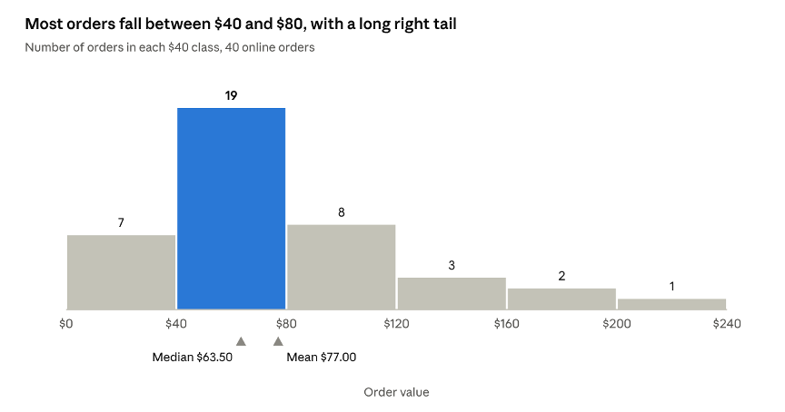
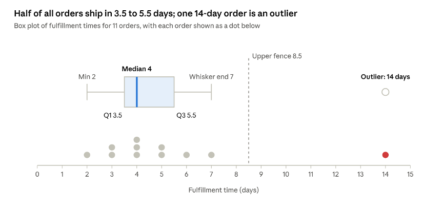
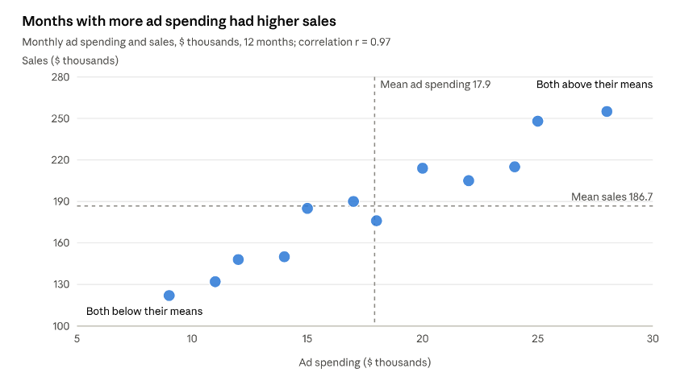

# BANA 5368 Chapter 1: Data, Analytics, and Descriptive Statistics

## How to use this chapter

This chapter is the written companion to Unit 1. The two lecture videos and their slides show you the ideas; this chapter explains them in full sentences, defines every term, and works through examples step by step. 

The chapter has two halves that match the two lectures. Sections 1.1 to 1.4 cover business analytics and working with data (Lecture 1.1). Sections 1.5 to 1.9 cover descriptive statistics (Lecture 1.2). The chapter closes with a summary, a glossary of key terms, an Excel function reference, and review questions with answers.

Throughout the chapter you will find three kinds of boxes:

::: {.callout-note title="Definition"}
  Definition boxes state a term precisely. These are the terms you should be able to use correctly on quizzes and exams.
:::

::: {.callout-tip title="Example"}
  Example boxes work through a calculation or a business situation from start to finish.
:::

::: {.callout-tip appearance="simple" icon=false title="In Excel"}
  In Excel boxes show the functions and features that carry out the idea. All work in this course is done in Excel.
:::

### Learning objectives

After studying this chapter, you should be able to:

1. Explain how data turn into information, knowledge, and decisions, and who in an organization does that work.
2. Distinguish the four types of analytics and the business question each one answers.
3. Identify common internal and external data sources and explain how relational tables are linked by keys.
4. Classify data by structure, format, level of aggregation, and scale of measurement.
5. Describe the steps of preparing data for analysis and the Excel tools used to clean data.
6. Explain the basic principles of handling personal data ethically.
7. Distinguish populations from samples and parameters from statistics.
8. Summarize categorical data with frequency tables, charts, and cross-tabulations.
9. Build a frequency distribution and histogram for numerical data and describe the shape of a distribution.
10. Compute and interpret measures of center, position, and variability.
11. Describe the relationship between two numerical variables with a scatterplot and the correlation coefficient.

## 1.1 Why data matter in business

Every business runs on processes, every process leaves a trail of data, and analytics is the work of turning that trail into better decisions. This section explains where business data come from in the first place, why the amount of data has exploded, and how raw data become something a manager can act on.

### Business value and business processes

A company's financial health depends on everything it does: what it sells, what it buys, whom it hires, and how it serves customers. Those activities are organized into business processes.

::: {.callout-note title="Definition — Business value"}
All the items, events, and interactions that determine a company's financial health.
:::

::: {.callout-note title="Definition — Business process"}
A coordinated, standardized set of activities, carried out by people and equipment, that accomplishes a specific business task.
:::

Examples are everywhere. An airline assigns crews to flights. A retailer processes a customer's return. A hospital schedules operating rooms. Each of these processes is repeated thousands of times, and each repetition is recorded: who was involved, when it happened, how long it took, and what it cost. A large company runs thousands, sometimes millions, of process steps every day, so it accumulates data whether or not anyone plans to analyze them.

### The growth of data

The volume of data created in the world has grown exponentially. More data is a double-edged sword. It creates opportunities: finer detail, longer histories, and questions that used to be unanswerable. It also creates **data overload**, where there is too much data to synthesize or interpret properly and the useful signal gets lost. The skill that matters most is not collecting more data but knowing which data actually answer the question at hand.

### From data to decisions: the information value chain

Data by themselves rarely tell anyone what to do. A spreadsheet with a million rows of transactions is a raw resource, not an answer. The **information value chain** describes the steps by which raw data become a decision.

| Stage | What it means |
| --- | --- |
| Data | Raw facts with little meaning on their own |
| Context | The setting, event, or situation the data describe |
| Information | Data organized with context so they are useful to the decision maker |
| Knowledge | Understanding gained from information, often by combining it with experience |
| Decision | A conclusion reached, and an action chosen, after weighing the knowledge |

The critical step is adding context. The number 7.2 is data. "Average minutes a customer waits at the downtown store between 7 and 9 a.m." is information. Knowing that this wait has risen by two minutes since mobile ordering launched, and that long waits drive customers away, is knowledge.

::: {.callout-tip title="Example — A coffee chain"}
A coffee chain collects millions of time-stamped transactions from its app and registers (*data*). An analyst focuses on weekday mornings at downtown stores (*context*) and finds that average waits between 7 and 9 a.m. have risen since mobile ordering launched (*information*). Digging further, she learns that mobile and walk-in orders compete for the same counter during the rush (*knowledge*). Management adds a separate mobile pickup station at downtown stores (*decision*). The example is illustrative.
:::

Notice that each step adds something the previous one lacked. Moving up the chain is what analytics is for, and it is why the same dataset can be worthless to one person and valuable to another.

### Who works with data

Three roles appear in almost every organization that uses data. They are often filled by different people, although in smaller firms one person may play several.

- **Decision maker.** Owns the business question and needs information and knowledge to answer it. Typically a manager or executive.
- **Data scientist.** A specialist who knows how to extract, manipulate, model, and statistically test data, often with programming tools.
- **Business analyst.** The interpreter or liaison between the two. The analyst knows the business, knows which data are needed to answer a question, and can communicate with both the decision maker and the data scientist.

Most MBA graduates will act as business analysts or will manage people who do. Either way, they need the toolkit in this course: enough statistical literacy to ask good questions, judge whether an analysis is sound, and explain results in business terms.

### Analytics across business functions

::: {.callout-note title="Definition — Business analytics"}
The use of data to create knowledge, draw conclusions, and address business questions.
:::

Every business function uses analytics, but each asks different questions.

| Function | Typical focus | Example question |
| --- | --- | --- |
| Marketing | Customer preferences, segments, campaign performance | Which customers are most likely to respond to this promotion? |
| Accounting | Audit, financial and managerial accounting, tax | Which transactions look unusual enough to audit? |
| Finance | Investments, budgets, forecasts, collections | When will customers pay their outstanding invoices? |
| Operations | Supply chain, human resources, IT, logistics | How do we get the right product to the right place at the right time? |

A useful way to think about analytical work is the **analytics mindset**: the habit of (1) asking the right question, (2) extracting, transforming, and loading the relevant data, (3) applying an appropriate analytic technique, and (4) interpreting and sharing the results with the people who need them. A good business question is specific and can be answered with data. "Is our business doing well?" is not such a question. "Has the average order value of first-time customers changed since we introduced free shipping?" is.

### Four types of analytics

Business questions fall into a small number of types, and each type calls for a different kind of analysis. Moving from the first to the fourth requires more skill and more assumptions, and it also delivers more value for decision making.

| Type | Question it answers | What it provides | Example | In this course |
| --- | --- | --- | --- | --- |
| Descriptive | What happened? | Hindsight | What is the average age of our customers? | Unit 1 and Unit 3 |
| Diagnostic | Why did it happen? | Insight | Why did shipping times rise last quarter? | Unit 4 |
| Predictive | What is likely to happen? | Foresight | What will demand be next year? | Unit 5 |
| Prescriptive | What should we do? | Optimized decisions | Should we make this part or buy it? | Unit 6 |

Some frameworks add a fifth level, *adaptive* or *autonomous* analytics, in which systems adjust their own decisions as conditions change. Everything starts with description: you cannot explain, predict, or optimize something you have not first measured and summarized. That is the focus of the second half of this chapter.

## 1.2 Where data come from

Business data come from two places: the company's own information systems and sources outside the company. Internal data describe what the business itself did; external data supply the context of the economy, the market, and customers in general. Most useful analyses combine both.

### Internal data sources

The backbone of a modern company's data is usually an **enterprise system**, also called an **enterprise resource planning (ERP) system**.

::: {.callout-note title="Definition — Enterprise system (ERP)"}
A set of interconnected information systems that share a centralized database and record a company's core transactions, such as purchasing, inventory, production, sales, and accounting. Widely used examples include SAP, Oracle, and Workday.
:::

Around the ERP sit other systems that generate data of their own:

- **Customer relationship management (CRM)** systems record contacts, sales opportunities, and service requests.
- **Point-of-sale** systems record every store and online transaction.
- **Human resources** systems record employees, pay, and benefits.
- **Web and app logs** record clicks, sessions, and searches.
- **Sensors** on machines, vehicles, and shipments record location, temperature, and performance, often called the Internet of Things (IoT).

### Relational databases

Inside these systems, data are almost always stored in a **relational database**: a collection of tables, each of which stores one kind of thing, linked to each other by shared fields. Storing each fact once, in one place, avoids the errors that creep in when the same information is copied into many places.

::: {.callout-note title="Definition — Table, field, record"}
A **table** organizes data into columns and rows. A **field** is a column; it holds one attribute of the things the table describes, such as a customer's city. A **record** is a row; it holds one instance, such as one customer.
:::

A company does not keep a customer's name and address on every sales transaction. It keeps them once, in a Customers table, and records only the customer's ID on each transaction. Two kinds of key make this work.

::: {.callout-note title="Definition — Primary key"}
A field whose value uniquely identifies each record in a table, such as TransactionID in a Transactions table or CustomerID in a Customers table.
:::

::: {.callout-note title="Definition — Foreign key"}
A field in one table that refers to the primary key of another table, creating a link between the two. CustomerID in the Transactions table is a foreign key pointing to the Customers table.
:::

::: {.callout-tip title="Example — Linking two tables"}
The Transactions table below records transaction T1003 as a return by customer C2506. Looking up C2506 in the Customers table tells us the customer is Avery Chen of Houston. If Avery moves to Dallas, the company changes one cell in the Customers table, and every past and future transaction is automatically linked to the correct address. All names are fictional.
:::

| TransactionID (primary key) | Date | Type | CustomerID (foreign key) |
| --- | --- | --- | --- |
| T1001 | 10/01 | Sale | C2506 |
| T1002 | 10/02 | Sale | C2522 |
| T1003 | 10/02 | Return | C2506 |
| T1004 | 10/03 | Sale | C2580 |

| CustomerID (primary key) | Name | City |
| --- | --- | --- |
| C2506 | Avery Chen | Houston |
| C2522 | Jordan Patel | Austin |
| C2580 | Taylor Brooks | El Paso |

When you combine the two tables to analyze, say, sales by city, you are doing in a spreadsheet what a database does with a *join*. In Excel the usual tool is XLOOKUP (see Section 1.4).

### External data sources

External data provide context that a company's own records cannot. Many high-quality sources are free.

| Source | What you can learn | Examples |
| --- | --- | --- |
| Government statistical agencies | Population, demographics, employment, prices, output | U.S. Census Bureau, Bureau of Labor Statistics (BLS), Bureau of Economic Analysis (BEA) |
| Federal Reserve | Interest rates, exchange rates, money supply, thousands of economic series | FRED database (Federal Reserve Bank of St. Louis) |
| Company filings | Financial statements of publicly traded companies | SEC EDGAR |
| Market data | Stock prices, returns, trading volume | Exchanges and financial data providers |
| Social media and the web | Sentiment, trends, product reviews | Platform interfaces, review sites |
| Small business resources | Market research and industry data guides | U.S. Small Business Administration |
| Commercial vendors | Credit data, consumer panels, industry data | Data brokers, market research firms |

### Big data

The term **big data** refers to data sets so large, fast-moving, or varied that traditional tools struggle to handle them. They are usually described by four Vs:

- **Volume:** the sheer amount of data, from clickstreams, sensors, logs, transactions, and social media.
- **Velocity:** the speed at which data are generated and must be analyzed.
- **Variety:** the range of forms the data take.
- **Veracity:** how trustworthy the data are; data may be uncleaned, unverified, or biased.

The variety dimension leads to an important classification by **structure**:

| Structure | Description | Examples |
| --- | --- | --- |
| Structured | Highly organized; fits neatly into rows and columns | Financial statements, sales orders, customer databases |
| Semi-structured | Contains tags or markers that organize it, but no fixed table | JSON and XML files, web logs, emails (header fields plus free text) |
| Unstructured | No predefined structure | Social media posts, images, audio, video, documents |

Much of the world's data is unstructured, and analyzing it requires specialized tools. In this course we work with structured, tabular data in Excel. That is not a limitation in practice: most business decisions still rest on structured data, and the concepts you learn here carry over to every other tool.

::: {.callout-tip title="Example — Are financial statements big data"}
A public company's quarterly financial statements are low in volume (a few pages), low in velocity (four times a year), low in variety (highly structured), and high in veracity (audited). They are extremely valuable, but they are not big data. Size and value are different things.
:::

## 1.3 Describing a data set

Before analyzing any data set, an analyst needs to know four things about it: how it is laid out, what file format it comes in, how detailed it is, and what kind of measurement each field records. The last of these matters most, because it decides which calculations and charts make sense.

### Tabular data: variables and observations

When analysts request data, they almost always want **tabular data**, arranged in rows and columns. The alternative, **text data** such as posts, reviews, and documents, needs different tools.

::: {.callout-note title="Definition — Variable and observation"}
In a tabular data set, each column is a **variable** (also called a field or attribute): a characteristic measured on every unit. Each row is an **observation** (also called a record or case): one unit on which the variables are measured. The top row, the **header row**, holds the variable names.
:::

Good tabular data follow a simple rule: one row per observation, one column per variable, one value per cell, no blank rows, and no subtotals mixed in with the data. Data laid out this way are sometimes called *tidy* data, and every Excel tool in this course assumes this layout.

### File formats: .csv and .xlsx

Data are very often delivered as a **comma-separated values** file, with the extension .csv. A CSV file is plain text: each line is one record, and commas separate the fields. Because it is so simple, almost any program can read it, and it is not limited to the size of an Excel worksheet.

An **Excel workbook** (.xlsx) can hold several worksheets with formulas, formatting, charts, and PivotTables. A single worksheet holds up to 1,048,576 rows and 16,384 columns.

|  | .csv | .xlsx |
| --- | --- | --- |
| Content | Plain text values only | Values, formulas, formatting, charts, PivotTables |
| Sheets | One | Many |
| Size limit | None in the format itself | 1,048,576 rows × 16,384 columns per sheet |
| Readable by | Virtually any program or language | Excel and compatible spreadsheet programs |

One practical warning: if you save an Excel workbook as CSV, only the values on the active sheet are kept. Formulas, formatting, and other sheets are lost.

### Level of aggregation: raw versus aggregated data

::: {.callout-note title="Definition — Raw and aggregated data"}
**Raw data** contain the individual records, such as each sales transaction. **Aggregated data** have already been combined into totals, counts, or averages, such as total sales per day.
:::

Raw data give the analyst full flexibility: you can group and summarize them any way the question requires, and you can check them for errors. Aggregated data are smaller and quicker to use, but the detail is gone and cannot be recovered. A table of daily totals cannot tell you sales by customer or by hour, and it cannot give you the variability of individual order sizes. When in doubt, ask for raw data.

### Scales of measurement: types of data

The most important question about any variable is what kind of measurement it records. The first division is between categorical and numerical data.

::: {.callout-note title="Definition — Categorical and numerical data"}
**Categorical** (qualitative) data place each observation into a category or group, such as a sales channel or a region. **Numerical** (quantitative) data are meaningful numbers that measure an amount, such as revenue or age.
:::

Each of these divides again, giving four **scales of measurement**:

| Scale | Type | Key property | Examples | Meaningful summaries |
| --- | --- | --- | --- | --- |
| Nominal | Categorical | Categories with no natural order | Sales channel, region, product category, payment method | Counts, proportions, mode |
| Ordinal | Categorical | Categories with a natural order, but unequal or unknown spacing | Satisfaction rating (1–5), size (S, M, L), credit rating | Add: median, percentiles, ranking |
| Interval | Numerical | Equal spacing between values, but no true zero | Temperature in °F or °C, calendar year, SAT score | Add: differences, mean, standard deviation |
| Ratio | Numerical | Equal spacing and a true zero meaning "none" | Sales, price, cost, weight, age, units sold | Add: ratios and percentage comparisons |

Each scale allows everything the scale above it allows, plus more. Two points deserve emphasis.

First, ordinal categories may be coded as numbers, but the distances between them are not necessarily equal. The step from "neutral" (3) to "agree" (4) need not be the same size as the step from "agree" to "strongly agree" (5). Averaging ordinal codes is common in practice, but it assumes equal spacing that the data do not guarantee.

Second, the difference between interval and ratio data is the meaning of zero. A useful test is to ask whether "twice as much" makes sense. $200 is twice $100, so revenue is ratio data. But 80°F is not "twice as hot" as 40°F, because 0°F does not mean "no temperature." Most business quantities, such as money, counts, time durations, and weights, are ratio data.

### Numbers are not always numerical data

A variable stored as a number is not necessarily numerical. Customer IDs, ZIP codes, invoice numbers, and product codes are labels that happen to be written with digits. Adding or averaging them is meaningless.

::: {.callout-tip title="Example — Classifying the fields of a sales table"}
A retailer's transaction table has the fields below. Each is classified by asking two questions: is it a label or an amount, and if it is an amount, does zero mean "none"?

| Field | Example value | Scale | Reason |
| --- | --- | --- | --- |
| Invoice number | 5004 | Nominal | An identifier; arithmetic on it is meaningless |
| Customer ID | C2580 | Nominal | A label, even when stored as a number |
| Channel | Online | Nominal | Categories with no order |
| Satisfaction rating | 4 (of 5) | Ordinal | Ordered categories, not equally spaced |
| Order date | 10/03/2026 | Interval | Ordered, and differences in days are meaningful, but there is no natural zero date |
| Quantity | 2 | Ratio | Zero means no units; 4 units is twice 2 units |
| Unit price | $159.84 | Ratio | Zero means free; ratios make sense |
:::

Getting the scale right protects you from errors that software will happily make for you. Excel will compute the average of a column of ZIP codes without complaint. Only you can recognize that the result means nothing.

## 1.4 Preparing data for analysis

Real data are rarely ready to analyze. Records are duplicated, labels are spelled three different ways, numbers arrive stored as text, and values are missing. Analysts routinely report that preparing data takes more of their time than analyzing it. This section describes a systematic approach and the Excel tools that support it, and then turns to the ethics of handling data about people.

### Four steps

1. **Ensure data quality.** Check that each variable has the right data type: dates are stored as dates and in one consistent format, numbers are stored as numbers, and text values are spelled consistently so they group correctly.
2. **Validate completeness and integrity.** *Completeness* means all the records and fields arrived: compare the number of records with the source system. *Integrity* means the values are accurate and were not altered along the way: compare totals and summary statistics with the source, and check that date ranges make sense.
3. **Clean the data** (often called *data wrangling*). Remove headings and subtotal rows mixed in with the data, strip extra spaces and non-printing characters, fix inconsistent labels, correct obvious entry errors, and decide how to handle missing values.
4. **Explore.** Run a quick preliminary analysis, such as counts, minimums, maximums, and a chart or two, to confirm that the data can actually answer the question you started with.

Completeness and integrity are different, and you need both. A data set can be complete but wrong (every record present, some amounts corrupted), or accurate but incomplete (every value correct, one month missing). Either one leads to wrong conclusions.

### Common data problems

| Problem | Example | Why it matters |
| --- | --- | --- |
| Inconsistent formats | 1/3/26 and 2026-01-03 in one column | Dates sort and group incorrectly |
| Duplicate records | The same order entered twice | Totals and counts are inflated |
| Missing values | Blank income or ZIP code | Averages and counts silently exclude records |
| Inconsistent labels | TX, Texas, texas | One category is split into three |
| Outliers and entry errors | An employee age of 250 | Averages and spreads are distorted |
| Extra spaces and hidden characters | "Houston " versus "Houston" | Lookups fail and categories split |
| Numbers stored as text | `'1250` | Excel will not add or average it |
| Headings or subtotals inside the data | A "Total" row in the middle | Sums double-count |

A quick visual check helps: in Excel, text aligns to the left of a cell and numbers align to the right. A column of numbers with a few left-aligned entries almost always contains numbers stored as text.

### Missing values

When values are missing, there are three choices.

- **Leave them as they are.** Appropriate when the analysis can handle blanks. Be aware that most Excel functions, such as AVERAGE, skip blank cells without telling you.
- **Remove the records with missing values.** Simple and transparent, but it throws away information. Worse, if the records with missing values differ systematically from the rest, the remaining data are biased. If low-income customers are less likely to report income, dropping blanks overstates average income.
- **Impute** a replacement value, such as the mean, the median, or a value predicted from other variables. This keeps the records, but it makes the data look less variable than they really are.

The most important step is to ask *why* values are missing. The reason often matters more than the technique.

::: {.callout-tip appearance="simple" icon=false title="In Excel — Cleaning with formulas"}
Put the formula in a helper column, fill it down, then copy the results and use Paste Special › Values to replace the original.

- `=TRIM(A2)` removes leading, trailing, and repeated spaces.
- `=CLEAN(A2)` removes non-printing characters that often come with imported data. `=TRIM(CLEAN(A2))` does both.
- `=PROPER(A2)`, `=UPPER(A2)`, `=LOWER(A2)` standardize capitalization.
- `=VALUE(A2)` converts a number stored as text into a number.
- `=SUBSTITUTE(A2,"-","")` replaces specific characters, here removing dashes.
:::

::: {.callout-tip appearance="simple" icon=false title="In Excel — Cleaning with built-in features"}
- **Remove Duplicates** (Data tab) deletes repeated records.
- **Find and Replace** (Ctrl + H) fixes inconsistent labels in one pass.
- **Text to Columns** (Data tab) splits one field into several, such as a full name into first and last names.
- **Flash Fill** (Ctrl + E) completes a pattern after you type one or two examples.
- **Data Validation** (Data tab) restricts what can be entered in a cell, preventing errors at the source.
- **Filters** and **Conditional Formatting** make blanks, duplicates, and extreme values easy to spot.
:::

### Excel essentials for analysis

A few Excel concepts come up in every unit of this course.

**Formulas and functions.** Every formula begins with an equal sign. Excel follows the standard order of operations: parentheses, exponents, multiplication and division (left to right), then addition and subtraction (left to right). So `=3*2-1` returns 5, while `=3*(2-1)` returns 3. A function is a built-in formula written as `=NAME(arguments)`, such as `=AVERAGE(B2:B101)`, where `B2:B101` is a **range** of cells. Percentage change is computed as `=(New-Old)/Old`.

**Relative and absolute references.** By default, cell references are *relative*: when a formula is copied, its references shift by the same number of rows and columns. A reference with dollar signs, such as `$D$6`, is *absolute* and does not change when copied. A *mixed* reference (`$D6` or `D$6`) locks only the column or only the row. Pressing F4 while editing a reference cycles through these options.

::: {.callout-tip title="Example — Share of total"}
Revenue for three products is in D2:D4 and the total is in D6. To compute each product's share, enter `=D2/$D$6` in E2 and copy it down. The numerator shifts (D3, D4) but the denominator stays fixed at D6. Without the dollar signs, the copied formulas would divide by the empty cells D7 and D8 and return `#DIV/0!` errors.
:::

**Error values.** `#DIV/0!` means division by zero or by an empty cell. `#VALUE!` means the wrong type of data, such as text in a calculation. `#REF!` means a reference to a cell that no longer exists. `#NAME?` means Excel does not recognize a function name, often a typo. `#N/A` means a lookup found no match. A cell filled with `#####` is not an error; the column is too narrow to display the value.

**Excel Tables.** Converting a data range into an Excel Table (click in the data and press Ctrl + T) is good practice before any analysis. Tables expand automatically as rows are added, add filter buttons, and allow *structured references* such as `=SUM(Sales[Revenue])`, which are easier to read than `=SUM(D2:D500)` and do not break when data are added.

**PivotTables.** A PivotTable summarizes a table by groups in a few clicks. Insert › PivotTable, then drag fields into four areas: **Rows** and **Columns** define the groups, **Values** holds what is summarized (sum, count, average), and **Filters** limits which records are included. When the source data change, right-click and choose Refresh.

**Lookups.** XLOOKUP finds a value in one column and returns the matching value from another, which is how you combine two tables linked by a key. For example, `=XLOOKUP(B2,Customers[CustomerID],Customers[City])` returns the city of the customer whose ID is in B2. XLOOKUP is available in Microsoft 365 and Excel 2021 or later; VLOOKUP is the older alternative.

### Data ethics

::: {.callout-note title="Definition — Data ethics"}
The moral responsibility that comes with gathering, using, and protecting **personally identifiable information (PII)**: any information that can identify a specific person, alone or combined with other data.
:::

Obvious examples of PII are names, Social Security numbers, account numbers, and email addresses. Less obvious examples include home addresses, birth dates, and device or IP addresses. An address alone often identifies a household, and combining just two or three ordinary fields, such as ZIP code, birth date, and gender, is frequently enough to identify an individual.

Ethical practice applies at three stages:

- **Gathering.** Tell people what you collect and why, give them a way to opt out, collect only what you need, and make sure third-party data providers follow ethical practices too.
- **Protecting.** Store data securely, limit access to the people who need it, maintain safeguards against breaches, and enforce consequences for misuse.
- **Using.** Use data only for the purposes people agreed to, anonymize or aggregate data whenever possible, and check whether an analysis produces unfair or biased outcomes for particular groups.

These are not only ethical obligations. Mishandling personal data can also expose a company to legal liability and lasting damage to customer trust.

## 1.5 Populations, samples, and summarizing categorical data

With clean data in hand, the next step is to describe them. Descriptive statistics turn hundreds or thousands of values into a few tables, charts, and numbers that a person can take in. This section sets out the vocabulary of statistics and then shows how to summarize categorical variables.

### Descriptive and inferential statistics

::: {.callout-note title="Definition — Descriptive and inferential statistics"}
**Descriptive statistics** summarize and describe the data at hand, using tables, charts, and numerical measures. **Inferential statistics** use data from a sample to draw conclusions about a larger population, and quantify how confident we can be in those conclusions.
:::

This chapter is about description. Inference begins in Unit 2 with sampling distributions and continues with confidence intervals (Unit 3), hypothesis tests (Unit 4), and regression (Units 5 and 6). Description always comes first: you cannot draw sound conclusions from data you have not looked at.

### Populations and samples

::: {.callout-note title="Definition — Population and sample"}
A **population** is the entire group of units we want to know about, such as all of a company's customers. A **sample** is the subset of the population that we actually observe.
:::

::: {.callout-note title="Definition — Parameter and statistic"}
A **parameter** is a number that describes a population; it is usually unknown. A **statistic** is a number computed from a sample. We use statistics to estimate parameters.
:::

Statisticians keep the two apart with notation: Greek letters (or capital N) for population parameters, Roman letters for sample statistics. You will see this notation in every remaining unit, so it is worth learning now.

| Quantity | Population parameter | Sample statistic |
| --- | --- | --- |
| Number of observations | N | n |
| Mean | μ ("mu") | x̄ ("x-bar") |
| Standard deviation | σ ("sigma") | s |
| Variance | σ² | s² |
| Proportion | p | p̂ ("p-hat") |

Whether a data set is a population or a sample depends on the question. The salaries of all 40 employees in a department are a population if the question is about that department, and a sample if the question is about the whole company.

### How data are organized in time

- **Cross-sectional data** record many units at one point in time, such as October sales at each of 50 stores.
- **Time series data** record one unit over many periods, such as one store's monthly sales from 2020 to 2026.
- **Panel data** record many units over many periods, such as monthly sales at each of 50 stores from 2020 to 2026.

### Frequency distributions for categorical data

The basic summary of a categorical variable is a count of how many observations fall into each category.

::: {.callout-note title="Definition — Frequency distribution"}
A table that shows the number of observations (the **frequency**) in each category. The **relative frequency** of a category is its frequency divided by the total number of observations, so the relative frequencies always sum to 1. The **percent frequency** is the relative frequency times 100.
:::

::: {.callout-tip title="Example — Payment methods"}
An online retailer records the payment method used in 50 orders.

| Payment method | Frequency | Relative frequency | Percent frequency |
| --- | --- | --- | --- |
| Credit card | 23 | 0.46 | 46% |
| Debit card | 12 | 0.24 | 24% |
| Mobile wallet | 10 | 0.20 | 20% |
| Cash on delivery | 5 | 0.10 | 10% |
| Total | 50 | 1.00 | 100% |

Credit card is the most common payment method, so it is the **mode** of this variable. The mode is the only measure of center that makes sense for nominal data (Section 1.7).
:::

::: {.callout-tip appearance="simple" icon=false title="In Excel — Counting categories"}
With the payment methods in D2:D51, `=COUNTIF(D2:D51,"Credit card")` returns 23. `=COUNTA(D2:D51)` counts all non-empty cells (50), so `=COUNTIF(D2:D51,"Credit card")/COUNTA(D2:D51)` returns the relative frequency 0.46. A PivotTable with Payment method in Rows and Payment method again in Values (set to Count) builds the whole frequency table at once.
:::

### Bar charts and pie charts

Two charts are standard for categorical data.

A **bar chart** shows each category as a bar whose length is the category's frequency or percent. Bar charts make comparisons easy, because people judge lengths accurately. Sort the bars from largest to smallest, unless the categories have a natural order (as ordinal data do), in which case keep that order. Bars may run horizontally, which leaves room for long category names.

A **pie chart** shows each category as a slice of a circle, sized by its share of the total. Pie charts show parts of a whole, but people judge angles and areas poorly, so small differences are hard to see. Use a pie only when there are a few categories and the point is their share of a total that is meaningful as a whole.

When in doubt, use a bar chart.

### Cross-tabulation: two categorical variables

To see how two categorical variables relate, use a cross-tabulation.

::: {.callout-note title="Definition — Cross-tabulation (contingency table)"}
A table that counts observations for every combination of the categories of two variables: one variable's categories form the rows and the other's form the columns.
:::

::: {.callout-tip title="Example — Channel and customer type"}
A retailer classifies 200 orders by channel and by whether the customer is new or returning.

| Counts | New | Returning | Total |
| --- | --- | --- | --- |
| Online | 30 | 50 | 80 |
| In store | 40 | 80 | 120 |
| Total | 70 | 130 | 200 |

More new customers buy in store (40) than online (30), but that comparison is misleading, because the store handles more orders overall. Converting each row to percentages of its row total puts the channels on an equal footing:

| Row percentages | New | Returning | Total |
| --- | --- | --- | --- |
| Online | 37.5% | 62.5% | 100% |
| In store | 33.3% | 66.7% | 100% |
| All orders | 35.0% | 65.0% | 100% |

Now the comparison is fair: 37.5% of online orders come from new customers, compared with 33.3% in store. Online is slightly better at attracting new customers. The general lesson is that counts answer "how many," while percentages of the right total answer "how likely." Choose the total that matches your question: row percentages compare rows, column percentages compare columns.
:::

::: {.callout-tip appearance="simple" icon=false title="In Excel — Cross-tabulation"}
In a PivotTable, put Channel in Rows, Customer type in Columns, and any field in Values set to Count. Then right-click a value and choose Show Values As › % of Row Total.
:::

## 1.6 Distributions of numerical data

A numerical variable can take many different values, so counting each value separately rarely helps. Instead we group the values into classes and look at the overall pattern, called the variable's **distribution**: where the values are concentrated, how spread out they are, and whether the pattern is symmetric. This section shows how to build and read that picture, and how to choose charts more generally.

### Frequency distributions for numerical data

::: {.callout-note title="Definition — Classes"}
Non-overlapping intervals (also called **bins**) that together cover the full range of the data. A frequency distribution for numerical data counts the observations in each class.
:::

Building one takes four steps.

1. **Choose the number of classes, k.** Too few classes hide the pattern; too many make it ragged. A common rule of thumb is to choose the smallest k for which 2 raised to the power k is at least n, the number of observations.
2. **Choose the class width.** Divide the range of the data by k and round up to a convenient number.
3. **Set the class limits.** Start at or just below the minimum. Each value must fall in exactly one class, so define classes as "40 to under 80," not "40 to 80."
4. **Count** the observations in each class, and add relative and cumulative percentages.

$$
\text{class width} \approx \frac{\text{largest value} - \text{smallest value}}{k}
$$

::: {.callout-tip title="Example — Online order values"}
An online store records the value of 40 orders, ranging from 18 dollars to 236 dollars. Since 2 to the 5th power is 32 (less than 40) and 2 to the 6th is 64 (at least 40), we use k = 6 classes. The range is 236 − 18 = 218, and 218 / 6 ≈ 36, which we round up to a class width of 40 dollars.

| Order value | Frequency | Percent | Cumulative percent |
| --- | --- | --- | --- |
| $0 to under $40 | 7 | 17.5% | 17.5% |
| $40 to under $80 | 19 | 47.5% | 65.0% |
| $80 to under $120 | 8 | 20.0% | 85.0% |
| $120 to under $160 | 3 | 7.5% | 92.5% |
| $160 to under $200 | 2 | 5.0% | 97.5% |
| $200 to under $240 | 1 | 2.5% | 100.0% |
| Total | 40 | 100.0% |  |

The cumulative percent answers questions like "what share of orders are under 120 dollars?" directly: 85%.
:::

### The histogram

A **histogram** is the chart of a frequency distribution for numerical data. Each class is drawn as a bar whose height is its frequency. 
Unlike a bar chart for categories, the bars touch, because the classes cover a continuous scale with no gaps.

The histogram makes three features visible at a glance. Most orders are clustered between 40 and 80 dollars. 
The distribution has a long tail to the right, made up of a few large orders. And because of that tail, the mean order value (77 dollars) is well above the median (63.50 dollars), a pattern we return to in Section 1.7.

::: {.callout-tip appearance="simple" icon=false title="In Excel — Histograms"}
In Excel 2016 and later, select the raw data and choose Insert › Charts › Histogram. Excel picks classes automatically; right-click the horizontal axis and choose Format Axis to set the bin width and starting point. Alternatively, count each class with `=COUNTIFS(A2:A41,">=40",A2:A41,"<80")` and draw a column chart with the gap width set to zero.
:::

### The shape of a distribution

When you look at a histogram, describe its shape in three respects.

**Symmetry and skewness.** A distribution is **symmetric** if its two sides are roughly mirror images. It is **right-skewed** (positively skewed) if it has a long tail to the right, and **left-skewed** (negatively skewed) if the long tail is on the left.

| Shape | Tail | Mean versus median | Business examples |
| --- | --- | --- | --- |
| Symmetric | Neither side | Mean ≈ median | Fill weights of a packaging line, measurement errors |
| Right-skewed | Long tail to the right | Mean > median | Incomes, home prices, order values, insurance claims |
| Left-skewed | Long tail to the left | Mean < median | Scores on an easy exam, age at retirement |

Right skew is especially common in business, because many quantities have a floor at zero but no ceiling.

**Number of peaks.** A distribution with one peak is **unimodal**. One with two distinct peaks is **bimodal**, which often means the data mix two different groups. Restaurant lunch and dinner checks, combined in one data set, would likely show two peaks.

**Outliers.** Values far from the rest deserve a closer look. An outlier may be an entry error to correct, or a genuine and important case, such as an unusually large customer.

### Exploratory and explanatory visualization

Charts serve two different purposes, and it helps to know which one you are pursuing.

::: {.callout-note title="Definition — Exploratory and explanatory visualization."}
**Exploratory** visualizations are made by the analyst, for the analyst, to uncover patterns, anomalies, and new questions; they are quick, numerous, and rough. **Explanatory** visualizations are made for an audience, to communicate a specific finding to decision makers; they are few, polished, and focused on one message.
:::

Exploratory charts can reveal what nobody thought to look for. A well-known example comes from accounting research. When researchers drew histograms of the annual earnings reported by thousands of U.S. companies, the distribution was roughly bell-shaped, with one striking exception: there were far fewer small losses, and far more small profits, than the smooth shape implied. The jump right at zero suggested that some firms manage their reported earnings to just clear breakeven. A simple histogram raised a question worth investigating.

### Choosing a chart by purpose

For an explanatory chart, start with the message, then pick the chart that carries it.

| Purpose | Business question | Chart |
| --- | --- | --- |
| Comparison | Which region sold the most last year? | Bar or column chart |
| Composition | What share of revenue comes from each division? | Pie chart or stacked bar |
| Distribution | How long does it take to fulfill an order? | Histogram or box plot |
| Trend over time | How has ad revenue changed over five years? | Line chart |
| Relationship | How does advertising spending relate to sales? | Scatterplot |

A few principles make any chart communicate better:

- Write a title that states the finding, not just the topic: "Online orders grew 30% in 2026" rather than "Online orders."
- Label axes and give units.
- Start the axis of a bar or column chart at zero, because readers compare bar lengths.
- Sort categories by size unless they have a natural order.
- Use color with purpose: one highlight color for what matters, gray for the rest.
- Leave out 3-D effects, heavy gridlines, and decoration that carries no information.
- Follow conventions your audience knows, such as red for negative values in financial reports.

## 1.7 Measures of center

A measure of center answers the question "what is a typical value?" with a single number. There are several such measures, and they can disagree sharply. Knowing which one to report, and why, is one of the most practical skills in this chapter.

### The running example

Sections 1.7 and 1.8 use one small data set throughout. A company records the fulfillment time, in days from order to shipment, for 11 recent orders. Sorted from smallest to largest:

**2, 3, 3, 4, 4, 4, 5, 5, 6, 7, 14**

There are n = 11 observations, and their sum is 57 days. Most orders ship in three to six days, but one took 14 days. Watch how that single order affects each measure.

### The mean

::: {.callout-note title="Definition — Mean"}
The **mean** (arithmetic average) is the sum of the values divided by the number of values. For a population it is written μ; for a sample, x̄.
:::

$$
\mu = \frac{\sum_{i=1}^{N} x_i}{N} \qquad\qquad \bar{x} = \frac{\sum_{i=1}^{n} x_i}{n}
$$

The Greek letter Σ ("sigma") means "add up": Σ xᵢ is the sum of all the values. The two formulas are the same calculation; only the notation differs, to signal whether we have the whole population or a sample.

::: {.callout-tip title="Example — Mean fulfillment time"}
The 11 times sum to 57 days, so the sample mean is x̄ = 57 / 11 = 5.18 days.
:::

The mean has a useful physical interpretation: it is the **balance point** of the data. If each observation were a weight placed on a number line, the line would balance at the mean. That is why a single far-out value can move the mean a long way, just as a heavy weight far from the center tips a seesaw.

The mean has another property that matters in business: mean × n = total. If the average order value is 77 dollars across 40 orders, revenue is 3,080 dollars. No other measure of center connects to totals this way.

### The median

::: {.callout-note title="Definition — Median"}
The middle value when the data are sorted. Half of the observations are at or below the median and half are at or above it.
:::

To find the median, sort the data. If n is odd, the median is the single middle value, at position (n + 1) / 2. If n is even, it is the average of the two middle values, at positions n / 2 and n / 2 + 1.

::: {.callout-tip title="Example — Median fulfillment time"}
With n = 11, the median is in position (11 + 1) / 2 = 6. The 6th sorted value is 4, so the median is 4 days. If there were only the four values 2, 3, 5, 9, the median would be (3 + 5) / 2 = 4.
:::

### The mode

::: {.callout-note title="Definition — Mode"}
The value that occurs most often.
:::

In the running example, 4 days appears three times, more than any other value, so the mode is 4 days. A data set can have one mode, several modes, or none at all if every value is distinct. The mode is the only measure of center for nominal data (the most common payment method in Section 1.5), and it is useful for discrete values such as shoe sizes or household sizes. For continuous data with few repeated values, the tallest bar of the histogram, the **modal class**, plays the same role.

### Mean versus median: the effect of an outlier

Compare the mean and median with and without the 14-day order:

|  | Mean | Median |
| --- | --- | --- |
| All 11 orders | 5.18 days | 4 days |
| Without the 14-day order | 4.30 days | 4 days |

Removing one unusual value moves the mean by almost a full day but leaves the median unchanged. The median is **resistant** to outliers: it depends only on the order of the values, not on how far the extreme ones lie from the center. The mean uses every value's size and is pulled toward the tail.

This gives a simple rule linking center to shape. In a symmetric distribution, the mean and median are about equal. In a right-skewed distribution, the mean is above the median; in a left-skewed one, below it. A large gap between the two is itself a signal of skewness or outliers.

| Use the... | When | Examples |
| --- | --- | --- |
| Mean | Data are roughly symmetric, or totals matter | Average order value for revenue planning, average fill weight |
| Median | Data are skewed or contain outliers, and you want a typical value | Household income, home prices, time to resolve a support ticket |
| Mode | Data are categorical, or you want the most common value | Most popular product, most common payment method |

In practice, report both the mean and the median whenever they differ noticeably, and say why.

### The weighted mean

The ordinary mean treats every observation equally. When observations carry different importance, use a weighted mean.

::: {.callout-note title="Definition — Weighted mean"}
The sum of each value times its weight, divided by the sum of the weights.
:::

$$
\bar{x}_w = \frac{\sum w_i x_i}{\sum w_i}
$$

::: {.callout-tip title="Example — Average cost of inventory"}
A company buys a component three times: 100 units at 5 dollars, 300 units at 6 dollars, and 600 units at 7 dollars. The simple average of the three prices is (5 + 6 + 7) / 3 = 6 dollars, but that ignores the fact that most units were bought at the highest price. Weighting each price by the number of units gives the true average cost per unit:

| Purchase | Units (w) | Price (x) | w × x |
| --- | --- | --- | --- |
| 1 | 100 | $5.00 | $500 |
| 2 | 300 | $6.00 | $1,800 |
| 3 | 600 | $7.00 | $4,200 |
| Total | 1,000 |  | $6,500 |

The weighted mean is 6,500 / 1,000 = 6.50 dollars per unit. Grade point averages (weighted by credit hours), portfolio returns (weighted by the amount invested), and price indexes (weighted by spending shares) are all weighted means.
:::

::: {.callout-tip appearance="simple" icon=false title="In Excel — Weighted mean"}
With weights in B2:B4 and values in C2:C4, `=SUMPRODUCT(B2:B4,C2:C4)/SUM(B2:B4)` returns 6.50.
:::

### The geometric mean for growth rates

Rates of return and growth rates compound: each period's growth applies to the result of the previous period. For compounding rates, the arithmetic mean can be badly misleading.

::: {.callout-tip title="Example — Up 50%, down 50%"}
An investment of 100 dollars gains 50% in year one, growing to 150 dollars, and then loses 50% in year two, falling to 75 dollars. The arithmetic mean of the two returns is (50% − 50%) / 2 = 0%, which suggests the investor broke even. In fact a quarter of the money is gone.
:::

::: {.callout-note title="Definition — Geometric mean return"}
Convert each period's rate r into a growth factor (1 + r), multiply the n factors, take the nth root, and subtract 1.
:::

$$
\bar{r}_G = \sqrt[n]{(1 + r_1)(1 + r_2)\cdots(1 + r_n)} - 1
$$

For the example, the growth factors are 1.5 and 0.5, so the geometric mean return is the square root of 0.75, minus 1, or −13.4% per year. Check: 100 dollars × 0.866 × 0.866 = 75 dollars. The geometric mean is the constant rate that would take the starting value to the ending value, which is exactly what an investor wants to know.

::: {.callout-tip appearance="simple" icon=false title="In Excel — Geometric mean"
Enter the growth factors (1.5 and 0.5) in B2:B3, then `=GEOMEAN(B2:B3)-1` returns −0.134, or −13.4%.
:::

## 1.8 Measures of position and variability

A measure of center alone hides as much as it reveals. Two data sets can have the same mean and look nothing alike. This section covers measures of **position**, which say where a value stands relative to the rest, and measures of **variability**, which say how spread out the data are. In business, variability is often the more important of the two: in finance it is risk, in operations it is inconsistency, and in planning it is uncertainty.

### Percentiles and quartiles

::: {.callout-note title="Definition — Percentile"}
The pth percentile is a value such that about p percent of the observations are at or below it.
:::

Percentiles are common in business. A delivery company might promise that 90% of packages arrive within two days, which is a statement about the 90th percentile of delivery time. Salary surveys report the 25th, 50th, and 75th percentiles of pay for a job.

::: {.callout-note title="Definition — Quartiles"}
The three values that divide sorted data into four equal parts. The **first quartile**, Q1, is the 25th percentile; the **second quartile**, Q2, is the 50th percentile and equals the median; the **third quartile**, Q3, is the 75th percentile.
:::

There are several slightly different methods for computing percentiles, and in small samples they can give slightly different answers. In this course we use the method of Excel's PERCENTILE.INC and QUARTILE.INC functions. For the pth percentile of n sorted values, it computes the position (n − 1) × p + 1 and interpolates between neighboring values if the position is not a whole number.

::: {.callout-tip title="Example — Quartiles of fulfillment time"}
For n = 11 sorted values (2, 3, 3, 4, 4, 4, 5, 5, 6, 7, 14), Q1 is at position 10 × 0.25 + 1 = 3.5, halfway between the 3rd value (3) and the 4th value (4): Q1 = 3.5 days. Q3 is at position 10 × 0.75 + 1 = 8.5, halfway between the 8th value (5) and the 9th value (6): Q3 = 5.5 days. The median is Q2 = 4 days.
:::

### The five-number summary and the box plot

::: {.callout-note title="Definition — Five-number summary"}
The minimum, Q1, median, Q3, and maximum of a data set.
:::

For the running example, the five-number summary is 2, 3.5, 4, 5.5, 14. A **box plot** (or box-and-whisker plot) draws it. The box runs from Q1 to Q3, so it contains the middle half of the data, and a line inside the box marks the median. The whiskers extend from the box to the most extreme values that are not outliers, and outliers are plotted individually.

A common rule flags a value as an **outlier** if it lies more than 1.5 times the interquartile range (defined below) beyond either end of the box:

$$
\text{lower fence} = Q_1 - 1.5 \times IQR \qquad \text{upper fence} = Q_3 + 1.5 \times IQR
$$

Here the IQR is 5.5 − 3.5 = 2 days, so the fences are 3.5 − 3 = 0.5 and 5.5 + 3 = 8.5 days. The 14-day order lies beyond the upper fence, so it is an outlier, and the upper whisker stops at 7 days, the largest value that is not.

Box plots are especially useful for comparing several groups side by side, such as fulfillment times at each of five warehouses. Excel 2016 and later draws them under Insert › Charts › Statistical › Box and Whisker.

### Why variability matters

::: {.callout-tip title="Example — Two suppliers"}
Two suppliers each deliver in 10 days on average. Supplier A's last five deliveries took 9, 10, 10, 10, and 11 days. Supplier B's took 5, 7, 10, 13, and 15 days. The means are identical, yet a production planner would much rather work with Supplier A, whose deliveries are predictable. The mean alone cannot tell them apart; a measure of variability can.
:::

### Range and interquartile range

::: {.callout-note title="Definition — Range"}
The maximum minus the minimum.
:::

::: {.callout-note title="Definition — Interquartile range (IQR)"}
Q3 minus Q1: the spread of the middle 50% of the data.
:::

For the running example, the range is 14 − 2 = 12 days and the IQR is 2 days. The range is easy to compute and to explain, but it depends entirely on the two most extreme observations, so a single outlier inflates it. The IQR ignores the top and bottom quarters of the data, which makes it resistant to outliers, just like the median. The median and IQR are therefore a natural pair for skewed data.

### Variance and standard deviation

The variance and standard deviation measure spread using every observation. The idea is to measure how far each value lies from the mean, the **deviation** xᵢ − x̄, and to average those distances. Deviations above and below the mean always sum to exactly zero, so we square them first, which makes them all positive and gives extra weight to large deviations.

::: {.callout-note title="Definition — Variance"}
The average squared deviation from the mean. For a population of N values it is σ²; for a sample of n values it is s², which divides by n − 1 instead of n (explained below).
:::

$$
\sigma^2 = \frac{\sum (x_i - \mu)^2}{N} \qquad\qquad s^2 = \frac{\sum (x_i - \bar{x})^2}{n - 1}
$$

::: {.callout-note title="Definition — Standard deviation"}
The square root of the variance: σ for a population, s for a sample.
:::

The variance is in squared units (days squared, dollars squared), which are hard to interpret. Taking the square root returns to the original units. Think of the standard deviation as a **typical distance of observations from the mean**.

::: {.callout-tip title="Example — Computing a standard deviation by hand"}
A store sells 4, 6, 7, 9, and 14 units of a product in five weeks. The mean is 40 / 5 = 8 units.

| Week | x | x − x̄ | (x − x̄)² |
| --- | --- | --- | --- |
| 1 | 4 | −4 | 16 |
| 2 | 6 | −2 | 4 |
| 3 | 7 | −1 | 1 |
| 4 | 9 | +1 | 1 |
| 5 | 14 | +6 | 36 |
| Sum | 40 | 0 | 58 |

The sample variance is s² = 58 / (5 − 1) = 14.5, and the sample standard deviation is s = √14.5 = 3.81 units. In a typical week, sales are about 3.8 units away from the average of 8.
:::

For the running example, the same steps give s² = 10.56 and s = 3.25 days. Without the 14-day order, s falls to 1.49 days. Like the mean, the standard deviation uses every value and is sensitive to outliers.

**Why divide by n − 1?** We would like to measure deviations from the population mean μ, but μ is unknown, so we use x̄ instead. Because x̄ is computed from the same sample, it sits right in the middle of the sample's values, and deviations from it are, on average, a little smaller than deviations from μ would be. Dividing by n would therefore underestimate the population variance; dividing by n − 1 corrects for this. Another way to see it: once x̄ is known, only n − 1 of the deviations are free to vary, because they must sum to zero. The quantity n − 1 is called the **degrees of freedom**, an idea that returns in Unit 2.

::: {.callout-tip appearance="simple" icon=false title="In Excel — Variance and standard deviation"}
For a sample, use `=VAR.S(range)` and `=STDEV.S(range)`. For a population, use `=VAR.P(range)` and `=STDEV.P(range)`. Business data are almost always samples, so use the .S versions unless you are told otherwise. For the running example, `=STDEV.S(A2:A12)` returns 3.25.
:::

### z-scores

::: {.callout-note title="Definition — z-score"}
The number of standard deviations a value lies above or below the mean.
:::

$$
z = \frac{x - \bar{x}}{s}
$$

A z-score of 0 is exactly average; a positive z-score is above the mean and a negative one is below. Because z-scores have no units, they let you compare values measured on different scales, such as a student's percentile on two exams with different averages.

::: {.callout-tip title="Example — How unusual is the 14-day order?"}
z = (14 − 5.18) / 3.25 = 2.71. The order took about 2.7 standard deviations longer than average. The 2-day order has z = (2 − 5.18) / 3.25 = −0.98, a little less than one standard deviation below average.
:::

A common rule of thumb treats values with z-scores beyond ±2 as unusual and beyond ±3 as extreme. In Excel, `=STANDARDIZE(14,AVERAGE(A2:A12),STDEV.S(A2:A12))` returns 2.71.

### The coefficient of variation

Standard deviations are in the units of the data, so comparing them across variables of very different size can mislead.

::: {.callout-note title="Definition — Coefficient of variation (CV)"}
The standard deviation divided by the mean, expressed as a percentage: spread relative to the size of the values.
:::

$$
CV = \frac{s}{\bar{x}} \times 100\%
$$

::: {.callout-tip title="Example — Comparing two products"}
Product X sells an average of 200 units a day with a standard deviation of 20. Product Y sells 20 units a day with a standard deviation of 6. Product X has the larger standard deviation, but its CV is 20 / 200 = 10%, while Product Y's is 6 / 20 = 30%. Relative to its typical level, Product Y's demand is three times as variable, which matters for setting safety stock.
:::

For the running example, CV = 3.25 / 5.18 = 62.7%. The CV makes sense only for ratio data with a positive mean.

### The empirical rule and Chebyshev's theorem

The standard deviation becomes especially useful when combined with the shape of the distribution.

::: {.callout-note title="Definition — Empirical rule"}
For data with a roughly bell-shaped (normal) distribution, about 68% of observations lie within one standard deviation of the mean, about 95% within two, and about 99.7% within three.
:::

::: {.callout-note title="Definition — Chebyshev's theorem"}
For data with any distribution, at least 1 − 1/k² of the observations lie within k standard deviations of the mean, for any k greater than 1.
:::

| Within | Bell-shaped data (empirical rule) | Any data (Chebyshev, at least) |
| --- | --- | --- |
| ±1 standard deviation | about 68% | no guarantee |
| ±2 standard deviations | about 95% | 75% |
| ±3 standard deviations | about 99.7% | 89% |

::: {.callout-tip title="Example — Filling cereal boxes"}
A packaging line fills boxes with a mean weight of 500 grams and a standard deviation of 4 grams, and the weights are bell-shaped. By the empirical rule, about 95% of boxes weigh between 492 and 508 grams, and almost all weigh between 488 and 512 grams. A box weighing 485 grams (z = −3.75) would signal that something on the line has gone wrong.
:::

The empirical rule explains the z-score rule of thumb: in bell-shaped data, only about 5% of values lie more than two standard deviations from the mean, and only 0.3% more than three. The bell-shaped normal distribution is at the center of Unit 2.

## 1.9 Relationships between two variables

So far we have described one variable at a time. Many business questions, though, are about how two variables move together. Do months with more advertising have higher sales? Do larger homes sell for more? Do longer delivery times go with lower customer ratings? This section introduces the tools for describing such relationships.

### The scatterplot

::: {.callout-note title="Definition — Scatterplot"}
A chart that plots pairs of numerical values, one variable on each axis, with one point per observation.
:::

By convention, the variable you think does the influencing (the **explanatory** variable) goes on the horizontal axis, and the variable being influenced (the **response** variable) on the vertical axis. When reading a scatterplot, look for four things:

- **Direction:** do the points slope upward (a positive relationship) or downward (a negative one)?
- **Form:** do they follow roughly a straight line, or a curve?
- **Strength:** how tightly do they cluster around that pattern?
- **Unusual points:** are there observations that do not fit the pattern?

::: {.callout-tip title="Example — Advertising and sales"}
A company records its advertising spending and sales for 12 months. Each point below is one month.

The relationship is positive (more advertising goes with more sales), roughly linear, and fairly strong. The dashed lines mark the two means. Most points fall in the upper-right region, where both variables are above their means, or in the lower-left region, where both are below. That observation is the key to measuring the relationship with a number.
:::

### Covariance

For each observation, multiply its deviation from the mean of x by its deviation from the mean of y. In the upper-right and lower-left regions of the scatterplot, both deviations have the same sign, so the product is positive. In the other two regions, the product is negative. The covariance averages these products.

::: {.callout-note title="Definition — Covariance"}
A measure of how two variables vary together: positive when they tend to be above or below their means at the same time, negative when one tends to be above its mean while the other is below.
:::

$$
s_{xy} = \frac{\sum (x_i - \bar{x})(y_i - \bar{y})}{n - 1}
$$

For the advertising data, the sample covariance is about 250.5. The sign tells us the relationship is positive, but the size is hard to interpret: it is measured in thousands of dollars times thousands of dollars, and it would change if we measured sales in dollars instead of thousands. To judge strength, we need a measure without units.

### The correlation coefficient

::: {.callout-note title="Definition — Correlation coefficient"}
The covariance divided by the product of the two standard deviations. It measures the direction and strength of the *linear* relationship between two numerical variables.
:::

$$
r = \frac{s_{xy}}{s_x \, s_y}
$$

The correlation coefficient r has no units and always lies between −1 and +1.

| Value of r | Meaning |
| --- | --- |
| +1 | Perfect positive linear relationship: all points lie on an upward-sloping line |
| Close to +1 (say, above 0.7) | Strong positive linear relationship |
| Near 0 | No linear relationship |
| Close to −1 (say, below −0.7) | Strong negative linear relationship |
| −1 | Perfect negative linear relationship |

The cutoffs are rough guides, not rules. For the advertising data, r = 0.97, a very strong positive linear relationship.

Two cautions apply to every correlation.

**Correlation measures only linear relationships.** A strong curved relationship, such as profit rising and then falling as price increases, can have a correlation near zero. Always look at the scatterplot before interpreting r.

**Correlation is not causation.** Ice cream sales and drowning deaths are positively correlated, but ice cream does not cause drowning: both rise in hot weather. A hidden third variable that drives both is called a **confounding** (or lurking) variable. Even in the advertising example, a strong correlation does not prove that advertising caused the higher sales; perhaps the company advertises more in months when it already expects strong demand. Establishing cause and effect requires careful study design, a topic for later units.

::: {.callout-tip appearance="simple" icon=false title="In Excel — Scatterplots, covariance, and correlation"}
Put the explanatory variable in the left column, select both columns, and choose Insert › Charts › Scatter. `=CORREL(A2:A13,B2:B13)` returns the correlation coefficient (0.97 here), and `=COVARIANCE.S(A2:A13,B2:B13)` returns the sample covariance (250.5). Correlation is the starting point for regression analysis in Units 5 and 6.
:::

## Chapter summary

- Business processes generate data continuously. Analytics turns data, combined with context, into information, knowledge, and decisions. The business analyst connects decision makers with data specialists.
- Business questions fall into four types: descriptive (what happened), diagnostic (why), predictive (what will happen), and prescriptive (what to do). Description comes first.
- Internal data come from enterprise systems and are stored in relational databases, whose tables are linked by primary and foreign keys. External data from government, financial, and web sources supply context.
- Before analyzing a data set, know its layout, file format, level of aggregation, and the scale of measurement of each variable: nominal, ordinal, interval, or ratio. The scale determines which summaries make sense, and numbers are not always numerical data.
- Data must be checked for quality, validated for completeness and integrity, cleaned, and explored before analysis. Missing values call for a deliberate choice and a question about why they are missing. Personal data must be gathered, protected, and used responsibly.
- Descriptive statistics summarize the data at hand; inferential statistics generalize from a sample to a population. Parameters describe populations and statistics describe samples.
- Categorical data are summarized with frequency tables, bar charts, and cross-tabulations; percentages of the right total make groups comparable.
- Numerical data are summarized first by their distribution: a frequency distribution and histogram reveal center, spread, skewness, peaks, and outliers.
- The mean uses every value and connects to totals, but outliers pull it toward the tail; the median is resistant. Weighted means handle observations of unequal importance, and geometric means handle compounding growth rates.
- Quartiles, the IQR, and box plots describe position and spread resistantly. The variance and standard deviation use every value; z-scores and the coefficient of variation put values and spreads on a common scale. For bell-shaped data, about 68%, 95%, and 99.7% of values lie within one, two, and three standard deviations of the mean.
- Scatterplots, covariance, and the correlation coefficient describe how two numerical variables move together. Correlation measures linear association only, and it is not causation.

## Key terms

| Term | Meaning | Section |
| --- | --- | --- |
| Aggregated data | Data already combined into totals, counts, or averages | 1.3 |
| Business analytics | Using data to create knowledge, draw conclusions, and address business questions | 1.1 |
| Business process | A coordinated, standardized set of activities that accomplishes a business task | 1.1 |
| Box plot | A chart of the five-number summary that shows outliers individually | 1.8 |
| Categorical data | Data that place observations into categories | 1.3 |
| Coefficient of variation | Standard deviation divided by the mean, as a percentage | 1.8 |
| Correlation coefficient (r) | Unit-free measure, from −1 to +1, of the strength and direction of a linear relationship | 1.9 |
| Covariance | Measure of how two variables vary together | 1.9 |
| Cross-tabulation | Table of counts for every combination of two categorical variables | 1.5 |
| Data ethics | Responsibility for gathering, using, and protecting personal information | 1.4 |
| Descriptive statistics | Tables, charts, and numbers that summarize the data at hand | 1.5 |
| Enterprise system (ERP) | Interconnected information systems sharing a central database | 1.2 |
| Foreign key | Field that refers to the primary key of another table | 1.2 |
| Frequency distribution | Table of the number of observations in each category or class | 1.5, 1.6 |
| Geometric mean | The nth root of the product of growth factors, minus 1; the average compounding rate | 1.7 |
| Histogram | Chart of a frequency distribution for numerical data, with touching bars | 1.6 |
| Inferential statistics | Methods that use a sample to draw conclusions about a population | 1.5 |
| Information value chain | Data and context become information, knowledge, and decisions | 1.1 |
| Interquartile range (IQR) | Q3 minus Q1; the spread of the middle half of the data | 1.8 |
| Interval data | Numerical data with equal spacing but no true zero | 1.3 |
| Mean | Sum of the values divided by their number | 1.7 |
| Median | Middle value of sorted data | 1.7 |
| Mode | Most frequent value | 1.7 |
| Nominal data | Categories with no natural order | 1.3 |
| Numerical data | Meaningful numbers that measure an amount | 1.3 |
| Ordinal data | Categories with a natural order | 1.3 |
| Outlier | A value far from the rest; commonly, beyond 1.5 IQR from the box | 1.6, 1.8 |
| Parameter | Number that describes a population | 1.5 |
| Percentile | Value with about p percent of observations at or below it | 1.8 |
| Personally identifiable information (PII) | Information that can identify a specific person | 1.4 |
| Population | The entire group of interest | 1.5 |
| Primary key | Field that uniquely identifies each record in a table | 1.2 |
| Quartiles | The 25th, 50th, and 75th percentiles (Q1, Q2, Q3) | 1.8 |
| Range | Maximum minus minimum | 1.8 |
| Ratio data | Numerical data with equal spacing and a true zero | 1.3 |
| Raw data | Individual records, not yet summarized | 1.3 |
| Sample | The subset of the population actually observed | 1.5 |
| Scatterplot | Chart of paired numerical values, one point per observation | 1.9 |
| Skewness | Asymmetry of a distribution; a long tail to the right or left | 1.6 |
| Standard deviation | Square root of the variance; a typical distance from the mean | 1.8 |
| Statistic | Number computed from a sample | 1.5 |
| Variance | Average squared deviation from the mean (divided by n − 1 for a sample) | 1.8 |
| Weighted mean | Sum of weight × value divided by the sum of the weights | 1.7 |
| z-score | Number of standard deviations a value lies from the mean | 1.8 |

## Excel reference

| Task | Function or feature |
| --- | --- |
| Count a category | `=COUNTIF(range,"category")` |
| Count non-empty cells / numeric cells | `=COUNTA(range)` / `=COUNT(range)` |
| Count values in a class | `=COUNTIFS(range,">=40",range,"<80")` |
| Mean, median, mode | `=AVERAGE(range)`, `=MEDIAN(range)`, `=MODE.SNGL(range)` |
| Weighted mean | `=SUMPRODUCT(weights,values)/SUM(weights)` |
| Geometric mean return | `=GEOMEAN(growth factors)-1` |
| Minimum, maximum | `=MIN(range)`, `=MAX(range)` |
| Percentile, quartile | `=PERCENTILE.INC(range,p)`, `=QUARTILE.INC(range,q)` |
| Sample variance, standard deviation | `=VAR.S(range)`, `=STDEV.S(range)` |
| Population variance, standard deviation | `=VAR.P(range)`, `=STDEV.P(range)` |
| z-score | `=STANDARDIZE(x,mean,sd)` |
| Correlation, sample covariance | `=CORREL(x range,y range)`, `=COVARIANCE.S(x range,y range)` |
| Look up a value in another table | `=XLOOKUP(value,lookup range,return range)` |
| Clean text | `=TRIM()`, `=CLEAN()`, `=PROPER()`, `=VALUE()`, `=SUBSTITUTE()` |
| Frequency table, cross-tabulation | Insert › PivotTable |
| Histogram, box plot, scatterplot | Insert › Charts |
| Full set of summary statistics | Data › Data Analysis › Descriptive Statistics (requires the Analysis ToolPak add-in) |

To turn on the Analysis ToolPak in Windows: File › Options › Add-ins, choose Excel Add-ins next to Manage, click Go, and check Analysis ToolPak. On a Mac: Tools › Excel Add-ins. Its Descriptive Statistics output also reports the **standard error** (s divided by the square root of n), which becomes central in Unit 2, along with **skewness** (positive for right skew, negative for left) and **kurtosis** (how heavy the tails are).

## Review questions

Try each question before reading the answer.

1. Classify each variable by scale of measurement: (a) a customer's ZIP code, (b) number of employees at a store, (c) satisfaction on a 1-to-7 scale, (d) daily high temperature in degrees Celsius, (e) sales region.
2. Explain the difference between data and information, using an example from a business you know.
3. A small company tracks the number of returns per week: 6, 9, 10, 12, 13. Compute the mean, median, range, sample variance, and sample standard deviation. What is the z-score of the week with 13 returns?
4. A company reports that its average salary is 95,000 dollars, but its median salary is 62,000 dollars. What does this tell you about the distribution of salaries? Which number better describes a typical employee?
5. A student earns an A (4 points) in a 3-credit course, a B (3 points) in a 4-credit course, and a C (2 points) in a 2-credit course. What is the student's grade point average?
6. An investment returns +20%, −10%, and +5% in three successive years. What is the arithmetic mean return? What is the geometric mean return? Which describes the investment's actual performance?
7. For a data set, Q1 = 20 and Q3 = 30. Is a value of 50 an outlier by the 1.5 × IQR rule? Is a value of 6?
8. Stock A has an average annual return of 8% with a standard deviation of 4%. Stock B averages 12% with a standard deviation of 9%. Which is riskier relative to its return?
9. Which chart would you use to show (a) the market shares of four brands, (b) monthly revenue over three years, (c) the relationship between price and quantity sold, (d) the distribution of delivery times?
10. Across a company's stores, the correlation between employee training hours and sales per employee is 0.85. Does this show that training increases sales? Explain.
11. A survey asks customers for their household income, and 30% leave the question blank. Why might simply dropping those responses bias the average income you report?

### Answers

1. (a) Nominal: a ZIP code is a label, not an amount. (b) Ratio. (c) Ordinal. (d) Interval: 0°C does not mean "no temperature." (e) Nominal.
2. Data are raw facts, such as a list of daily sales figures. Information adds context so the data become useful, such as "weekend sales at the airport store fell 12% after the new security checkpoint opened."
3. Mean = 50 / 5 = 10. Median = 10. Range = 13 − 6 = 7. Deviations are −4, −1, 0, 2, 3; their squares sum to 16 + 1 + 0 + 4 + 9 = 30. Sample variance = 30 / 4 = 7.5; sample standard deviation = √7.5 = 2.74. The z-score of 13 is (13 − 10) / 2.74 = 1.10.
4. The mean is far above the median, so the distribution is right-skewed: a relatively small number of very high salaries pull the mean up. The median better describes a typical employee.
5. GPA = (3 × 4 + 4 × 3 + 2 × 2) / (3 + 4 + 2) = 28 / 9 = 3.11.
6. Arithmetic mean = (20 − 10 + 5) / 3 = 5%. Geometric mean = the cube root of (1.20 × 0.90 × 1.05), minus 1 = the cube root of 1.134, minus 1 = 4.28% per year. The geometric mean describes actual performance: 1 dollar grows to 1.134 dollars over three years, the same as growing 4.28% every year.
7. IQR = 30 − 20 = 10. Fences are 20 − 15 = 5 and 30 + 15 = 45. A value of 50 is above 45, so it is an outlier. A value of 6 is inside the lower fence of 5, so it is not.
8. CV of A = 4 / 8 = 50%; CV of B = 9 / 12 = 75%. Stock B is riskier relative to its return, although it also offers a higher return.
9. (a) A bar chart, or a pie chart since there are only four parts of a whole. (b) A line chart. (c) A scatterplot. (d) A histogram or box plot.
10. No. Correlation does not establish causation. Stores with higher sales may be able to afford more training, or better-managed stores may both train more and sell more. A confounding variable could explain the association.
11. If households with high or low incomes are less likely to answer, the remaining responses are not representative. For example, if high earners skip the question more often, the average of the answers that remain understates average income.
