Every number you calculate from business data comes with a hidden question attached: *how much would this number change if I had happened to get different data?* This chapter is about answering that question. It is the conceptual core of the course. Confidence intervals (Unit 3), hypothesis tests (Unit 4), and the standard errors printed next to every regression coefficient (Units 5 and 6) are all applications of the single idea developed here: the **sampling distribution**.

By the end of this chapter you should be able to:

- Explain why business data should almost always be treated as a sample from an ongoing process.
- Describe what a sampling distribution is, and why every statistic has one.
- State the Central Limit Theorem and use it to calculate probabilities for a sample mean.
- Standardize values with z-scores and work with the standard normal distribution.
- Explain why the sample variance varies from sample to sample, and use the chi-square distribution to describe that variation.
- Explain what degrees of freedom are and where they come from.
- Explain why the t distribution replaces the normal distribution when the population standard deviation is unknown, and use it to calculate probabilities.
- Explain why proportions use the standard normal distribution rather than the t distribution, and calculate probabilities for a sample proportion.
- Carry out all of these calculations in Excel.

## 2.1 Populations Are Processes

In Unit 1 we defined a population as the entire group we want to learn about and a sample as the part of it we actually observe. That definition is fine as far as it goes, but it invites a misleading mental picture: a population as a big, fixed list (every customer, every invoice) from which we pull a few rows.

For most business questions a better picture is this: **the population is the process that generates the data.** It is the mechanism that produces customers, invoices, defective parts, or returns. That process was running before our data were collected, and it keeps running after the data stop. It has no last row.

::: {.callout-note title="Definition — Population (as a process)"}
The **population** is the data-generating process we care about: the mechanism that produces the outcomes of interest. Its characteristics, such as its average and its variability, are called **parameters**.
:::

::: {.callout-note title="Definition — Sample and statistic"}
A **sample** is the set of outcomes the process actually produced and we actually observed. A number calculated from a sample, such as its average or standard deviation, is called a **statistic**.
:::

The distinction matters because business decisions are almost never about what already happened. They are about what will keep happening. The table below makes the point. The left column records a fact about the data; the right column states the thing a manager actually needs to know.

| Area | What happened (the sample) | What matters for decisions (the process) |
|---|---|---|
| HR | 8 people quit last week. | We lose about 8 people a week. |
| Operations | The machine produced 4 faulty parts last shift. | The machine produces about 4 faulty parts a shift. |
| Marketing | That email got a 3.1% click rate. | Emails like that get about a 3.1% click rate. |
| Finance | This fund returned 9% last year. | This fund returns about 9% a year. |
| Accounting | We found 2 errors in these 100 invoices. | About 2% of our invoices contain an error. |
| Entrepreneurship | My food truck made less than \$300 every Wednesday night this month. | My food truck makes less than \$300 on Wednesday nights. |

Notice the little word *about* in every entry on the right. The jump from left to right is an inference from a sample to a process, and the word *about* is an admission that the jump involves uncertainty. This chapter is about measuring how big that uncertainty is.

Even a complete census is a sample in this sense. Suppose you record the satisfaction score of every one of last month's 4,212 customers. You have all of last month's customers, but you do not have next month's, and next month's are the ones your decision affects. Last month's census is one sample from the process that produces customers and their satisfaction.

From here on, **as soon as we have data, we treat it as a sample.**

### Notation

Statistics uses Greek letters for parameters (properties of the process, usually unknown) and Latin letters for statistics (calculated from the sample, always known once we have data).

| Quantity | Process parameter (unknown) | Sample statistic (calculated) |
|---|---|---|
| Mean | $\mu$ ("mu") | $\bar{x}$ ("x-bar") |
| Variance | $\sigma^2$ ("sigma squared") | $s^2$ |
| Standard deviation | $\sigma$ ("sigma") | $s$ |
| Number of observations | — | $n$ |

Throughout this chapter we also assume that the process is **stable** (statisticians say *stationary*): its mean and variability are not drifting over the period we study. If the machine is wearing out or the market is shifting, a sample from last month describes last month's process, not today's. Checking that assumption is a matter of business judgment as much as statistics.

## 2.2 The Idea of a Sampling Distribution

A sample is our best attempt to learn about the process, but every sample contains an element of chance. Which customers happened to walk in, which parts happened to be inspected, which week happened to be recorded: all of this is luck of the draw. A different sample from the same process would have given slightly different numbers.

::: {.callout-tip title="Example — Three possible samples"}
A call center wants to know the average length of its customer service calls. Imagine three supervisors each pulling a random sample of five calls on the same day:

- Supervisor A: 2.1, 9.4, 4.0, 1.3, 6.2 minutes → $\bar{x}$ = 4.60
- Supervisor B: 7.8, 3.5, 12.6, 5.0, 2.4 minutes → $\bar{x}$ = 6.26
- Supervisor C: 4.4, 0.9, 6.1, 8.3, 3.0 minutes → $\bar{x}$ = 4.54

Same process, same day, same method, three different averages. None of the supervisors did anything wrong. The averages differ because the samples differ.
:::

In practice there is only one supervisor and one sample. But the thought experiment is the key to everything that follows. Imagine taking every possible sample of the same size from the process and calculating the average of each one. The resulting collection of averages has a distribution of its own. That distribution is the **sampling distribution of the sample mean**.

::: {.callout-note title="Definition — Sampling distribution"}
The **sampling distribution** of a statistic is the distribution of values the statistic would take across all possible random samples of the same size from the same process.
:::

We only ever see one sample mean, and we do not know where in the sampling distribution it fell. What the sampling distribution tells us is how much sample means *typically* scatter around the true process mean. That is exactly the information we need to judge how far to trust our one number.

The same reasoning applies to any statistic, not just the mean. The sample variance $s^2$ measures how variable our data are. If we want to use it to learn about the variability of the process, we face the same problem: our $s^2$ is one value out of the many different values we could have gotten from other samples. The distribution of all those possible values is the **sampling distribution of the sample variance**. Section 2.5 takes it up.

Every sampling distribution has the same three features we used to describe data in Unit 1:

1. **Center.** Where do the possible values of the statistic cluster? Ideally, around the parameter we are trying to learn about.
2. **Spread.** How far do the possible values typically fall from that center? The standard deviation of a sampling distribution has its own name.
3. **Shape.** Is the sampling distribution symmetric, skewed, bell-shaped? The shape determines which probability distribution we use to calculate probabilities.

::: {.callout-note title="Definition — Standard error"}
The **standard error** of a statistic is the standard deviation of its sampling distribution. It measures how much the statistic typically varies from sample to sample.
:::

The rest of the chapter works out these three features for the two most important statistics: the sample mean and the sample variance.

## 2.3 The Sampling Distribution of the Mean

### Center and spread

Two facts describe the center and spread of the sampling distribution of $\bar{x}$ for random samples of size $n$ from a process with mean $\mu$ and standard deviation $\sigma$. They hold for any process, whatever its shape.

**Center.** The sample means are centered on the process mean:

$$
\text{mean of the sampling distribution of } \bar{x} = \mu
$$

Some samples overshoot and some undershoot, but there is no systematic tendency in either direction. Statisticians say that $\bar{x}$ is an **unbiased** estimator of $\mu$.

**Spread.** The standard error of the mean is

$$
SE_{\bar{x}} = \frac{\sigma}{\sqrt{n}}
$$

Averages vary less than individual values, because in an average the unusually high and unusually low observations partly cancel. The larger the sample, the more cancelling takes place. The square root has a practical consequence that is worth remembering: **to cut the standard error in half, you need four times as much data.** Precision gets expensive quickly.

::: {.callout-tip title="Example — The square-root law"}
Individual call lengths at the call center have a standard deviation of $\sigma$ = 6 minutes.

- With samples of $n$ = 9 calls, $SE_{\bar{x}} = 6/\sqrt{9}$ = 2 minutes.
- With $n$ = 36 calls, $SE_{\bar{x}} = 6/\sqrt{36}$ = 1 minute.
- With $n$ = 144 calls, $SE_{\bar{x}} = 6/\sqrt{144}$ = 0.5 minutes.

Each halving of the standard error takes four times as many calls.
:::

### Shape: the Central Limit Theorem

Center and spread are not enough to calculate probabilities. We also need the shape. Here statistics hands us one of its most useful results.

::: {.callout-note title="Definition — Central Limit Theorem (CLT)"}
If the sample is large enough, the sampling distribution of the sample mean is approximately normal, with mean $\mu$ and standard deviation $\sigma/\sqrt{n}$, **regardless of the shape of the process that generates the individual values**.
:::

The remarkable part is the last clause. Individual call lengths are strongly right-skewed: most calls are short, a few are very long. Order values, insurance claims, incomes, and repair times are all skewed in the same way. Yet averages of these quantities behave like bell curves once the samples are big enough.

@fig-clt shows the theorem at work. The left panel is the call-length process: very skewed, with a mean of 6 minutes and a standard deviation of 6 minutes. The other panels show 20,000 simulated sample means each, for samples of 2, 5, and 36 calls. As $n$ grows, the distribution of sample means narrows (the $\sqrt{n}$ law) and becomes bell-shaped (the CLT). By $n$ = 36 the normal curve the theorem predicts fits the simulated averages almost perfectly.

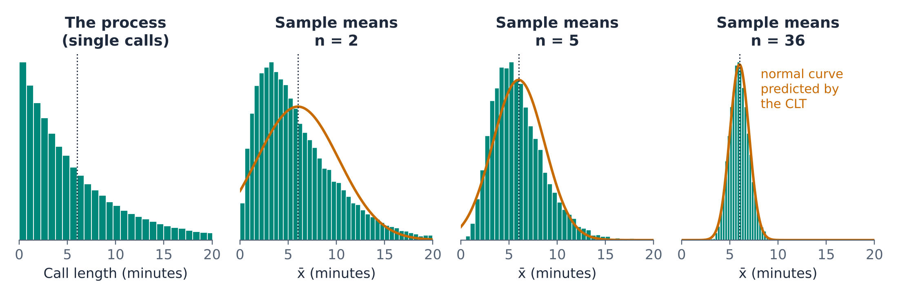{#fig-clt fig-alt="Four histograms. The first shows individual call lengths, strongly right-skewed with most calls under 5 minutes and a long tail past 20 minutes. The next three show 20,000 simulated sample means for samples of 2, 5, and 36 calls. With 2 calls the averages are still skewed; with 5 they are less skewed; with 36 they form a narrow, symmetric bell centered at 6 minutes that matches the overlaid normal curve."}

How large is "large enough"? There is no single cutoff, but these rules of thumb serve well in business work:

- **If the process itself is roughly normal**, the sampling distribution of $\bar{x}$ is normal for any sample size, even $n$ = 2.
- **For moderately skewed processes**, $n$ of about 30 or more is usually enough. This is the most commonly quoted rule.
- **For strongly skewed processes or processes with extreme outliers** (insurance claims, venture returns, viral social media posts), much larger samples may be needed.

::: {.callout-warning title="The CLT is about averages, not individual values"}
The CLT says nothing about the shape of the data themselves. Call lengths stay skewed no matter how many calls you record. Only the *averages* of samples become normal. Using the normal distribution to answer a question about a single call would give the wrong answer.
:::

### Calculating probabilities for a sample mean

Because the normal distribution is completely described by its mean and standard deviation, the CLT lets us calculate the probability that a sample mean lands in any range we like. We still will not know which sample mean we have, but we will know how much variability to expect.

::: {.callout-tip title="Example — Call center averages"}
The call-length process has $\mu$ = 6 minutes and $\sigma$ = 6 minutes. A supervisor reviews a random sample of $n$ = 36 calls each week. What is the probability that the sample average exceeds 7.5 minutes?

By the CLT, $\bar{x}$ is approximately normal with mean 6 and standard error $6/\sqrt{36}$ = 1 minute. A sample average of 7.5 is 1.5 standard errors above the mean, and

$$
P(\bar{x} > 7.5) = 0.0668
$$

So in a typical year, the weekly average would exceed 7.5 minutes in about 3 or 4 weeks (52 × 0.0668 ≈ 3.5) purely by chance, with nothing wrong in the call center. A supervisor who reacts to every such week is reacting to noise. For contrast, about 28.7% of *individual* calls last longer than 7.5 minutes. Averages are much more stable than the values they average.
:::

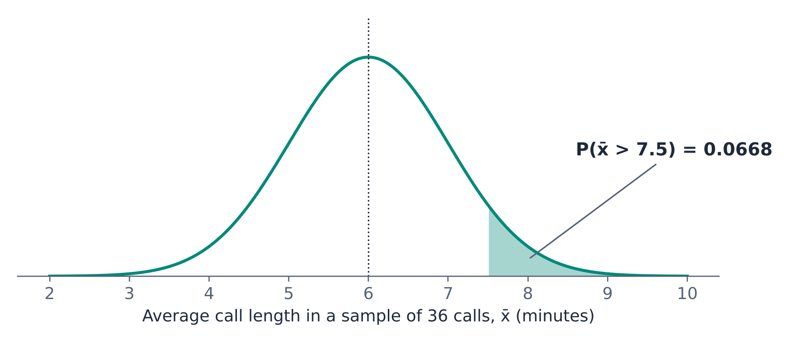{#fig-calls fig-alt="Normal curve centered at 6 minutes with standard deviation 1 minute. The area to the right of 7.5 minutes is shaded and labeled P of x-bar greater than 7.5 equals 0.0668."}

::: {.callout-tip title="Example — Average order value"}
An online retailer's individual order values are right-skewed with $\mu$ = \$82 and $\sigma$ = \$40. The analytics team computes the average of a random sample of $n$ = 64 orders each day. What is the probability that a day's sample average lands within \$4 of the true mean, that is, between \$78 and \$86?

The standard error is $40/\sqrt{64}$ = \$5. By the CLT,

$$
P(78 \le \bar{x} \le 86) = P(\bar{x} \le 86) - P(\bar{x} \le 78) = 0.7881 - 0.2119 = 0.5763
$$

Only about 58% of days will produce a sample average within \$4 of the truth. If management wants daily averages that are reliably within \$4, the sample of 64 orders is too small.
:::

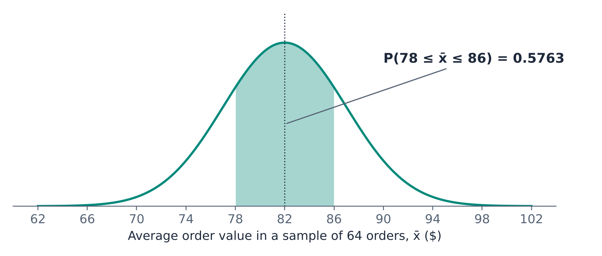{#fig-orders fig-alt="Normal curve centered at 82 dollars with standard deviation 5 dollars. The area between 78 and 86 dollars is shaded and labeled 0.5763."}

::: {.callout-tip title="Example — Bottling line"}
A filling machine puts an average of $\mu$ = 500 ml into each bottle, with a standard deviation of $\sigma$ = 4 ml. Every hour, quality control weighs a random sample of $n$ = 16 bottles and records the average fill. Fill volumes are approximately normal, so the sampling distribution of $\bar{x}$ is normal even though 16 is a small sample.

The standard error is $4/\sqrt{16}$ = 1 ml. Between which two values will the middle 95% of hourly averages fall?

Using the inverse of the normal distribution, the 2.5th percentile is 498.04 ml and the 97.5th percentile is 501.96 ml. Hourly averages outside this range happen only 5% of the time when the machine is working as designed, so a reading outside it is a reasonable signal to check the machine.
:::

::: {.callout-tip title="Example — The food truck"}
Return to the food truck owner from the table in Section 2.1. Suppose that over the past year, Wednesday-night revenue has averaged $\mu$ = \$340 with $\sigma$ = \$60, and nightly revenue is roughly normal. This month's four Wednesdays averaged under \$300. Is the owner right to conclude that Wednesdays have gotten worse?

The standard error for an average of $n$ = 4 nights is $60/\sqrt{4}$ = \$30. If nothing has changed,

$$
P(\bar{x} < 300) = 0.0912
$$

A month this bad happens about once every 11 months by chance alone. It is a reason to keep watching, not proof that the process has changed. If the four-week average had been \$285, the probability would have been 0.0334, which is more persuasive. Units 3 and 4 turn this kind of reasoning into formal tools.
:::

::: {.callout-note .excel icon=false title="In Excel — Normal probabilities"}
| Task | Function | Example (call center: mean 6, SE 1) |
|---|---|---|
| $P(\bar{x} \le a)$ | `=NORM.DIST(a, mean, sd, TRUE)` | `=NORM.DIST(7.5, 6, 1, TRUE)` → 0.9332 |
| $P(\bar{x} > a)$ | `=1 - NORM.DIST(a, mean, sd, TRUE)` | `=1 - NORM.DIST(7.5, 6, 1, TRUE)` → 0.0668 |
| $P(a \le \bar{x} \le b)$ | `=NORM.DIST(b, …) - NORM.DIST(a, …)` | `=NORM.DIST(86, 82, 5, TRUE) - NORM.DIST(78, 82, 5, TRUE)` → 0.5763 |
| Value with probability $p$ below it | `=NORM.INV(p, mean, sd)` | `=NORM.INV(0.975, 500, 1)` → 501.96 |

Two habits prevent most errors. First, for a sample mean, the standard deviation argument is the **standard error** $\sigma/\sqrt{n}$, not $\sigma$. Calculate it in its own cell, for example `=6/SQRT(36)`, and refer to that cell. Second, always type `TRUE` as the last argument of `NORM.DIST`. `TRUE` returns a probability; `FALSE` returns the height of the curve, which is not a probability.
:::

## 2.4 Standardizing: z-Scores and the Standard Normal Distribution

### Why standardize?

Business processes are measured in many different units: millimeters, grams, minutes, dollars, percentage points. That is natural for running the business but awkward for analysis. Consider a machine shop that makes a part with two critical dimensions:

- The radius has a target of 50 mm and a standard deviation of 2 mm. The specification allows ±4 mm.
- The weight has a target of 250 g and a standard deviation of 7.5 g. The specification allows ±15 g.

Is ±4 mm a tighter or looser tolerance than ±15 g? Is a part with a radius of 53 mm more or less unusual than a part weighing 235 g? Millimeters and grams cannot be compared directly. Standardizing solves the problem by measuring every value in the same unit: standard deviations from the mean.

::: {.callout-note title="Definition — z-score"}
The **z-score** of a value $x$ is the number of standard deviations it lies above or below the mean:

$$
z = \frac{x - \mu}{\sigma}
$$

Positive z-scores lie above the mean, negative ones below. A z-score has no units.
:::

::: {.callout-tip title="Example — Comparing millimeters and grams"}
- Radius of 53 mm: $z = (53 - 50)/2 = 1.5$
- Weight of 235 g: $z = (235 - 250)/7.5 = -2.0$

The weight is the more unusual measurement: two standard deviations below target, compared with one and a half above.

The specifications standardize the same way. ±4 mm is $\pm 4/2 = \pm 2$ standard deviations, and ±15 g is $\pm 15/7.5 = \pm 2$ standard deviations. In standardized terms the two tolerances are identical, so (if both are normal) each dimension falls within specification 95.45% of the time.
:::

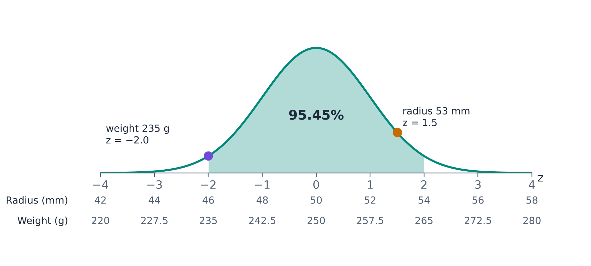{#fig-std fig-alt="Standard normal curve with z from minus 4 to 4 and the area between minus 2 and 2 shaded, labeled 95.45 percent. Two extra scales below the z axis translate z into radius in millimeters (42 to 58, with 50 at z equals 0) and weight in grams (220 to 280, with 250 at z equals 0). A dot at z equals 1.5 marks a radius of 53 mm and a dot at z equals minus 2 marks a weight of 235 g."}

### The standard normal distribution

If $x$ comes from a normal distribution, its z-score comes from a normal distribution with mean 0 and standard deviation 1. This one distribution, the **standard normal distribution**, serves every normal process at once, whatever its units. Before spreadsheets existed, this was the reason for standardizing: a single printed table of standard normal probabilities covered every normal problem. Excel has made the tables unnecessary, but the standard normal remains the common language of statistics, and a handful of its values are worth knowing by heart.

| Central area | Cuts off in each tail | z |
|---|---|---|
| 80% | 10% | ±1.282 |
| 90% | 5% | ±1.645 |
| 95% | 2.5% | ±1.960 |
| 99% | 0.5% | ±2.576 |

These are also the source of the empirical rule from Unit 1: about 68% of a normal distribution lies within 1 standard deviation of the mean, about 95% within 2, and about 99.7% within 3.

### The CLT in standardized form

Standardizing a sample mean works the same way, except that we divide by the standard error of the mean rather than by $\sigma$:

$$
Z = \frac{\bar{x} - \mu}{\sigma / \sqrt{n}}
$$

The CLT can then be stated compactly: for large enough samples, $Z$ follows the standard normal distribution. In the call center example, a sample average of 7.5 minutes gives $Z = (7.5 - 6)/1 = 1.5$, and the probability of exceeding 1.5 on the standard normal is the same 0.0668 we found before.

::: {.callout-note .excel icon=false title="In Excel — z-scores and the standard normal"}
| Task | Function | Example |
|---|---|---|
| z-score of $x$ | `=STANDARDIZE(x, mean, sd)` | `=STANDARDIZE(235, 250, 7.5)` → −2 |
| $P(Z \le z)$ | `=NORM.S.DIST(z, TRUE)` | `=NORM.S.DIST(1.5, TRUE)` → 0.9332 |
| z with probability $p$ below it | `=NORM.S.INV(p)` | `=NORM.S.INV(0.975)` → 1.960 |

`STANDARDIZE` gives exactly the same result as `=(x - mean)/sd`. For a sample mean, use the standard error as the third argument: `=STANDARDIZE(7.5, 6, 6/SQRT(36))` → 1.5.
:::

### The catch: we do not know $\sigma$

Look back at every example in this section and the last. Each one assumed that we know the process standard deviation $\sigma$. In practice we almost never do. $\sigma$ is a parameter of the process, and parameters are exactly what we cannot observe. All we have is the sample standard deviation $s$ calculated from our data.

The natural move is to plug in $s$ wherever we need $\sigma$. That move turns out to be correct, but it comes at a price. $s$ is itself a statistic. It varies from sample to sample, just as $\bar{x}$ does, so plugging it in adds a second source of randomness. To account for that randomness we first need to understand the sampling distribution of the sample variance. That is the subject of the next section, and it leads directly to the t distribution in Section 2.7.

## 2.5 The Sampling Distribution of the Variance

### The sample variance varies too

Return to the bottling line, where the true standard deviation of fill volumes is $\sigma$ = 4 ml. Suppose quality control calculates the sample standard deviation $s$ from each hourly sample. How much will $s$ bounce around from hour to hour?

@fig-ssim answers by simulation. For samples of 5 bottles, the sample standard deviation ranges widely, from below 2 ml to above 6 ml. With 16 bottles it is tighter, and with 50 bottles tighter still. Like the sample mean, the sample standard deviation has a sampling distribution, and its spread shrinks as the sample grows. Unlike the sample mean's, its shape is not symmetric: it has a longer right tail, especially for small samples.

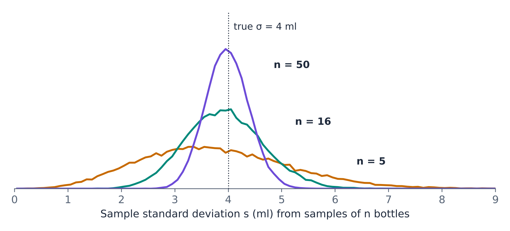{#fig-ssim fig-alt="Three simulated distributions of the sample standard deviation, with a dotted line at the true value of 4 ml. For n equals 5 the distribution is wide and right-skewed, spreading from about 1 to 8 ml. For n equals 16 it is narrower, from about 2 to 6 ml. For n equals 50 it is a tall narrow peak from about 3 to 5 ml."}

The center of the sampling distribution of $s^2$ is exactly $\sigma^2$: the sample variance is an unbiased estimator of the process variance. This is precisely why we divide by $n - 1$ rather than $n$ when we calculate $s^2$, as discussed in Unit 1. Dividing by $n$ would make the sample variance systematically too small.

### The chi-square distribution

To calculate probabilities about $s^2$ we need a probability distribution with the right shape. That distribution is the chi-square distribution (written $\chi^2$, pronounced "kai-square").

::: {.callout-note title="Definition — Sampling distribution of the variance"}
If the process is **normally distributed** with variance $\sigma^2$, then for random samples of size $n$,

$$
\frac{(n-1)\,s^2}{\sigma^2}
$$

follows a **chi-square distribution with $n - 1$ degrees of freedom**.
:::

The quantity $(n-1)s^2/\sigma^2$ is just the sample variance rescaled. If $s^2$ happens to equal $\sigma^2$, it equals $n - 1$; if $s^2$ is twice $\sigma^2$, it equals $2(n-1)$. Rescaling this way lets one family of distributions cover every sample size and every process variance.

The chi-square distribution has a few properties worth knowing:

- It takes only non-negative values, since variances cannot be negative.
- It is right-skewed, with the skew most pronounced for small degrees of freedom.
- Its mean equals its degrees of freedom, and its variance is twice its degrees of freedom.
- As the degrees of freedom grow, it becomes more symmetric and more bell-shaped.

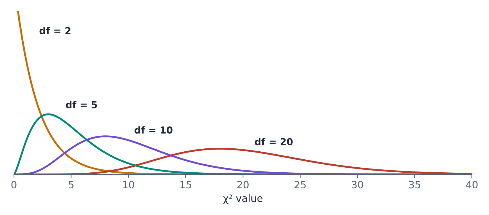{#fig-chishapes fig-alt="Four chi-square density curves. With 2 degrees of freedom the curve starts high at zero and falls steadily. With 5 it peaks near 3 and is strongly right-skewed. With 10 it peaks near 8 and is less skewed. With 20 it peaks near 18 and is nearly symmetric."}

::: {.callout-warning title="Normality matters here"}
The chi-square result requires the process itself to be normally distributed, and, unlike the CLT for the mean, it does not become approximately true for large samples from non-normal processes. For skewed or heavy-tailed processes, chi-square probabilities about the variance can be badly wrong. Check a histogram of the data before relying on them.
:::

### Using the chi-square distribution

::: {.callout-tip title="Example — Is the filling machine getting less consistent?"}
The bottling line is designed to fill with $\sigma$ = 4 ml. Quality control takes a sample of $n$ = 16 bottles and finds $s$ = 5 ml. Should they worry?

If the machine is working as designed, the probability of a sample standard deviation above 5 ml is

$$
P(s > 5) = P\left(\chi^2_{15} > \frac{15 \times 5^2}{4^2}\right) = P(\chi^2_{15} > 23.44) = 0.0753
$$

About 7.5% of hourly samples will show a standard deviation of 5 ml or more even when nothing is wrong. One such reading is not alarming; a run of them would be.
:::

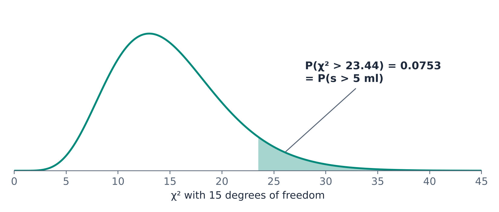{#fig-chifill fig-alt="Chi-square density curve with 15 degrees of freedom, peaking near 13. The right tail beyond 23.44 is shaded and labeled 0.0753, equal to the probability that the sample standard deviation exceeds 5 ml."}

::: {.callout-tip title="Example — How much does s vary?"}
Continue with the bottling line ($\sigma$ = 4 ml). Between which values will the middle 95% of sample standard deviations fall for samples of 16 bottles?

The 2.5th and 97.5th percentiles of the chi-square distribution with 15 degrees of freedom are 6.262 and 27.488. Solving $(n-1)s^2/\sigma^2 = c$ for $s$ gives $s = \sigma\sqrt{c/(n-1)}$, so

$$
s_{\text{low}} = 4\sqrt{6.262/15} = 2.58 \text{ ml} \qquad s_{\text{high}} = 4\sqrt{27.488/15} = 5.41 \text{ ml}
$$

The same calculation for other sample sizes shows how imprecise a sample standard deviation is when the sample is small:

| Sample size | Middle 95% of sample standard deviations |
|---|---|
| 5 | 1.39 to 6.68 ml |
| 16 | 2.58 to 5.41 ml |
| 50 | 3.21 to 4.79 ml |

With five bottles, the sample standard deviation can easily come out at a third of the true value or at more than half again as much.
:::

::: {.callout-tip title="Example — A calm year for a volatile fund"}
An investment fund's monthly returns have a standard deviation of $\sigma$ = 4 percentage points, and returns are approximately normal. What is the probability that a year of monthly returns ($n$ = 12) shows a sample standard deviation below 3 percentage points?

$$
P(s < 3) = P\left(\chi^2_{11} < \frac{11 \times 3^2}{4^2}\right) = P(\chi^2_{11} < 6.19) = 0.1394
$$

Roughly one year in seven, this fund will *look* considerably safer than it is. An investor who judges risk from a single year of data can be badly misled. (Actual fund returns tend to have heavier tails than the normal distribution, which makes the chi-square calculation a rough guide here rather than an exact answer.)
:::

::: {.callout-note .excel icon=false title="In Excel — Chi-square probabilities"}
| Task | Function | Example |
|---|---|---|
| Area to the left of $x$ | `=CHISQ.DIST(x, df, TRUE)` | `=CHISQ.DIST(6.1875, 11, TRUE)` → 0.1394 |
| Area to the right of $x$ | `=CHISQ.DIST.RT(x, df)` | `=CHISQ.DIST.RT(23.4375, 15)` → 0.0753 |
| Value with probability $p$ to its left | `=CHISQ.INV(p, df)` | `=CHISQ.INV(0.025, 15)` → 6.262 |
| Value with probability $p$ to its right | `=CHISQ.INV.RT(p, df)` | `=CHISQ.INV.RT(0.025, 15)` → 27.488 |

Remember to convert the sample variance to the chi-square scale first: `=(n-1)*s^2/sigma^2`. In the bottling example, `=CHISQ.DIST.RT(15*5^2/4^2, 15)` does it in one step.
:::

## 2.6 Degrees of Freedom

The phrase "degrees of freedom" has now come up twice, and it will follow us through the rest of the course. Here is where it comes from.

The sample variance is built from the deviations of each observation from the sample mean, $x_i - \bar{x}$. These deviations always sum to zero. That is a mathematical property of the mean, not a coincidence. So once you know $n - 1$ of the deviations, the last one is fixed: it must be whatever makes the total zero.

::: {.callout-tip title="Example — Only n − 1 free choices"}
Three numbers have a mean of 10. Choose the first two freely, say 7 and 15. The third is no longer free: the three must sum to 30, so it must be 8. Two of the three values were free to vary; the third was determined by the requirement that the mean be 10.
:::

::: {.callout-note title="Definition — Degrees of freedom"}
The **degrees of freedom** (df) of a statistic is the number of independent pieces of information that go into it after accounting for quantities that had to be estimated from the same data along the way.
:::

When we calculate $s^2$, we first had to estimate $\mu$ by $\bar{x}$, and that estimate used up one piece of information. The sample variance therefore rests on $n - 1$ independent deviations, which is why it has $n - 1$ degrees of freedom, and why we divide by $n - 1$.

Why should a manager care? Degrees of freedom measure how much information remains for estimating variability. Few degrees of freedom mean the estimate of variability is shaky, and every calculation built on it must allow extra room for error. Many degrees of freedom mean the estimate of variability is reliable. The t distribution in the next section makes this adjustment automatically.

## 2.7 The t Distribution

### Putting the pieces together

We now have everything we need to deal with the catch from Section 2.4. The standardized sample mean

$$
Z = \frac{\bar{x} - \mu}{\sigma/\sqrt{n}}
$$

follows the standard normal distribution, but we cannot calculate it because we do not know $\sigma$. Replacing $\sigma$ with $s$ gives a quantity we *can* calculate:

$$
T = \frac{\bar{x} - \mu}{s/\sqrt{n}}
$$

The numerator still varies from sample to sample, as before. But now the denominator varies as well, because $s$ varies. Sometimes $s$ comes out smaller than $\sigma$, which makes $T$ larger in absolute value than $Z$ would have been. So $T$ is more spread out than $Z$, with more extreme values in both tails.

How much more spread out? Divide the top and bottom of $T$ by $\sigma/\sqrt{n}$ and rearrange:

$$
T = \frac{\dfrac{\bar{x}-\mu}{\sigma/\sqrt{n}}}{\sqrt{\dfrac{(n-1)s^2/\sigma^2}{n-1}}} = \frac{\text{standard normal}}{\sqrt{\text{chi-square} \,/\, \text{its degrees of freedom}}}
$$

The numerator is the standard normal variable from the CLT. The denominator contains exactly the chi-square variable from Section 2.5, divided by its degrees of freedom. $T$ combines the two sampling distributions we have studied. The distribution of this ratio was worked out over a century ago, and it has a name.

::: {.callout-note title="Definition — t distribution"}
If the process is normally distributed, then

$$
T = \frac{\bar{x} - \mu}{s/\sqrt{n}}
$$

follows a **t distribution with $n - 1$ degrees of freedom**.
:::

### Properties of the t distribution

- Like the standard normal, it is symmetric and centered at 0.
- It has heavier tails than the standard normal: extreme values are more likely. This is the extra uncertainty from estimating $\sigma$ with $s$.
- It is a family of distributions, one for each value of the degrees of freedom.
- As the degrees of freedom grow, $s$ becomes a more reliable estimate of $\sigma$, and the t distribution gets closer and closer to the standard normal. With 30 degrees of freedom the two are already hard to tell apart in a picture; with several hundred they are practically identical.

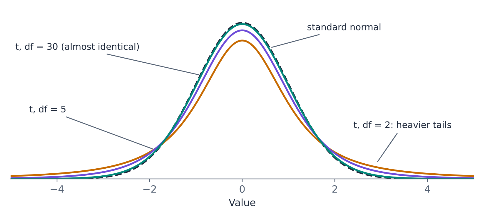{#fig-tnorm fig-alt="Four symmetric bell-shaped curves centered at zero. The standard normal is drawn dashed. The t curve with 30 degrees of freedom nearly coincides with it. The t curve with 5 degrees of freedom is slightly lower in the middle and higher in the tails. The t curve with 2 degrees of freedom is lowest in the middle and has the heaviest tails."}

How much does the normality assumption matter? Much less than it does for the chi-square result. Because the numerator of $T$ is a sample mean, the CLT is working in our favor, and t-based calculations are reasonably accurate for moderate sample sizes unless the process is strongly skewed or has extreme outliers. For small samples, look at the data first.

### A brewer's problem

The t distribution was discovered by William Sealy Gosset, a chemist who worked for the Guinness brewery in Dublin around the turn of the twentieth century. Guinness took a scientific approach to brewing and wanted to know, for example, which varieties of barley gave the best yield and how the quality of raw materials affected the beer. But Gosset's experiments were small. A field trial or a batch of brewing produced only a handful of observations, far too few for the large-sample methods of the day, which treated $s$ as if it were $\sigma$.

Gosset worked out how much extra uncertainty comes from estimating the standard deviation from a small sample, and published the result in the journal *Biometrika* in 1908. Guinness did not allow its staff to publish under their own names, so the paper appeared under the pseudonym "Student." The distribution is still called **Student's t distribution** today. The statistician Ronald Fisher later recognized the importance of Gosset's work, extended it, and popularized the form and the letter $t$ that we use now.

It is fitting that one of the most widely used tools in statistics came out of a business trying to make better decisions from limited data. That is still exactly what it is for.

### Using the t distribution

::: {.callout-tip title="Example — How much wider is t?"}
For the standard normal, 95% of values fall between −1.96 and 1.96. For the t distribution, the corresponding cutoffs depend on the degrees of freedom:

| Sample size $n$ | Degrees of freedom | t value cutting off the middle 95% |
|---|---|---|
| 5 | 4 | ±2.776 |
| 10 | 9 | ±2.262 |
| 16 | 15 | ±2.131 |
| 30 | 29 | ±2.045 |
| 100 | 99 | ±1.984 |
| (normal) | — | ±1.960 |

With a sample of 5, the cutoff is 42% farther out than the normal cutoff. With a sample of 100, the difference is small. These cutoffs will become the building blocks of confidence intervals in Unit 3.
:::

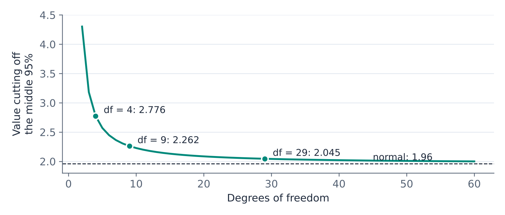{#fig-tcrit fig-alt="Line chart of the t value cutting off the middle 95 percent against degrees of freedom from 2 to 60. The curve starts above 4 at 2 degrees of freedom, drops steeply to 2.776 at 4 and 2.262 at 9, and flattens toward a dashed line at 1.96, reaching 2.045 at 29."}

::: {.callout-tip title="Example — Time to proficiency"}
An HR department claims that new analysts reach full proficiency in an average of $\mu$ = 20 working days. A manager tracks a random sample of $n$ = 10 recent hires and finds $\bar{x}$ = 22.4 days with $s$ = 3.1 days. If the HR claim is correct, how unusual is a sample average this high?

$$
T = \frac{22.4 - 20}{3.1/\sqrt{10}} = 2.45
$$

With 9 degrees of freedom, $P(T > 2.45) = 0.0184$. If the claim were true, a sample average of 22.4 days or more would happen less than 2% of the time, which casts doubt on the claim.

Had the manager used the standard normal instead, the probability would have come out as 0.0072, overstating how surprising the result is by a factor of about two and a half. With only 10 observations, ignoring the uncertainty in $s$ matters.
:::

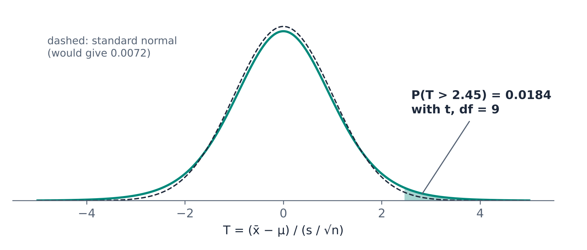{#fig-ttrain fig-alt="t density curve with 9 degrees of freedom and a dashed standard normal curve for comparison. The area to the right of 2.45 under the t curve is shaded and labeled 0.0184. A note says the standard normal would give 0.0072."}

::: {.callout-tip title="Example — Bottling line, with s"}
Quality control at the bottling line now no longer assumes $\sigma$ = 4 ml. A sample of $n$ = 16 bottles has $\bar{x}$ = 497.9 ml and $s$ = 4.4 ml. If the machine is correctly set to $\mu$ = 500 ml, how likely is a sample mean at least this far below 500?

$$
T = \frac{497.9 - 500}{4.4/\sqrt{16}} = -1.91
$$

With 15 degrees of freedom, $P(T \le -1.91) = 0.0378$. The probability of a sample mean at least this far from 500 *in either direction* is twice that, 0.0756.
:::

::: {.callout-note .excel icon=false title="In Excel — t probabilities"}
| Task | Function | Example |
|---|---|---|
| Area to the left of $t$ | `=T.DIST(t, df, TRUE)` | `=T.DIST(-1.909, 15, TRUE)` → 0.0378 |
| Area to the right of $t$ | `=T.DIST.RT(t, df)` | `=T.DIST.RT(2.448, 9)` → 0.0184 |
| Area in both tails beyond ±$t$ | `=T.DIST.2T(t, df)` | `=T.DIST.2T(1.909, 15)` → 0.0756 |
| Value with probability $p$ to its left | `=T.INV(p, df)` | `=T.INV(0.95, 15)` → 1.753 |
| Value cutting off the middle $1 - p$ | `=T.INV.2T(p, df)` | `=T.INV.2T(0.05, 15)` → 2.131 |

`T.DIST.2T` only accepts a non-negative first argument; for a negative $t$, use `ABS`: `=T.DIST.2T(ABS(t), df)`. Note that `T.INV.2T` takes the *total* area in both tails, so `0.05` returns the cutoff for the middle 95%.
:::

## 2.8 A Special Case: Proportions

Many business questions have yes-or-no answers. Did the customer click? Does the invoice contain an error? Did the employee quit? Is the part defective? Several entries in the table in Section 2.1 were of this kind. Questions like these are about proportions, and proportions need one more look, because the reasoning of Section 2.7 does not carry over to them.

### Proportions are means of 0–1 variables

Record each outcome as 1 if it happened and 0 if it did not.

::: {.callout-note title="Definition — 0–1 variable and proportion"}
A **0–1 variable** (also called a binary, indicator, or dummy variable) equals 1 when an outcome occurs and 0 when it does not. The **process proportion** $p$ is the probability that the process produces a 1. The **sample proportion** $\hat{p}$ ("p-hat") is the share of 1s in the sample.
:::

Coded this way, a proportion is just an average. If 62 of 2,000 recipients click an email, the sum of the 0–1 values is 62, and

$$
\hat{p} = \frac{\sum x_i}{n} = \frac{62}{2000} = 0.031 = \bar{x}
$$

So everything we know about sample means applies. The sampling distribution of $\hat{p}$ is centered on $p$, its standard error is $\sigma/\sqrt{n}$, and the CLT says it is approximately normal for large enough samples.

### The variance is a function of the mean

What makes proportions special is the standard deviation. For an ordinary variable, the mean and the standard deviation are two separate characteristics of the process; knowing one tells you nothing about the other. For a 0–1 variable they are tied together.

Work it out from first principles. The variance is the average of the squared values minus the square of the average. Because $0^2 = 0$ and $1^2 = 1$, squaring a 0–1 variable changes nothing, so the average of the squared values is also $p$. Therefore

$$
\sigma^2 = p - p^2 = p(1-p) \qquad \text{and} \qquad \sigma = \sqrt{p(1-p)}
$$

Once you know the proportion, you know the standard deviation. There is nothing else to learn about the variability of a yes-or-no process. Substituting into $\sigma/\sqrt{n}$ gives the standard error of a sample proportion:

$$
SE_{\hat{p}} = \sqrt{\frac{p(1-p)}{n}}
$$

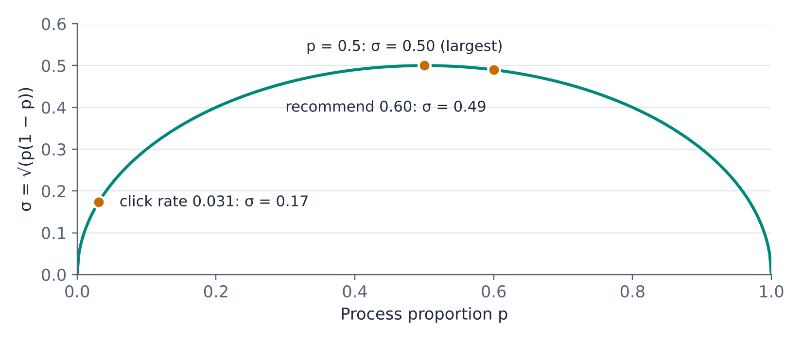{#fig-sdp fig-alt="Arch-shaped curve of the standard deviation of a 0-1 variable against the proportion p, from 0 at p equals 0, rising to a maximum of 0.5 at p equals 0.5, and back to 0 at p equals 1. Marked points: a click rate of 0.031 with standard deviation 0.17, p of 0.5 with 0.50, and a recommend rate of 0.60 with 0.49."}

@fig-sdp shows the relationship. Variability is largest when the outcome is a coin flip ($p$ = 0.5) and shrinks toward zero for outcomes that almost always or almost never happen.

### Why not the t distribution?

When $\sigma$ was unknown in Section 2.7, we replaced it with $s$ and switched from the standard normal to the t distribution. For proportions we do not. There are two reasons.

1. **There is no separate variance to estimate.** The t distribution exists to account for the extra randomness of a sample standard deviation that varies on its own, independently of the sample mean. For a 0–1 variable that extra randomness does not exist. If we know or assume $p$, as when we check a claim, $\sigma$ is known exactly, and the CLT in standardized form applies directly. Even when we have to estimate $p$ from the data (which we will do in Unit 3), the sample standard deviation is completely determined by $\hat{p}$. If 12 of 40 customers renew, $\hat{p}$ = 0.30, and the standard deviation is fixed at about 0.46 the moment you know $\hat{p}$. It carries no information of its own.
2. **The conditions behind the t distribution fail.** The t result in Section 2.7 requires a normally distributed process, with a sample variance that follows a chi-square distribution and varies independently of the sample mean. A 0–1 variable is about as far from normal as a variable can be, and its standard deviation is tied exactly to its mean. None of the ingredients of the t distribution are present.

What does apply is the CLT, because $\hat{p}$ is a sample mean.

::: {.callout-note title="Definition — Sampling distribution of a proportion"}
If the sample is large enough, the sampling distribution of $\hat{p}$ is approximately normal with mean $p$ and standard error $\sqrt{p(1-p)/n}$. Equivalently,

$$
Z = \frac{\hat{p} - p}{\sqrt{p(1-p)/n}}
$$

follows the **standard normal distribution**.
:::

::: {.callout-warning title="Using t for proportions"}
Software will happily calculate a sample standard deviation from a column of 0s and 1s and plug it into a t formula. The result looks reasonable but rests on assumptions that do not hold. For proportions, use the standard normal.
:::

### How large is "large enough"?

For proportions, the usual rule of thumb is that the sample should contain at least 10 expected 1s and at least 10 expected 0s:

$$
np \ge 10 \qquad \text{and} \qquad n(1-p) \ge 10
$$

The rule bites hardest for rare events. A 2% error rate needs a sample of at least 500 before the normal approximation is trustworthy.

::: {.callout-tip title="Example — Why rare events need big samples"}
About 2% of a company's invoices contain an error. An auditor checks a random sample of 100 invoices, so $np$ = 2, far below 10. @fig-rare shows what goes wrong. With so few expected errors, the sample proportion can only take a handful of lumpy values (0%, 1%, 2%, …), and the normal curve even spills below 0%. If the auditor used the normal distribution anyway, the probability of finding an error rate of 4% or more would come out as about 0.077. The correct value, from a distribution for counts that is beyond the scope of this course, is about 0.141, almost twice as large.

With a sample of 1,000 invoices, $np$ = 20 and the normal curve fits the distribution of $\hat{p}$ closely.
:::

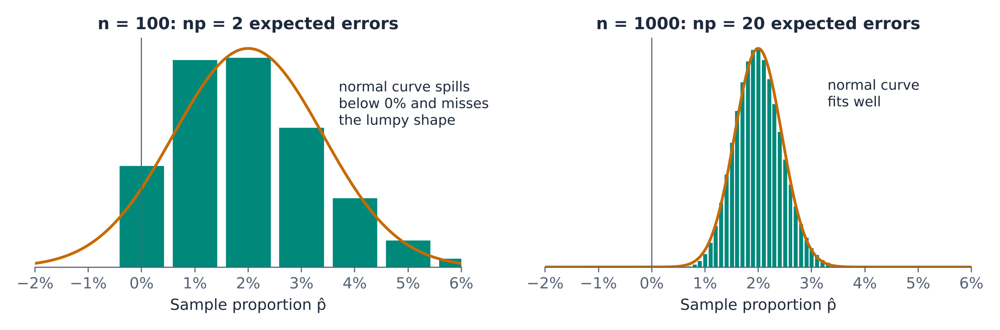{#fig-rare fig-alt="Two panels. Left, samples of 100 invoices: the possible sample error rates form a few lumpy bars at 0, 1, 2, 3, 4, 5 and 6 percent, and the overlaid normal curve fits poorly and extends below 0 percent. Right, samples of 1,000 invoices: many thin bars form a smooth bell shape centered at 2 percent that the normal curve matches well."}

### Using the normal distribution for proportions

::: {.callout-tip title="Example — Invoice audit"}
With $p$ = 0.02 and $n$ = 1,000 invoices, what is the probability that the audit finds an error rate above 3%?

$$
SE_{\hat{p}} = \sqrt{\frac{0.02 \times 0.98}{1000}} = 0.00443 \qquad Z = \frac{0.03 - 0.02}{0.00443} = 2.26
$$

$P(\hat{p} > 0.03) = 0.0119$. An audit result above 3% would be a strong sign that the error rate has risen. (The exact value is 0.0126, so with 20 expected errors the normal approximation is very close.)
:::

::: {.callout-tip title="Example — Email click rate"}
Emails like the one in Section 2.1 get a click rate of about $p$ = 0.031. The next campaign goes to a random sample of $n$ = 2,000 customers, which gives $np$ = 62 expected clicks. How likely is a click rate below 2.5%, purely by chance?

$$
SE_{\hat{p}} = \sqrt{\frac{0.031 \times 0.969}{2000}} = 0.00388 \qquad Z = \frac{0.025 - 0.031}{0.00388} = -1.55
$$

$P(\hat{p} < 0.025) = 0.0608$. About one campaign in sixteen will come in below 2.5% even if the new email is exactly as good as the old ones. A marketing team that redesigns its emails after every weak result is chasing noise.
:::

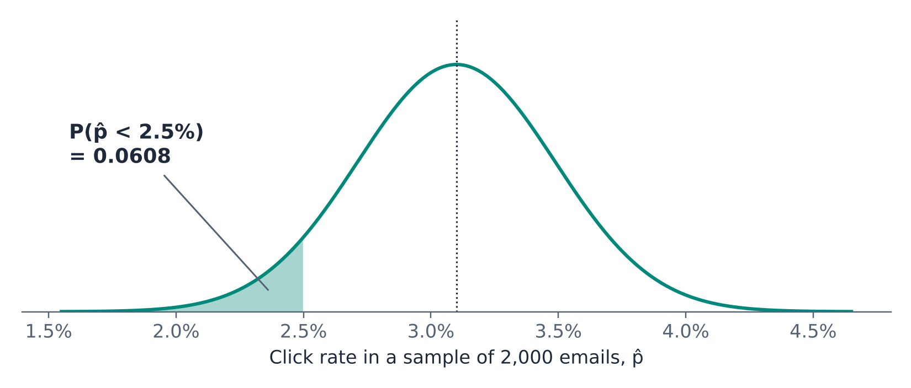{#fig-email fig-alt="Normal curve centered at a click rate of 3.1 percent, spanning about 1.5 to 4.7 percent. The area below 2.5 percent is shaded and labeled 0.0608."}

::: {.callout-tip title="Example — Customer survey"}
In the long run, 60% of a retailer's customers say they would recommend the store. Each month the retailer surveys $n$ = 150 random customers. Between which values will the middle 95% of monthly survey results fall?

$$
SE_{\hat{p}} = \sqrt{\frac{0.6 \times 0.4}{150}} = 0.04 \qquad 0.60 \pm 1.96 \times 0.04 = 0.522 \text{ to } 0.678
$$

Monthly results anywhere from about 52% to 68% are consistent with a stable 60%. This "plus or minus 7.8 percentage points" is the margin of error you see attached to opinion polls, and it is the idea behind the confidence intervals of Unit 3.
:::

::: {.callout-note .excel icon=false title="In Excel — Proportions"}
| Task | Function | Example |
|---|---|---|
| Sample proportion from a 0–1 column | `=AVERAGE(range)` | `=AVERAGE(B2:B2001)` → 0.031 |
| Sample proportion from text answers | `=COUNTIF(range, "Yes")/COUNTA(range)` | `=COUNTIF(C2:C151, "Yes")/COUNTA(C2:C151)` |
| Standard error | `=SQRT(p*(1-p)/n)` | `=SQRT(0.031*0.969/2000)` → 0.00388 |
| $P(\hat{p} \le a)$ | `=NORM.DIST(a, p, SE, TRUE)` | `=NORM.DIST(0.025, 0.031, 0.00388, TRUE)` → 0.0608 |
| Middle 95% of $\hat{p}$ | `=NORM.INV(0.025, p, SE)` and `=NORM.INV(0.975, p, SE)` | `=NORM.INV(0.975, 0.6, 0.04)` → 0.678 |

Do not use `STDEV.S` and the `T.` functions on a 0–1 column. Calculate the standard error from $p$ with `SQRT(p*(1-p)/n)` and use the `NORM.` functions.
:::

## 2.9 Putting It Together

Every statistic calculated from a sample has a sampling distribution, and that distribution tells us how much the statistic would vary if we had a different sample. The table summarizes the four cases in this chapter.

| What we want to describe | Statistic | Distribution | Requires | Excel |
|---|---|---|---|---|
| A sample mean, $\sigma$ known | $Z = \dfrac{\bar{x}-\mu}{\sigma/\sqrt{n}}$ | Standard normal | Large $n$ (CLT) or a normal process | `NORM.DIST`, `NORM.S.DIST`, `NORM.INV`, `NORM.S.INV` |
| A sample variance | $\dfrac{(n-1)s^2}{\sigma^2}$ | Chi-square, $n-1$ df | A normal process | `CHISQ.DIST`, `CHISQ.DIST.RT`, `CHISQ.INV`, `CHISQ.INV.RT` |
| A sample mean, $\sigma$ unknown | $T = \dfrac{\bar{x}-\mu}{s/\sqrt{n}}$ | t, $n-1$ df | A normal process; roughly true for moderate $n$ | `T.DIST`, `T.DIST.RT`, `T.DIST.2T`, `T.INV`, `T.INV.2T` |
| A sample proportion | $Z = \dfrac{\hat{p}-p}{\sqrt{p(1-p)/n}}$ | Standard normal (never t) | $np \ge 10$ and $n(1-p) \ge 10$ | `NORM.DIST`, `NORM.INV`, `NORM.S.DIST`, `NORM.S.INV` |

In this chapter we worked in one direction: we assumed we knew the process (its $\mu$, and sometimes its $\sigma$) and asked what samples would look like. Real analysis runs in the other direction. We have a sample and want to say something about the process. Unit 3 turns the sampling distributions from this chapter around to produce **confidence intervals**, ranges that capture the process mean or variance with a stated level of confidence. Unit 4 uses them to **test claims** about a process, much as we already did informally with the food truck and the time-to-proficiency examples.

## Key Terms

- **0–1 variable:** A variable that equals 1 when an outcome occurs and 0 when it does not. Its mean is a proportion and its standard deviation is $\sqrt{p(1-p)}$.
- **Central Limit Theorem (CLT):** For large enough samples, the sampling distribution of the sample mean is approximately normal with mean $\mu$ and standard deviation $\sigma/\sqrt{n}$, whatever the shape of the process.
- **Chi-square distribution:** A right-skewed distribution of non-negative values that describes $(n-1)s^2/\sigma^2$ for samples from a normal process.
- **Degrees of freedom:** The number of independent pieces of information in a statistic after accounting for quantities estimated from the same data.
- **Parameter:** A characteristic of the process, such as $\mu$ or $\sigma$. Usually unknown.
- **Population (process):** The data-generating mechanism we want to learn about.
- **Sample:** The outcomes of the process that we observed.
- **Sample proportion:** The share of 1s in a sample of a 0–1 variable, $\hat{p}$. Its standard error is $\sqrt{p(1-p)/n}$.
- **Sampling distribution:** The distribution of a statistic across all possible samples of the same size.
- **Standard error:** The standard deviation of a sampling distribution. For the sample mean, $\sigma/\sqrt{n}$.
- **Standard normal distribution:** The normal distribution with mean 0 and standard deviation 1.
- **Statistic:** A number calculated from a sample, such as $\bar{x}$ or $s$.
- **t distribution:** A symmetric, heavy-tailed distribution that describes $(\bar{x}-\mu)/(s/\sqrt{n})$ for samples from a normal process. It approaches the standard normal as the degrees of freedom grow.
- **Unbiased:** A statistic is unbiased if its sampling distribution is centered on the parameter it estimates.
- **z-score:** The number of standard deviations a value lies from the mean, $(x-\mu)/\sigma$.

## Practice Problems

1. A warehouse manager says: "We don't need statistics. We record every single order we pick, so we have the whole population." Explain why, for the purpose of planning next quarter's staffing, the manager's data are still a sample.
2. A process has $\sigma$ = 12. Find the standard error of the mean for samples of 36 and 144. How many observations would be needed to bring the standard error down to 0.5?
3. Delivery times for a restaurant are right-skewed with $\mu$ = 42 minutes and $\sigma$ = 15 minutes. For a random sample of 50 deliveries, find the probability that the average delivery time exceeds 45 minutes. Show the Excel formula.
4. Using the same restaurant, a student calculates the probability that a *single* delivery takes more than 45 minutes with `=1-NORM.DIST(45, 42, 15, TRUE)`. Explain what is wrong with this approach.
5. Store A had weekly sales of \$118,000, where weekly sales at that store average \$100,000 with a standard deviation of \$12,000. Store B had weekly sales of \$54,000, where its sales average \$45,000 with a standard deviation of \$5,000. Which store had the more exceptional week? Use z-scores.
6. A machine fills containers with $\mu$ = 750 ml and $\sigma$ = 10 ml; fills are normal. Quality control averages samples of 25 containers. Between which two values will the middle 90% of sample averages fall?
7. A normal process has $\sigma$ = 4. For a sample of 10 observations, find the probability that the sample standard deviation exceeds 6. Show the Excel formula.
8. Five numbers have a mean of 20. Four of them are 18, 22, 25, and 15. What is the fifth? How does this illustrate degrees of freedom?
9. For a sample of 12 observations, find the t value that cuts off the middle 95% of the t distribution. Compare it with the corresponding standard normal value and explain why it is larger.
10. A supplier claims its bags of coffee contain an average of 250 g. You weigh a random sample of 20 bags and find $\bar{x}$ = 246 g and $s$ = 8 g. If the supplier's claim is true, what is the probability of a sample mean of 246 g or less? Which distribution did you use, and why?
11. For each situation, say which distribution (standard normal, chi-square, or t) applies: (a) the probability that the average of 200 insurance claims exceeds some value, with $\sigma$ known from years of records; (b) the probability that the standard deviation of 15 part weights exceeds the design value; (c) the probability that the average of 12 project durations exceeds a target, with $\sigma$ unknown.
12. A production line makes 5% defective parts. Quality control inspects a random sample of 400 parts. Check whether the normal approximation is appropriate, then find the probability that more than 7% of the sampled parts are defective. Show the Excel formula.
13. A colleague codes customer renewals as 1 (renewed) and 0 (did not renew), calculates the sample standard deviation of the column with `STDEV.S`, and uses `T.DIST` to find a probability about the renewal rate. Explain what is wrong with this approach. Separately, would the normal approximation be appropriate for a sample of 60 customers if the renewal rate is 1%?

### Answers

1. Staffing decisions depend on the orders that will arrive next quarter, which have not been generated yet. The recorded orders are one realization of the ongoing process that generates orders, so they are a sample from that process.
2. $12/\sqrt{36}$ = 2 and $12/\sqrt{144}$ = 1. For a standard error of 0.5 we need $\sqrt{n} = 12/0.5 = 24$, so $n$ = 576.
3. The standard error is $15/\sqrt{50}$ = 2.121. By the CLT, `=1-NORM.DIST(45, 42, 15/SQRT(50), TRUE)` = 0.0786.
4. The CLT applies to averages, not to individual values. Individual delivery times are right-skewed, so the normal distribution is the wrong model for a single delivery.
5. Store A: $z = (118 - 100)/12 = 1.5$. Store B: $z = (54 - 45)/5 = 1.8$. Store B's week was more exceptional relative to its own normal variation.
6. The standard error is $10/\sqrt{25}$ = 2 ml. `=NORM.INV(0.05, 750, 2)` = 746.71 ml and `=NORM.INV(0.95, 750, 2)` = 753.29 ml.
7. The chi-square value is $9 \times 6^2/4^2 = 20.25$. `=CHISQ.DIST.RT(20.25, 9)` = 0.0164.
8. The five numbers must sum to 100, so the fifth is 100 − 80 = 20. Once the mean is fixed, only four of the five values are free to vary.
9. `=T.INV.2T(0.05, 11)` = 2.201, compared with 1.960 for the standard normal. The t value is larger because using $s$ in place of $\sigma$ adds uncertainty, which spreads the distribution out.
10. $T = (246 - 250)/(8/\sqrt{20}) = -2.24$. `=T.DIST(-2.236, 19, TRUE)` = 0.0188. The t distribution with 19 degrees of freedom applies because $\sigma$ is unknown and was replaced by $s$.
11. (a) Standard normal: large sample, $\sigma$ known. (b) Chi-square with 14 degrees of freedom, assuming weights are normal. (c) t with 11 degrees of freedom, assuming durations are roughly normal.
12. $np = 400 \times 0.05 = 20$ and $n(1-p) = 380$, both at least 10, so the normal approximation is appropriate. The standard error is $\sqrt{0.05 \times 0.95/400} = 0.0109$. `=1-NORM.DIST(0.07, 0.05, SQRT(0.05*0.95/400), TRUE)` = 0.0332.
13. For a 0–1 variable the standard deviation is determined by the proportion, $\sqrt{p(1-p)}$, so there is no separate variance to estimate, and the conditions behind the t distribution (a normal process with an independently varying $s$) do not hold. The standard error should be calculated as $\sqrt{p(1-p)/n}$ and probabilities found with the standard normal. For the second part, $np = 60 \times 0.01 = 0.6$, far below 10, so the normal approximation is not appropriate.
