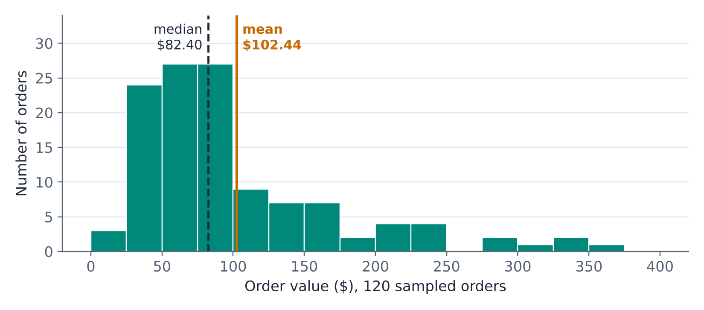
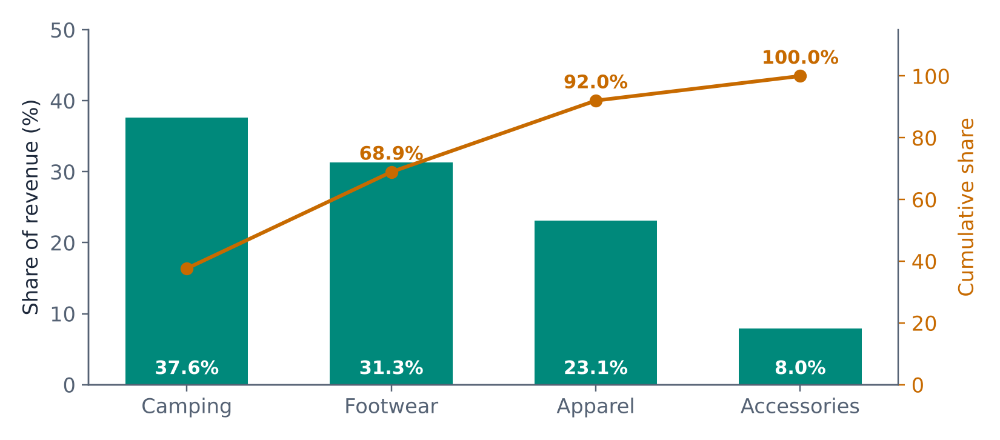
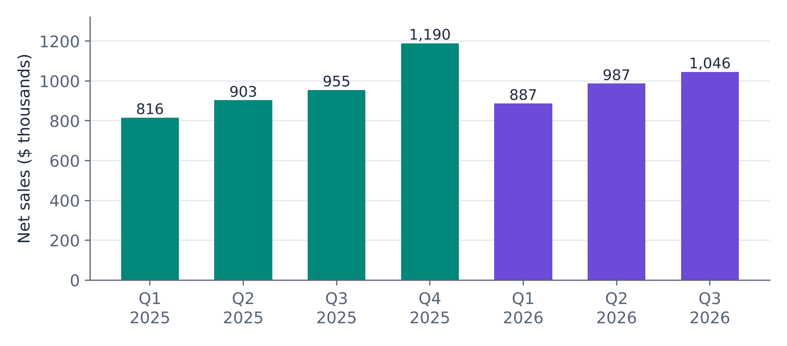
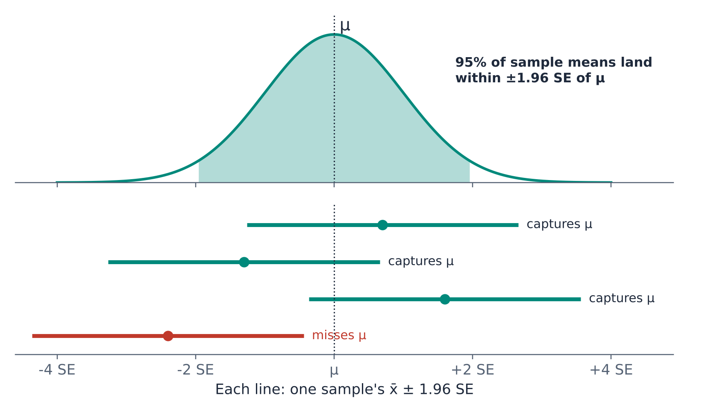
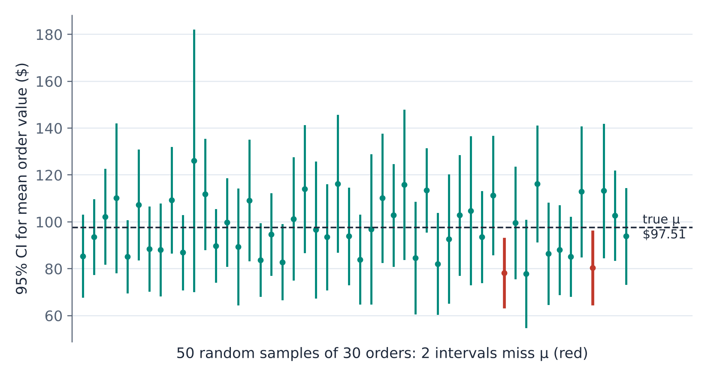
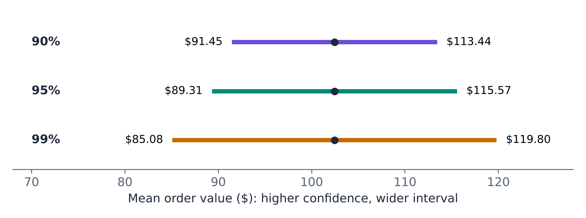
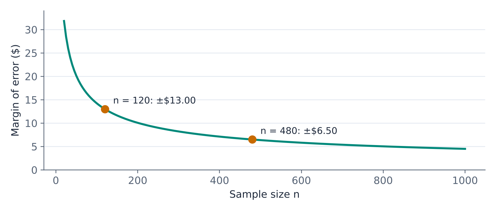
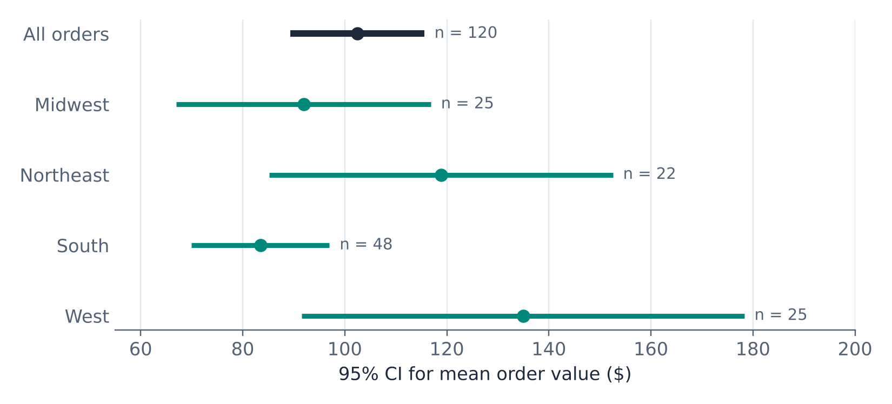
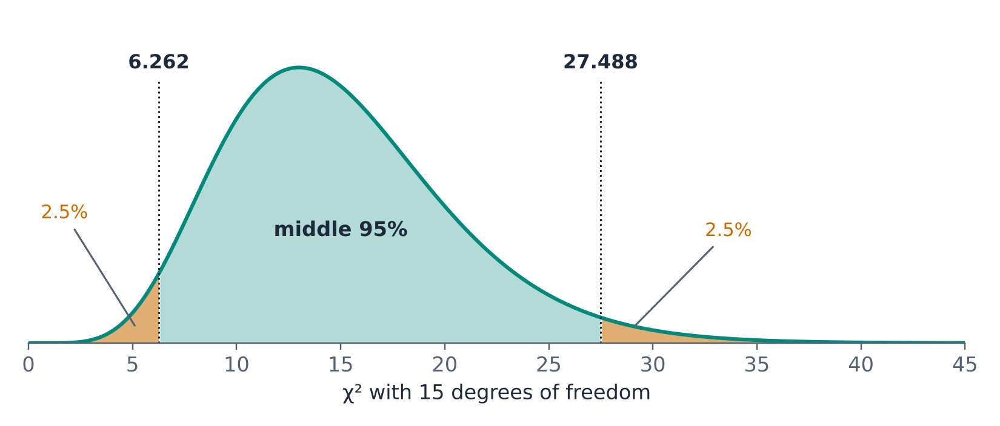

Most of the numbers that circulate in a business are descriptive: last quarter's sales, the average order value, the share of orders returned, the change in operating margin. They answer the most basic question analytics can ask: *what happened?* This chapter is about answering that question well, and then about answering the follow-up question every descriptive number should raise: *how precise is it?*

The first half of the chapter covers the techniques of descriptive analysis: summarizing a variable, slicing data into groups, and describing change over time and in financial statements. The second half returns to the sampling distributions of Unit 2 and turns them around. In Unit 2 we assumed we knew the process and asked what samples would look like. Here we have a sample and want to say something about the process. The tool for that is the **confidence interval**, and we build one for each kind of number a descriptive report contains: a mean, a proportion, and a standard deviation.

By the end of this chapter you should be able to:

- Distinguish descriptive, diagnostic, predictive, and prescriptive analytics, and recognize descriptive questions across business functions.
- Produce and interpret a complete numerical summary of a variable, including skewness and kurtosis, with Excel's Analysis ToolPak.
- Summarize data by group with PivotTables, and avoid the average-of-averages trap.
- Describe change correctly: percent change, percentage points, year-over-year comparisons, compound annual growth, and horizontal and vertical analysis of financial statements.
- Explain the logic of a confidence interval and interpret one correctly.
- Calculate confidence intervals for a mean, a proportion, and a standard deviation in Excel, and choose the right one.
- Plan the sample size needed for a desired margin of error.
- Report descriptive results together with their uncertainty.

## 3.1 Four Questions, Four Kinds of Analytics

Business questions come in many forms, but most of them are versions of four basic questions. Each corresponds to a type of analytics, and together they map out the rest of this course.

| Type of analytics | The question it answers | Example | Where in this course |
|---|---|---|---|
| **Descriptive** | What happened? What is happening? | What was our average order value last quarter? | Unit 3 (this chapter) |
| **Diagnostic** | Why did it happen? | Why did operating income fall although sales rose? | Unit 4 |
| **Predictive** | What is likely to happen? | What will sales be next quarter? | Unit 5 |
| **Prescriptive** | What should we do about it? | How much should we spend on marketing next quarter? | Unit 6 |

The four types build on each other. You cannot explain why something happened until you have described accurately what happened, and you cannot sensibly decide what to do until you have some idea of what will happen if you do it. Descriptive analytics is the foundation, and it is also where most of the day-to-day analytical work in organizations takes place.

::: {.callout-note title="Definition — Descriptive analytics"}
**Descriptive analytics** characterizes, summarizes, and organizes data so that people can understand what happened or what is happening. Its tools are counts, totals, averages, rates, measures of variability, tables, and charts.
:::

Every business function asks descriptive questions:

| Function | Typical descriptive questions |
|---|---|
| Marketing | How many units did we sell, by region and by channel? What share of website visits ended in a purchase? |
| Operations | What is our average delivery time? What share of orders ship on time? How consistent is our packing time? |
| Accounting | How did each line of the income statement change from last year? What share of revenue goes to cost of goods sold? |
| Finance | What was our return on assets? How volatile has our stock been over the last year? |
| Human resources | What is our annual employee turnover rate? How long does it take on average to fill a position? |

### Exploratory and confirmatory analysis

Descriptive work is often **exploratory**: you look at data with an open mind, summarizing and charting it to see what is there, to spot anomalies, and to find patterns worth a closer look. Exploratory analysis generates questions. **Confirmatory** analysis takes a specific question, fixed in advance, and uses statistical methods to answer it with a stated level of confidence. Hypothesis tests (Unit 4) and regression (Units 5 and 6) are confirmatory tools. The distinction matters because a pattern you went looking for after exploring the data is much weaker evidence than a pattern you predicted before you looked. A good workflow explores first, then confirms with fresh data or a pre-specified test.

### Where the data come from

Descriptive analysis usually draws on the information systems a company already runs:

- **Customer relationship management (CRM)** systems: customer contacts, order histories, payment terms, and service interactions.
- **Supply chain management (SCM)** systems: suppliers, purchase orders, inventory, shipments, and delivery times.
- **Human resource management systems (HRMS)**: recruiting, payroll, benefits, training, and turnover.
- **Financial reporting (accounting)** systems: transactions recorded in the general ledger, and the financial statements built from them.

## 3.2 The Running Example: Brazos Outfitters

Throughout this chapter we follow Brazos Outfitters, an online retailer of outdoor gear. Brazos processed roughly 10,000 online orders in the third quarter of 2026. Its analytics team drew a **random sample of 120 of those orders** for a quarterly review. For each order, the sample records:

| Variable | Description | Type |
|---|---|---|
| Month | Month the order was placed (Jul, Aug, Sep) | Categorical |
| Region | Customer's region (West, Midwest, South, Northeast) | Categorical |
| Channel | Website or mobile app | Categorical |
| Category | Main product category (Camping, Apparel, Footwear, Accessories) | Categorical |
| Items | Number of items in the order | Numerical (discrete) |
| Order value | Order total in dollars | Numerical (continuous) |
| Delivery days | Days from order to delivery | Numerical (discrete) |
| Pack time | Minutes the warehouse spent packing the order | Numerical (continuous) |
| Returned | Whether any item in the order was returned (Yes/No) | Categorical (binary) |

Remember the lesson of Unit 2: these 120 orders are a sample from the ongoing process that generates Brazos's orders. Every number we calculate from them describes the sample exactly, and describes the process only approximately. The first half of this chapter computes the numbers; the second half measures the "approximately."

## 3.3 Summarizing a Single Variable

### The Analysis ToolPak summary

Unit 1 introduced the individual measures of center, position, and spread. In practice an analyst usually wants all of them at once, and Excel's **Analysis ToolPak** produces them in a single table. Here is its output for the order values of the 120 sampled orders:

| Statistic | Value | What it tells us |
|---|---|---|
| Mean | 102.4427 | The average order was worth \$102.44. |
| Standard Error | 6.6310 | How much the mean would vary from sample to sample (Section 3.6). |
| Median | 82.40 | Half the orders were worth less than \$82.40. |
| Mode | #N/A | No order value occurred more than once. |
| Standard Deviation | 72.6391 | Typical distance of an order from the mean: about \$73. |
| Sample Variance | 5276.4378 | The standard deviation squared, in squared dollars. |
| Kurtosis | 2.5878 | Heavier tails than a normal distribution. |
| Skewness | 1.6382 | A long tail to the right. |
| Range | 353.81 | Maximum minus minimum. |
| Minimum | 14.10 | The smallest order. |
| Maximum | 367.91 | The largest order. |
| Sum | 12293.12 | Total value of the 120 sampled orders. |
| Count | 120 | Number of orders. |
| Confidence Level(95.0%) | 13.1300 | The margin of error for the mean (Section 3.8). |

Two lines of this table, *Standard Error* and *Confidence Level*, cannot be interpreted with descriptive tools alone. They are about the *process*, not the sample, and they are the bridge to the second half of this chapter. The other lines deserve a closer look first.

### Center: mean or median?

The mean (\$102.44) is about \$20 higher than the median (\$82.40). That gap is a signal. A handful of large orders, up to \$367.91, pull the mean upward, while the median, the middle order, is unaffected by how large the largest orders are. @fig-hist shows the shape behind the numbers: most orders cluster between \$25 and \$100, with a long tail to the right.

{#fig-hist fig-alt="Histogram of 120 order values in 25-dollar bins from 0 to 400 dollars. Most orders fall between 25 and 100 dollars, with the tallest bars between 50 and 100. A long right tail extends past 350 dollars. A dashed line marks the median at 82.40 dollars and a solid line marks the mean at 102.44 dollars, to the right of the median."}

Which number should a report use? It depends on the question:

- **For totals and planning**, use the mean. Mean × number of orders = total revenue, a relationship the median does not have. A finance team forecasting revenue needs the mean.
- **For describing a typical order**, use the median. If marketing asks what a typical customer spends, \$82 is a more honest answer than \$102, because most customers spend less than the mean.

Reporting both, as the ToolPak does, is often best. The gap between them is itself informative.

The mode is reported as `#N/A` because no two orders had exactly the same value. For continuous data that is normal: the mode is useful for categorical and discrete variables (the most common region, the most common number of items) and rarely for amounts of money.

### Shape: skewness and kurtosis

Two lines of the ToolPak output describe the shape of the distribution with a single number each.

::: {.callout-note title="Definition — Skewness"}
**Skewness** measures the asymmetry of a distribution. It is zero for a symmetric distribution, positive when there is a long tail to the right, and negative when there is a long tail to the left. As a rough guide, values beyond ±1 indicate substantial skew.
:::

::: {.callout-note title="Definition — Kurtosis"}
**Kurtosis** (as reported by Excel, sometimes called *excess* kurtosis) measures how heavy the tails of a distribution are compared with a normal distribution. It is zero for a normal distribution and positive when extreme values are more common than a normal distribution would predict.
:::

A skewness of 1.64 and a kurtosis of 2.59 confirm what the histogram shows: order values are right-skewed with occasional very large orders. That is typical of money amounts (order values, salaries, insurance claims, house prices) and it matters for what comes next. Recall from Unit 2 that the normal-based tools for averages rely on the Central Limit Theorem. With 120 orders, the CLT has enough data to work with, but for a small sample of such skewed data, normal-based calculations would be less trustworthy.

::: {.callout-note .excel icon=false title="In Excel — Descriptive Statistics with the Analysis ToolPak"}
1. If **Data Analysis** does not appear at the right end of the **Data** tab, turn on the add-in: **File › Options › Add-ins**, choose *Excel Add-ins* in the Manage box, click **Go**, and tick **Analysis ToolPak**. (On a Mac: **Tools › Excel Add-ins**.)
2. **Data › Data Analysis › Descriptive Statistics**.
3. Select the column of data as the *Input Range*. Tick *Labels in first row* if you included the header.
4. Tick **Summary statistics** and **Confidence Level for Mean** (leave it at 95%).

The output is static: it does not update if the data change. Each line also has a worksheet function, which does update: `AVERAGE`, `MEDIAN`, `MODE.SNGL`, `STDEV.S`, `VAR.S`, `KURT`, `SKEW`, `MIN`, `MAX`, `SUM`, and `COUNT`.
:::

### Categorical variables: counts and proportions

For a categorical variable such as *Returned*, the natural summaries are counts and proportions. Of the 120 orders, 15 had a return, so the **return rate** in the sample is 15/120 = 0.125, or 12.5%.

A useful way to think about a proportion is as the mean of a variable coded 1 for "yes" and 0 for "no." The average of fifteen 1s and one hundred five 0s is 15/120 = 0.125. This is more than a computational trick. It means that everything we know about sample means, including the Central Limit Theorem, also applies to proportions, as we saw in Unit 2 and will use again in Section 3.9.

::: {.callout-note .excel icon=false title="In Excel — Proportions"}
| Task | Formula |
|---|---|
| Count of "Yes" answers | `=COUNTIF(J2:J121, "Yes")` → 15 |
| Proportion of "Yes" answers | `=COUNTIF(J2:J121, "Yes")/COUNTA(J2:J121)` → 0.125 |
| 0/1 helper column | `=IF(J2="Yes", 1, 0)`, filled down; then `=AVERAGE(K2:K121)` → 0.125 |

The helper column is worth the extra step: it lets a PivotTable report return rates by group with a simple *Average*.
:::

## 3.4 Slicing and Aggregating

A single summary for the whole sample is rarely enough. Managers want to know how numbers differ by region, channel, product, or month. Splitting the data by a categorical variable and summarizing each group is called **aggregating** (or "slicing and dicing"), and the PivotTable is Excel's tool for it.

### Group summaries

Here is a PivotTable of the Brazos sample by region:

| Region | Orders | Revenue | Share of revenue | Average order | Median order | Return rate |
|---|---|---|---|---|---|---|
| Midwest | 25 | \$2,298.24 | 18.7% | \$91.93 | \$68.22 | 20.0% |
| Northeast | 22 | \$2,615.58 | 21.3% | \$118.89 | \$89.40 | 4.5% |
| South | 48 | \$4,005.77 | 32.6% | \$83.45 | \$81.91 | 14.6% |
| West | 25 | \$3,373.53 | 27.4% | \$134.94 | \$94.81 | 8.0% |
| **All** | **120** | **\$12,293.12** | **100.0%** | **\$102.44** | **\$82.40** | **12.5%** |

The table answers several descriptive questions at once. The South supplies the most orders and the largest share of revenue, but its customers spend the least per order. The West has relatively few orders but the highest average order value. The Midwest's return rate stands out. Each of these observations invites a diagnostic *why* question, which is exactly what exploratory description is for. Notice, too, that the groups are small: 22 to 48 orders each. We will see in Section 3.8 what that does to the precision of each group's numbers.

### Cross-tabulations

A **cross-tabulation** (or contingency table) counts observations by two categorical variables at once. Placing *Category* in the rows and *Returned* in the columns gives:

| Category | Not returned | Returned | Total | Return rate |
|---|---|---|---|---|
| Accessories | 22 | 0 | 22 | 0.0% |
| Apparel | 28 | 6 | 34 | 17.6% |
| Camping | 29 | 4 | 33 | 12.1% |
| Footwear | 26 | 5 | 31 | 16.1% |
| **Total** | **105** | **15** | **120** | **12.5%** |

The last column is a **row percentage**: the share of each row that falls in the *Returned* column. Choosing the right percentage is the key to reading a cross-tab. Row percentages answer "Of the apparel orders, what share were returned?" Column percentages answer "Of the returned orders, what share were apparel?" (6 of 15, or 40%). Both are legitimate, but they answer different questions.

### Pareto analysis

A **Pareto analysis** sorts categories from largest to smallest and adds a running cumulative share, to show how concentrated a total is. The name refers to the "80/20" pattern found in many business settings, where a minority of products, customers, or causes accounts for most of the total. @fig-pareto shows Brazos's revenue by category: Camping and Footwear together bring in 68.9% of the revenue, and adding Apparel takes the total to 92.0%.

{#fig-pareto fig-alt="Bar chart of the share of sample revenue by category, sorted from largest to smallest: Camping 37.6 percent, Footwear 31.3 percent, Apparel 23.1 percent, Accessories 8.0 percent. A line on a second axis shows the cumulative share rising to 68.9, 92.0, and 100 percent."}

### The average-of-averages trap

Suppose a manager wants the average order value across all regions and takes the simple average of the four regional averages in the table:

$$
\frac{91.93 + 118.89 + 83.45 + 134.94}{4} = 107.30
$$

That is wrong. The correct overall average is \$102.44. The simple average of the four regional averages gives the West's 25 orders the same weight as the South's 48, even though the South has nearly twice as many orders. Because the South also has the lowest average order, giving it too little weight pushes the result up.

::: {.callout-warning title="Average a ratio by dividing totals"}
To get an overall average (or rate, or ratio) from group figures, divide the overall total by the overall count: total revenue / total orders = \$12,293.12 / 120 = \$102.44. Equivalently, take an average of the group averages **weighted** by the group sizes. A simple average of group averages is correct only when all groups are the same size.
:::

The same trap appears whenever rates are combined: averaging the return rates of four warehouses, the conversion rates of several campaigns, or the margins of several product lines.

::: {.callout-note .excel icon=false title="In Excel — PivotTables"}
1. Click anywhere in the data and choose **Insert › PivotTable**.
2. Drag *Region* to **Rows**, and *Order value* to **Values** (it defaults to *Sum*).
3. Drag *Order value* to **Values** again; click it, choose **Value Field Settings**, and change *Sum* to *Average* (or *Count*).
4. For shares of the total, drag a field to Values once more and use **Show Values As › % of Grand Total** (or **% of Row Total** in a cross-tab).
5. For a return rate by group, put the 0/1 helper column in Values and summarize it by *Average*.

A PivotTable's grand total row always computes from the underlying data, so it reports the correct overall average, not the average of the group averages.
:::

## 3.5 Describing Change, Growth, and Ratios

### Percent change and percentage points

The **percent change** from an old value to a new one is

$$
\text{percent change} = \frac{\text{new} - \text{old}}{\text{old}}
$$

Brazos's net sales rose from \$3,512 thousand in 2024 to \$3,864 thousand in 2025, a change of \$352 thousand, or 352/3,512 = 10.0%.

When the quantity that changes is itself a percentage, a second way of describing change appears. Suppose Brazos's return rate rose from 10.5% to 12.5%. The rate rose by **2.0 percentage points** (12.5 − 10.5). It also rose by **19.0 percent** ((12.5 − 10.5)/10.5). Both statements are true, they describe the same change, and confusing them is one of the most common errors in business reporting. "Returns up 2%" is ambiguous; "returns up 2 percentage points" is not.

::: {.callout-note title="Definition — Percentage point"}
A **percentage point** is the unit for the arithmetic difference between two percentages. A move from 10.5% to 12.5% is an increase of 2.0 percentage points, which is a 19.0% increase relative to the starting value.
:::

### Compared with when? Seasonality

@fig-rev shows Brazos's quarterly net sales. Comparing each quarter with the one before (quarter-over-quarter, QoQ) makes the first quarter of 2026 look like a disaster: sales fell 25.5% from the fourth quarter of 2025. But the fourth quarter includes the holiday season and is always Brazos's strongest. Comparing the first quarter of 2026 with the first quarter of 2025 (year-over-year, YoY) tells the real story: sales grew 8.7%.

{#fig-rev fig-alt="Bar chart of quarterly net sales in thousands of dollars: Q1 2025 816, Q2 2025 903, Q3 2025 955, Q4 2025 1,190, Q1 2026 887, Q2 2026 987, Q3 2026 1,046. Each quarter of 2026 is above the same quarter of 2025, but Q1 2026 is well below Q4 2025."}

| Quarter | Net sales (\$000) | QoQ change | YoY change |
|---|---|---|---|
| Q4 2025 | 1,190 | +24.6% | — |
| Q1 2026 | 887 | −25.5% | +8.7% |
| Q2 2026 | 987 | +11.3% | +9.3% |
| Q3 2026 | 1,046 | +6.0% | +9.5% |

For any seasonal business (retail, travel, construction, tax preparation) year-over-year comparisons remove the seasonal pattern and are usually the right default.

### Growth over several years

From 2020 to 2025, Brazos's annual net sales grew from \$2,410 thousand to \$3,864 thousand. What was the annual growth rate? The **compound annual growth rate** (CAGR) is the constant yearly rate that would carry the starting value to the ending value:

$$
\text{CAGR} = \left(\frac{\text{ending value}}{\text{starting value}}\right)^{1/\text{years}} - 1 = \left(\frac{3{,}864}{2{,}410}\right)^{1/5} - 1 = 9.9\%
$$

The total growth over five years was 60.3%, but dividing 60.3% by 5 (12.1% a year) overstates the annual rate, because growth compounds: each year's growth builds on the previous year's higher base.

### Ratios and key performance indicators

Totals are hard to compare across companies, regions, or years of different sizes. Ratios scale them. Some of the most common are financial ratios such as gross margin (gross profit / net sales) and return on assets (net income / total assets); others are operational rates such as the return rate, the on-time delivery rate, or revenue per order. When a ratio is tracked regularly against a target, it is called a **key performance indicator** (KPI). In the Brazos sample, for example, 78 of 120 orders (65%) arrived within four days, a natural KPI for the fulfillment team.

### Horizontal and vertical analysis of financial statements

Two standard descriptive techniques apply these ideas to financial statements line by line.

::: {.callout-note title="Definition — Horizontal analysis"}
**Horizontal analysis** reports the dollar change and percent change in each line of a financial statement from one period to the next.
:::

::: {.callout-note title="Definition — Vertical analysis"}
**Vertical analysis** expresses each line of a financial statement as a percentage of a base figure from the same period: net sales for the income statement, total assets for the balance sheet. The result is often called a **common-size** statement.
:::

Here is Brazos's income statement for 2024 and 2025 with both analyses (dollar amounts in thousands):

| Line item | 2024 | 2025 | Change | % change | 2024 % of sales | 2025 % of sales |
|---|---|---|---|---|---|---|
| Net sales | 3,512 | 3,864 | +352 | +10.0% | 100.0% | 100.0% |
| Cost of goods sold | 1,966 | 2,202 | +236 | +12.0% | 56.0% | 57.0% |
| **Gross profit** | 1,546 | 1,662 | +116 | +7.5% | 44.0% | 43.0% |
| Selling and marketing | 562 | 657 | +95 | +16.9% | 16.0% | 17.0% |
| Shipping and fulfillment | 386 | 456 | +70 | +18.1% | 11.0% | 11.8% |
| General and administrative | 298 | 305 | +7 | +2.3% | 8.5% | 7.9% |
| **Operating income** | 300 | 244 | −56 | −18.7% | 8.5% | 6.3% |
| Interest expense | 44 | 38 | −6 | −13.6% | 1.3% | 1.0% |
| **Income before taxes** | 256 | 206 | −50 | −19.5% | 7.3% | 5.3% |
| Income tax expense | 53 | 46 | −7 | −13.2% | 1.5% | 1.2% |
| **Net income** | 203 | 160 | −43 | −21.2% | 5.8% | 4.1% |

The horizontal analysis tells a clear story: sales grew 10.0%, but cost of goods sold, selling and marketing, and shipping and fulfillment all grew faster, so operating income fell 18.7% and net income fell 21.2%. The vertical analysis tells the same story in terms of margins: the gross margin slipped one point, from 44.0% to 43.0%, and the operating margin fell from 8.5% to 6.3% of sales, with shipping and fulfillment absorbing an extra 0.8 cents of every sales dollar.

Note what this analysis does and does not do. It describes precisely *what* happened to each line. It does not say *why* shipping costs outgrew sales: higher carrier rates, more free-shipping promotions, a shift toward heavier products? That is a diagnostic question, and Unit 4 takes it up.

::: {.callout-note .excel icon=false title="In Excel — Change and growth"}
| Task | Formula | Example |
|---|---|---|
| Percent change | `=(new-old)/old` | `=(3864-3512)/3512` → 10.0% |
| Percentage-point change | `=new_rate-old_rate` | `=0.125-0.105` → 0.020 (2.0 points) |
| CAGR | `=(end/start)^(1/years)-1` | `=(3864/2410)^(1/5)-1` → 9.9% |
| CAGR, built-in | `=RRI(years, start, end)` | `=RRI(5, 2410, 3864)` → 9.9% |
| Vertical analysis | `=line/sales` with sales anchored | `=B3/B$2` |

In vertical analysis, anchoring the row of the base figure (`B$2`) lets you fill the formula down the whole statement.
:::

## 3.6 From Description to Inference

Everything so far in this chapter describes the 120 sampled orders exactly. The average order value in the sample *is* \$102.44; there is no uncertainty about that. But nobody at Brazos cares about those particular 120 orders for their own sake. Management wants to know the average order value of the *process*: the orders Brazos receives in general, including next quarter's. The sample mean is our best single guess at that process mean, but a different random sample of 120 orders would have produced a different guess.

::: {.callout-note title="Definition — Point estimate and interval estimate"}
A **point estimate** is a single number calculated from a sample to estimate a process parameter, such as $\bar{x}$ for $\mu$. An **interval estimate** is a range of values, calculated from the sample, that is likely to contain the parameter, together with a statement of how likely.
:::

A point estimate on its own hides how precise it is. "Average order value: \$102.44" looks equally authoritative whether it came from 12 orders or 12,000. An interval estimate makes the precision visible. The standard error in the ToolPak output, \$6.63, is the first step: it estimates how much the sample mean typically varies from sample to sample. The confidence interval turns that standard error into a range.

## 3.7 The Logic of a Confidence Interval

### Turning the sampling distribution around

Unit 2 showed that for large enough samples the sample mean is approximately normal, centered on $\mu$, with standard error $\sigma/\sqrt{n}$. One consequence is that 95% of all possible sample means fall within 1.96 standard errors of $\mu$:

$$
P\left(\mu - 1.96\,\frac{\sigma}{\sqrt{n}} \;\le\; \bar{x} \;\le\; \mu + 1.96\,\frac{\sigma}{\sqrt{n}}\right) = 0.95
$$

Now turn the statement around. If $\bar{x}$ is within 1.96 standard errors of $\mu$, then $\mu$ is within 1.96 standard errors of $\bar{x}$. The distance is the same, measured from the other end. So the interval

$$
\bar{x} \pm 1.96\,\frac{\sigma}{\sqrt{n}}
$$

contains $\mu$ for exactly those samples whose mean landed in the middle 95% of the sampling distribution, which is 95% of all samples. @fig-cilogic illustrates. Each line below the curve is the interval from one sample. Samples whose mean falls inside the shaded middle 95% produce intervals that reach $\mu$; a sample in the tails produces an interval that misses.

{#fig-cilogic fig-alt="Top panel: a normal sampling distribution centered at mu, with the middle 95 percent, between minus 1.96 and plus 1.96 standard errors, shaded. Bottom panel: four horizontal intervals, each centered at a sample mean and extending 1.96 standard errors either way. Three sample means fall inside the shaded region and their intervals cross mu. One sample mean falls at minus 2.4 standard errors and its interval, drawn in red, misses mu."}

::: {.callout-note title="Definition — Confidence interval"}
A **confidence interval** is an interval estimate calculated by a method that captures the process parameter in a stated percentage of all possible samples. That percentage is the **confidence level**. Most confidence intervals take the form

$$
\text{point estimate} \pm \text{margin of error}, \qquad \text{margin of error} = \text{critical value} \times \text{standard error}
$$
:::

### What "95% confident" means

@fig-cisim shows the idea in a simulation. The process is a skewed order-value process with a true mean of \$97.51, which in real life we would not know. Each vertical line is a 95% confidence interval calculated from a different random sample of 30 orders. Most of the intervals cross the true mean; two of the fifty, drawn in red, miss it.

{#fig-cisim fig-alt="Fifty vertical intervals for the mean order value, each from a different random sample of 30 orders, plotted side by side. A dashed horizontal line marks the true mean of 97.51 dollars. The intervals vary in center and width. Forty-eight of them cross the dashed line; two, drawn in red, lie entirely below it."}

The picture shows how to interpret a confidence interval, and also how not to:

- **The confidence is in the method, not in any one interval.** "95% confidence" means that the procedure captures the true value in 95% of samples. Once we have calculated our one interval, it either contains $\mu$ or it does not; we just do not know which.
- **The parameter is fixed; the interval is random.** It is the interval that changes from sample to sample, not $\mu$. Saying "there is a 95% probability that $\mu$ is between \$89.31 and \$115.57" is a common shorthand, but strictly it confuses the two.
- **A confidence interval is about the process mean, not about individual values.** The interval for the mean order value does *not* say that 95% of orders fall in it. Individual orders range from \$14 to \$368.
- **The interval accounts only for sampling error.** If the sample was not random (say, only orders from loyal customers), or the data were recorded wrongly, a confidence interval offers no protection.

A good plain-English interpretation for a manager: *"Based on our sample, we are 95% confident that the average order value across all our orders is between \$89.31 and \$115.57."*

### Choosing the confidence level

95% is the most common confidence level, but nothing is special about it. 90% and 99% are also widely used. The choice is a trade-off: to be more confident of capturing the parameter, the interval must be wider. @fig-levels shows the three levels for Brazos's mean order value.

{#fig-levels fig-alt="Three horizontal intervals centered at 102.44 dollars. The 90 percent interval runs from 91.45 to 113.44 dollars, the 95 percent interval from 89.31 to 115.57 dollars, and the 99 percent interval from 85.08 to 119.80 dollars."}

A 100% confidence interval is always available, but it is useless: the average order value is somewhere between zero and infinity. A useful interval balances confidence against precision.

## 3.8 Confidence Interval for a Mean

### When σ is known

If the process standard deviation $\sigma$ is known, the interval follows directly from the reasoning above:

$$
\bar{x} \pm z^{*}\,\frac{\sigma}{\sqrt{n}}
$$

where $z^*$ is the standard normal value that cuts off the middle of the distribution at the chosen confidence level: 1.645 for 90%, 1.960 for 95%, and 2.576 for 99% (the key values from Unit 2).

::: {.callout-tip title="Example — The bottling line, σ known"}
The filling machine from Unit 2 has a long, well-documented standard deviation of $\sigma$ = 4 ml. An hourly sample of $n$ = 16 bottles has a mean of $\bar{x}$ = 497.9 ml. The standard error is $4/\sqrt{16}$ = 1 ml, and the 95% confidence interval is

$$
497.9 \pm 1.96 \times 1 = 495.94 \text{ to } 499.86 \text{ ml}
$$

The interval does not include the target of 500 ml, which suggests the machine is filling slightly low.
:::

### When σ is unknown: the t interval

In practice $\sigma$ is almost never known. As Unit 2 showed, replacing it with the sample standard deviation $s$ turns the standard normal into the t distribution with $n - 1$ degrees of freedom. The confidence interval changes accordingly:

::: {.callout-note title="Definition — Confidence interval for a mean"}
For a random sample from a process that is normal, or for a sample large enough for the Central Limit Theorem to apply,

$$
\bar{x} \pm t^{*}\,\frac{s}{\sqrt{n}}
$$

where $t^{*}$ is the value cutting off the middle of the t distribution with $n - 1$ degrees of freedom at the chosen confidence level.
:::

This is the interval to use for a mean in nearly every business application. Because $t^*$ is larger than $z^*$, it is slightly wider than the $\sigma$-known interval would be, which is the honest price of not knowing $\sigma$. For large samples the difference is negligible.

::: {.callout-tip title="Example — Brazos's average order value"}
The sample of $n$ = 120 orders has $\bar{x}$ = \$102.44 and $s$ = \$72.64.

1. **Standard error:** $s/\sqrt{n} = 72.64/\sqrt{120}$ = \$6.631. This is the *Standard Error* line of the ToolPak output.
2. **Critical value:** with 119 degrees of freedom, $t^*$ = 1.980 for 95% confidence.
3. **Margin of error:** 1.980 × 6.631 = \$13.13. This is the *Confidence Level(95.0%)* line of the ToolPak output.
4. **Interval:** \$102.44 ± \$13.13 = **\$89.31 to \$115.57**.

We are 95% confident that Brazos's average order value is between about \$89 and \$116. The interval is roughly ±13% of the estimate: good enough to plan with, not precise enough to detect a change of a few dollars.
:::

The ToolPak's mysterious *Confidence Level* line is now explained: it is the margin of error of a t-based confidence interval for the mean. To get the interval, subtract it from and add it to the mean.

::: {.callout-note .excel icon=false title="In Excel — Confidence interval for a mean"}
| Task | Formula | Brazos example |
|---|---|---|
| Standard error | `=STDEV.S(range)/SQRT(COUNT(range))` | 6.631 |
| Critical value $t^*$ | `=T.INV.2T(1-conf, n-1)` | `=T.INV.2T(0.05, 119)` → 1.980 |
| Margin of error (σ unknown) | `=CONFIDENCE.T(alpha, s, n)` | `=CONFIDENCE.T(0.05, 72.64, 120)` → 13.13 |
| Margin of error (σ known) | `=CONFIDENCE.NORM(alpha, sigma, n)` | `=CONFIDENCE.NORM(0.05, 4, 16)` → 1.96 |
| Lower and upper limits | `=mean - ME` and `=mean + ME` | 89.31 and 115.57 |

`alpha` is 1 minus the confidence level: 0.05 for 95%, 0.10 for 90%, 0.01 for 99%. Both `CONFIDENCE` functions return the margin of error, not the interval itself.
:::

### When is the t interval trustworthy?

The t interval assumes a random sample and either a normal process or a sample large enough for the CLT. The simulation behind @fig-cisim offers a reality check. For the skewed order-value process, intervals from samples of 30 actually captured the true mean about 92.5% of the time rather than 95%; with samples of 120 the figure rose to about 94.4%. For a roughly symmetric process, the t interval works well even for small samples. The practical rules:

- Always look at a histogram first.
- For roughly symmetric data, the t interval is reliable for small and large samples alike.
- For skewed data, prefer larger samples, and treat intervals from small samples as approximate.
- Outliers deserve a look before anything else: a single data-entry error can move both the mean and the standard deviation substantially.

### What determines the width?

The margin of error $t^* \times s/\sqrt{n}$ has three ingredients, and each one points to a lever:

| Ingredient | Effect on the margin of error | Under the analyst's control? |
|---|---|---|
| Confidence level ($t^*$) | Higher confidence → wider | Yes, but only by accepting less confidence |
| Variability ($s$) | More variable process → wider | Rarely; it is a property of the process |
| Sample size ($n$) | Larger sample → narrower, with $\sqrt{n}$ | Yes, at a cost |

The square-root law from Unit 2 applies here too: to halve the margin of error, you need four times as much data. @fig-me shows how Brazos's margin of error for the mean order value would shrink with larger samples. Going from 120 to 480 orders cuts it from about \$13 to about \$6.50.

{#fig-me fig-alt="Line chart of the margin of error for the mean order value against sample size from 20 to 1,000. The curve falls steeply at first and then flattens. A point at n equals 120 shows a margin of plus or minus 13.00 dollars and a point at n equals 480 shows plus or minus 6.50 dollars."}

### Planning the sample size

Turning the margin-of-error formula around tells us how large a sample we need for a desired margin of error $E$:

$$
n = \left(\frac{z^{*}\,\sigma}{E}\right)^2
$$

Two details make this usable in practice. First, we need a planning value for $\sigma$ before the data are collected; a standard deviation from earlier data or a pilot sample serves. Second, $z^*$ is used rather than $t^*$, because $t^*$ depends on the very $n$ we are trying to find. The result is always **rounded up**.

::: {.callout-tip title="Example — How many orders for ±\$10?"}
Brazos wants next quarter's review to estimate the average order value within ±\$10 with 95% confidence. Using this quarter's standard deviation of about \$73 as the planning value,

$$
n = \left(\frac{1.96 \times 73}{10}\right)^2 = 204.7 \;\rightarrow\; 205 \text{ orders}
$$
:::

### Intervals by group

Descriptive reports slice data into groups, and each group's numbers deserve their own intervals. @fig-regions shows 95% confidence intervals for the average order value in each region.

{#fig-regions fig-alt="Five horizontal intervals for the mean order value. All orders, n equals 120: 89 to 116 dollars. Midwest, n equals 25: 67 to 117 dollars. Northeast, n equals 22: 85 to 153 dollars. South, n equals 48: 70 to 97 dollars. West, n equals 25: 92 to 178 dollars. The regional intervals are much wider than the overall interval."}

| Region | $n$ | Mean | Std. dev. | $t^*$ | Margin of error | 95% CI |
|---|---|---|---|---|---|---|
| Midwest | 25 | \$91.93 | \$60.40 | 2.064 | \$24.93 | \$67.00 to \$116.86 |
| Northeast | 22 | \$118.89 | \$75.91 | 2.080 | \$33.66 | \$85.23 to \$152.55 |
| South | 48 | \$83.45 | \$46.65 | 2.012 | \$13.55 | \$69.91 to \$97.00 |
| West | 25 | \$134.94 | \$105.01 | 2.064 | \$43.35 | \$91.60 to \$178.29 |

Two lessons stand out. First, slicing data shrinks the sample in each slice, so group-level numbers are much less precise than the overall number. The West's average of \$134.94 looked impressive in the PivotTable of Section 3.4; its confidence interval runs from about \$92 to \$178. Second, it is tempting to compare the intervals by eye and declare that two regions differ, or do not. Comparing two groups properly is a diagnostic question with its own tools, and Unit 4 develops them.

### Scaling up: an interval for a total

Sometimes the quantity of interest is a total rather than an average: the total dollar error in a set of accounts, the total value of inventory, the total hours of overtime. If the process consists of a known number $N$ of items and we sample $n$ of them at random, the total is estimated by $N\bar{x}$, and a confidence interval for the total is simply the interval for the mean multiplied by $N$.

::: {.callout-tip title="Example — Auditing accounts receivable"}
An auditor examines a random sample of $n$ = 60 of a client's $N$ = 2,400 customer accounts and compares each recorded balance with the balance the customer confirms. The recorded balances are overstated by an average of $\bar{x}$ = \$14.20 per account, with $s$ = \$38.50.

The 95% confidence interval for the mean overstatement is

$$
14.20 \pm 2.001 \times \frac{38.50}{\sqrt{60}} = 14.20 \pm 9.95 = \$4.25 \text{ to } \$24.15
$$

Multiplying by 2,400 accounts, the total overstatement is estimated at \$34,080, with a 95% confidence interval of **\$10,210 to \$57,950**. Whether that matters depends on the auditor's materiality threshold. If misstatements above \$50,000 would be material, the upper end of the interval says the auditor cannot yet rule that out.
:::

When the sample is a large fraction of the total (more than about 5%), the formula overstates the uncertainty slightly, and a correction factor can be applied. In the audit example the sample is 2.5% of the accounts, so the correction is negligible.

## 3.9 Confidence Interval for a Proportion

Many descriptive numbers are proportions: return rates, conversion rates, on-time rates, error rates, survey shares. Section 2.8 of Unit 2 showed that the sample proportion $\hat{p}$ is approximately normal with standard error $\sqrt{p(1-p)/n}$, and that the standard normal, not the t distribution, is the right tool, because the variability of a 0/1 variable is pinned down by $p$ itself. Turning that sampling distribution around gives the confidence interval.

::: {.callout-note title="Definition — Confidence interval for a proportion"}
For a random sample with at least 10 "successes" and at least 10 "failures,"

$$
\hat{p} \pm z^{*}\sqrt{\frac{\hat{p}\,(1-\hat{p})}{n}}
$$
:::

The only change from Unit 2 is that the unknown $p$ in the standard error is replaced by the sample proportion $\hat{p}$.

::: {.callout-tip title="Example — Brazos's return rate"}
Of the $n$ = 120 sampled orders, 15 were returned, so $\hat{p}$ = 0.125. The sample has 15 successes and 105 failures, both at least 10.

$$
SE = \sqrt{\frac{0.125 \times 0.875}{120}} = 0.0302 \qquad 0.125 \pm 1.96 \times 0.0302 = 0.125 \pm 0.059
$$

The 95% confidence interval runs from **6.6% to 18.4%**. That is a wide range for a rate management will want to track closely: 120 orders contain only 15 returns, which is not much information about a rate.
:::

### When the conditions fail

The "10 successes and 10 failures" rule is not a technicality. Look back at the cross-tabulation in Section 3.4: none of the 22 accessories orders was returned. The sample return rate for accessories is 0%, and the formula gives a standard error of zero and a confidence interval of "0% to 0%," which is absurd. Accessories are surely returned sometimes; 22 orders are simply too few to see it. When a group has fewer than 10 successes or failures, the normal-based interval is unreliable. The remedy is more data, or specialized methods beyond this course.

### Margins of error in surveys

Opinion polls and customer surveys usually report a single "margin of error," such as ±3 points. That is the margin of error of a 95% confidence interval for a proportion, typically calculated at $\hat{p}$ = 0.5, where $\hat{p}(1-\hat{p})$ is largest. Using 0.5 gives the widest possible margin, so the stated margin is valid for every question in the survey. The customer-survey example in Unit 2, with its "plus or minus 7.8 percentage points" for a sample of 150, was exactly this kind of margin.

### Planning the sample size

Solving the margin of error for $n$ gives

$$
n = \frac{(z^*)^2\, p\,(1-p)}{E^2}
$$

with a planning value for $p$. If nothing is known about $p$, use 0.5, which gives the largest (most conservative) sample size:

| Desired margin of error (95%) | Sample size with $p$ = 0.5 |
|---|---|
| ±5 percentage points | 385 |
| ±3 percentage points | 1,068 |
| ±2 percentage points | 2,401 |

These numbers explain why national polls typically survey about 1,000 people: ±3 points is precise enough for most purposes, and halving the margin would take four times the interviews. Notice that the required sample size does not depend on the size of the population. A poll of 1,068 people is as precise for a city as for an entire country.

::: {.callout-tip title="Example — Tracking the return rate"}
Brazos wants to estimate its return rate within ±3 percentage points with 95% confidence. This quarter's 12.5% is a reasonable planning value:

$$
n = \frac{1.96^2 \times 0.125 \times 0.875}{0.03^2} = 466.9 \;\rightarrow\; 467 \text{ orders}
$$

With $p$ = 0.5 the answer would be 1,068. A planning value well away from 0.5 saves a great deal of data, as long as it is realistic.
:::

::: {.callout-note .excel icon=false title="In Excel — Confidence interval for a proportion"}
| Task | Formula | Example |
|---|---|---|
| Sample proportion | `=COUNTIF(range,"Yes")/COUNTA(range)` | 0.125 |
| Standard error | `=SQRT(p*(1-p)/n)` | `=SQRT(0.125*0.875/120)` → 0.0302 |
| Critical value $z^*$ | `=NORM.S.INV(1-alpha/2)` | `=NORM.S.INV(0.975)` → 1.960 |
| Margin of error | `=NORM.S.INV(0.975)*SQRT(p*(1-p)/n)` | 0.0592 |
| Margin of error, shortcut | `=CONFIDENCE.NORM(alpha, SQRT(p*(1-p)), n)` | `=CONFIDENCE.NORM(0.05, SQRT(0.125*0.875), 120)` → 0.0592 |
| Sample size | `=ROUNDUP(NORM.S.INV(0.975)^2*p*(1-p)/E^2, 0)` | `=ROUNDUP(1.96^2*0.25/0.03^2, 0)` → 1068 |

Do not use `CONFIDENCE.T` or `STDEV.S` for a proportion. The shortcut works because $\sqrt{\hat{p}(1-\hat{p})}$ is the standard deviation of a 0/1 variable.
:::

## 3.10 Confidence Interval for a Standard Deviation

Descriptive reports often include measures of variability: the consistency of a filling machine, the volatility of an investment, the spread of delivery times. These are estimates too, and they deserve intervals.

Unit 2 showed that for a **normal** process, $(n-1)s^2/\sigma^2$ follows a chi-square distribution with $n - 1$ degrees of freedom. Let $\chi^2_L$ and $\chi^2_U$ be the values that cut off 2.5% in the lower and upper tails (@fig-chici). Then in 95% of samples

$$
\chi^2_L \;\le\; \frac{(n-1)\,s^2}{\sigma^2} \;\le\; \chi^2_U
$$

{#fig-chici fig-alt="Chi-square density curve with 15 degrees of freedom. The region between 6.262 and 27.488 is shaded and labeled middle 95 percent; each tail beyond these values holds 2.5 percent."}

Solving both inequalities for $\sigma^2$ and taking square roots gives the interval.

::: {.callout-note title="Definition — Confidence interval for a standard deviation"}
For a random sample from a **normal** process, a 95% confidence interval for $\sigma$ runs from

$$
\sqrt{\frac{(n-1)\,s^2}{\chi^2_U}} \quad \text{to} \quad \sqrt{\frac{(n-1)\,s^2}{\chi^2_L}}
$$

where $\chi^2_L$ and $\chi^2_U$ cut off 2.5% in the lower and upper tails of the chi-square distribution with $n - 1$ degrees of freedom. (Leave out the square roots for an interval for the variance $\sigma^2$.)
:::

Notice that the *upper* chi-square value produces the *lower* limit: dividing by a larger number gives a smaller result.

::: {.callout-tip title="Example — How consistent is the filling machine?"}
A sample of $n$ = 16 bottles has $s$ = 4.4 ml. Fill volumes are normal. With 15 degrees of freedom, $\chi^2_L$ = 6.262 and $\chi^2_U$ = 27.488, so

$$
\sqrt{\frac{15 \times 4.4^2}{27.488}} = 3.25 \text{ ml} \qquad \sqrt{\frac{15 \times 4.4^2}{6.262}} = 6.81 \text{ ml}
$$

We are 95% confident that the machine's standard deviation is between 3.25 and 6.81 ml. The design value of 4 ml is inside the interval, so the sample gives no clear evidence that the machine has become less consistent.
:::

Two features of this interval stand out. First, it is **not symmetric** around $s$: 4.4 ml is 1.15 ml above the lower limit but 2.41 ml below the upper limit. That reflects the right skew of the chi-square distribution, and it means the "estimate ± margin of error" form does not apply here. Second, it is **wide**. With 16 observations, the data are consistent with a standard deviation anywhere from about three-quarters of the sample value to more than half again as much, echoing what Unit 2 showed about how much $s$ varies in small samples.

::: {.callout-tip title="Example — Brazos's packing time"}
The 120 sampled orders have a mean pack time of 6.12 minutes and a standard deviation of $s$ = 1.16 minutes; a histogram shows a roughly symmetric, bell-shaped distribution (skewness 0.14). With 119 degrees of freedom, $\chi^2_L$ = 90.70 and $\chi^2_U$ = 151.08, giving a 95% confidence interval for $\sigma$ of **1.03 to 1.33 minutes**. With 120 observations the interval is much narrower, and only mildly asymmetric.
:::

::: {.callout-warning title="Normality really matters here"}
The chi-square interval relies on a normal process, and unlike the t interval it does not become approximately correct for large samples from skewed processes. For order values (skewness 1.64) it would give a misleadingly narrow interval for $\sigma$. Use it for measurements that are plausibly normal, such as fill volumes, dimensions, and processing times, and check a histogram first.
:::

::: {.callout-note .excel icon=false title="In Excel — Confidence interval for a standard deviation"}
| Task | Formula | Bottling example |
|---|---|---|
| $\chi^2_L$ | `=CHISQ.INV(0.025, n-1)` | `=CHISQ.INV(0.025, 15)` → 6.262 |
| $\chi^2_U$ | `=CHISQ.INV.RT(0.025, n-1)` | `=CHISQ.INV.RT(0.025, 15)` → 27.488 |
| Lower limit for σ | `=SQRT((n-1)*s^2/CHISQ.INV.RT(0.025, n-1))` | 3.25 |
| Upper limit for σ | `=SQRT((n-1)*s^2/CHISQ.INV(0.025, n-1))` | 6.81 |

For a 90% interval, use 0.05 in place of 0.025; for 99%, use 0.005.
:::

## 3.11 Reporting Descriptive Results with Their Uncertainty

A descriptive report that includes confidence intervals tells its readers not just what the sample showed but how far to trust it. Here is the core of Brazos's quarterly review, with 95% confidence intervals:

| Measure | Estimate | 95% confidence interval | Method |
|---|---|---|---|
| Average order value | \$102.44 | \$89.31 to \$115.57 | t interval, $n$ = 120 |
| Return rate | 12.5% | 6.6% to 18.4% | Interval for a proportion |
| Average delivery time | 3.78 days | 3.55 to 4.00 days | t interval |
| Average pack time | 6.12 min | 5.91 to 6.33 min | t interval |
| Std. deviation of pack time | 1.16 min | 1.03 to 1.33 min | Chi-square interval |

A few conventions make such reports more useful:

- **State the confidence level and the sample size**, for example "\$102.44 (95% CI \$89.31 to \$115.57; n = 120)."
- **Round sensibly.** An estimate with a margin of error of \$13 does not need cents in a management summary; "\$102 (\$89 to \$116)" conveys everything that is known. Keep full precision in the spreadsheet, and round only in the report.
- **Flag small groups.** Group-level results with few observations should carry their (wide) intervals, or a warning.
- **Say what the interval does not cover.** A confidence interval reflects sampling error only, not measurement errors, biased samples, or changes in the process since the data were collected.

The table summarizes the three intervals of this chapter.

| Parameter | Point estimate | Interval | Distribution | Requires | Excel |
|---|---|---|---|---|---|
| Mean $\mu$ | $\bar{x}$ | $\bar{x} \pm t^* s/\sqrt{n}$ | t, $n-1$ df | Normal process or large $n$ | `CONFIDENCE.T`, `T.INV.2T` |
| Proportion $p$ | $\hat{p}$ | $\hat{p} \pm z^* \sqrt{\hat{p}(1-\hat{p})/n}$ | Standard normal | ≥ 10 successes and ≥ 10 failures | `NORM.S.INV`, `CONFIDENCE.NORM` |
| Std. deviation $\sigma$ | $s$ | $\sqrt{(n-1)s^2/\chi^2_U}$ to $\sqrt{(n-1)s^2/\chi^2_L}$ | Chi-square, $n-1$ df | Normal process | `CHISQ.INV`, `CHISQ.INV.RT` |

Descriptive analysis tells us what happened, and confidence intervals tell us how precisely we know it. The next question is usually a comparison: did returns really go up, or is that noise? Do West Coast customers really spend more than Southern ones? Did the new packing procedure really speed things up? Those are diagnostic questions, and Unit 4 answers them with hypothesis tests, which are built from the same sampling distributions as the intervals in this chapter.

## Key Terms

- **Aggregation:** Summarizing data by group, for example totals or averages by region.
- **Compound annual growth rate (CAGR):** The constant annual growth rate that carries a starting value to an ending value over a number of years.
- **Confidence interval:** An interval estimate produced by a method that captures the process parameter in a stated percentage of all possible samples.
- **Confidence level:** The percentage of all possible samples for which the method captures the parameter, such as 95%.
- **Critical value:** The value from the standard normal, t, or chi-square distribution that cuts off the middle of the distribution at the chosen confidence level.
- **Cross-tabulation:** A table that counts observations by two categorical variables at once.
- **Descriptive analytics:** Analysis that characterizes, summarizes, and organizes data to show what happened or is happening.
- **Diagnostic, predictive, and prescriptive analytics:** Analysis that asks why something happened, what is likely to happen, and what should be done, respectively.
- **Exploratory analysis:** Open-ended examination of data to find patterns and generate questions. **Confirmatory analysis** answers a question fixed in advance with statistical methods.
- **Horizontal analysis:** The dollar and percent change in each line of a financial statement from one period to the next.
- **Interval estimate:** A range of values, calculated from a sample, that is likely to contain a parameter.
- **Key performance indicator (KPI):** A ratio or measure tracked regularly against a target.
- **Kurtosis:** A measure of how heavy the tails of a distribution are compared with a normal distribution (zero for a normal distribution in Excel's version).
- **Margin of error:** The critical value times the standard error; the "plus or minus" part of a confidence interval.
- **Pareto analysis:** Sorting categories from largest to smallest with a cumulative share, to show how concentrated a total is.
- **Percentage point:** The unit for the arithmetic difference between two percentages.
- **Point estimate:** A single number calculated from a sample to estimate a parameter.
- **Skewness:** A measure of the asymmetry of a distribution; positive for a long right tail.
- **Vertical analysis:** Expressing each line of a financial statement as a percentage of a base figure from the same period, producing a common-size statement.

## Practice Problems

1. Classify each question as descriptive, diagnostic, predictive, or prescriptive: (a) How many customer complaints did we receive in September? (b) How many servers should we rent for the holiday season? (c) Why did complaints spike in September? (d) How many complaints should we expect in December?
2. A company reports a mean salary of \$78,000 and a median salary of \$61,000. What does this tell you about the shape of the salary distribution? Which number better describes a typical employee's salary? Which would you need to budget total payroll?
3. A bank's loan default rate rose from 8% to 10%. Describe the change in percentage points and as a percent change.
4. A company's revenue grew from \$5.0 million to \$7.2 million over four years. Find the compound annual growth rate, and explain why it is less than 44%/4 = 11%.
5. Store A had 200 orders with an average value of \$50. Store B had 50 orders with an average value of \$90. A manager reports an average order value of \$70 across both stores. What is the correct figure, and what mistake did the manager make?
6. A company had net sales of \$2,400 thousand, cost of goods sold of \$1,500 thousand, and operating expenses of \$600 thousand. Prepare the vertical analysis: gross margin and operating margin as percentages of sales.
7. A sample of 40 deliveries has a mean of 3.6 days and a standard deviation of 1.3 days. Calculate a 95% confidence interval for the mean delivery time, and show the Excel formula for the margin of error.
8. Recalculate the interval in Problem 7 at 99% confidence. Why is it wider?
9. A manager reads "95% CI for the average order value: \$89.31 to \$115.57" and concludes: (a) "95% of our orders are worth between \$89 and \$116." (b) "If we repeated the sampling many times, about 95% of the intervals would contain the true average." (c) "There is a 95% chance that next quarter's sample mean will fall in this interval." Which statement is correct? What is wrong with the others?
10. In a sample of 400 subscribers, 64 canceled within a year. Calculate a 95% confidence interval for the cancellation rate. Check the conditions.
11. A market research firm wants a ±4 percentage point margin of error at 95% confidence and has no idea what the proportion will be. How many people must it survey?
12. A café wants to estimate its average ticket within ±\$2 at 95% confidence. Past data suggest a standard deviation of about \$20. How many tickets should it sample?
13. A sample of 20 machined parts from a normal process has a standard deviation of 2.5 µm. Calculate a 95% confidence interval for the process standard deviation. Is the interval symmetric around 2.5?
14. A warehouse holds 5,000 items. A random sample of 80 items shows average shrinkage (recorded minus counted value) of \$3.10 per item, with a standard deviation of \$9.40. Estimate the total shrinkage and give a 95% confidence interval.
15. The Analysis ToolPak reports *Mean* 52.3 and *Confidence Level(95.0%)* 4.1 for a sample of 30 observations. Write down the 95% confidence interval, and work out the standard error.

### Answers

1. (a) Descriptive. (b) Prescriptive. (c) Diagnostic. (d) Predictive.
2. The mean is well above the median, so the distribution is right-skewed: a few high salaries pull the mean up. The median (\$61,000) better describes a typical employee. Total payroll is the mean times the number of employees, so budgeting needs the mean.
3. An increase of 2 percentage points, or a 25% increase ((10 − 8)/8).
4. CAGR = (7.2/5.0)^(1/4) − 1 = 9.5%. Simple division ignores compounding: each year's growth builds on a larger base, so a smaller constant rate suffices to reach the same end point.
5. The correct average is (200 × 50 + 50 × 90)/250 = \$14,500/250 = \$58. The manager took a simple average of the two store averages, giving Store B's 50 orders the same weight as Store A's 200.
6. Gross profit = 2,400 − 1,500 = 900, a gross margin of 37.5%. Operating income = 900 − 600 = 300, an operating margin of 12.5%.
7. $SE = 1.3/\sqrt{40}$ = 0.2055; $t^*$ = `T.INV.2T(0.05, 39)` = 2.023; margin of error = `CONFIDENCE.T(0.05, 1.3, 40)` = 0.416 days. The interval is 3.18 to 4.02 days.
8. $t^*$ = `T.INV.2T(0.01, 39)` = 2.708, margin of error = 0.557, interval 3.04 to 4.16 days. Capturing the mean in 99% of samples rather than 95% requires a wider net.
9. (b) is correct. (a) confuses the interval for the mean with the spread of individual orders. (c) is wrong because the interval is about the process mean $\mu$, not about future sample means, which vary around $\mu$, not around this sample's $\bar{x}$.
10. $\hat{p}$ = 64/400 = 0.16, with 64 successes and 336 failures (both at least 10). $SE = \sqrt{0.16 \times 0.84/400}$ = 0.0183, margin of error = 1.96 × 0.0183 = 0.036. The interval is 12.4% to 19.6%.
11. $n = 1.96^2 \times 0.5 \times 0.5/0.04^2$ = 600.2, so 601 people.
12. $n = (1.96 \times 20/2)^2$ = 384.1, so 385 tickets.
13. With 19 degrees of freedom, $\chi^2_L$ = 8.907 and $\chi^2_U$ = 32.852. The interval is $\sqrt{19 \times 2.5^2/32.852}$ = 1.90 µm to $\sqrt{19 \times 2.5^2/8.907}$ = 3.65 µm. It is not symmetric: 2.5 is 0.60 above the lower limit and 1.15 below the upper limit, reflecting the skew of the chi-square distribution.
14. $t^*$ = 1.990 with 79 degrees of freedom, $SE = 9.40/\sqrt{80}$ = 1.051, margin of error = 2.092. The interval for the mean is \$1.01 to \$5.19 per item. Total shrinkage is estimated at 5,000 × 3.10 = \$15,500, with a 95% confidence interval of about \$5,040 to \$25,960.
15. The interval is 52.3 ± 4.1 = 48.2 to 56.4. The confidence level line is $t^* \times SE$ with $t^*$ = `T.INV.2T(0.05, 29)` = 2.045, so $SE$ = 4.1/2.045 = 2.00.
