Unit 3 ended with a descriptive report on Brazos Outfitters and a list of questions that report could not answer. Shipping costs grew faster than sales: why? The return rate in the latest sample was higher than usual: did returns really go up, or is that noise? Customers in the West appeared to spend much more per order than customers in the South: is that real? Questions of this kind ask *why* something happened, or whether a difference we see is genuine. They are the subject of **diagnostic analysis**.

This chapter has two halves. The first half covers the practical techniques of diagnosis: establishing what we expected to see, drilling down into aggregate numbers to find where a change came from, and screening data for anomalies and outliers. Along the way, a recurring question appears: is the pattern we found a real signal, or could chance alone have produced it? The second half answers that question with **hypothesis tests**. We start with the logic of a test and apply it to a single mean and a single proportion, then move on to the comparisons that diagnostic work needs most: two means, paired measurements, two proportions, categorical tables, and several groups at once. The chapter closes with the most important part: how to use hypothesis tests well, and how not to.

By the end of this chapter you should be able to:

- Explain what diagnostic analytics is and choose a sensible benchmark ("compared to what?") for a business result.
- Drill down into a change by decomposing ratios into components, separating volume and rate effects, and recognizing mix effects such as Simpson's paradox.
- Screen data for outliers, duplicates, unmatched records, and departures from Benford's law, and decide what to do with what you find.
- Explain the logic of a hypothesis test: hypotheses, test statistic, p-value, significance level, and the two kinds of error.
- Test a claim about a mean or a proportion, and connect the result to a confidence interval.
- Compare two means (independent or paired), two proportions, several means, and categorical variables with the appropriate test, using Excel's functions and Analysis ToolPak.
- Distinguish statistical from practical significance, recognize the dangers of multiple testing, and explain why a significant difference does not by itself establish a cause.

## 4.1 From What to Why

Recall the four basic questions of analytics from Unit 3: *what happened* (descriptive), *why did it happen* (diagnostic), *what is likely to happen* (predictive), and *what should we do* (prescriptive). Descriptive analysis produces the facts. Diagnostic analysis starts when a fact surprises someone.

::: {.callout-note title="Definition — Diagnostic analytics"}
**Diagnostic analytics** investigates the reasons behind past results that cannot be explained by looking at the descriptive numbers alone. It looks for the sources of a change, for anomalies that depart from what was expected, and for relationships between variables, and it uses statistical tests to decide whether a pattern is real.
:::

Every business function asks diagnostic questions:

| Function | Typical diagnostic questions |
|---|---|
| Marketing | Why did the conversion rate fall last month? Did the new email subject line really increase clicks? |
| Operations | Why are deliveries in some regions slower? Is one carrier responsible for most late shipments? Did the new packing procedure really speed things up? |
| Accounting | Why did operating income fall although sales rose? Why do so many invoices fall just below the approval limit? |
| Finance | Why did our borrowing costs rise relative to our peers? Is the difference in returns between two funds more than chance? |
| Human resources | Why is turnover higher in one division? Do employees who completed the training perform better? |

### Compared to what?

A result is only surprising relative to an **expectation**. "Shipping costs were \$456 thousand" is a fact; "shipping costs grew 18.1% while sales grew 10.0%" is a finding, because it compares the result with a benchmark. Choosing the right benchmark is the first decision in any diagnosis, and different benchmarks can tell different stories.

| Benchmark | Example question | Brazos example |
|---|---|---|
| Past performance | Is this different from last year or last quarter? | Return rate vs. last year's 10% |
| Plan, budget, or target | Did we hit what we planned? | Delivery time vs. the carrier contract |
| A related quantity | Did costs keep pace with the activity that drives them? | Shipping costs vs. sales and orders |
| Other segments | Is one region, product, or supplier different from the rest? | Regions, carriers, product categories |
| Peers or industry | Are we different from comparable companies? | Return rates of other online outdoor retailers |
| A known pattern | Does the data look the way data of this kind normally look? | Benford's law for invoice amounts |
| A control group | What would have happened without the change? | The A/B test of the free-shipping threshold |

The last row is the strongest benchmark of all, and we return to it in Section 4.9.

### The diagnostic workflow

Diagnostic work rarely follows a straight line, but it usually involves the same moves:

1. **Notice a gap** between a result and an expectation.
2. **Describe the gap precisely**: how large, since when, and where.
3. **Drill down** into components and segments to locate where the gap comes from.
4. **Form candidate explanations**: hypotheses about the cause.
5. **Test the explanations** against data, ideally fresh data, and where possible with an experiment.
6. **Act and monitor**: change something, and check whether the gap closes.

Steps 1 to 4 are mostly exploratory; step 5 is confirmatory. Recall the distinction from Unit 3: exploratory analysis generates questions by looking at data with an open mind, while confirmatory analysis answers a question fixed in advance. That distinction becomes crucial in Section 4.12, because a hypothesis suggested by a set of data cannot be fairly confirmed by the same data.

## 4.2 Drilling Down: Why Did Shipping Costs Outgrow Sales?

In Unit 3's horizontal analysis of the Brazos income statement, net sales grew 10.0% from 2024 to 2025, but shipping and fulfillment costs grew 18.1%, from \$386 thousand to \$456 thousand. As a share of sales, shipping rose from 11.0% to 11.8%. Higher carrier rates? Heavier products? Something else? A total like "shipping costs" hides its causes; **drilling down** means breaking it into its components and segments until the source of the change becomes visible.

::: {.callout-note title="Definition — Drill-down analysis"}
**Drill-down analysis** examines a summary number at successively finer levels of detail (by component, by segment, by period, down to individual transactions) to locate where a change or difference comes from.
:::

### Decomposing a ratio

Shipping costs are driven by the number of packages shipped, not by dollars of sales. That suggests rewriting the ratio of shipping to sales in terms of orders:

$$
\frac{\text{shipping costs}}{\text{sales}} = \frac{\text{shipping costs}/\text{orders}}{\text{sales}/\text{orders}} = \frac{\text{cost per order}}{\text{average order value}}
$$

The ratio can rise because each order costs more to ship, or because each order brings in less revenue, or both. Brazos's order system gives the number of orders in each year:

| | 2024 | 2025 | Change |
|---|---|---|---|
| Orders | 37,800 | 43,900 | +16.1% |
| Net sales (\$000) | 3,512 | 3,864 | +10.0% |
| Average order value (AOV) | \$92.91 | \$88.02 | −5.3% |
| Shipping and fulfillment (\$000) | 386 | 456 | +18.1% |
| Shipping cost per order | \$10.21 | \$10.39 | +1.7% |
| Shipping as % of sales | 11.0% | 11.8% | +0.8 points |

The drill-down changes the story. The cost of shipping an order barely moved (+1.7%), so carrier rates are not the main culprit. What changed is the number of orders, which grew much faster than sales, because the average order became smaller.

### Volume and rate effects

A change in any total that equals *volume × rate* can be split into two parts: the part due to the change in volume, and the part due to the change in rate.

$$
\Delta\,\text{total} = \underbrace{\Delta\,\text{volume} \times \text{old rate}}_{\text{volume effect}} + \underbrace{\Delta\,\text{rate} \times \text{new volume}}_{\text{rate effect}}
$$

For Brazos's shipping costs, the volume effect is 6,100 more orders × \$10.21 = \$62.3 thousand, and the rate effect is \$0.18 more per order × 43,900 orders = \$7.7 thousand. Together they account for the full \$70.0 thousand increase. About 89% of the increase comes from shipping more orders. Managers in accounting know this technique as **variance analysis**, where actual costs are compared with a budget and the difference is split into volume (or quantity) and price (or rate) variances.

### Why did the average order shrink? Mix effects

The next level down asks why the average order value fell from \$92.91 to \$88.02. Splitting orders by product category gives a surprising result:

| Category | 2024 orders | 2024 share | 2024 AOV | 2025 orders | 2025 share | 2025 AOV | AOV change |
|---|---|---|---|---|---|---|---|
| Camping | 11,700 | 31.0% | \$124.50 | 11,300 | 25.7% | \$126.70 | +1.8% |
| Footwear | 8,900 | 23.5% | \$103.00 | 8,800 | 20.0% | \$104.50 | +1.5% |
| Apparel | 10,000 | 26.5% | \$80.00 | 11,300 | 25.7% | \$81.00 | +1.3% |
| Accessories | 7,200 | 19.0% | \$47.00 | 12,500 | 28.5% | \$47.80 | +1.7% |
| **All orders** | **37,800** | **100%** | **\$92.91** | **43,900** | **100%** | **\$88.02** | **−5.3%** |

The average order value *rose* in every single category, yet it *fell* overall. @fig-mix shows how. The number of accessories orders, Brazos's smallest orders at under \$50 on average, jumped 74%, from 7,200 to 12,500, and their share of all orders rose from 19.0% to 28.5%. The overall average is a weighted average of the category averages, and the weights shifted toward the category with the smallest orders. Had the 2024 mix of orders stayed the same, the 2025 category AOVs would have produced an overall AOV of \$94.35, an increase.

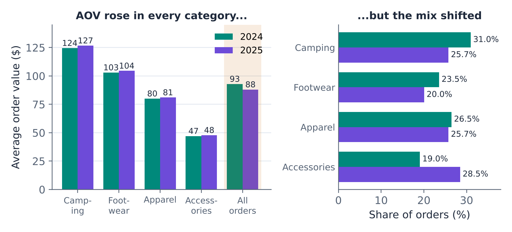{#fig-mix fig-alt="Left panel: grouped bars of average order value by category for 2024 and 2025. Each category is slightly higher in 2025: Camping 124 to 127, Footwear 103 to 104, Apparel 80 to 81, Accessories 47 to 48 dollars. The All orders bars fall from 93 to 88 dollars. Right panel: share of orders by category. Camping falls from 31.0 to 25.7 percent, Footwear from 23.5 to 20.0, Apparel from 26.5 to 25.7, and Accessories rises from 19.0 to 28.5 percent."}

::: {.callout-note title="Definition — Mix effect and Simpson's paradox"}
A **mix effect** is a change in an overall average or rate caused by a shift in the composition of the groups rather than by a change within any group. In its most striking form, **Simpson's paradox**, a trend that appears in every group reverses when the groups are combined.
:::

Simpson's paradox is the average-of-averages trap from Unit 3 seen from a different angle: whenever groups of different sizes are combined, the overall figure depends on both the group figures and the group sizes. Mix effects are everywhere in business: a hospital's average length of stay depends on its mix of patients, a bank's default rate on its mix of loans, a company's average salary on its mix of junior and senior staff. Before concluding that "performance got worse," a diagnostic analyst checks whether the mix changed.

### From drill-down to hypothesis

The drill-down has located the source of the problem: more, smaller orders, especially accessories. It has not explained *why* customers began placing more small orders. Here management knowledge comes in. In January 2025, Brazos lowered its free-shipping threshold from \$75 to \$49. A plausible hypothesis is that the lower threshold encouraged customers to place separate small orders instead of combining items into one larger order.

Plausible is not proven. Other things also changed in 2025: new products, competitors' prices, the economy. A drill-down generates hypotheses; it does not confirm them. Section 4.9 shows how Brazos tested this one directly.

::: {.callout-note .excel icon=false title="In Excel — Drilling down with PivotTables"}
1. Build a PivotTable with the summary you want to explain, for example *Sum of Shipping cost* and *Count of Order ID* by *Year*.
2. **Drill down by adding a field**: drag *Category* (or *Region*, *Carrier*, *Month*) into **Rows** below *Year*. Use the **+/−** buttons, or right-click › **Expand/Collapse**, to move between levels.
3. **Drill through to the records**: double-click any value cell. Excel opens a new sheet listing every row behind that number (**Show Details**).
4. **Filter interactively** with **Insert › Slicer** to compare segments side by side.
5. For ratios such as cost per order or AOV, compute them from the totals (sum ÷ count) in cells next to the PivotTable, or with a calculated field, rather than averaging ratios (Unit 3's average-of-averages trap).
:::

## 4.3 Anomalies and Outliers

The second core activity of diagnostic analysis is looking for observations that do not fit: a transaction that is unusually large, an invoice that appears twice, a shipment the carrier billed that Brazos never sent, a set of numbers whose digits look wrong.

::: {.callout-note title="Definition — Anomaly and outlier"}
An **anomaly** is anything that departs from what was expected: a record, a pattern, or a result. An **outlier** is an individual observation that lies far from the rest of the data. An outlier may be an error, a sign of fraud or of a process problem, or simply a genuine extreme value. Finding one is the start of an investigation, not the end.
:::

### Screening with z-scores

Unit 1 introduced the z-score, which measures how many standard deviations an observation lies from the mean:

$$
z = \frac{x - \bar{x}}{s}
$$

For data from a roughly normal distribution, only about 0.3% of observations lie more than 3 standard deviations from the mean, so a common screening rule flags any observation with $|z| > 3$. For Brazos's 120 sampled orders ($\bar{x}$ = \$102.44, $s$ = \$72.64), that cutoff is \$102.44 + 3 × \$72.64 = \$320.36, and three orders exceed it. The largest, \$367.91, has $z$ = 3.65.

### Screening with the IQR fences

The z-score rule has two weaknesses. It assumes a roughly normal shape, and the outliers it is looking for inflate the very mean and standard deviation used to find them. A more robust rule uses the quartiles, which extreme values barely affect. The **interquartile range** (IQR) is $Q_3 - Q_1$, and the **fences** are

$$
\text{lower fence} = Q_1 - 1.5 \times \text{IQR} \qquad \text{upper fence} = Q_3 + 1.5 \times \text{IQR}
$$

Observations outside the fences are flagged as potential outliers; these are the individual points drawn beyond the "whiskers" of a box plot. For the Brazos orders, $Q_1$ = \$53.69 and $Q_3$ = \$124.74, so the IQR is \$71.05 and the upper fence is \$231.32. Eight orders lie above it. (The lower fence is negative, so no order can fall below it.)

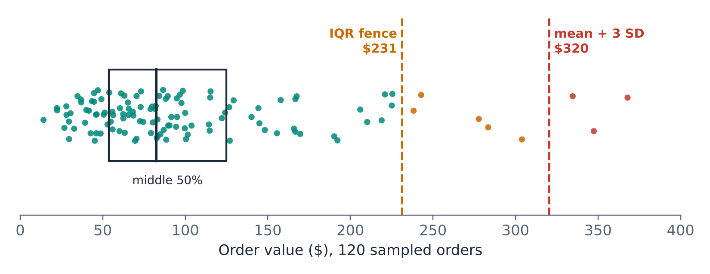{#fig-outliers fig-alt="Strip plot of 120 order values from 0 to 400 dollars with a box marking the middle 50 percent between about 54 and 125 dollars. A dashed line marks the IQR fence at 231 dollars and another marks the mean plus three standard deviations at 320 dollars. Five orders between the two lines are highlighted in amber and three orders above 320 dollars in red."}

@fig-outliers shows both screens. Should Brazos delete these eight orders? Certainly not without checking them. Order values are right-skewed (Unit 3 found a skewness of 1.64), and in skewed data large values are expected, not suspicious. A quick look at the eight orders shows that they are ordinary multi-item purchases (six to nine items each) of camping gear and footwear by real customers. They are extreme but genuine, and they belong in every total and average Brazos reports. (On a logarithmic scale, the order values are nearly symmetric and no order is more than 2.7 standard deviations from the mean, another sign that nothing unusual is going on.)

::: {.callout-warning title="Investigate outliers; don't automatically delete them"}
An outlier screen produces a list of observations to check, not a list to delete. Correct values that are clearly errors (a price entered as \$4,999 instead of \$49.99). Keep values that are genuine, even if extreme, and if they strongly affect a result, report the result with and without them. Deleting inconvenient data because it is "an outlier" is one of the easiest ways to reach a wrong conclusion.
:::

### Duplicates and reconciliations

Two simple anomaly checks find a surprising number of errors in transaction data.

A **duplicate check** looks for records that should be unique but appear more than once: the same vendor, invoice number, and amount paid twice; the same customer charged twice for one order. In Excel, `COUNTIFS` counts how many rows share the same key fields:

| Vendor | Invoice no. | Amount | Paid on | Count of vendor + invoice + amount |
|---|---|---|---|---|
| V-118 | 40211 | \$1,240.00 | Jul 2 | 1 |
| V-205 | 7781 | \$486.50 | Jul 4 | **2** |
| V-311 | 55-0918 | \$92.75 | Jul 8 | 1 |
| V-205 | 7781 | \$486.50 | Jul 19 | **2** |

A **reconciliation** compares two records of the same activity that should agree: the company's cash ledger and the bank statement, inventory records and a physical count, or a carrier's invoice and the company's own shipment log. Every tracking number on the carrier's bill should appear in Brazos's shipment log. A lookup that returns "not found" flags shipments Brazos is being billed for but has no record of sending, which could be a billing error, a data-entry gap, or something worse.

### Benford's law

Some anomalies are invisible in individual records and only show up in the pattern of many. A famous example concerns the **first digit** of numbers. Naively, one might expect the first digits 1 through 9 to be equally common. For many kinds of naturally occurring financial data, they are not: about 30% of numbers start with 1, and fewer than 5% start with 9.

::: {.callout-note title="Definition — Benford's law"}
**Benford's law** states that in many naturally occurring sets of numbers that span several orders of magnitude, the probability that the first digit is $d$ is
$$
P(d) = \log_{10}\left(1 + \frac{1}{d}\right), \qquad d = 1, 2, \ldots, 9
$$
:::

| First digit | 1 | 2 | 3 | 4 | 5 | 6 | 7 | 8 | 9 |
|---|---|---|---|---|---|---|---|---|---|
| Expected share | 30.1% | 17.6% | 12.5% | 9.7% | 7.9% | 6.7% | 5.8% | 5.1% | 4.6% |

The intuition: for a number to start with 2, it must first grow past all the numbers starting with 1. Moving from 100 to 200 requires doubling, while moving from 900 to 1,000 requires growing only 11%. Amounts that grow or vary multiplicatively spend much more "time" with a leading 1 than with a leading 9.

Benford's law applies well to invoice amounts, expense claims, transaction values, account balances, and populations, data that span several orders of magnitude and arise from many independent influences. It does not apply to assigned numbers (phone numbers, invoice IDs), to amounts with a narrow range (hourly wages, prices of a single product), or to amounts capped by policy. When data that should follow Benford's law do not, someone may have made up or manipulated numbers, because people inventing amounts tend to spread first digits too evenly.

Brazos's accounts-payable team paid 1,200 vendor invoices in the third quarter of 2026, ranging from about \$10 to more than \$50,000. @fig-benford compares their first digits with Benford's law.

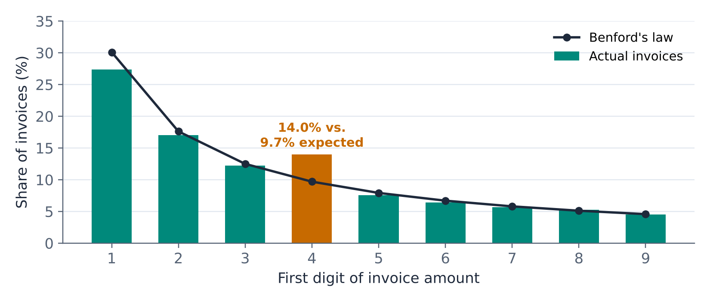{#fig-benford fig-alt="Bar chart of the share of invoices by first digit, 1 through 9, with a line showing Benford's expected shares. The bars follow the line closely except at digit 4, highlighted, where 14.0 percent of invoices start with 4 compared with 9.7 percent expected. Digit 1 is somewhat below the line, at 27.3 percent versus 30.1 percent."}

| First digit | 1 | 2 | 3 | 4 | 5 | 6 | 7 | 8 | 9 | Total |
|---|---|---|---|---|---|---|---|---|---|---|
| Invoices | 328 | 204 | 147 | 168 | 91 | 77 | 68 | 63 | 54 | 1,200 |
| Actual share | 27.3% | 17.0% | 12.3% | 14.0% | 7.6% | 6.4% | 5.7% | 5.3% | 4.5% | 100% |
| Benford share | 30.1% | 17.6% | 12.5% | 9.7% | 7.9% | 6.7% | 5.8% | 5.1% | 4.6% | 100% |

Most digits match closely, but 168 invoices start with a 4, where Benford's law would lead us to expect about 116. Drilling down into those invoices, the excess sits in a narrow band: dozens of invoices between \$450 and \$499.99. Brazos's policy requires a manager's approval for invoices of \$500 or more. A cluster just below an approval limit is a classic red flag: it may mean that some vendors or employees split purchases into smaller invoices to avoid review.

Two cautions apply. First, a departure from Benford's law is a reason to look closer, not evidence of fraud; there may be an innocent explanation, such as a vendor whose standard monthly fee happens to be \$475. Second, with only 1,200 invoices, the actual shares will never match Benford's exactly. Is 14.0% versus 9.7% a meaningful departure, or the kind of difference chance produces? Every diagnostic finding in this section ends with that question, and the rest of the chapter answers it. (For the invoices, the answer comes in Section 4.10.)

::: {.callout-note .excel icon=false title="In Excel — Anomaly screens"}
| Task | Formula (order values in G2:G121, invoices in D2:D1201) |
|---|---|
| z-score | `=STANDARDIZE(G2, AVERAGE(G$2:G$121), STDEV.S(G$2:G$121))` |
| Quartiles and IQR | `=QUARTILE.INC(G$2:G$121, 1)`, `=QUARTILE.INC(G$2:G$121, 3)`, then Q3 − Q1 |
| Upper fence | `=Q3 + 1.5*IQR`, then flag with `=IF(G2>fence, "check", "")` |
| Duplicate check | `=COUNTIFS(A:A, A2, B:B, B2, C:C, C2)` → anything above 1 is a duplicate |
| Reconciliation | `=IF(COUNTIF(Log!A:A, A2)=0, "not in log", "")` or `=XLOOKUP(A2, Log!A:A, Log!A:A, "not found")` |
| First digit | `=VALUE(LEFT(D2, 1))` (amounts of at least 1) |
| Benford share for digit *d* | `=LOG10(1 + 1/d)` |
| Count by first digit | `=COUNTIF(E$2:E$1201, d)` |

**Home › Conditional Formatting › Highlight Cells Rules › Duplicate Values** gives a quick visual duplicate check on a single column. **Insert › Chart › Box and Whisker** draws a box plot that marks points beyond the IQR fences.
:::

## 4.4 Signal or Noise? The Logic of Hypothesis Testing

### A question about returns

Over the past year, about 10% of Brazos's orders had a return. In the Q3 sample of 120 orders, 15 had a return, a rate of 12.5%. The operations manager wants to know: has the return rate gone up?

The question is harder than it looks. Unit 2 taught that sample statistics vary from sample to sample. Even if the return process had not changed at all, and the true rate were still 10%, a sample of 120 orders would not show exactly 12 returns every time. So the real question is: **if nothing had changed, how unusual would a sample like ours be?**

We can answer that by simulation. @fig-psim shows the return rates in 10,000 simulated samples of 120 orders, each drawn from a process with a true return rate of exactly 10%. The rates vary widely, from under 1% to over 20%. About 22% of the simulated samples showed a return rate of 12.5% or higher.

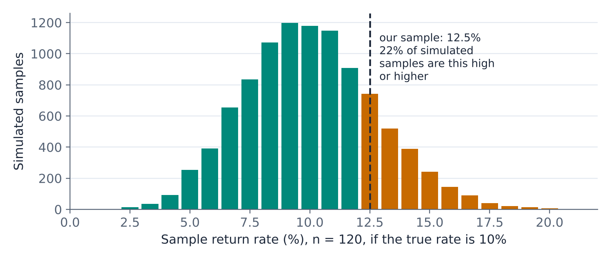{#fig-psim fig-alt="Histogram of sample return rates in 10,000 simulated samples of 120 orders when the true return rate is 10 percent. The distribution is centered near 10 percent and ranges from about 2 to 20 percent. A dashed line marks the observed 12.5 percent; the bars at and above it, highlighted, contain about 22 percent of the simulated samples."}

So a sample like ours is not unusual at all when nothing has changed: it would happen in more than one sample in five. The sample is consistent with a return rate that is still 10%. That does not prove that the rate has *not* gone up; it says that this sample does not provide convincing evidence that it has. This reasoning, made precise, is a hypothesis test.

### The hypotheses

::: {.callout-note title="Definition — Null and alternative hypotheses"}
The **null hypothesis** $H_0$ is the "nothing is going on" position: no change, no difference, no effect, the claim or standard holds. It always states a specific value for a parameter. The **alternative hypothesis** $H_1$ (or $H_a$) is what we suspect and want to find evidence for: a change, a difference, an effect.
:::

For the returns question,

$$
H_0: p = 0.10 \qquad\qquad H_1: p > 0.10
$$

A hypothesis test works like a criminal trial. The defendant (the null hypothesis) is presumed innocent. The prosecution (the analyst) presents evidence (the sample). The verdict is either "guilty," if the evidence is convincing beyond a reasonable doubt, or "not guilty," if it is not. "Not guilty" does not mean "innocent"; it means the evidence was not strong enough. In the same way, a test either **rejects** $H_0$ or **fails to reject** it. We never "accept" the null hypothesis, because a sample that fails to contradict it may simply be too small to do so.

### The test statistic and the p-value

To measure how far the sample is from what $H_0$ predicts, we use a **test statistic**. Most of the tests in this chapter have the same form as the z-scores of Unit 2:

$$
\text{test statistic} = \frac{\text{estimate} - \text{value under } H_0}{\text{standard error}}
$$

It counts how many standard errors the sample result lies from the value the null hypothesis claims. If $H_0$ is true, the test statistic follows a known distribution (the standard normal, a t distribution, a chi-square distribution, or an F distribution, depending on the test), and that distribution tells us how unusual our result is.

::: {.callout-note title="Definition — p-value"}
The **p-value** is the probability, calculated assuming the null hypothesis is true, of getting a test statistic at least as extreme as the one observed. A small p-value means the sample would be surprising if $H_0$ were true, which counts as evidence against $H_0$.
:::

For the returns question, the standard error under $H_0$ is $\sqrt{0.10 \times 0.90 / 120}$ = 0.0274, so the test statistic is $z$ = (0.125 − 0.10)/0.0274 = 0.91, and the p-value from the standard normal distribution is 0.18. The simulation gave 0.22; the small difference comes from using the normal approximation for a count as small as 15. Both say the same thing: a sample like ours is common when nothing has changed.

### The significance level and the decision

How small must a p-value be to reject $H_0$? The threshold is chosen in advance and is called the **significance level**, $\alpha$. The most common choice is $\alpha$ = 0.05, with 0.01 and 0.10 also widely used.

- If **p-value ≤ α**, reject $H_0$. The result is called **statistically significant** at level $\alpha$.
- If **p-value > α**, fail to reject $H_0$. The data are consistent with the null hypothesis.

An equivalent way to make the decision compares the test statistic with a **critical value**, the value that cuts off a tail of area $\alpha$. Rejecting when the statistic is beyond the critical value gives exactly the same decision as rejecting when the p-value is at most $\alpha$. Modern software reports p-values, which carry more information: a p-value of 0.049 and a p-value of 0.0001 are both "significant at 5%," but the second is far stronger evidence.

::: {.callout-tip title="Example — Is the bottling line filling low?"}
The filling machine from Units 2 and 3 targets 500 ml and has a well-documented standard deviation of $\sigma$ = 4 ml. An hourly sample of $n$ = 16 bottles has a mean of $\bar{x}$ = 497.9 ml. Is the machine off target?

1. **Hypotheses:** $H_0: \mu = 500$ against $H_1: \mu \ne 500$. A machine filling either too low or too high is a problem, so the alternative is two-sided.
2. **Significance level:** $\alpha$ = 0.05.
3. **Test statistic:** the standard error is $4/\sqrt{16}$ = 1 ml, so $z = (497.9 - 500)/1 = -2.10$.
4. **p-value:** the probability of a $z$ at least 2.10 away from zero in either direction is 2 × 0.0179 = **0.036** (@fig-pz).
5. **Decision and conclusion:** 0.036 ≤ 0.05, so reject $H_0$. The sample provides statistically significant evidence that the machine is not filling to the 500 ml target on average. It appears to be filling low.

At $\alpha$ = 0.01, by contrast, we would not reject: the evidence is moderately strong, not overwhelming.
:::

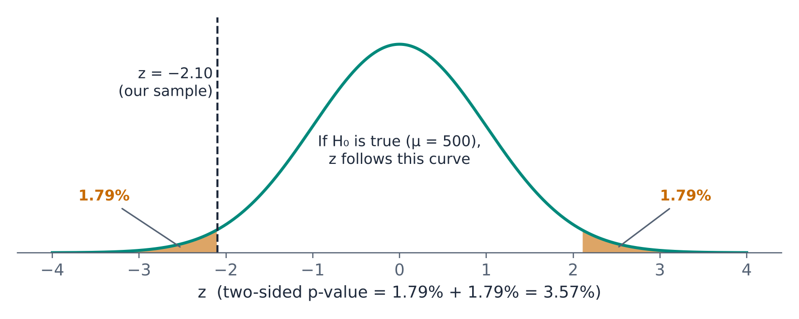{#fig-pz fig-alt="Standard normal curve labeled as the distribution of z if the null hypothesis that mu equals 500 is true. A dashed line marks the observed z of minus 2.10. Both tails beyond minus 2.10 and plus 2.10 are shaded and each labeled 1.79 percent, for a two-sided p-value of 3.57 percent."}

Every hypothesis test in this chapter follows the same five steps: state the hypotheses, choose $\alpha$, compute the test statistic, find the p-value, and state the decision **in the language of the business problem**. "Reject $H_0$" is not a conclusion a manager can use; "the machine is filling low" is.

### One-sided or two-sided?

The alternative hypothesis can take three forms:

| Alternative | Type | p-value is the area… | Use when |
|---|---|---|---|
| $H_1: \mu \ne \mu_0$ | Two-sided | in both tails beyond ±(statistic) | A departure in either direction matters, or the direction was not predicted |
| $H_1: \mu > \mu_0$ | One-sided (right) | to the right of the statistic | Only an increase matters, and the question was posed that way before seeing the data |
| $H_1: \mu < \mu_0$ | One-sided (left) | to the left of the statistic | Only a decrease matters, posed in advance |

For a symmetric distribution, the two-sided p-value is twice the one-sided p-value in the direction of the data. The choice must be made **before** looking at the data. Choosing a one-sided test after seeing which way the data point halves the p-value and makes the evidence look twice as strong as it is. When in doubt, use two-sided.

### Two kinds of error

A test can go wrong in two ways.

| | $H_0$ is actually true | $H_0$ is actually false |
|---|---|---|
| **Reject $H_0$** | **Type I error** (false alarm). Probability = $\alpha$ | Correct decision. Probability = **power** |
| **Fail to reject $H_0$** | Correct decision | **Type II error** (missed effect). Probability = $\beta$ |

::: {.callout-note title="Definition — Type I error, Type II error, and power"}
A **Type I error** rejects a null hypothesis that is true: a false alarm. Its probability is the significance level $\alpha$. A **Type II error** fails to reject a null hypothesis that is false: a missed effect. The **power** of a test is the probability that it correctly rejects a false null hypothesis, $1 - \beta$.
:::

The two errors trade off against each other. Lowering $\alpha$ makes false alarms rarer but makes real effects harder to detect. The right balance depends on the business consequences:

| Situation | Type I error (false alarm) | Type II error (missed effect) |
|---|---|---|
| Bottling line | Stop the line and recalibrate a machine that was fine | Keep underfilling bottles; risk fines and customer complaints |
| Fraud screen on invoices | Investigate an honest vendor | Miss a fraud |
| A/B test of a website change | Roll out a change that does nothing | Abandon a change that would have raised sales |

If a false alarm is cheap and a missed effect is expensive, a larger $\alpha$ such as 0.10 can be sensible; if a false alarm is very costly, use a smaller $\alpha$ such as 0.01. The only way to reduce *both* errors at once is to collect more data.

::: {.callout-warning title="What a p-value is not"}
- **It is not the probability that $H_0$ is true.** It is the probability of data like ours *if* $H_0$ is true. A p-value of 0.03 does not mean a 3% chance that the machine is on target.
- **It does not measure the size or importance of an effect.** A tiny effect can have a tiny p-value in a huge sample (Section 4.12).
- **A large p-value is not evidence that nothing happened.** It means the data could not distinguish the effect from noise, often because the sample was small.
- **0.05 is a convention, not a law of nature.** p = 0.049 and p = 0.051 represent practically the same evidence.
:::

## 4.5 Testing a Mean

When the process standard deviation is unknown, which is almost always, the test for a mean replaces $\sigma$ with $s$ and the standard normal with the t distribution, exactly as the confidence interval did in Unit 3.

::: {.callout-note title="Definition — One-sample t test"}
To test $H_0: \mu = \mu_0$, compute
$$
t = \frac{\bar{x} - \mu_0}{s/\sqrt{n}}
$$
and find the p-value from the t distribution with $n - 1$ degrees of freedom. The test requires a random sample from a normal process, or a sample large enough for the Central Limit Theorem to apply.
:::

::: {.callout-tip title="Example — Is the carrier meeting its contract?"}
Brazos's contract with its main carrier specifies an average delivery time of no more than 3.5 days. In the Q3 sample, the $n$ = 120 orders took $\bar{x}$ = 3.775 days on average, with $s$ = 1.267 days. Is the carrier in breach?

1. **Hypotheses:** $H_0: \mu = 3.5$ (the contract is met; strictly $\mu \le 3.5$) against $H_1: \mu > 3.5$. Brazos only has a complaint if deliveries are slower than promised, and the question was framed that way before the data were examined, so the test is one-sided.
2. **Significance level:** $\alpha$ = 0.05.
3. **Test statistic:** $SE = 1.267/\sqrt{120}$ = 0.1156 days, so $t$ = (3.775 − 3.5)/0.1156 = **2.38**, with 119 degrees of freedom.
4. **p-value:** the area to the right of 2.38 under the t distribution with 119 degrees of freedom is **0.0095** (@fig-pt). Equivalently, 2.38 exceeds the one-sided critical value of 1.658.
5. **Conclusion:** reject $H_0$. The sample provides strong evidence that the carrier's average delivery time exceeds the 3.5 days in the contract. If average delivery times really were 3.5 days, a sample mean as high as 3.775 would occur in fewer than 1 in 100 samples.
:::

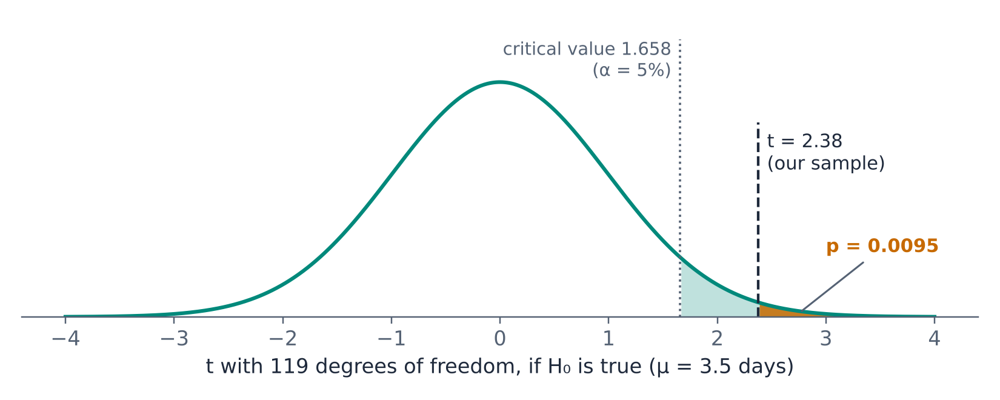{#fig-pt fig-alt="t distribution with 119 degrees of freedom, labeled as the distribution if the null hypothesis that mu equals 3.5 days is true. A dotted line marks the 5 percent critical value of 1.658, with the region to its right lightly shaded. A dashed line marks the observed t of 2.38; the small area to its right is shaded and labeled p equals 0.0095."}

Notice what the conclusion does and does not say. It says the average exceeds 3.5 days. It does not say by how much (the estimate, 3.775 days, and its confidence interval answer that), and it does not say why. Section 4.11 drills into the *why* by region.

Excel's Analysis ToolPak has no one-sample t test, but the calculation takes three cells.

::: {.callout-note .excel icon=false title="In Excel — One-sample t test"}
| Task | Formula | Delivery example |
|---|---|---|
| Test statistic | `=(AVERAGE(H2:H121)-3.5)/(STDEV.S(H2:H121)/SQRT(COUNT(H2:H121)))` | 2.378 |
| p-value, right tail ($H_1: \mu > \mu_0$) | `=T.DIST.RT(t, df)` | `=T.DIST.RT(2.378, 119)` → 0.0095 |
| p-value, left tail ($H_1: \mu < \mu_0$) | `=T.DIST(t, df, TRUE)` | |
| p-value, two-sided ($H_1: \mu \ne \mu_0$) | `=T.DIST.2T(ABS(t), df)` | `=T.DIST.2T(2.378, 119)` → 0.0190 |
| Critical value, one-sided | `=T.INV(1-alpha, df)` | `=T.INV(0.95, 119)` → 1.658 |
| Critical value, two-sided | `=T.INV.2T(alpha, df)` | `=T.INV.2T(0.05, 119)` → 1.980 |

`T.DIST.2T` requires a non-negative first argument, hence the `ABS`. For a z test with known $\sigma$, use `=NORM.S.DIST(z, TRUE)` for the left tail and `=1-NORM.S.DIST(z, TRUE)` for the right tail.
:::

### Tests and confidence intervals

Hypothesis tests and confidence intervals are built from the same sampling distribution, and they agree:

> A two-sided test at level $\alpha$ rejects $H_0: \mu = \mu_0$ exactly when $\mu_0$ lies outside the $(1 - \alpha)$ confidence interval.

Unit 3's intervals can therefore be read as tests:

| Question | 95% confidence interval | Hypothesized value | Inside? | Two-sided test at 5% |
|---|---|---|---|---|
| Bottling line on target? | 495.94 to 499.86 ml | 500 ml | No | Reject ($p$ = 0.036) |
| Average delivery 3.5 days? | 3.55 to 4.00 days | 3.5 days | No | Reject ($p$ = 0.019) |
| Return rate still 10%? | 6.6% to 18.4% | 10% | Yes | Fail to reject |

The interval carries more information than the test. The test answers a yes-or-no question about one value; the interval shows *every* value consistent with the data, and so shows how large the effect might be. Good practice reports both: the test to answer the question, and the interval to show the size of the answer.

### Power and sample size

How likely was the delivery test to detect a problem? That depends on how large the problem really is. With $n$ = 120 and $s$ = 1.27 days, the one-sided test at $\alpha$ = 0.05 has these chances of rejecting $H_0$:

| True average delivery time | 3.6 days | 3.7 days | 3.8 days | 3.9 days |
|---|---|---|---|---|
| Power (probability of rejecting $H_0$) | 22% | 53% | 83% | 96% |

A small breach of contract (3.6 days) would be missed most of the time; a large one would almost always be caught. Larger samples raise power, by the same square-root law that narrows confidence intervals. Planning a study means choosing a sample large enough to give good power for the smallest effect worth detecting.

## 4.6 Testing a Proportion

The test for a proportion follows Unit 2's result that the sample proportion $\hat{p}$ is approximately normal with standard error $\sqrt{p(1-p)/n}$. Under the null hypothesis, $p$ equals the hypothesized value $p_0$, so the standard error is calculated from $p_0$.

::: {.callout-note title="Definition — One-sample z test for a proportion"}
To test $H_0: p = p_0$, compute
$$
z = \frac{\hat{p} - p_0}{\sqrt{p_0\,(1-p_0)/n}}
$$
and find the p-value from the standard normal distribution. The test requires a random sample with $n p_0 \ge 10$ and $n(1-p_0) \ge 10$.
:::

Notice the one difference from the confidence interval of Unit 3: the interval uses $\hat{p}$ in the standard error because it has no hypothesized value, while the test uses $p_0$ because it asks what would happen if $H_0$ were true.

::: {.callout-tip title="Example — Has the return rate gone up?"}
1. **Hypotheses:** $H_0: p = 0.10$ against $H_1: p > 0.10$. Check: $n p_0$ = 12 and $n(1-p_0)$ = 108, both at least 10.
2. **Significance level:** $\alpha$ = 0.05.
3. **Test statistic:** $SE = \sqrt{0.10 \times 0.90/120}$ = 0.0274, so $z$ = (0.125 − 0.10)/0.0274 = **0.91**.
4. **p-value:** `=1-NORM.S.DIST(0.913, TRUE)` = **0.18**.
5. **Conclusion:** fail to reject $H_0$. The sample does not provide convincing evidence that the return rate has risen above 10%. The increase from 10% to 12.5% is well within the range that sampling variation produces.
:::

Should the operations manager conclude that returns are fine? Not quite. A sample of 120 orders contains little information about a rate near 10%. If the true return rate really had risen to 12.5%, this test would detect it only about 25% of the time. To have an 80% chance of detecting a rise from 10% to 12.5% at $\alpha$ = 0.05, Brazos would need a sample of about 950 orders. "No significant increase" in a small sample is weak reassurance; the right next step is more data.

### One-sample tests at a glance

| Parameter | $H_0$ | Test statistic | Distribution | Requires | Excel p-value |
|---|---|---|---|---|---|
| Mean, $\sigma$ known | $\mu = \mu_0$ | $z = \dfrac{\bar{x} - \mu_0}{\sigma/\sqrt{n}}$ | Standard normal | Normal process or large $n$ | `NORM.S.DIST` |
| Mean, $\sigma$ unknown | $\mu = \mu_0$ | $t = \dfrac{\bar{x} - \mu_0}{s/\sqrt{n}}$ | t, $n - 1$ df | Normal process or large $n$ | `T.DIST.RT`, `T.DIST.2T` |
| Proportion | $p = p_0$ | $z = \dfrac{\hat{p} - p_0}{\sqrt{p_0(1-p_0)/n}}$ | Standard normal | $np_0 \ge 10$, $n(1-p_0) \ge 10$ | `NORM.S.DIST` |

## 4.7 Comparing Two Means

Most diagnostic questions are comparisons: this region against that one, this quarter against last, customers who saw a promotion against those who did not. The rest of this chapter develops tests for comparisons, starting with the most common: comparing the means of two independent groups.

### Do West customers really spend more?

Unit 3's PivotTable showed an average order value of \$134.94 for the 25 sampled orders from the West, against \$83.45 for the 48 orders from the South, a gap of \$51.49. Unit 3's confidence intervals by region were wide, and comparing them by eye is unreliable. A two-sample test answers the question directly.

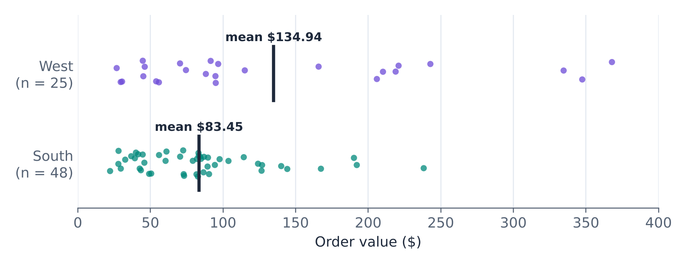{#fig-ws fig-alt="Strip plot of order values for 48 South orders and 25 West orders on a scale from 0 to 400 dollars. South orders cluster between about 25 and 150 dollars, with a mean of 83.45 dollars. West orders are more spread out, including three orders above 330 dollars, with a mean of 134.94 dollars."}

The hypotheses are $H_0: \mu_W - \mu_S = 0$ and $H_1: \mu_W - \mu_S \ne 0$. The test statistic compares the difference in sample means with its standard error. Because the two samples are independent, the variance of the difference is the sum of the two variances:

$$
t = \frac{\bar{x}_1 - \bar{x}_2}{\sqrt{\dfrac{s_1^2}{n_1} + \dfrac{s_2^2}{n_2}}}
$$

::: {.callout-note title="Definition — Two-sample t test (unequal variances)"}
The **two-sample t test** compares the means of two independent groups. The version that does not assume equal variances, often called **Welch's t test**, uses the statistic above and a t distribution whose degrees of freedom are calculated from the two sample sizes and variances. It requires independent random samples from normal processes, or samples large enough for the Central Limit Theorem.
:::

The degrees-of-freedom formula is cumbersome, and Excel calculates it for you. It always lies between the smaller sample size minus 1 and $n_1 + n_2 - 2$.

### Reading the ToolPak output

The Analysis ToolPak's **t-Test: Two-Sample Assuming Unequal Variances** produces this output for the West and South order values:

| | West | South | What it tells us |
|---|---|---|---|
| Mean | 134.9412 | 83.4535 | The two sample means; the difference is \$51.49. |
| Variance | 11027.1163 | 2176.0013 | Sample variances: standard deviations of \$105.01 and \$46.65. |
| Observations | 25 | 48 | Sample sizes. |
| Hypothesized Mean Difference | 0 | | The difference under $H_0$. |
| df | 29 | | Degrees of freedom (rounded). |
| t Stat | 2.3345 | | (134.94 − 83.45)/22.05: the gap is 2.33 standard errors. |
| P(T<=t) one-tail | 0.0134 | | One-sided p-value, in the direction of the data. |
| t Critical one-tail | 1.6991 | | One-sided critical value at the chosen $\alpha$. |
| P(T<=t) two-tail | 0.0267 | | **Two-sided p-value.** |
| t Critical two-tail | 2.0452 | | Two-sided critical value. |

The standard error of the difference is $\sqrt{11027.12/25 + 2176.00/48}$ = \$22.05, so the gap of \$51.49 is 2.33 standard errors. The two-sided p-value is 0.027. At $\alpha$ = 0.05, we reject $H_0$: the difference in average order value between the West and the South is statistically significant.

A confidence interval for the difference shows its size:

$$
(\bar{x}_W - \bar{x}_S) \pm t^{*} \times SE = 51.49 \pm 2.045 \times 22.05 = \$6.38 \text{ to } \$96.59
$$

The interval excludes zero, consistent with the test, but it is very wide. The data are consistent with West orders being larger by as little as \$6 or as much as \$97. Before reading too much into this result, look at @fig-ws again: the three largest orders in the entire sample, all above \$330, came from the West. Without them, the West average would be \$105.62. Section 4.12 returns to this comparison, because it raises two of the most important cautions about hypothesis tests.

### Equal or unequal variances?

The ToolPak also offers **t-Test: Two-Sample Assuming Equal Variances**, which pools the two sample variances into one estimate. When the variances really are similar, the two tests give nearly identical results. When they differ, and especially when the smaller sample has the larger variance, as here, the pooled test can be badly misleading: for West versus South it reports a p-value of 0.005, more than five times smaller than the correct 0.027. The unequal-variances version is safe whether or not the variances are equal, so use it by default.

::: {.callout-note .excel icon=false title="In Excel — Comparing two means"}
**Analysis ToolPak:** **Data › Data Analysis › t-Test: Two-Sample Assuming Unequal Variances**. Enter the two groups' data as *Variable 1 Range* and *Variable 2 Range* (each group in its own column; sort or filter the data to separate them), set *Hypothesized Mean Difference* to 0, tick *Labels* if you included headers, and set *Alpha*. The output is static, like all ToolPak output.

**Worksheet function:** `=T.TEST(array1, array2, tails, type)` returns the p-value directly. Use `tails` = 2 for a two-sided test, and `type` = 3 for unequal variances (2 = equal variances, 1 = paired). For the regions: `=T.TEST(West, South, 2, 3)` → 0.0267.
:::

## 4.8 Paired Samples

Sometimes the two sets of measurements are not independent but come in natural pairs: the same employees before and after training, the same stores this year and last year, the same products priced by two suppliers. Pairs call for a different, and usually far more powerful, test.

### Did the new packing procedure work?

Brazos's warehouse redesigned its packing procedure. To evaluate it, 12 packers each worked one shift with the old procedure and one with the new, in random order, and the average packing time per order was recorded for each shift:

| Packer | 1 | 2 | 3 | 4 | 5 | 6 | 7 | 8 | 9 | 10 | 11 | 12 | Mean |
|---|---|---|---|---|---|---|---|---|---|---|---|---|---|
| Old procedure (min) | 7.1 | 5.5 | 6.4 | 6.8 | 6.8 | 5.7 | 6.0 | 6.6 | 5.3 | 7.4 | 7.3 | 7.2 | 6.508 |
| New procedure (min) | 6.4 | 4.9 | 5.8 | 5.5 | 6.4 | 5.6 | 5.4 | 6.9 | 4.9 | 6.5 | 7.1 | 6.4 | 5.983 |
| Time saved (min) | 0.7 | 0.6 | 0.6 | 1.3 | 0.4 | 0.1 | 0.6 | −0.3 | 0.4 | 0.9 | 0.2 | 0.8 | 0.525 |

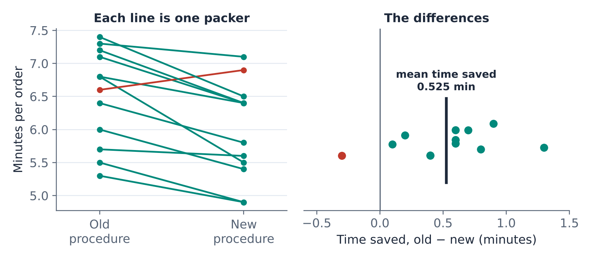{#fig-paired fig-alt="Left panel: a slope chart with one line per packer from the old procedure to the new procedure, on a scale of about 5 to 7.5 minutes per order. Eleven lines slope downward; one, highlighted in red, slopes upward from 6.6 to 6.9 minutes. Right panel: the twelve differences, time saved equals old minus new, plotted on a line from minus 0.6 to 1.5 minutes. Eleven are positive and one is negative; a bar marks the mean time saved of 0.525 minutes."}

The packers differ a lot from each other: the fastest averages about 5.3 minutes per order and the slowest about 7.4. That variation has nothing to do with the procedure, and it would swamp the effect of the procedure in a comparison of two independent groups. Pairing removes it. Instead of comparing two groups, we compute each packer's **difference** and ask whether the average difference is zero. The paired test is simply a one-sample t test on the differences.

::: {.callout-note title="Definition — Paired t test"}
For $n$ pairs with differences $d_i$, mean difference $\bar{d}$, and standard deviation of the differences $s_d$, the **paired t test** of $H_0: \mu_d = 0$ uses
$$
t = \frac{\bar{d}}{s_d/\sqrt{n}}
$$
with $n - 1$ degrees of freedom.
:::

::: {.callout-tip title="Example — The packing study"}
1. **Hypotheses:** $H_0: \mu_d = 0$ against $H_1: \mu_d \ne 0$, where $d$ = old − new.
2. **Test statistic:** $\bar{d}$ = 0.525 minutes and $s_d$ = 0.411, so $SE$ = 0.411/$\sqrt{12}$ = 0.119 and $t$ = 0.525/0.119 = **4.42**, with 11 degrees of freedom.
3. **p-value:** `=T.DIST.2T(4.42, 11)` = **0.001**.
4. **Conclusion:** reject $H_0$. The new procedure reduces packing time, by an estimated 0.525 minutes per order (95% CI: 0.26 to 0.79 minutes). Eleven of the twelve packers were faster with it.
:::

The ToolPak's **t-Test: Paired Two Sample for Means** gives the same result. With *Old* as Variable 1 and *New* as Variable 2:

| | Old | New |
|---|---|---|
| Mean | 6.5083 | 5.9833 |
| Variance | 0.5299 | 0.5433 |
| Observations | 12 | 12 |
| Pearson Correlation | 0.8423 | |
| Hypothesized Mean Difference | 0 | |
| df | 11 | |
| t Stat | 4.4198 | |
| P(T<=t) one-tail | 0.0005 | |
| t Critical one-tail | 1.7959 | |
| P(T<=t) two-tail | 0.0010 | |
| t Critical two-tail | 2.2010 | |

The *Pearson Correlation* line, 0.84, shows why pairing matters: packers who were fast under the old procedure were fast under the new one too.

::: {.callout-warning title="Analyze paired data as pairs"}
Had we wrongly treated the old and new times as two independent groups, the two-sample test would have reported $t$ = 1.76 and a p-value of 0.093, not significant at 5%. Same data, opposite conclusion. The independent-samples test compares the 0.525-minute improvement with the large differences *between* packers; the paired test compares it with the much smaller variation in each packer's *improvement*. Whenever the same units are measured twice, or units are deliberately matched, use the paired test.
:::

Pairing is also a design choice. Testing the new procedure on 12 packers with both procedures gave a clear answer. Testing it on 12 different packers who used only the new procedure, compared with 12 who used only the old, would have needed a much larger study to reach the same certainty.

::: {.callout-note .excel icon=false title="In Excel — Paired t test"}
**Analysis ToolPak:** **Data › Data Analysis › t-Test: Paired Two Sample for Means**. The two ranges must have the same number of rows, with each row one pair. The ToolPak computes Variable 1 − Variable 2.

**Worksheet function:** `=T.TEST(old_range, new_range, 2, 1)` → 0.0010 (two-sided, paired).

**By hand:** compute a column of differences, then run a one-sample t test on it: `=AVERAGE(D2:D13)/(STDEV.S(D2:D13)/SQRT(12))` → 4.42.
:::

## 4.9 Comparing Two Proportions

### Did returns really go up from Q2 to Q3?

Brazos's Q2 sample of 120 orders had 10 returns (8.3%); the Q3 sample had 15 (12.5%). The test for two proportions compares the difference $\hat{p}_2 - \hat{p}_1$ with its standard error. Under $H_0: p_1 = p_2$, both samples come from a process with the same rate, so the best estimate of that common rate pools the two samples:

$$
\hat{p} = \frac{x_1 + x_2}{n_1 + n_2} \qquad\quad z = \frac{\hat{p}_2 - \hat{p}_1}{\sqrt{\hat{p}\,(1-\hat{p})\left(\dfrac{1}{n_1} + \dfrac{1}{n_2}\right)}}
$$

::: {.callout-note title="Definition — Two-proportion z test"}
The **two-proportion z test** compares the proportions of "successes" in two independent samples, using the pooled proportion $\hat{p}$ in the standard error and the standard normal distribution for the p-value. It requires at least about 10 successes and 10 failures in each sample.
:::

For the returns, the pooled rate is 25/240 = 0.1042, the standard error is $\sqrt{0.1042 \times 0.8958 \times (1/120 + 1/120)}$ = 0.0394, and $z$ = (0.125 − 0.0833)/0.0394 = 1.06. The two-sided p-value is **0.29**. There is no evidence that the return rate changed between the quarters; a jump from 8.3% to 12.5% in samples of 120 is entirely consistent with noise. A 95% confidence interval for the change runs from −3.5 to +11.9 percentage points, which says that the data cannot even tell whether returns went up or down. (The Q2 sample has exactly 10 returns, right at the edge of the condition, which is one more reason to treat this comparison as rough.)

### An experiment: the free-shipping threshold

Section 4.2's drill-down produced a hypothesis: lowering the free-shipping threshold from \$75 to \$49 led customers to place more, smaller orders. Comparing 2024 with 2025 cannot confirm it, because too many other things changed between the years. So in October 2026, Brazos ran an **A/B test**. For two weeks, each visitor to the website was randomly assigned to see either the old \$75 threshold (version A) or the current \$49 threshold (version B).

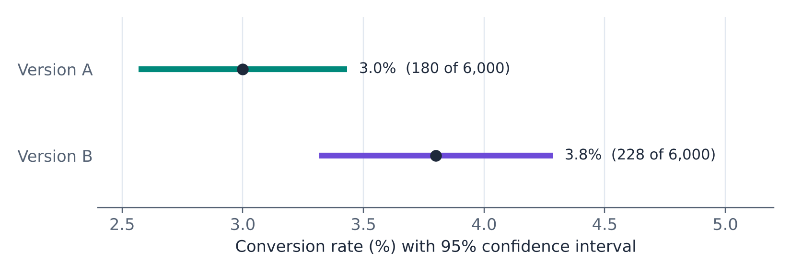{#fig-ab fig-alt="Two horizontal confidence intervals. Version A: conversion rate 3.0 percent, 180 of 6,000 sessions, interval from about 2.6 to 3.4 percent. Version B: 3.8 percent, 228 of 6,000 sessions, interval from about 3.3 to 4.3 percent."}

| | Version A (\$75 threshold) | Version B (\$49 threshold) |
|---|---|---|
| Sessions | 6,000 | 6,000 |
| Orders | 180 | 228 |
| Conversion rate | 3.0% | 3.8% |
| Orders under \$50 | 25 of 180 (13.9%) | 71 of 228 (31.1%) |

::: {.callout-tip title="Example — Does the lower threshold raise conversion?"}
1. **Hypotheses:** $H_0: p_A = p_B$ against $H_1: p_A \ne p_B$.
2. **Pooled proportion:** $\hat{p}$ = (180 + 228)/12,000 = 0.034.
3. **Test statistic:** $SE = \sqrt{0.034 \times 0.966 \times (1/6000 + 1/6000)}$ = 0.00331, so $z$ = (0.038 − 0.030)/0.00331 = **2.42**.
4. **p-value:** `=2*(1-NORM.S.DIST(2.42, TRUE))` = **0.016**.
5. **Conclusion:** reject $H_0$. The \$49 threshold raises the conversion rate, from 3.0% to 3.8% (95% CI for the increase: 0.15 to 1.45 percentage points).
:::

The share of orders under \$50 tells the rest of the story: 31.1% under the \$49 threshold against 13.9% under the \$75 threshold, a difference with $z$ = 4.08 and a p-value below 0.0001. The lower threshold brings in more orders, and it makes them smaller, just as the drill-down suggested.

Because visitors were assigned to the two versions *at random*, the two groups differ in nothing except the threshold, apart from chance, and the test accounts for chance. That is what allows a causal conclusion here: the threshold *caused* the difference. Section 4.12 explains why the West-versus-South comparison allows no such conclusion. Whether the lower threshold is a good idea is yet another question: more orders mean more revenue, but smaller orders carry the same shipping cost. Weighing the two is a prescriptive question for Unit 6.

::: {.callout-note .excel icon=false title="In Excel — Comparing two proportions"}
The ToolPak has no test for proportions, but the calculation is short:

| Task | Formula | A/B example |
|---|---|---|
| Sample proportions | `=x1/n1`, `=x2/n2` | 0.030, 0.038 |
| Pooled proportion | `=(x1+x2)/(n1+n2)` | 0.034 |
| Standard error | `=SQRT(p*(1-p)*(1/n1+1/n2))` | 0.00331 |
| Test statistic | `=(p2-p1)/SE` | 2.42 |
| Two-sided p-value | `=2*(1-NORM.S.DIST(ABS(z), TRUE))` | 0.016 |
:::

## 4.10 Chi-Square Tests for Categorical Data

The tests so far compare numbers: means and proportions. Diagnostic questions often involve categorical variables with more than two categories: Is lateness related to which carrier handled the shipment? Do the first digits of the invoices follow Benford's law? The **chi-square tests** answer such questions by comparing observed counts with the counts we would expect if the null hypothesis were true.

### Is on-time delivery related to the carrier?

Brazos ships with three carriers. Of 1,000 shipments in September 2026, 867 (86.7%) arrived by the promised date. By carrier:

| Carrier | On time | Late | Total | On-time rate |
|---|---|---|---|---|
| A | 382 | 38 | 420 | 91.0% |
| B | 261 | 39 | 300 | 87.0% |
| C | 224 | 56 | 280 | 80.0% |
| **Total** | **867** | **133** | **1,000** | **86.7%** |

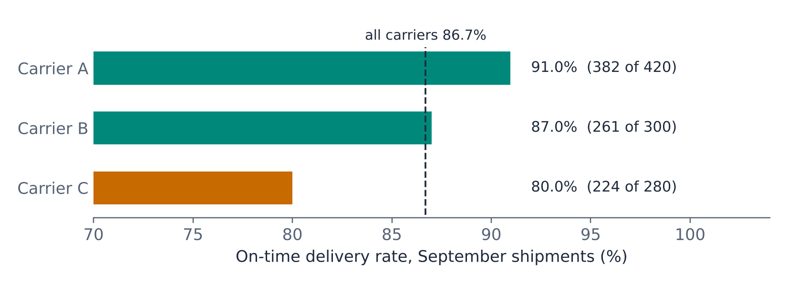{#fig-carriers fig-alt="Horizontal bar chart of on-time delivery rates: Carrier A 91.0 percent, 382 of 420; Carrier B 87.0 percent, 261 of 300; Carrier C 80.0 percent, 224 of 280, highlighted. A dashed line marks the overall rate of 86.7 percent."}

The null hypothesis is that on-time delivery is **independent** of the carrier: all three have the same on-time rate, and the differences in the table are due to chance. If $H_0$ were true, each carrier would deliver 86.7% of its shipments on time, so the **expected count** in each cell is

$$
\text{expected count} = \frac{\text{row total} \times \text{column total}}{\text{grand total}}
$$

For Carrier A, the expected number on time is 420 × 867/1,000 = 364.14, and the expected number late is 420 × 133/1,000 = 55.86. The **chi-square statistic** adds up the squared gaps between observed ($O$) and expected ($E$) counts, each scaled by the expected count:

$$
\chi^2 = \sum \frac{(O - E)^2}{E}
$$

| Carrier | Observed on time | Expected on time | Observed late | Expected late | Contribution to $\chi^2$ |
|---|---|---|---|---|---|
| A | 382 | 364.14 | 38 | 55.86 | 0.876 + 5.710 |
| B | 261 | 260.10 | 39 | 39.90 | 0.003 + 0.020 |
| C | 224 | 242.76 | 56 | 37.24 | 1.450 + 9.451 |

The total is $\chi^2$ = **17.51**. If $H_0$ is true, this statistic follows a chi-square distribution with $(r-1)(c-1)$ degrees of freedom, where $r$ and $c$ are the numbers of rows and columns: here (3 − 1)(2 − 1) = 2. The p-value, the area to the right of 17.51, is **0.0002**. We reject $H_0$: on-time performance differs among the carriers.

::: {.callout-note title="Definition — Chi-square test of independence"}
The **chi-square test of independence** tests whether two categorical variables are related, using a cross-tabulation of counts. It compares observed counts $O$ with the counts $E$ expected under independence, using $\chi^2 = \sum (O - E)^2 / E$ with $(r - 1)(c - 1)$ degrees of freedom. Large values of $\chi^2$, in the right tail, are evidence of a relationship. The test requires all expected counts to be at least 5.
:::

The contributions show *where* the relationship lies, which is the diagnostic payoff. The two largest contributions are Carrier C's late deliveries (56 observed against 37 expected) and Carrier A's late deliveries (38 against 56 expected). Carrier C delivers late far more often than the others, and Carrier A less often.

The chi-square test is always one-sided in this sense: any departure from independence, in any cell and any direction, makes $\chi^2$ larger.

### When the conditions fail

The expected-count condition rules out some tempting tests. Unit 3's cross-tabulation of product category by returns had only 15 returns among 120 orders. The expected numbers of returns in the four categories are 2.75, 4.25, 4.12, and 3.88, all below 5, so a chi-square test of whether returns depend on category would be unreliable. As with the confidence interval for accessories returns in Unit 3, the remedy is more data.

### Goodness of fit: do the invoices follow Benford's law?

A second chi-square test compares the counts in a single categorical variable with the counts predicted by a theory. For the 1,200 invoices of Section 4.3, $H_0$ is that the first digits follow Benford's law. The expected count for digit $d$ is 1,200 × $\log_{10}(1 + 1/d)$:

| First digit | 1 | 2 | 3 | 4 | 5 | 6 | 7 | 8 | 9 |
|---|---|---|---|---|---|---|---|---|---|
| Observed | 328 | 204 | 147 | 168 | 91 | 77 | 68 | 63 | 54 |
| Expected | 361.2 | 211.3 | 149.9 | 116.3 | 95.0 | 80.3 | 69.6 | 61.4 | 54.9 |
| $(O-E)^2/E$ | 3.06 | 0.25 | 0.06 | 22.99 | 0.17 | 0.14 | 0.04 | 0.04 | 0.02 |

::: {.callout-note title="Definition — Chi-square goodness-of-fit test"}
The **chi-square goodness-of-fit test** tests whether the counts in the categories of one variable match the proportions specified by $H_0$. It uses $\chi^2 = \sum (O - E)^2 / E$ with $k - 1$ degrees of freedom, where $k$ is the number of categories, and requires all expected counts to be at least 5.
:::

The statistic is $\chi^2$ = 26.76 with 9 − 1 = 8 degrees of freedom, and the p-value is **0.0008**. The departure from Benford's law is far larger than chance would produce, and nearly all of it comes from the digit 4. The auditors' next step is to pull the invoices between \$450 and \$500 and look at who submitted them and to which vendors they were paid.

::: {.callout-note .excel icon=false title="In Excel — Chi-square tests"}
| Task | Formula | Example |
|---|---|---|
| Expected count (independence) | `=row_total*column_total/grand_total`, e.g. `=$D2*B$5/$D$5` | 364.14 |
| p-value from observed and expected tables | `=CHISQ.TEST(observed_range, expected_range)` | carriers → 0.00016 |
| Chi-square statistic | `=SUMPRODUCT((O-E)^2/E)` over the two ranges | 17.51 |
| p-value from the statistic | `=CHISQ.DIST.RT(chi2, df)` | `=CHISQ.DIST.RT(17.51, 2)` → 0.00016 |
| Critical value | `=CHISQ.INV.RT(alpha, df)` | `=CHISQ.INV.RT(0.05, 2)` → 5.991 |

`CHISQ.TEST` works out the degrees of freedom from the shape of the table, $(r-1)(c-1)$. For a goodness-of-fit test arranged in a single row or column it uses $k - 1$, which is correct for Benford's law: `=CHISQ.TEST(observed, expected)` → 0.0008. The ToolPak has no chi-square tool; the functions above are the way to do it.
:::

## 4.11 Comparing Several Means: One-Way ANOVA

The delivery test of Section 4.5 found that Brazos's average delivery time exceeds the contract's 3.5 days. Drilling down by region suggests that the problem is not spread evenly:

| Region | Orders | Mean delivery days | Std. dev. |
|---|---|---|---|
| Midwest | 25 | 3.88 | 1.13 |
| Northeast | 22 | 4.23 | 1.19 |
| South | 48 | 3.25 | 1.28 |
| West | 25 | 4.28 | 1.10 |

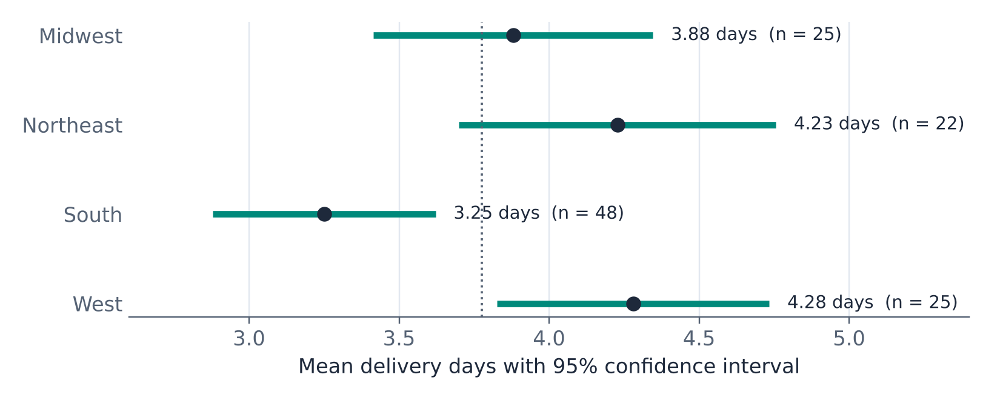{#fig-anova fig-alt="Four horizontal confidence intervals for mean delivery days: Midwest 3.88 days, n equals 25; Northeast 4.23 days, n equals 22; South 3.25 days, n equals 48; West 4.28 days, n equals 25. A dotted line marks the overall mean of 3.78 days. The South interval lies to the left of the West and Northeast intervals."}

Are the regions really different? With four regions there are six possible pairs, and testing each pair at $\alpha$ = 0.05 would give an overall chance of at least one false alarm much higher than 5% (Section 4.12 explains why). **Analysis of variance** (ANOVA) instead tests all the groups at once, with $H_0: \mu_1 = \mu_2 = \mu_3 = \mu_4$ against $H_1$: at least one mean differs.

The idea is to compare two kinds of variation. If the regions' true means were all equal, the variation *between* the region means would be no larger than what the variation *within* regions leads us to expect from sampling. The **F statistic** is the ratio of the two:

$$
F = \frac{\text{variation between group means}}{\text{variation within groups}} = \frac{MS_{\text{between}}}{MS_{\text{within}}}
$$

Values near 1 are consistent with $H_0$; large values are evidence that the means differ. The ToolPak's **Anova: Single Factor** reports:

| Source of Variation | SS | df | MS | F | P-value | F crit |
|---|---|---|---|---|---|---|
| Between Groups | 24.381 | 3 | 8.127 | 5.661 | 0.0012 | 2.683 |
| Within Groups | 166.544 | 116 | 1.436 | | | |
| Total | 190.925 | 119 | | | | |

*SS* are sums of squared deviations, *df* their degrees of freedom (number of groups − 1 between, number of observations − number of groups within), and *MS* = SS/df. The F statistic is 8.127/1.436 = 5.66, well above the critical value of 2.68, with a p-value of 0.0012. Delivery times differ significantly among the regions.

::: {.callout-note title="Definition — One-way ANOVA"}
**One-way analysis of variance** tests whether the means of three or more independent groups are all equal. It compares the variation between group means with the variation within groups using the F statistic. It requires independent random samples from normal processes with similar standard deviations (a common rule of thumb: the largest group standard deviation no more than twice the smallest).
:::

The regional standard deviations range only from 1.10 to 1.28, so the equal-spread condition is comfortably met. ANOVA says that the regions differ, but not which ones. @fig-anova suggests the answer: deliveries to the South are about a day faster than deliveries to the West and Northeast. Formal follow-up comparisons exist but are beyond this course; looking at the group means and their confidence intervals, as in the figure, is a sensible start. Combined with the carrier finding of Section 4.10, a diagnosis is taking shape for the operations team: which carriers serve the slow regions?

::: {.callout-note .excel icon=false title="In Excel — One-way ANOVA"}
**Data › Data Analysis › Anova: Single Factor**. The input range must have one column per group (*Grouped By: Columns*), so first arrange the data that way: sort by region and copy each region's values into its own column, or use `=FILTER(H2:H121, C2:C121="West")` in Excel 365. Tick *Labels in first row* if you included the region names. The output has a SUMMARY table (count, sum, average, and variance for each group) and the ANOVA table above.
:::

## 4.12 Using Hypothesis Tests Well

Hypothesis tests are powerful, and easy to misuse. Four principles separate good diagnostic practice from bad.

### Statistical significance is not practical significance

"Statistically significant" means only that an effect is unlikely to be pure chance. It says nothing about whether the effect is large enough to matter. With enough data, even trivial effects become significant. Suppose a large retailer runs an A/B test with 500,000 sessions per version and finds conversion rates of 3.00% and 3.08%. The test statistic is $z$ = 2.33 and the p-value is 0.020: significant at 5%. But the difference is 0.08 percentage points. Whether that is worth anything depends on the cost of the change and the value of a conversion, questions the p-value cannot answer.

The reverse also holds: a small study can miss a large, important effect (Section 4.6). The remedy for both is the same: **always report the estimated effect and its confidence interval**, not just the p-value. "The \$49 threshold raised conversion from 3.0% to 3.8% (95% CI for the increase: 0.15 to 1.45 points; $p$ = 0.016)" tells a manager everything the test does, and much more.

### Many tests, many false alarms

Each test at $\alpha$ = 0.05 has a 5% chance of a false alarm when $H_0$ is true. Run many tests, and false alarms become nearly certain. If a marketing team tests 20 website changes that in truth do nothing, the probability that at least one comes out "significant" is $1 - 0.95^{20}$ = 64%. Slice data into enough segments, and some segment will always show a "significant" difference.

::: {.callout-note title="Definition — Multiple comparisons"}
The **multiple comparisons problem** is the increase in the chance of at least one false alarm when many hypothesis tests are performed. Searching data for any significant result and reporting only what was found (sometimes called **data dredging** or **p-hacking**) produces findings that often fail to hold up in new data.
:::

Now reconsider West versus South. Unit 3's PivotTable showed four regions; the question "do West customers spend more than Southern ones?" arose because, *after looking at the data*, these were the highest and lowest averages. There are six pairs of regions, and we tested the pair with the largest gap. If the six comparisons had been planned in advance, a simple and conservative correction, the **Bonferroni correction**, would test each at $\alpha$ = 0.05/6 = 0.0083. The West-South p-value of 0.027 does not pass that bar. Add the fact that the gap rests heavily on three very large orders, and the honest conclusion is: the West-South difference is a promising exploratory finding, not a confirmed one. The way to confirm it is to state the hypothesis now and test it on next quarter's sample.

This is the exploratory-confirmatory distinction from Unit 3 at work. A hypothesis suggested by a set of data must be tested on different data.

### Significance is not causation

Suppose next quarter's sample confirms that West orders are larger. Does that mean West customers spend more *because they live in the West*, so that marketing in the West is more valuable? Not necessarily. Look at what the West's customers buy: in the Q3 sample, 40% of West orders were for camping gear (Brazos's most expensive category, averaging \$140 per order), against 17% of South orders, while accessories (averaging \$44) made up 25% of South orders but only 16% of West orders. The regional difference may be largely a product-mix difference, the same kind of mix effect as in Section 4.2.

::: {.callout-note title="Definition — Confounding variable"}
A **confounding variable** is a variable related both to the groups being compared and to the outcome, so that it can create or hide a difference between the groups. Product mix is a potential confounder in the West-South comparison.
:::

A hypothesis test can tell us that two groups differ by more than chance. It cannot tell us *why*, unless the groups were formed by random assignment. This is the key distinction:

- In an **observational comparison** (regions, customer types, stores that chose to remodel), the groups may differ in many ways besides the one we are interested in. A significant difference is a lead to investigate, not a proven cause.
- In a **randomized experiment** (the A/B test, the packing study with its randomized order), chance alone decides who gets which treatment, so the groups are alike in everything else. A significant difference can then be attributed to the treatment.

This is why A/B tests have become standard practice in e-commerce and marketing: they turn diagnostic hypotheses into causal answers. When experiments are impossible (we cannot randomly assign customers to regions), the next best tool is to measure the confounders and adjust for them. That is exactly what regression does, and it is the subject of Units 5 and 6.

### Choosing the right test

| Question | Data | Test | Excel |
|---|---|---|---|
| Does a mean differ from a target? | One numerical variable | One-sample t test | `T.DIST.RT`, `T.DIST.2T` |
| Does a proportion differ from a benchmark? | One yes/no variable | One-sample z test for a proportion | `NORM.S.DIST` |
| Do two independent groups have different means? | Numerical outcome, two groups | Two-sample t test (unequal variances) | ToolPak; `T.TEST(…, 2, 3)` |
| Did the same units change? | Numerical outcome, measured twice or matched | Paired t test | ToolPak; `T.TEST(…, 2, 1)` |
| Do two groups have different proportions? | Yes/no outcome, two groups | Two-proportion z test | `NORM.S.DIST` |
| Are two categorical variables related? | Cross-tabulation of counts | Chi-square test of independence | `CHISQ.TEST` |
| Do counts match a theory? | Counts in categories | Chi-square goodness-of-fit test | `CHISQ.TEST` |
| Do three or more groups have different means? | Numerical outcome, several groups | One-way ANOVA | ToolPak *Anova: Single Factor* |

### Reporting a test

A good report of a hypothesis test, written for a manager, contains the question, the estimate, its uncertainty, the p-value, and a conclusion in plain language, with any important caveat:

> *"On average, the carrier delivered orders in 3.78 days (95% CI: 3.55 to 4.00 days; n = 120), above the 3.5 days specified in the contract. A difference this large would be very unlikely if the carrier were meeting the contract (one-sided t test, p = 0.009). Delivery times differ significantly by region (ANOVA, p = 0.001), with the West and Northeast slowest."*

Diagnostic analysis explains what happened and tests whether the patterns are real. The next step is to use those relationships to predict, and that requires a tool that can describe how an outcome depends on several variables at once, while holding others, such as product mix, constant. That tool is regression, the subject of Unit 5.

## Key Terms

- **Alternative hypothesis ($H_1$):** The claim a test seeks evidence for: a change, a difference, or an effect.
- **Analysis of variance (ANOVA):** A test of whether three or more group means are equal, comparing variation between groups with variation within groups using the F statistic.
- **Anomaly:** Anything that departs from what was expected: a record, a pattern, or a result.
- **Benford's law:** The expected distribution of first digits in many naturally occurring numbers: $P(d) = \log_{10}(1 + 1/d)$, so about 30% start with 1 and under 5% with 9.
- **Chi-square test of independence:** A test of whether two categorical variables are related, comparing observed and expected counts in a cross-tabulation.
- **Chi-square goodness-of-fit test:** A test of whether counts in categories match the proportions specified by a theory.
- **Confounding variable:** A variable related to both the groups being compared and the outcome, which can create or hide a difference.
- **Critical value:** The value of a test statistic that cuts off a tail of area $\alpha$; rejecting beyond it is equivalent to rejecting when the p-value is at most $\alpha$.
- **Diagnostic analytics:** Analysis that investigates why something happened: locating the sources of change, finding anomalies, and testing whether patterns are real.
- **Drill-down analysis:** Examining a summary number at successively finer levels of detail to locate where a change comes from.
- **IQR fences:** $Q_1 - 1.5 \times \text{IQR}$ and $Q_3 + 1.5 \times \text{IQR}$; observations outside them are flagged as potential outliers.
- **Mix effect:** A change in an overall average or rate caused by a shift in the composition of groups rather than a change within groups.
- **Multiple comparisons problem:** The increased chance of at least one false alarm when many tests are performed.
- **Null hypothesis ($H_0$):** The "nothing is going on" position; it states a specific value for a parameter.
- **Outlier:** An observation that lies far from the rest of the data.
- **p-value:** The probability, assuming $H_0$ is true, of a test statistic at least as extreme as the one observed.
- **Paired t test:** A t test on the differences within matched pairs or repeated measurements of the same units.
- **Power:** The probability that a test rejects a false null hypothesis.
- **Randomized experiment (A/B test):** A study in which chance decides which units receive which treatment, so that a difference in outcomes can be attributed to the treatment.
- **Significance level ($\alpha$):** The threshold for rejecting $H_0$, chosen in advance; also the probability of a Type I error.
- **Simpson's paradox:** A trend that appears within every group but reverses when the groups are combined, because of a mix effect.
- **Statistically significant:** A result with a p-value at or below $\alpha$; unlikely to be due to chance alone, but not necessarily large or important.
- **Test statistic:** A number that measures how far the sample result lies from what $H_0$ predicts, usually in standard errors.
- **Two-proportion z test:** A test comparing the proportions of successes in two independent samples, using a pooled proportion.
- **Two-sample t test:** A test comparing the means of two independent groups; the unequal-variances (Welch) version is the safe default.
- **Type I error:** Rejecting a true null hypothesis: a false alarm. **Type II error:** Failing to reject a false null hypothesis: a missed effect.
- **Volume and rate effects:** The parts of a change in a total (volume × rate) due to the change in volume and the change in rate.

## Practice Problems

1. A company's customer-service costs rose from \$1.20 million to \$1.50 million, while the number of support tickets rose from 40,000 to 52,000. Calculate the cost per ticket in each year, and split the \$300,000 increase into a volume effect and a rate effect. What does the drill-down suggest?
2. Sales rep A closed 40 of 50 "hot" leads and 30 of 150 "cold" leads. Sales rep B closed 120 of 160 hot leads and 6 of 40 cold leads. Calculate each rep's close rate for hot leads, for cold leads, and overall. Which rep is better? Explain the apparent contradiction.
3. A set of daily processing times has mean 52, standard deviation 8, first quartile 47, and third quartile 57 minutes. Two days took 80 and 74 minutes. Which of the two would be flagged by the $|z| > 3$ rule, and which by the IQR fences?
4. An auditor examines 2,000 expense claims. According to Benford's law, how many claims would you expect to start with the digit 1? With the digit 9? Name one kind of business data to which Benford's law should *not* be applied, and explain why.
5. Write the null and alternative hypotheses, and say whether the test is one-sided or two-sided: (a) A supplier claims that at most 2% of its parts are defective; you suspect more. (b) A bank wants to know whether the average wait time at a new branch differs from the 6-minute company standard. (c) A retailer wants to know whether a loyalty program has increased the average monthly spending of members above the previous \$85.
6. Brazos uses a statistical screen to decide which vendor invoices to send for a detailed audit. The null hypothesis for each invoice is "the invoice is legitimate." Describe a Type I error and a Type II error in this context. Which is more costly, and what does that imply for the choice of $\alpha$?
7. A call center promises an average hold time of at most 2 minutes. A random sample of 36 calls has a mean hold time of 2.3 minutes and a standard deviation of 0.9 minutes. Test the promise at $\alpha$ = 0.05. Give the test statistic, the p-value with its Excel formula, and a conclusion in plain language. Would you reach the same conclusion at $\alpha$ = 0.01?
8. A 95% confidence interval for the mean of a process is 48.2 to 56.4. Without any calculation, state the result of a two-sided test at $\alpha$ = 0.05 of (a) $H_0: \mu = 50$ and (b) $H_0: \mu = 57$. Explain.
9. In a sample of 500 parts from the supplier in Problem 5(a), 16 are defective. Check the conditions and carry out the test at $\alpha$ = 0.05.
10. The ToolPak's two-sample t test (unequal variances) for the order values of app and web orders in the Brazos sample reports means of 105.64 (app, 39 orders) and 100.90 (web, 81 orders), t Stat 0.311, df 63, and P(T<=t) two-tail 0.757. State the hypotheses and the conclusion. Does this show that app and web customers spend the same?
11. For each study, say whether a paired or a two-sample (independent) test is appropriate: (a) The sales of 30 stores in the year before and the year after a remodel. (b) The sales of 30 remodeled stores compared with 30 stores that were not remodeled. (c) Two tire brands, one mounted on each front wheel of 20 delivery vans, with tread wear measured after 10,000 miles.
12. Eight employees' weekly data-entry errors were counted before and after a training course. The differences (after − before) have a mean of −1.5 errors and a standard deviation of 1.8 errors. Test whether the training reduces errors, at $\alpha$ = 0.05. Why is a one-sided test appropriate here?
13. Two versions of a marketing email were each sent to 4,000 randomly selected customers. Version A was clicked by 120 customers and version B by 160. Test whether the click rates differ, at $\alpha$ = 0.05. Can the company conclude that version B's design *caused* the higher click rate? Why?
14. A factory recorded defects by shift: of 400 units made on the day shift, 12 were defective; of 300 units made on the night shift, 21 were defective. Calculate the expected counts under independence, the chi-square statistic, and its degrees of freedom. Is the defect rate related to the shift? (The p-value is 0.013.)
15. A ToolPak *Anova: Single Factor* comparing average sales across five store formats reports F = 2.10, F crit = 2.87, and P-value = 0.12. State the hypotheses and the conclusion. A manager responds: "So all five formats perform the same." What is wrong with that statement?
16. A marketing team tests 15 versions of a web ad against the current ad, each at $\alpha$ = 0.05, and finds that one version produces a significantly higher click rate. If in truth none of the 15 versions is better, what is the probability that at least one test comes out significant? What should the team do before rolling out the "winning" ad?
17. A report says: "Customers who use our mobile app spend 20% more per year than customers who do not (p < 0.001). We should push all customers to the app to increase spending." Identify the flaw in the reasoning, name a plausible confounding variable, and describe a study that could test the claim properly.

### Answers

1. Cost per ticket: \$1,200,000/40,000 = \$30.00 in the first year and \$1,500,000/52,000 = \$28.85 in the second. Volume effect: 12,000 × \$30.00 = +\$360,000. Rate effect: (\$28.85 − \$30.00) × 52,000 = −\$60,000. Total: +\$300,000. Costs rose entirely because ticket volume rose; the cost of handling each ticket actually fell. The diagnostic question to ask next is why tickets increased by 30%.
2. Rep A: hot 80%, cold 20%, overall 70/200 = 35%. Rep B: hot 75%, cold 15%, overall 126/200 = 63%. Rep A has the higher close rate for both kinds of lead, yet the lower overall rate, because 75% of A's leads were cold while 80% of B's were hot. This is Simpson's paradox. Rep A is the better closer; Rep B had the easier mix of leads.
3. $z$(80) = (80 − 52)/8 = 3.5 and $z$(74) = 2.75, so only 80 is flagged by the z rule. IQR = 57 − 47 = 10, so the upper fence is 57 + 15 = 72; both 80 and 74 are flagged by the IQR fences. Both days deserve a look before anything is concluded.
4. 2,000 × $\log_{10}(2)$ = 602 claims starting with 1, and 2,000 × $\log_{10}(10/9)$ = 92 starting with 9. Benford's law does not apply to assigned numbers (employee IDs, invoice numbers, phone numbers), to amounts within a narrow range (hourly wages, the price of one product), or to amounts capped or set by policy, because such numbers do not span several orders of magnitude or arise from natural variation.
5. (a) $H_0: p = 0.02$, $H_1: p > 0.02$; one-sided. (b) $H_0: \mu = 6$, $H_1: \mu \ne 6$; two-sided. (c) $H_0: \mu = 85$, $H_1: \mu > 85$; one-sided.
6. Type I error: a legitimate invoice is flagged and audited (wasted audit time, an annoyed vendor). Type II error: a fraudulent or erroneous invoice passes the screen (money lost). A missed fraud is usually far more costly than an unnecessary audit, which argues for a relatively large $\alpha$, such as 0.10: a more sensitive screen that accepts more false alarms in exchange for fewer missed problems.
7. $H_0: \mu = 2$, $H_1: \mu > 2$. $SE = 0.9/\sqrt{36}$ = 0.15, $t$ = (2.3 − 2)/0.15 = 2.00 with 35 df. p-value `=T.DIST.RT(2, 35)` = 0.027. At $\alpha$ = 0.05, reject $H_0$: the sample provides evidence that average hold times exceed the promised 2 minutes. At $\alpha$ = 0.01 we would fail to reject, because 0.027 > 0.01.
8. (a) 50 lies inside the interval, so the test fails to reject $H_0: \mu = 50$. (b) 57 lies outside the interval, so the test rejects $H_0: \mu = 57$ ($p$ < 0.05). A two-sided test at 5% rejects exactly the values outside the 95% confidence interval.
9. $n p_0$ = 10 and $n(1 - p_0)$ = 490, both at least 10 (just). $\hat{p}$ = 16/500 = 0.032, $SE = \sqrt{0.02 \times 0.98/500}$ = 0.00626, $z$ = (0.032 − 0.02)/0.00626 = 1.92, p-value `=1-NORM.S.DIST(1.92, TRUE)` = 0.028. Reject $H_0$: there is evidence that the defect rate exceeds the supplier's 2% claim.
10. $H_0: \mu_{\text{app}} = \mu_{\text{web}}$, $H_1: \mu_{\text{app}} \ne \mu_{\text{web}}$. With p = 0.757, fail to reject: there is no evidence of a difference in average order value between app and web orders. This does not show they are the same; with samples of 39 and 81 skewed order values, a difference of several dollars in either direction would be hard to detect. A confidence interval for the difference would show how large a difference the data cannot rule out.
11. (a) Paired: the same stores are measured twice. (b) Independent two-sample: two separate groups of stores. (c) Paired: each van carries both brands, so each van forms a pair, which removes differences between vans, drivers, and routes.
12. $H_0: \mu_d = 0$, $H_1: \mu_d < 0$ (after − before is negative if training reduces errors). $SE = 1.8/\sqrt{8}$ = 0.636, $t$ = −1.5/0.636 = −2.36 with 7 df. One-sided p-value `=T.DIST(-2.36, 7, TRUE)` = 0.025. Reject $H_0$ at 5%: the training reduces errors. A one-sided test is appropriate because the question, posed before the data were collected, is whether training *reduces* errors. (The two-sided p-value is 0.051, which shows how much the choice matters for borderline results, and why it must be made in advance.)
13. $\hat{p}_A$ = 0.030, $\hat{p}_B$ = 0.040, pooled $\hat{p}$ = 280/8,000 = 0.035. $SE = \sqrt{0.035 \times 0.965 \times (1/4000 + 1/4000)}$ = 0.00411, $z$ = 0.010/0.00411 = 2.43, two-sided p-value 0.015. Reject $H_0$: the click rates differ. Because customers were randomly assigned to the two versions, the groups are alike except for the email, so the company can conclude that the version caused the difference.
14. Overall defect rate 33/700. Expected defects: day 400 × 33/700 = 18.86, night 300 × 33/700 = 14.14. Expected non-defects: day 381.14, night 285.86. $\chi^2$ = (12 − 18.86)²/18.86 + (388 − 381.14)²/381.14 + (21 − 14.14)²/14.14 + (279 − 285.86)²/285.86 = 2.49 + 0.12 + 3.32 + 0.16 = 6.11, with (2 − 1)(2 − 1) = 1 df. With p = 0.013, reject independence at 5%: the defect rate is higher on the night shift (7.0% versus 3.0%).
15. $H_0$: all five format means are equal; $H_1$: at least one differs. F = 2.10 < 2.87 and p = 0.12 > 0.05, so fail to reject. The manager's statement treats "no significant difference" as proof of no difference. The data simply cannot distinguish the formats; real differences may exist that this sample is too small to detect.
16. $1 - 0.95^{15}$ = 0.54: more likely than not, at least one useless ad would look "significant." Before rolling out the winner, the team should confirm the result in a fresh test of that one ad against the current ad, with the hypothesis stated in advance.
17. The comparison is observational: customers chose whether to use the app. A significant difference shows that app users spend more, not that the app makes them spend more. A plausible confounder is customer engagement or loyalty: the most loyal, highest-spending customers are the most likely to download the app. (Income or purchase frequency are other candidates.) A proper test would be a randomized experiment, for example offering an app-download incentive to a randomly chosen half of customers and comparing the two halves' subsequent spending.
