Unit 4 explained what happened at Brazos Outfitters and tested whether the patterns were real. It ended with a question that diagnostic tools cannot answer well: how does an outcome depend on several variables at once, and how can we use that dependence to say what will happen next? Brazos's marketing team wants to know what sales to expect in a market for a given advertising budget. The finance team needs a monthly sales forecast for next year's budget. Questions of this kind look forward. They are the subject of **predictive analysis**, and the workhorse of predictive analysis in business is **regression**.

This chapter has two halves. The first half introduces predictive analytics and its traps, including the most common one, ignoring base rates, and then builds the simple linear regression model from the ground up: fitting a line, measuring how well it fits, testing whether the relationship is real, and turning the line into predictions with honest intervals around them. The second half extends the model to several predictors at once, to categories such as regions, to curved relationships, and to forecasting a seasonal time series. It closes with the two habits that separate useful predictive models from misleading ones: testing a model on data it has not seen, and knowing what a regression coefficient can and cannot tell you.

By the end of this chapter you should be able to:

- Explain what predictive analytics is, distinguish classification, regression, and time-series forecasting, and recognize the base-rate fallacy.
- Fit a simple linear regression in Excel, and interpret the slope, the intercept, $R^2$, and the standard error of the estimate in business terms.
- Test whether a slope differs from zero, build a confidence interval for it, and read every part of the Analysis ToolPak's regression output.
- Make a point prediction, and distinguish a confidence interval for an average outcome from a prediction interval for a single outcome.
- Fit and interpret a multiple regression, including dummy variables for categories and a squared term for a curved relationship, and explain what "holding other variables constant" means.
- Build a forecast for a seasonal time series with a trend and monthly dummy variables.
- Validate a predictive model on held-out data with MAE, RMSE, and MAPE, and recognize overfitting, multicollinearity, extrapolation, and the limits of causal interpretation.

## 5.1 From Explaining to Predicting

Recall the four basic questions of analytics: *what happened* (descriptive), *why did it happen* (diagnostic), *what is likely to happen* (predictive), and *what should we do* (prescriptive). Units 3 and 4 answered the first two. This unit turns to the third.

::: {.callout-note title="Definition — Predictive analytics"}
**Predictive analytics** uses patterns in historical data to estimate unknown or future outcomes: what a customer will do, what a market will buy, what a cost will be, what next month's sales will look like. Its output is probabilistic: a best estimate together with a measure of how far off that estimate is likely to be.
:::

### Deterministic and probabilistic answers

Descriptive analysis reports facts: last year's sales *were* \$3,864 thousand. A prediction is different in kind. Next year's sales are not a fact yet, and no model can state them exactly. A predictive model gives a **point prediction**, its single best estimate, and should also say how uncertain that estimate is, usually with an interval. "Sales in 2026 will be about \$4.25 million" is half an answer. "Sales in 2026 will be about \$4.25 million, and each month's sales will very likely fall within \$22 thousand of its forecast" is a whole answer, and it is the kind this chapter teaches you to give.

### Three families of predictive models

Predictive questions come in three main forms, depending on what is being predicted.

| Family | Question | Output | Business examples |
|---|---|---|---|
| **Classification** | Which category? | A class (yes/no, segment) or the probability of each class | Will this customer stop buying from us? Is this transaction fraudulent? Will this loan applicant repay? Which segment does a new customer belong to? |
| **Regression** | How much? | A number | What sales should we expect in a market with a given ad budget? What will this month's customer-service costs be? What will this house sell for? |
| **Time-series forecasting** | What comes next? | Future values of a series, period by period | Monthly demand for the next year, weekly cash flow, call-center volume by hour |

The three overlap. A time-series forecast can be built with a regression (Section 5.10 does exactly that), and many classification models are regressions on a yes/no outcome. Classification models such as logistic regression, decision trees, and neural networks are usually built in specialized software rather than Excel, so this course covers their logic and how to judge their output (Section 5.2), and concentrates its hands-on work on regression.

Every business function asks predictive questions:

| Function | Typical predictive questions |
|---|---|
| Marketing | What sales will a campaign generate? Which customers are likely to respond to an offer, or to leave? |
| Operations | How many orders will arrive next week, and how many packers do we need? How much inventory should we stock for the summer peak? |
| Finance | What will revenue and cash flow be next quarter? Which borrowers are likely to default? |
| Accounting | How will costs change if volume rises 20%? Which transactions are likely to be errors or fraud? |
| Human resources | Which employees are at risk of leaving? How many hires will we need next year? |

### Prediction is not explanation

A model can predict well without explaining anything. The number of visitors who search Brazos's website for "tent" this week predicts next week's camping sales, but searches do not *cause* sales; both reflect customers planning trips. For prediction, that is fine: a reliable association, applied to a situation like the one in which it was observed, is all a forecast needs.

The trouble starts when a prediction is used to make a decision that *changes* one of the variables. If Brazos bought ads to increase the number of "tent" searches, camping sales would not follow. Deciding what to do requires knowing what would happen if we intervened, which is a causal question. Keep this distinction in mind; it returns in Section 5.7, when we ask what an advertising coefficient really measures, and in Section 5.12.

## 5.2 Base Rates

Before building any model, an analyst should know the **base rate** of what is being predicted. It is the simplest prediction there is, and ignoring it is one of the most common errors in reasoning about predictions.

::: {.callout-note title="Definition — Base rate and the base-rate fallacy"}
The **base rate** is how often an outcome occurs in the relevant population, based on historical experience: the share of transactions that are fraudulent, the share of product launches that succeed, the average growth of companies like ours. The **base-rate fallacy** is the error of judging a prediction or a piece of evidence without accounting for the base rate, typically by giving too much weight to specific, vivid new information.
:::

::: {.callout-tip title="Example — How good is the fraud screen?"}
Brazos's payment processor offers an automated fraud screen. The vendor reports that the screen flags 95% of fraudulent orders and wrongly flags only 5% of legitimate ones. At Brazos, about 1% of orders turn out to be fraudulent. When the screen flags an order, how likely is it that the order really is fraudulent?

Many people answer "about 95%." Work it out with counts for 10,000 orders:

| | Flagged | Not flagged | Total |
|---|---|---|---|
| Fraudulent (1%) | 95 | 5 | 100 |
| Legitimate (99%) | 495 | 9,405 | 9,900 |
| **Total** | **590** | **9,410** | **10,000** |

The screen flags 590 orders, and only 95 of them are fraudulent: **16.1%**. More than five of every six flagged orders are legitimate. The screen is not bad at its job; the problem is the base rate. Because legitimate orders outnumber fraudulent ones 99 to 1, even a small false-alarm rate applied to the large group produces far more false alarms than true alarms from the small group.
:::

The table in the example is called a **confusion matrix**: it cross-tabulates what a classification model predicted against what actually happened. It is the standard way to judge a classifier, and it shows why a single headline number can mislead. The fraud screen's **accuracy**, the share of all orders it classifies correctly, is (95 + 9,405)/10,000 = 95%. But a "screen" that never flags anything would be 99% accurate, since 99% of orders are legitimate, and it would catch no fraud at all. When one outcome is rare, accuracy is close to meaningless; ask instead what share of the rare cases the model catches, and what share of its alarms are real.

The practical consequences for Brazos are concrete. If every flagged order is cancelled, Brazos turns away about five legitimate customers for every fraud it stops. A better policy is to send flagged orders for a quick manual review, which a 16% hit rate easily justifies.

### Base rates as the starting point for forecasts

Base rates also discipline forecasts. Suppose Brazos's product team forecasts first-year sales of \$500 thousand for a new line of trekking poles, based on enthusiastic responses in a customer survey. Of Brazos's 14 previous product-line launches, first-year sales ranged from \$40 thousand to \$410 thousand, with a median of \$130 thousand. The base rate does not say the forecast is wrong. It says that the forecast claims this launch will beat every previous one by a wide margin, and that the evidence for such a claim had better be strong. Survey enthusiasm, which preceded most of the earlier launches too, is not.

A sound habit is to start from the base rate (the "outside view") and then adjust it for what is genuinely different about the case at hand (the "inside view"). The same idea applies to predictive models: a model is only useful if it predicts better than a naive benchmark such as the historical average or "same as last year." Section 5.11 uses exactly that comparison.

## 5.3 The Regression Line

### The question: advertising and sales

Brazos sells online throughout the country and buys digital advertising (search and social-media ads) targeted at individual metropolitan markets. For 2025, the marketing team has the advertising spend and the online sales for each of 40 markets. They want to know what sales to expect in a market for a given ad budget, starting with a new market where they plan to spend \$8,000.

| Market | Region | Ad spend (\$000) | Households (000) | Pickup partner | Sales (\$000) |
|---|---|---|---|---|---|
| M01 | Midwest | 5.92 | 590 | 0 | 73.0 |
| M02 | West | 5.72 | 607 | 1 | 73.2 |
| M03 | West | 2.62 | 322 | 0 | 47.6 |
| M04 | South | 3.73 | 970 | 1 | 92.3 |
| M05 | Midwest | 13.76 | 1,097 | 0 | 137.6 |
| ... | ... | ... | ... | ... | ... |

The first step is always a picture. @fig-scatter plots sales against ad spend. Ad spend ranges from \$1,710 to \$20,050 per market, and sales from \$25,000 to \$196,400. The relationship is clearly positive and roughly linear, and the correlation, which you met in Unit 1, is $r$ = 0.90.

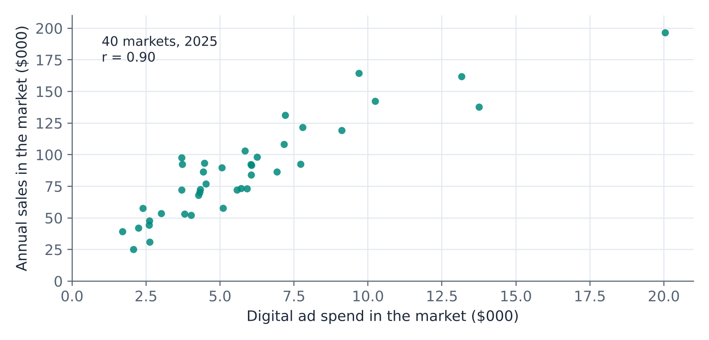{#fig-scatter fig-alt="Scatterplot of annual sales in thousands of dollars against digital ad spend in thousands of dollars for 40 markets in 2025. The points rise from lower left to upper right in a fairly tight linear band; correlation r equals 0.90. Most markets spend between 2 and 10 thousand dollars; one market spends about 20 thousand dollars and has sales of about 196 thousand dollars."}

A correlation says the relationship is strong; it does not say how much sales change with ad spend, and it cannot produce a prediction. A regression line does both.

::: {.callout-note title="Definition — Dependent and independent variables"}
In a regression, the **dependent variable** $y$ (also called the response or outcome) is the variable we want to predict. The **independent variables** $x$ (also called predictors or explanatory variables) are the variables we use to predict it. Here, sales is the dependent variable and ad spend the independent variable. The words describe roles in the model, not a proven causal direction.
:::

### Fitting a line

A straight line is described by an intercept and a slope:

$$
\hat{y} = b_0 + b_1 x
$$

The hat on $\hat{y}$ ("y-hat") marks it as a predicted or **fitted value**, as opposed to an actual observed value $y$. For each market, the difference between the actual and the fitted value is the **residual**:

$$
e = y - \hat{y}
$$

A positive residual means the market sold more than the line predicts; a negative residual means it sold less. Many lines could be drawn through the cloud of points. Regression chooses the one that makes the residuals, taken together, as small as possible.

::: {.callout-note title="Definition — Least squares"}
The **least squares regression line** is the line that minimizes the sum of squared residuals, $\sum (y - \hat{y})^2$. Its slope and intercept are
$$
b_1 = r \, \frac{s_y}{s_x} \qquad\qquad b_0 = \bar{y} - b_1 \bar{x}
$$
where $r$ is the correlation, $s_x$ and $s_y$ are the standard deviations, and $\bar{x}$ and $\bar{y}$ are the means. The line always passes through the point $(\bar{x}, \bar{y})$.
:::

Squaring the residuals does two things: it stops positive and negative residuals from cancelling, and it penalizes large misses more than small ones. For the Brazos markets, $\bar{x}$ = 5.882, $s_x$ = 3.601, $\bar{y}$ = 86.69, $s_y$ = 37.94, and $r$ = 0.8999, so

$$
b_1 = 0.8999 \times \frac{37.94}{3.601} = 9.4835 \qquad\qquad b_0 = 86.69 - 9.4835 \times 5.882 = 30.906
$$

and the fitted line is

$$
\widehat{\text{Sales}} = 30.91 + 9.48 \times \text{AdSpend}
$$

@fig-fit shows the line with every residual drawn in. Market M05, for example, spent \$13,760 on ads. The line predicts sales of 30.91 + 9.48 × 13.76 = \$161.4 thousand; the market actually sold \$137.6 thousand, so its residual is −\$23.8 thousand.

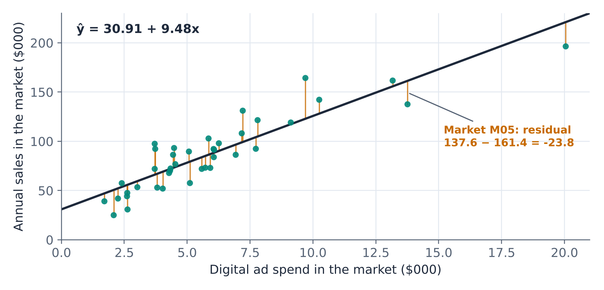{#fig-fit fig-alt="The scatterplot of sales against ad spend with the fitted line y-hat equals 30.91 plus 9.48 x. A short vertical segment connects each point to the line, representing its residual. Market M05, at an ad spend of 13.76 thousand dollars, is labeled: its residual is 137.6 minus 161.4, or minus 23.8 thousand dollars."}

### Interpreting the slope and intercept

::: {.callout-tip title="Example — What do 30.91 and 9.48 mean?"}
**Slope.** Both variables are in thousands of dollars, so $b_1$ = 9.48 means: markets with \$1,000 more ad spend have, *on average*, \$9,480 more sales. Equivalently, each additional dollar of ad spend is associated with \$9.48 of additional sales.

**Intercept.** $b_0$ = 30.91 is the predicted sales of a market with zero ad spend: \$30,910. Treat it with care. No market in the data spends less than \$1,710, so the intercept describes a situation the data never observed. It anchors the line; it is not a reliable estimate of what a market would sell with no advertising.
:::

Notice the careful wording: markets with more ad spend *have* higher sales; ad spend is *associated with* higher sales. The regression does not say that spending another \$1,000 in a market would *produce* \$9,480 of sales. Brazos does not assign budgets at random; larger markets receive larger budgets, and larger markets would sell more even with the same budget. Section 5.7 shows how much of the \$9.48 is really about market size.

::: {.callout-note .excel icon=false title="In Excel — Fitting a line"}
**Chart:** select the two columns (x first), **Insert › Scatter**, then right-click a point › **Add Trendline › Linear**, and tick **Display Equation on chart** and **Display R-squared value on chart**.

**Worksheet functions** (y range first, then x range):

| Task | Formula | Brazos markets |
|---|---|---|
| Slope $b_1$ | `=SLOPE(Sales, AdSpend)` | 9.4835 |
| Intercept $b_0$ | `=INTERCEPT(Sales, AdSpend)` | 30.9057 |
| Correlation $r$ | `=CORREL(Sales, AdSpend)` | 0.8999 |
| Fitted value at $x$ = 8 | `=FORECAST.LINEAR(8, Sales, AdSpend)` | 106.77 |

Here *Sales* and *AdSpend* stand for the cell ranges, such as `C2:C41` and `D2:D41`. These functions update automatically when the data change, unlike the ToolPak output in Section 5.5.
:::

### A second example: separating fixed and variable costs

Regression is also the standard way to estimate how a cost behaves. A **mixed cost** has a fixed part, incurred every period regardless of activity, and a variable part that rises with activity. Regressing the cost on the activity that drives it splits the two: the intercept estimates the fixed cost per period, and the slope estimates the variable cost per unit of activity.

::: {.callout-tip title="Example — Customer-service costs"}
Brazos's customer-service team (phone, chat, and email) recorded its monthly cost and the number of customer contacts for the 24 months of 2024 and 2025. Contacts ranged from 1,077 to 2,142 per month and costs from \$14,240 to \$18,960. The regression of cost on contacts is

$$
\widehat{\text{Cost}} = 9{,}895 + 3.86 \times \text{Contacts}
$$

with $R^2$ = 0.857. The slope estimates the **variable cost**: each additional customer contact costs about \$3.86. The intercept estimates the **fixed cost**: about \$9,895 per month for software, supervision, and the minimum staffing the team carries regardless of volume (@fig-cost).

For budgeting, a month with 2,000 contacts should cost about 9,894.91 + 3.8575 × 2,000 = \$17,610.
:::

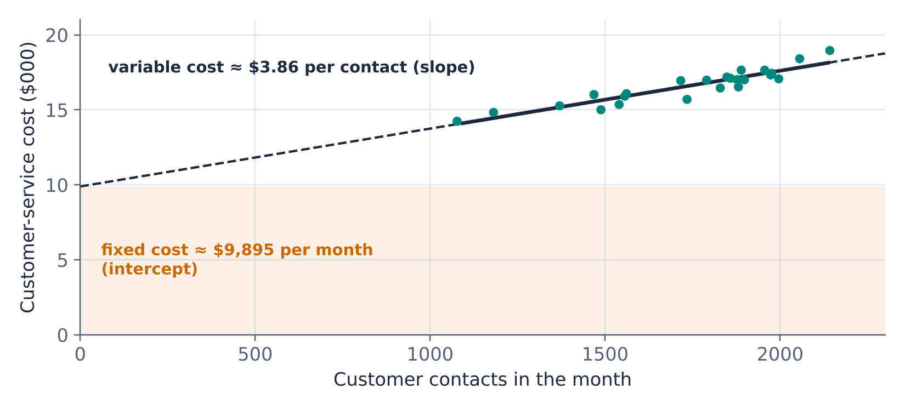{#fig-cost fig-alt="Scatterplot of monthly customer-service cost in thousands of dollars against customer contacts for 24 months. The points lie between about 1,080 and 2,140 contacts and 14 and 19 thousand dollars, close to a fitted line. The line is drawn solid over the range of the data and dashed back to zero contacts, where it meets the vertical axis at about 9.9 thousand dollars. A shaded band below that level is labeled fixed cost about 9,895 dollars per month (intercept); the line is labeled variable cost about 3.86 dollars per contact (slope)."}

Here the intercept has a business meaning, but the earlier caution still applies: zero contacts lies far outside the data. Accountants call the range of activity over which a cost estimate holds the **relevant range**. The \$9,895 is best read as the fixed cost *within* the relevant range of roughly 1,000 to 2,200 contacts, not a prediction of what the department would cost if no customer ever called.

## 5.4 How Well Does the Line Fit?

The least squares line is the best straight line through the data, but even the best line can fit badly. Two numbers summarize how well it fits: $R^2$ and the standard error of the estimate.

### Explained and unexplained variation

Sales vary a great deal across markets, from \$25 thousand to \$196 thousand. Without the regression, the best single prediction for every market would be the average, $\bar{y}$ = \$86.7 thousand. With the regression, each market gets its own prediction. For any market, the distance from the average can be split into two parts (@fig-decomp):

$$
\underbrace{y - \bar{y}}_{\text{total}} = \underbrace{\hat{y} - \bar{y}}_{\text{explained by the line}} + \underbrace{y - \hat{y}}_{\text{residual}}
$$

Market M09, for example, spent \$9,700 on ads and sold \$164.3 thousand, \$77.6 thousand above average. The line predicts \$122.9 thousand, so \$36.2 thousand of the gap is explained by its higher ad spend, and the remaining \$41.4 thousand is unexplained.

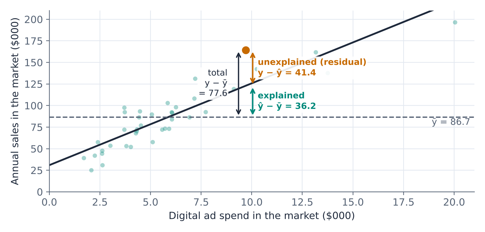{#fig-decomp fig-alt="The sales and ad spend scatterplot with the fitted line and a dashed horizontal line at the average sales of 86.7. One market, at 9.7 thousand dollars of ad spend and 164.3 thousand dollars of sales, is highlighted. Arrows show its total deviation from the average, 77.6, split into an explained part from the average up to the line, 36.2, and an unexplained residual from the line up to the point, 41.4."}

Squaring the three parts and adding them over all markets gives the three **sums of squares**, which satisfy SST = SSR + SSE:

| Sum of squares | Formula | Measures | Brazos |
|---|---|---|---|
| Total (SST) | $\sum (y - \bar{y})^2$ | All the variation in sales | 56,149.8 |
| Regression (SSR) | $\sum (\hat{y} - \bar{y})^2$ | Variation explained by the line | 45,473.1 |
| Error or residual (SSE) | $\sum (y - \hat{y})^2$ | Variation left unexplained | 10,676.7 |

### R-squared

::: {.callout-note title="Definition — Coefficient of determination"}
The **coefficient of determination** $R^2$ is the share of the variation in $y$ that the regression explains:
$$
R^2 = \frac{SSR}{SST} = 1 - \frac{SSE}{SST}
$$
It lies between 0 (the line explains nothing) and 1 (every point lies on the line). In a simple regression, $R^2$ equals the square of the correlation, $r^2$.
:::

For the markets, $R^2$ = 45,473.1/56,149.8 = **0.810**, which is 0.8999². Differences in ad spend account for about 81% of the variation in sales across markets; the other 19% reflects everything else.

What counts as a good $R^2$ depends entirely on the context. Models of aggregate quantities over time, such as monthly sales, often reach $R^2$ above 0.9. Models of individual behavior, such as one customer's annual spending, often explain 10% or 20% of the variation and are still valuable. A high $R^2$ does not mean a model is correct (Section 5.12 shows a high-$R^2$ model that is badly wrong), and a low one does not mean it is useless. For prediction, the more useful question is how far off the predictions typically are.

### The standard error of the estimate

::: {.callout-note title="Definition — Standard error of the estimate"}
The **standard error of the estimate** $s_e$ is the standard deviation of the residuals, the typical size of a prediction error:
$$
s_e = \sqrt{\frac{SSE}{n - 2}}
$$
It is measured in the units of $y$. The divisor $n - 2$ reflects the two coefficients estimated from the data. When the residuals are roughly normal, about 95% of the observations lie within $\pm 2 s_e$ of the line.
:::

For the markets, $s_e = \sqrt{10{,}676.7/38}$ = **\$16.76 thousand**. A typical market's sales differ from the line's prediction by about \$17 thousand, and 39 of the 40 markets lie within $\pm 2s_e$ = ±\$33.5 thousand of the line. That is a much more concrete statement of the model's accuracy than "$R^2$ = 0.81," and it already hints at the width of a prediction interval (Section 5.6).

::: {.callout-note .excel icon=false title="In Excel — Measuring fit"}
| Task | Formula | Brazos markets |
|---|---|---|
| $R^2$ | `=RSQ(Sales, AdSpend)` | 0.8099 |
| Standard error of the estimate $s_e$ | `=STEYX(Sales, AdSpend)` | 16.762 |
| SST | `=DEVSQ(Sales)` | 56,149.8 |

`DEVSQ` returns the sum of squared deviations from the mean. The trendline option *Display R-squared value on chart* shows the same $R^2$.
:::

## 5.5 Is the Relationship Real? Inference for the Slope

### The slope varies from sample to sample

The 40 markets are one year's data. A different year, or a different set of markets, would give somewhat different points and a somewhat different line. As in Units 2 to 4, we think of the data as produced by a process, here described by a **population regression model**:

$$
y = \beta_0 + \beta_1 x + \varepsilon
$$

The parameters $\beta_0$ and $\beta_1$ describe the true, unknown relationship, and $\varepsilon$ is random variation around it. The least squares coefficients $b_0$ and $b_1$ are estimates of $\beta_0$ and $\beta_1$, and like any estimate they have sampling distributions.

@fig-sim makes this concrete. It takes the fitted line as if it were the true relationship and generates 2,000 new samples of 40 markets, with the same ad budgets and random variation of the size we observed. Each sample gives its own slope. The slopes cluster around the true value with a standard deviation of about 0.75: this is the **standard error of the slope**.

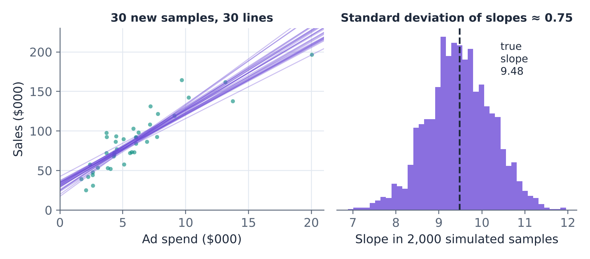{#fig-sim fig-alt="Left: the market scatterplot with 30 regression lines from 30 simulated samples; the lines fan out slightly, especially away from the center of the data. Right: histogram of the slopes from 2,000 simulated samples, bell-shaped and centered at the true slope of 9.48, ranging from about 7 to 12, with a standard deviation of about 0.75."}

In practice we have only one sample, and the standard error comes from a formula:

$$
SE(b_1) = \frac{s_e}{\sqrt{\sum (x - \bar{x})^2}} = \frac{16.762}{\sqrt{505.6}} = 0.7454
$$

The slope is estimated more precisely when the points lie close to the line (small $s_e$), when there are many of them, and when the $x$ values are spread out.

### Testing the slope

If ad spend had no linear relationship with sales, $\beta_1$ would be zero. The standard regression test asks whether the data provide evidence against that.

::: {.callout-note title="Definition — t test for a regression coefficient"}
To test $H_0: \beta_1 = 0$ against $H_1: \beta_1 \neq 0$, compute
$$
t = \frac{b_1}{SE(b_1)}
$$
and find the two-sided p-value from the t distribution with $n - 2$ degrees of freedom. A 95% confidence interval for $\beta_1$ is $b_1 \pm t^{*} \times SE(b_1)$, where $t^{*}$ is the two-sided critical value with $n - 2$ degrees of freedom.
:::

This is the same logic as every test in Unit 4: the test statistic counts how many standard errors the estimate lies from the null value. For the markets,

$$
t = \frac{9.4835}{0.7454} = 12.72
$$

with 38 degrees of freedom. A slope 12.7 standard errors from zero is far beyond anything chance would produce; the p-value is 2.85 × 10⁻¹⁵, effectively zero. With $t^{*}$ = `T.INV.2T(0.05, 38)` = 2.024, the 95% confidence interval for the slope is

$$
9.4835 \pm 2.024 \times 0.7454 = 7.97 \text{ to } 10.99
$$

Markets with \$1,000 more ad spend sell, on average, between about \$8.0 and \$11.0 thousand more. The interval excludes zero, consistent with the test. As always, the interval is more informative than the test, because it shows the size of the relationship and how precisely we know it.

::: {.callout-warning title="Conditions for regression inference"}
The standard errors, p-values, and intervals in this chapter rely on four conditions, often remembered as **LINE**:

- **L**inearity: the average of $y$ changes linearly with $x$.
- **I**ndependence: the residuals are independent of each other (watch out for data collected over time).
- **N**ormality: the residuals are roughly normal (less important in large samples).
- **E**qual variance: the spread of the residuals is the same for all values of $x$.

Section 5.12 shows how to check them with residual plots. The least squares line itself can always be computed; the conditions matter for the inference and the intervals.
:::

### Reading the ToolPak output

The Analysis ToolPak's **Regression** tool produces everything above at once. For sales on ad spend, its *SUMMARY OUTPUT* has three blocks.

**Regression Statistics**

| | Value | What it tells us |
|---|---|---|
| Multiple R | 0.8999 | The correlation between $y$ and $\hat{y}$; in simple regression, $|r|$. |
| R Square | 0.8099 | Share of the variation in sales explained by the model. |
| Adjusted R Square | 0.8048 | $R^2$ adjusted for the number of predictors (Section 5.7). |
| Standard Error | 16.7620 | The standard error of the estimate $s_e$, in \$ thousands. |
| Observations | 40 | Number of markets. |

**ANOVA**

| | df | SS | MS | F | Significance F |
|---|---|---|---|---|---|
| Regression | 1 | 45473.12 | 45473.12 | 161.85 | 2.85E-15 |
| Residual | 38 | 10676.71 | 280.97 | | |
| Total | 39 | 56149.82 | | | |

The ANOVA table is the sum-of-squares decomposition from Section 5.4. MS (mean square) is SS divided by df, and the residual MS is $s_e^2$ = 16.762² = 280.97. The F statistic, MS Regression / MS Residual, tests whether the model as a whole explains anything; Significance F is its p-value. In a simple regression, F is just $t^2$ (161.85 = 12.72²) and gives the same p-value as the slope's t test. It becomes useful in multiple regression (Section 5.7).

**Coefficients**

| | Coefficients | Standard Error | t Stat | P-value | Lower 95% | Upper 95% |
|---|---|---|---|---|---|---|
| Intercept | 30.9057 | 5.1235 | 6.032 | 5.14E-07 | 20.5338 | 41.2776 |
| AdSpend | 9.4835 | 0.7454 | 12.722 | 2.85E-15 | 7.9744 | 10.9925 |

Each row gives an estimate, its standard error, the t statistic for testing whether the true coefficient is zero, the two-sided p-value, and the 95% confidence interval. The row that matters here is *AdSpend*. The intercept's test asks whether a market with zero ad spend would have zero sales, a question nobody is asking; its p-value is rarely of interest.

Excel displays very small p-values in scientific notation: 2.85E-15 means 2.85 × 10⁻¹⁵. Report such values as "p < 0.001."

::: {.callout-note .excel icon=false title="In Excel — The Regression tool"}
1. **Data › Data Analysis › Regression** (enable the Analysis ToolPak first under **File › Options › Add-ins** if needed).
2. **Input Y Range:** the dependent variable, including its header (for example `C1:C41`).
3. **Input X Range:** the independent variable(s), including headers (for example `D1:D41`). For several predictors, the columns must be next to each other (Section 5.7).
4. Tick **Labels**. Tick **Confidence Level** only if you want an interval other than 95%.
5. Choose an output location. Under *Residuals*, tick **Residuals** and **Residual Plots** to get the fitted values, residuals, and the plots needed for Section 5.12.

The output is static: if the data change, run the tool again. For a live version, `=LINEST(Sales, AdSpend, TRUE, TRUE)` returns the coefficients, their standard errors, $R^2$, $s_e$, F, and the sums of squares as an array.
:::

## 5.6 Making Predictions

Back to the marketing team's question: what sales should Brazos expect in a new market where it plans to spend \$8,000 on ads? The point prediction is the value on the line:

$$
\hat{y} = 30.906 + 9.4835 \times 8 = \$106.8 \text{ thousand}
$$

How uncertain is that? It depends on what exactly is being predicted.

### Two different questions

1. **What are the average sales of all markets with \$8,000 of ad spend?** This is a question about the line itself, the mean of $y$ at $x$ = 8. The only uncertainty is in where the true line lies.
2. **What will this one new market sell?** This is a question about a single market. It inherits the uncertainty about the line *plus* the market's own deviation from the line, which, as $s_e$ shows, is typically about \$17 thousand.

::: {.callout-note title="Definition — Confidence and prediction intervals for regression"}
At a given value $x_0$, with $\hat{y} = b_0 + b_1 x_0$, $t^{*}$ the critical value with $n-2$ degrees of freedom, and $S_{xx} = \sum(x - \bar{x})^2$:

- A **confidence interval for the mean response** (the average $y$ of all cases with $x = x_0$) is
$$
\hat{y} \pm t^{*} s_e \sqrt{\frac{1}{n} + \frac{(x_0 - \bar{x})^2}{S_{xx}}}
$$
- A **prediction interval** (the $y$ of one new case with $x = x_0$) is
$$
\hat{y} \pm t^{*} s_e \sqrt{1 + \frac{1}{n} + \frac{(x_0 - \bar{x})^2}{S_{xx}}}
$$
:::

The only difference is the "1 +" under the square root, which represents the individual case's own random variation. For the new market, with $n$ = 40, $\bar{x}$ = 5.882, $S_{xx}$ = 505.6, $s_e$ = 16.762, and $t^{*}$ = 2.024:

$$
\frac{1}{40} + \frac{(8 - 5.882)^2}{505.6} = 0.0250 + 0.0089 = 0.0339
$$

- 95% confidence interval for the average: $106.8 \pm 2.024 \times 16.762 \times \sqrt{0.0339}$ = 106.8 ± 6.2, or **\$100.5 to \$113.0 thousand**.
- 95% prediction interval for the new market: $106.8 \pm 2.024 \times 16.762 \times \sqrt{1.0339}$ = 106.8 ± 34.5, or **\$72.3 to \$141.3 thousand**.

@fig-bands shows both intervals at every ad budget. The confidence band is narrow and pinches in at the center of the data, where the line is pinned down best. The prediction band is much wider and nearly parallel to the line.

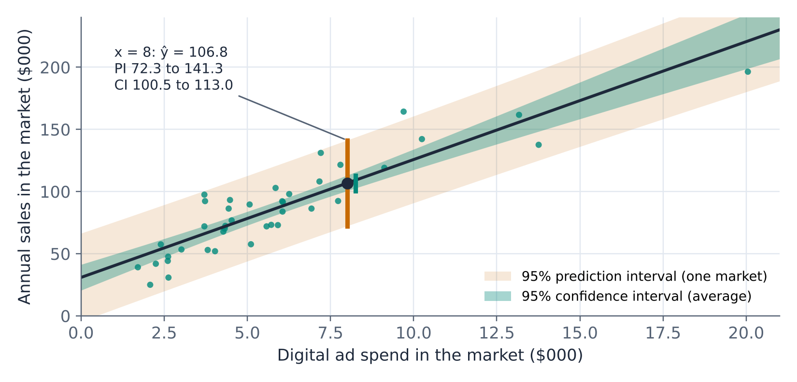{#fig-bands fig-alt="The sales and ad spend scatterplot with the fitted line, a narrow dark band around it for the 95 percent confidence interval of average sales, and a much wider light band for the 95 percent prediction interval of a single market. At an ad spend of 8 thousand dollars, the prediction is 106.8, the confidence interval runs from 100.5 to 113.0, and the prediction interval from 72.3 to 141.3. The confidence band is narrowest near the middle of the data and widens toward the edges."}

For the marketing team, the prediction interval is the honest answer: a new market with an \$8,000 budget will most likely sell somewhere between about \$72 thousand and \$141 thousand. That range is wide because markets differ in many ways besides ad spend. More data would narrow the confidence interval, since the line would be pinned down more precisely, but it would barely narrow the prediction interval: no amount of data removes the variation of individual markets around the line. Only a better model, one that explains more of that variation, can do that. Section 5.8 shows how much a better model helps.

::: {.callout-note .excel icon=false title="In Excel — Prediction and confidence intervals"}
With the planned ad spend in cell `G1`, *Sales* in `C2:C41`, and *AdSpend* in `D2:D41`:

| Quantity | Formula | Result |
|---|---|---|
| Point prediction | `=FORECAST.LINEAR(G1, C2:C41, D2:D41)` | 106.77 |
| Critical value $t^{*}$ | `=T.INV.2T(0.05, COUNT(D2:D41)-2)` | 2.0244 |
| Margin, mean response | `=G3*STEYX(C2:C41,D2:D41)*SQRT(1/COUNT(D2:D41)+(G1-AVERAGE(D2:D41))^2/DEVSQ(D2:D41))` | 6.25 |
| Margin, one new market | `=G3*STEYX(C2:C41,D2:D41)*SQRT(1+1/COUNT(D2:D41)+(G1-AVERAGE(D2:D41))^2/DEVSQ(D2:D41))` | 34.50 |

(`G3` holds the critical value.) Subtract and add each margin to the point prediction.
:::

### Don't extrapolate

::: {.callout-warning title="Extrapolation"}
A regression describes the relationship only over the range of the data. Predicting outside that range is **extrapolation**, and it assumes that the relationship continues unchanged where it has never been observed. The Brazos line predicts sales of 30.91 + 9.48 × 40 = \$410 thousand for a market with \$40,000 of ad spend, but no market spent more than \$20,050, and there is every reason to expect diminishing returns at budgets far beyond anything Brazos has tried. The formula for the intervals warns you too: the $(x_0 - \bar{x})^2$ term makes them widen away from the center of the data, and even that understates the risk, because it assumes the straight line still holds.
:::

Prediction also extrapolates in time. Every prediction assumes that the relationship that held in the data will hold for the case being predicted. If Brazos changed how it chooses which markets get large budgets, or if a competitor entered half of its markets, last year's line would describe last year's world. Monitor predictions against outcomes, and refit the model as new data arrive.

## 5.7 Multiple Regression

### What is an ad dollar worth?

Armed with the simple regression, the marketing team makes a case to Brazos's leadership: "Every dollar of advertising brings in \$9.48 of sales. We should double the ad budget." The finance team is skeptical, and its objection is the confounding problem from Unit 4. Brazos does not assign ad budgets at random. Larger markets, with more potential customers, receive larger budgets, and larger markets would buy more from Brazos even if the budgets were equal. The left panel of @fig-confound confirms it: ad spend and the number of households in the market are strongly correlated ($r$ = 0.78).

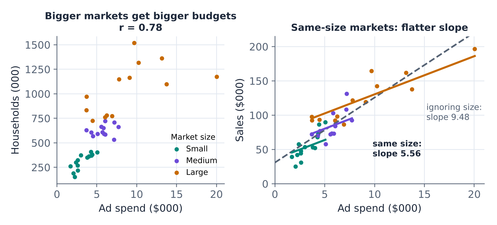{#fig-confound fig-alt="Left: scatterplot of households in thousands against ad spend for the 40 markets, colored by size group (small, medium, large); larger markets have larger ad budgets, correlation 0.78. Right: sales against ad spend, colored by the same size groups. A dashed line for all markets, ignoring size, has slope 9.48. Three solid parallel lines, one for each size group, have the flatter slope 5.56: within markets of similar size, more ad spend is associated with a smaller increase in sales."}

The simple regression mixes two things: the relationship between ad spend and sales, and the relationship between market size and sales, which comes along because large markets get large budgets. To separate them, we need a model with both variables.

::: {.callout-note title="Definition — Multiple regression"}
A **multiple regression** model predicts $y$ from several independent variables:
$$
\hat{y} = b_0 + b_1 x_1 + b_2 x_2 + \cdots + b_k x_k
$$
The coefficients are again chosen by least squares. Each coefficient $b_j$ is a **partial slope**: the expected change in $y$ for a one-unit increase in $x_j$, **holding all the other $x$ variables in the model constant**.
:::

Adding the number of households (in thousands) to the model gives:

| | Coefficients | Standard Error | t Stat | P-value | Lower 95% | Upper 95% |
|---|---|---|---|---|---|---|
| Intercept | 19.6949 | 4.2595 | 4.624 | 4.48E-05 | 11.0643 | 28.3254 |
| AdSpend | 5.5596 | 0.8793 | 6.323 | 2.30E-07 | 3.7780 | 7.3412 |
| Households | 0.0526 | 0.0092 | 5.722 | 1.50E-06 | 0.0340 | 0.0713 |

$R^2$ = 0.899, adjusted $R^2$ = 0.894, $s_e$ = 12.37, $n$ = 40.

$$
\widehat{\text{Sales}} = 19.69 + 5.56 \times \text{AdSpend} + 0.0526 \times \text{Households}
$$

::: {.callout-tip title="Example — Interpreting the coefficients"}
**AdSpend:** among markets with the *same number of households*, those with \$1,000 more ad spend have, on average, \$5,560 more sales. The 95% confidence interval runs from \$3,780 to \$7,340.

**Households:** among markets with the *same ad spend*, each additional 1,000 households is associated with \$52.60 more sales (0.0526 thousand dollars), or about \$5,260 per 100,000 households.

The association between ad spend and sales, holding market size constant, is \$5.56 per ad dollar, not \$9.48. About 40% of the simple regression's slope was market size in disguise.
:::

### Why the coefficient changed

The drop from 9.48 to 5.56 can be accounted for exactly. Regressing households on ad spend shows that markets with \$1,000 more ad spend have, on average, 74.55 thousand more households. Those extra households are worth 0.0526 × 74.55 = \$3.92 thousand of sales by themselves. So

$$
\underbrace{9.48}_{\text{simple slope}} = \underbrace{5.56}_{\text{ad spend, size held constant}} + \underbrace{3.92}_{\text{size that comes with bigger budgets}}
$$

::: {.callout-note title="Definition — Omitted variable bias"}
When a variable that affects $y$ is left out of a regression and is correlated with an included $x$, the coefficient on $x$ absorbs part of the omitted variable's effect. This distortion is **omitted variable bias**, the regression version of confounding. Its direction depends on the signs: here market size raises sales and is positively related to ad spend, so leaving it out inflated the ad coefficient.
:::

This is the first great advantage of multiple regression: it can statistically hold constant a variable that the data did not hold constant. Brazos could not compare markets of exactly equal size, because there are no two such markets, but the regression estimates what such a comparison would show.

Two caveats keep this in proportion. First, the regression holds constant only the variables in the model. If other differences between markets, such as income, climate, or the number of competing stores, are related to both ad budgets and sales, the 5.56 is still biased. Second, the model assumes the effects add up in a straight-line way. Section 5.12 returns to what regression coefficients can and cannot claim.

Which slope should the team use? It depends on the question. To *predict* sales in a new market whose budget was set the usual way, larger for larger markets, the simple model's 9.48 is a perfectly good predictive association, though the multiple regression predicts better. To decide whether to *spend more* in a market whose size is fixed, the relevant number is the effect of ad spend holding size constant, so 5.56 is much closer to the right answer than 9.48. That decision, how much to spend, is the subject of Unit 6.

### Adjusted R-squared

Adding households raised $R^2$ from 0.810 to 0.899. Adding *any* variable to a regression, even a column of random numbers, increases $R^2$ at least slightly, because least squares can always use the new variable to fit the sample's noise a little better. $R^2$ therefore cannot tell whether a new variable is worth including.

::: {.callout-note title="Definition — Adjusted R-squared"}
**Adjusted $R^2$** corrects $R^2$ for the number of predictors $k$:
$$
R^2_{adj} = 1 - (1 - R^2)\,\frac{n - 1}{n - k - 1}
$$
It increases when a new variable improves the fit by more than chance alone would, and decreases otherwise. Use it, not $R^2$, to compare models with different numbers of predictors fitted to the same data.
:::

For the two-variable model, $R^2_{adj} = 1 - (1 - 0.8991) \times 39/37$ = 0.894, up from 0.805 for ad spend alone, so households clearly earn their place.

### Testing the model and its coefficients

A multiple regression comes with two kinds of test.

- The **F test** in the ANOVA table tests whether the model as a whole explains anything: $H_0: \beta_1 = \beta_2 = \cdots = \beta_k = 0$ against the alternative that at least one coefficient is not zero. The degrees of freedom are $k$ for the regression and $n - k - 1$ for the residuals. Here F = 164.9 with 2 and 37 degrees of freedom, and Significance F is 3.7 × 10⁻¹⁹.
- Each coefficient's **t test** asks whether that variable adds anything, given the others in the model. The degrees of freedom are $n - k - 1$ = 37. Both ad spend (t = 6.32) and households (t = 5.72) are highly significant.

The standard error of the estimate is now $s_e = \sqrt{SSE/(n - k - 1)}$ = \$12.37 thousand, down from \$16.76 thousand: predictions from the two-variable model are typically off by about a quarter less.

::: {.callout-note .excel icon=false title="In Excel — Multiple regression with the ToolPak"}
The Regression tool accepts up to 16 independent variables, but **the X columns must be adjacent**. Arrange the data so that the predictors sit next to each other (for example *AdSpend* in column D and *Households* in column E), then enter `D1:E41` as the **Input X Range** and `C1:C41` as the **Input Y Range**, with **Labels** ticked. Copy columns to a new sheet if needed to make them adjacent; never sort one column without the others.

The output has one coefficient row per predictor, in the order of the columns. `=LINEST(C2:C41, D2:E41, TRUE, TRUE)` gives the same results live, but it lists the coefficients in *reverse* column order, a frequent source of mistakes.
:::

## 5.8 Categorical Predictors: Dummy Variables

### Pickup partners

In 19 of the 40 markets, Brazos has a partner store where customers can pick up orders and drop off returns. Does a pickup partner help sales? A first look says no: markets with a partner averaged \$88.4 thousand in sales and markets without one \$85.1 thousand, a difference of \$3.3 thousand with a two-sided p-value of 0.79.

A regression can include a yes/no characteristic like this through a **dummy variable**.

::: {.callout-note title="Definition — Dummy variable"}
A **dummy variable** (or indicator variable) equals 1 if an observation has a characteristic and 0 if it does not. In a regression, the coefficient of a dummy variable is the average difference in $y$ between observations with and without the characteristic, holding the other variables in the model constant.
:::

Adding *Pickup* (1 = partner store, 0 = none) to the model gives:

| | Coefficients | Standard Error | t Stat | P-value | Lower 95% | Upper 95% |
|---|---|---|---|---|---|---|
| Intercept | 13.1635 | 4.2364 | 3.107 | 0.0037 | 4.5717 | 21.7554 |
| AdSpend | 6.0465 | 0.7908 | 7.646 | 4.75E-09 | 4.4427 | 7.6502 |
| Households | 0.0496 | 0.0082 | 6.062 | 5.75E-07 | 0.0330 | 0.0662 |
| Pickup | 11.8778 | 3.5284 | 3.366 | 0.0018 | 4.7219 | 19.0338 |

$R^2$ = 0.923, adjusted $R^2$ = 0.917, $s_e$ = 10.94, F = 144.4 (Significance F = 4.0 × 10⁻²⁰).

Holding ad spend and market size constant, markets with a pickup partner sell on average **\$11.9 thousand more** than markets without one (95% CI: \$4.7 to \$19.0 thousand), and the difference is clearly significant (p = 0.002). Why did the simple comparison miss it? Because the markets with partners happen to have smaller ad budgets (\$5.30 thousand on average, against \$6.41 thousand) and slightly fewer households. Their lower budgets hid their advantage. The simple comparison was confounded too, this time in the other direction.

In effect, the dummy variable gives the two groups of markets their own intercepts and a common slope:

- No pickup partner: $\widehat{\text{Sales}} = 13.16 + 6.05 \times \text{AdSpend} + 0.0496 \times \text{Households}$
- Pickup partner: $\widehat{\text{Sales}} = (13.16 + 11.88) + 6.05 \times \text{AdSpend} + 0.0496 \times \text{Households}$

@fig-dummy shows the two parallel lines, \$11.9 thousand apart, for markets of average size.

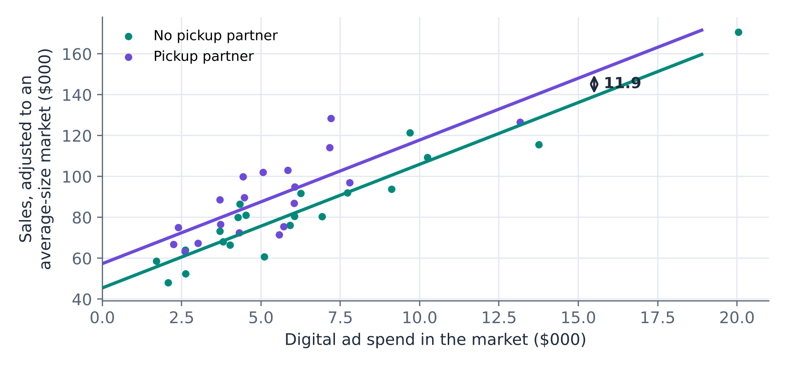{#fig-dummy fig-alt="Scatterplot of sales, adjusted to an average-size market, against ad spend, with points colored by whether the market has a pickup partner. Two parallel fitted lines, one for each group; the line for markets with a pickup partner lies 11.9 thousand dollars above the line for markets without one at every level of ad spend."}

### Better models, better predictions

The new market from Section 5.6 has 700 thousand households and no pickup partner. With an \$8,000 ad budget, the three-variable model predicts

$$
\widehat{\text{Sales}} = 13.16 + 6.05 \times 8 + 0.0496 \times 700 + 11.88 \times 0 = \$96.3 \text{ thousand}
$$

The exact 95% prediction interval for a multiple regression requires matrix algebra that is usually left to software, but a good approximation for a case within the range of the data is $\hat{y} \pm t^{*} s_e$ = 96.3 ± 2.028 × 10.94 = 96.3 ± 22.2. (The exact interval, ± 22.8, is slightly wider, because it also accounts for the uncertainty in the coefficients.) The simple regression's prediction interval for the same market was ±\$34.5 thousand. Explaining more of the variation among markets cut the uncertainty of the prediction by a third. If Brazos signed a pickup partner in the new market, the prediction would rise to \$108.1 thousand.

### More than two categories

Brazos's markets also fall into four regions. A categorical variable with $c$ categories needs $c - 1$ dummy variables. With the Midwest as the **baseline** category, the model uses three dummies, *West*, *South*, and *Northeast*; a Midwest market has zeros for all three. Each dummy's coefficient compares its region with the baseline, holding the other variables constant.

| | Coefficients | Standard Error | t Stat | P-value |
|---|---|---|---|---|
| Intercept | 8.2006 | 5.0670 | 1.618 | 0.115 |
| AdSpend | 6.3593 | 0.7572 | 8.399 | 1.06E-09 |
| Households | 0.0465 | 0.0081 | 5.716 | 2.23E-06 |
| Pickup | 8.2723 | 3.6759 | 2.250 | 0.031 |
| West | 3.8276 | 4.6874 | 0.817 | 0.420 |
| South | 13.8046 | 4.6432 | 2.973 | 0.0055 |
| Northeast | 6.6797 | 6.2465 | 1.069 | 0.293 |

$R^2$ = 0.942, adjusted $R^2$ = 0.931, $s_e$ = 9.96.

Holding ad spend, size, and pickup constant, South markets sell on average \$13.8 thousand more than comparable Midwest markets (p = 0.005), perhaps because Brazos is a Texas brand. The West and Northeast do not differ significantly from the Midwest. Adjusted $R^2$ rose from 0.917 to 0.931, so region adds useful information as a whole.

Notice that the pickup coefficient fell from 11.9 to 8.3. Pickup partners are concentrated in the South and Northeast (14 of Brazos's 19 partners are there), so part of what looked like a pickup effect was a regional difference. Every coefficient in a multiple regression depends on which other variables are in the model.

::: {.callout-warning title="The dummy variable trap"}
Never include a dummy for every category. If the model contained dummies for all four regions, they would always add up to 1 for every market and duplicate the intercept, and the regression could not be estimated (Excel either reports an error or silently drops one of the variables by giving it a coefficient of 0). Leave out one category, the baseline, and interpret every dummy coefficient as a comparison with it. Which category is the baseline does not change the model's predictions, only how the coefficients are expressed.
:::

::: {.callout-note .excel icon=false title="In Excel — Creating dummy variables"}
With the region in column B, create one column per non-baseline category:

- *South*: `=IF(B2="South", 1, 0)`, and similarly for *West* and *Northeast*.
- Yes/no text: `=IF(F2="Yes", 1, 0)`.

Fill the formulas down, place the new columns next to the other predictors, and include them in the **Input X Range**.
:::

## 5.9 Curved Relationships

Not every relationship is a straight line. Diminishing returns are everywhere in business: the hundredth salesperson adds less than the tenth, and the tenth discount email of the month annoys more than it persuades.

### How many emails are too many?

In the first half of 2026, Brazos ran a randomized experiment on its marketing emails. It divided 18,000 customers at random into 36 groups of 500 and assigned each group a frequency of 1 to 12 emails per month, three groups per frequency. The outcome was revenue per customer over the following quarter. The left panel of @fig-email shows the result.

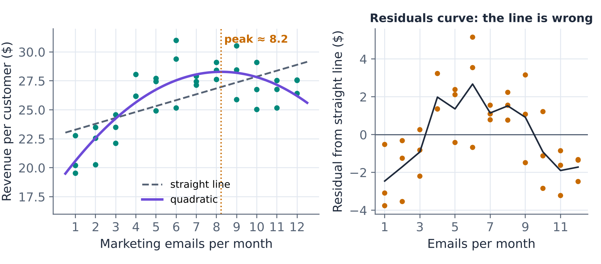{#fig-email fig-alt="Left: revenue per customer in dollars, from about 19 to 31, against marketing emails per month, 1 to 12, for 36 test groups. Revenue rises steeply from 1 to about 6 emails, levels off around 8, and declines slightly toward 12. A dashed straight line rising gently misses the shape; a quadratic curve follows it, peaking at about 8.2 emails. Right: residuals from the straight line against emails per month. They are negative at low and high frequencies and positive in the middle, forming an arch."}

A straight line fits poorly: $\widehat{\text{Revenue}} = 22.78 + 0.509 \times \text{Emails}$, with $R^2$ = 0.40. Its residuals, in the right panel, form an arch: the line overpredicts at low and high frequencies and underpredicts in the middle. A pattern in the residuals is the signature of a wrong functional form.

### A quadratic model

A curve that rises and then falls can be fitted by adding the square of the predictor as a second variable:

$$
\hat{y} = b_0 + b_1 x + b_2 x^2
$$

This is still a regression, fitted by least squares in the ToolPak, with $x$ and $x^2$ as two adjacent X columns. For the email experiment:

| | Coefficients | Standard Error | t Stat | P-value |
|---|---|---|---|---|
| Intercept | 18.3261 | 0.9365 | 19.569 | 9.94E-20 |
| Emails | 2.4179 | 0.3312 | 7.300 | 2.23E-08 |
| EmailsSq | −0.1468 | 0.0248 | −5.920 | 1.22E-06 |

$R^2$ = 0.708, adjusted $R^2$ = 0.691, $s_e$ = \$1.57.

The negative, highly significant coefficient on the squared term confirms the curve, and $R^2$ jumps from 0.40 to 0.71.

::: {.callout-tip title="Example — Reading a quadratic model"}
In a quadratic model, the effect of one more unit of $x$ is not constant; it depends on where you start. The **marginal effect** of one more email per month is approximately

$$
b_1 + 2 b_2 x = 2.418 - 0.294\,x
$$

- At 4 emails a month, one more email adds about 2.418 − 0.294 × 4 = **\$1.24** of revenue per customer per quarter.
- At 8 emails, it adds about **\$0.07**: essentially nothing.
- At 10 emails, it *reduces* revenue by about **\$0.52**.

Revenue peaks where the marginal effect is zero, at $x = -b_1/(2b_2)$ = 2.418/(2 × 0.1468) = **8.2 emails per month**, with predicted revenue of about \$28.27 per customer, against \$20.60 at one email a month.
:::

Because the email frequencies were assigned at random, the curve has a causal interpretation: it shows what *happens* to revenue when Brazos changes its email frequency, not just what is associated with it. That makes it directly useful for a decision. The revenue-maximizing frequency is not necessarily the best one, though; sending emails has costs, and frequent emails may push customers to unsubscribe, lowering revenue in later quarters. Choosing the best course of action from a model like this is prescriptive analysis, the subject of Unit 6.

As with straight lines, never extrapolate a curve. A quadratic fitted to 1 to 12 emails says nothing reliable about 20 emails, and polynomial curves can turn sharply just beyond the data (Section 5.11 shows a dramatic case).

### Logarithms

Another common way to model curvature uses natural logarithms. Two forms are especially useful in business:

- **Log of x:** $\hat{y} = b_0 + b_1 \ln(x)$ models diminishing returns that never turn negative. A 1% increase in $x$ is associated with a change of about $b_1/100$ in $y$. Advertising response is often modeled this way.
- **Log of y:** $\ln(\hat{y}) = b_0 + b_1 x$ models percentage effects. A one-unit increase in $x$ is associated with an approximately $100 \times b_1$% change in $y$. Salaries, prices, and sales that grow at a steady rate are often modeled this way.

::: {.callout-note .excel icon=false title="In Excel — Curved relationships"}
- **Squared term:** add a column `=B2^2` next to the original predictor, and include both columns in the **Input X Range**.
- **Logarithm:** add a column `=LN(B2)` (all values must be positive) and use it as a predictor, or transform $y$ instead.
- **Trendline:** right-click the points in a scatterplot › **Add Trendline**, and choose **Polynomial** (order 2 for a quadratic) or **Logarithmic**, with *Display Equation* and *R-squared* ticked. Use the trendline to explore, and the ToolPak for standard errors and tests.
:::

## 5.10 Forecasting a Time Series with Regression

In January 2026, Brazos's finance team needed a monthly sales forecast for the 2026 budget. @fig-monthly shows monthly net sales for the four years 2022 to 2025. Two patterns stand out: sales grow from year to year, and they follow the same seasonal cycle every year, low in January and February, high from April to July, dipping in September and October, and rising again for the holidays.

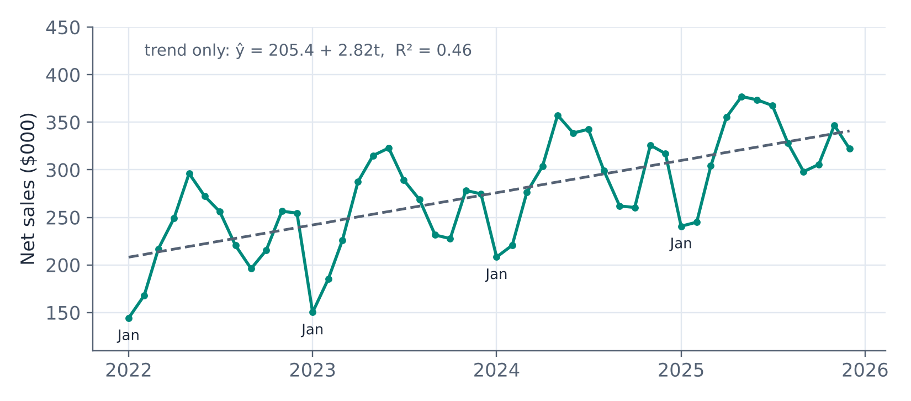{#fig-monthly fig-alt="Line chart of monthly net sales in thousands of dollars from January 2022 to December 2025. Sales rise from about 144 in January 2022 to a peak of 377 in May 2025, following a repeating annual cycle: lows each January, from about 144 in 2022 to 241 in 2025, highs each spring and early summer, a dip in September and October, and a smaller rise in November and December. A dashed straight trend line rises from about 208 to 341; its equation is y-hat equals 205.4 plus 2.82 t, with R-squared 0.46."}

::: {.callout-note title="Definition — Components of a time series"}
A business time series is usually described by three components:

- **Trend:** the long-run upward or downward movement.
- **Seasonality:** a pattern that repeats with a fixed period, such as every 12 months or every 7 days.
- **Irregular variation:** the random movement left after trend and seasonality.

(Longer, irregular swings related to the business cycle are sometimes treated as a fourth component.)
:::

### Modeling the trend

A regression can capture a linear trend with a **time index** $t$ = 1, 2, 3, ..., 48 as the independent variable. The trend-only model is

$$
\widehat{\text{Sales}} = 205.35 + 2.824\,t
$$

Sales grew by about \$2.8 thousand per month, but the model explains only 46% of the variation ($R^2$ = 0.459), and its residuals are large and systematic: every January lies far below the line and every May far above it. The model is missing the seasonality.

### Adding seasonal dummy variables

Seasonality is a categorical variable, the month, with 12 categories, so it calls for $12 - 1 = 11$ dummy variables. With January as the baseline, the model is

$$
\widehat{\text{Sales}} = b_0 + b_1 t + b_2\,\text{Feb} + b_3\,\text{Mar} + \cdots + b_{12}\,\text{Dec}
$$

where *Feb* is 1 for February observations and 0 otherwise, and so on. Fitted to all 48 months:

| | Coefficient | Standard Error | t Stat | | | Coefficient | Standard Error | t Stat |
|---|---|---|---|---|---|---|---|---|
| Intercept | 135.56 | 5.08 | 26.68 | | Jul | 112.07 | 6.68 | 16.78 |
| t (trend) | 2.647 | 0.101 | 26.16 | | Aug | 74.62 | 6.69 | 11.16 |
| Feb | 16.20 | 6.65 | 2.44 | | Sep | 39.90 | 6.70 | 5.96 |
| Mar | 64.66 | 6.65 | 9.72 | | Oct | 42.63 | 6.71 | 6.35 |
| Apr | 105.11 | 6.66 | 15.79 | | Nov | 89.56 | 6.73 | 13.31 |
| May | 139.96 | 6.66 | 21.01 | | Dec | 77.14 | 6.74 | 11.44 |
| Jun | 127.74 | 6.67 | 19.15 | | | | | |

$R^2$ = 0.981, adjusted $R^2$ = 0.974, $s_e$ = \$9.41 thousand, $n$ = 48.

::: {.callout-tip title="Example — Interpreting the seasonal model"}
**Trend:** holding the month constant, sales grow by about \$2.65 thousand per month, or about \$31.8 thousand per year in the monthly sales level.

**Month dummies:** each coefficient compares a month with January in the same year. May is the peak: holding the trend constant, May sales are \$140.0 thousand higher than January sales. September is \$39.9 thousand above January, and the holiday months November and December about \$90 and \$77 thousand above.

**Fit:** the model explains 98% of the variation, and its typical error is \$9.4 thousand, about 3% of an average month's sales.
:::

### The 2026 forecast

To forecast a future month, plug in its time index and month dummies. January 2026 is $t$ = 49 with all dummies 0:

$$
\widehat{\text{Sales}}_{\text{Jan 2026}} = 135.56 + 2.647 \times 49 = \$265.3 \text{ thousand}
$$

May 2026 is $t$ = 53 with *May* = 1: 135.56 + 2.647 × 53 + 139.96 = \$415.8 thousand. The full forecast:

| Month | Forecast (\$000) | | Month | Forecast (\$000) |
|---|---|---|---|---|
| Jan | 265.3 | | Jul | 393.2 |
| Feb | 284.1 | | Aug | 358.4 |
| Mar | 335.2 | | Sep | 326.3 |
| Apr | 378.3 | | Oct | 331.7 |
| May | 415.8 | | Nov | 381.3 |
| Jun | 406.2 | | Dec | 371.5 |

The forecasts add up to \$4,247 thousand for the year, 9.9% above 2025's \$3,864 thousand. Each month's 95% prediction interval is about ±\$22 thousand (@fig-forecast).

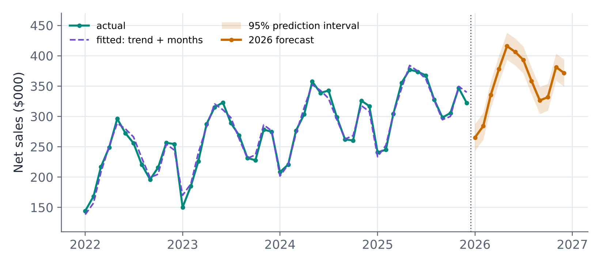{#fig-forecast fig-alt="Line chart of actual monthly sales from 2022 to 2025 with the fitted values of the trend-plus-months model, which follow the actual values closely. To the right, the 2026 forecast continues the pattern at a higher level, from 265 in January to a peak of 416 in May, with a shaded 95 percent prediction band about 22 thousand dollars wide on each side."}

A forecast like this rests on a strong assumption: that the trend and the seasonal pattern of 2022 to 2025 continue through 2026. A new competitor, a recession, or a change in Brazos's own strategy would break that assumption, and no statistical interval accounts for it. Good forecasting practice compares the forecast with actual results every month and revisits the model when they drift apart.

::: {.callout-note .excel icon=false title="In Excel — A trend-plus-season forecast"}
1. With dates in column A and sales in column C, create a time index in column B: `=ROW()-1` (or type 1, 2 and fill down).
2. Create 11 month dummies in columns D to N. For February in column D: `=IF(MONTH($A2)=2, 1, 0)`; change the 2 to 3, 4, ..., 12 for the other columns.
3. Run **Regression** with Y = column C and X = columns B to N (12 adjacent columns, within the ToolPak's limit of 16).
4. Add rows for the forecast months, with their time index and dummies, and compute the forecast with `=SUMPRODUCT(coefficients, values)` or by writing out $b_0 + b_1 t + \ldots$ with absolute references to the coefficient cells.

**Alternative:** Excel's **Data › Forecast Sheet** (the `FORECAST.ETS` function) fits an exponential-smoothing model that detects seasonality automatically and draws a forecast with confidence bounds. It is convenient, but it is a black box; the regression shows you the trend and every seasonal effect explicitly.
:::

## 5.11 Validating a Predictive Model

### The danger of overfitting

A model's fit to the data used to build it is an optimistic measure of how well it will predict new data. Every dataset contains noise, random features that will not repeat, and a model flexible enough can fit the noise as well as the pattern. Such a model looks excellent on paper and predicts poorly.

::: {.callout-note title="Definition — Overfitting"}
**Overfitting** occurs when a model is so flexible, with so many variables or such a complex form relative to the amount of data, that it fits the random noise in the sample along with the real pattern. An overfitted model has a high in-sample $R^2$ and poor accuracy on new data.
:::

The only reliable check is to test the model on data it has not seen.

::: {.callout-note title="Definition — Training and test data"}
In a **train/test split** (or holdout validation), the data are divided into a **training set**, used to fit the model, and a **test set** (or holdout set), used only to measure the accuracy of its predictions. For time series, the test set should be the most recent periods, so that the model is always tested on the future relative to its training data. For cross-sectional data, the test set is typically a random 20% to 30% of the observations.
:::

### Measuring forecast accuracy

Forecast errors are summarized by three common metrics. For $m$ test observations with actual values $y$ and forecasts $\hat{y}$:

::: {.callout-note title="Definition — MAE, RMSE, and MAPE"}
- **Mean absolute error:** $\text{MAE} = \frac{1}{m}\sum |y - \hat{y}|$, the average size of an error, in the units of $y$.
- **Root mean squared error:** $\text{RMSE} = \sqrt{\frac{1}{m}\sum (y - \hat{y})^2}$, also in the units of $y$, but penalizing large errors more heavily.
- **Mean absolute percentage error:** $\text{MAPE} = \frac{100}{m}\sum \left|\frac{y - \hat{y}}{y}\right|$, the average error as a percentage of the actual value; unit-free, so it can compare series of different sizes (but it fails when actual values are near zero).
:::

### Which model forecasts best?

To see how well the seasonal model would actually have forecast, refit it using only 2022 to 2024 (36 months) and use it to forecast 2025, which it has not seen. Compare it with two alternatives: the trend-only model, and a far more flexible model that replaces the straight trend with a fifth-degree polynomial in $t$ ($t, t^2, \ldots, t^5$) plus the 11 month dummies, 16 predictors in all, the most the ToolPak allows.

| Model | Predictors | $R^2$ (training) | Adjusted $R^2$ | MAPE, training | MAE, 2025 | RMSE, 2025 | MAPE, 2025 |
|---|---|---|---|---|---|---|---|
| Trend only | 1 | 0.347 | 0.328 | 15.1% | 36.3 | 42.1 | 12.1% |
| Trend + months | 12 | 0.978 | 0.966 | 2.9% | 7.6 | 9.7 | **2.4%** |
| 5th-degree trend + months | 16 | **0.982** | 0.966 | **2.4%** | 43.5 | 56.0 | 13.4% |

(MAE and RMSE in \$ thousands.)

The flexible model fits the training years best, with the highest $R^2$ and the smallest training error, and its adjusted $R^2$ ties the simpler seasonal model. On the test year it is a disaster: its 2025 forecasts are off by 13.4% on average, more than five times the seasonal model's 2.4%, and no better than ignoring seasonality altogether. @fig-overfit shows why. The polynomial bends to follow small wiggles in 2022–2024, and when it is extended into 2025 the bends take it far from reality: for December 2025 it forecast \$218 thousand, against actual sales of \$322 thousand.

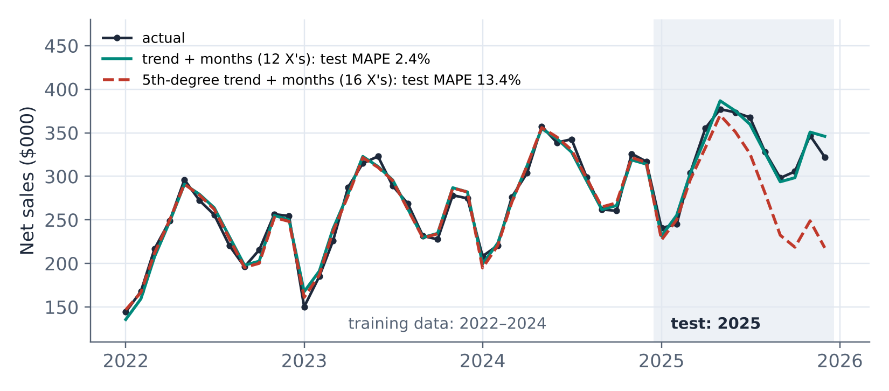{#fig-overfit fig-alt="Line chart of actual monthly sales, 2022 to 2025, with the 2025 test year shaded. Two models fitted to 2022 to 2024 are overlaid. Both track the training years closely. In the test year, the trend-plus-months model stays close to the actual values (test MAPE 2.4 percent), while the fifth-degree polynomial model veers downward from mid-2025, forecasting about 218 in December against an actual 322 (test MAPE 13.4 percent)."}

The seasonal model, by contrast, forecast 2025 about as accurately as it fit the training data. That is the sign of a model that has captured the pattern rather than the noise, and it is the reason to trust its 2026 forecast more than its $R^2$ alone would justify.

Four lessons generalize:

1. **Judge a predictive model by its accuracy on data it was not fitted to.** In-sample $R^2$ always flatters, and adjusted $R^2$ helps but does not reliably detect overfitting.
2. **Prefer the simplest model that captures the pattern.** Each added variable must earn its place by improving out-of-sample accuracy.
3. **Compare with a naive benchmark.** A model that cannot beat "same month last year, plus the average growth" or the historical average is not adding value (recall the base rates of Section 5.2).
4. **Use the test set once.** If you try twenty models and keep the one with the best test score, the test set has become part of the training process, the multiple-testing problem of Unit 4 in a new form. After choosing a model, refit it on all the data, as we did for the 2026 forecast.

::: {.callout-note .excel icon=false title="In Excel — Forecast error metrics"}
With actual values in `C38:C49` and forecasts in `D38:D49`:

| Metric | Formula |
|---|---|
| MAE | `=AVERAGE(ABS(C38:C49-D38:D49))` |
| RMSE | `=SQRT(SUMXMY2(C38:C49, D38:D49)/COUNT(C38:C49))` |
| MAPE | `=AVERAGE(ABS((C38:C49-D38:D49)/C38:C49))` (format as %) |

In older versions of Excel, confirm the MAE and MAPE formulas with Ctrl+Shift+Enter, or compute the errors in a helper column first. To fit on training data only, run the Regression tool on the training rows, then compute the forecasts for the test rows from the coefficients.
:::

## 5.12 Using Regression Well

Regression is easy to run and easy to misread. This section collects the checks that separate a sound analysis from a misleading one.

### Check the residuals

The LINE conditions of Section 5.5 are checked by plotting the residuals against the fitted values (or against each $x$). @fig-resid shows the three patterns to look for.

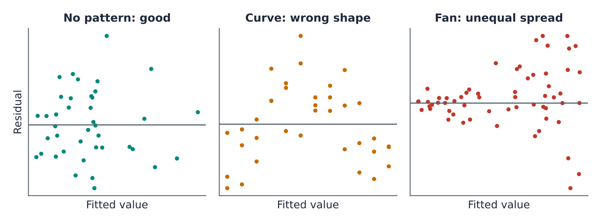{#fig-resid fig-alt="Three residual plots of residuals against fitted values. Left, labeled no pattern, good: points scattered randomly in a horizontal band around zero (the Brazos three-variable market model). Middle, labeled curve, wrong shape: residuals form an arch, negative at both ends and positive in the middle (the straight-line email model). Right, labeled fan, unequal spread: residuals are tightly clustered at small fitted values and spread widely at large ones (an illustration)."}

- **No pattern** (left): a random, even band around zero. The Brazos market model with ad spend, households, and pickup looks like this.
- **A curve** (middle): the model has the wrong shape. The straight-line email model shows this arch. Add a squared term or a logarithm (Section 5.9).
- **A fan** (right): the spread of the residuals grows with the fitted values, violating equal variance. Common with sales, incomes, and costs, where bigger units vary more. Standard errors and prediction intervals are then unreliable, too wide for small units and too narrow for large ones. Modeling $\ln(y)$ often fixes it.

Also look for **outliers**, points with large residuals, and **influential points**, unusual $x$ values that pull the line toward themselves. Brazos's market M32, with ad spend of \$20,050, more than \$6,000 beyond any other market, is such a point: it alone has a noticeable effect on the slope. Check that it is correct, and refit without it to see how much the conclusions depend on it, but do not delete it just because it is inconvenient. For data collected over time, also plot the residuals in time order: runs of positive and negative residuals signal that the independence condition fails, as it did for the trend-only model.

### Multicollinearity

When independent variables are strongly correlated with each other, the regression has trouble separating their effects. Suppose an analyst adds each market's population to the Brazos model, alongside households. Population and households are almost perfectly correlated ($r$ = 0.9994), since population is roughly 2.55 people per household:

| | Coefficients | Standard Error | t Stat | P-value |
|---|---|---|---|---|
| Intercept | 13.1663 | 4.3927 | 2.997 | 0.0050 |
| AdSpend | 6.0460 | 0.8203 | 7.371 | 1.28E-08 |
| Households | 0.0491 | 0.1563 | 0.314 | 0.755 |
| Pickup | 11.8768 | 3.5935 | 3.305 | 0.0022 |
| Population | 0.0002 | 0.0613 | 0.003 | 0.998 |

$R^2$ = 0.923 (unchanged), adjusted $R^2$ = 0.915 (down from 0.917).

Neither size variable is now remotely significant, although market size obviously matters: without population in the model, households had t = 6.06. The standard error of the households coefficient jumped from 0.0082 to 0.1563, nineteen times larger. The model's fit and predictions are unchanged; what has become impossible is to say how much of the size effect belongs to households and how much to population, because in these data they never move separately.

::: {.callout-note title="Definition — Multicollinearity"}
**Multicollinearity** is strong correlation among the independent variables of a regression. It inflates the standard errors of the affected coefficients, making them imprecise, unstable from sample to sample, and sometimes of the "wrong" sign, even when the model as a whole fits well and predicts well. It does not bias predictions within the range of the data.
:::

Symptoms include a significant F test with few or no significant t tests, coefficients that change dramatically when a variable is added or dropped, and signs that contradict common sense. The **variance inflation factor** (VIF), $1/(1 - R_j^2)$, where $R_j^2$ comes from regressing predictor $j$ on the other predictors, measures it directly; values above about 10 signal a problem. Here the VIF for households is about 917; for ad spend and households in the earlier model it was only 2.6. The usual remedy is to keep one of the redundant variables, or to combine them. Moderate correlation among predictors, like the 0.78 between ad spend and households, is normal and is exactly the situation in which multiple regression is needed.

### Correlation is not causation, in regression too

Holding variables constant in a regression is powerful, but it is not the same as an experiment. A regression coefficient from observational data measures an association, adjusted for the variables in the model. It is a causal effect only if nothing else that affects $y$ is related to $x$, and that is a strong assumption. Three problems from Unit 4 reappear:

- **Omitted variables.** The 5.56 ad coefficient adjusts for market size, pickup, and region, but not for local income, competition, or climate. If those are related to ad budgets, the coefficient is still biased.
- **Reverse causality.** Brazos sets each market's ad budget partly on the basis of the previous year's sales. If a market sells well for reasons of its own, it receives a bigger budget next year, so sales influence ad spend as well as the reverse. The regression cannot tell the two directions apart.
- **Selection.** Pickup partners chose to work with Brazos, presumably in markets where they expected Brazos's customers to be good business. Part of the "pickup effect" may reflect where partners chose to locate.

The email experiment of Section 5.9 had none of these problems, because chance alone decided which customers received how many emails. For decisions that matter, the strongest evidence comes from experiments: Brazos could test the effect of advertising by raising budgets in a randomly chosen half of its markets and comparing the two halves, a **geo-experiment**. When experiments are impossible, multiple regression with careful thought about what is omitted is the next best tool, and its causal conclusions should be stated with corresponding modesty.

For pure prediction, none of this matters as much. A model that predicts accurately on test data is a good predictive model, whatever the causal story. But the moment a model is used to choose what to change, its coefficients are being read causally, and they must be able to bear that reading.

### Using AI assistants for regression

Generative AI tools can set up a regression, explain output, and draft a summary for a manager in seconds, and they are increasingly built into spreadsheets. They also make characteristic mistakes: analyzing the wrong range or a truncated copy of the data, misreading a column, inventing plausible-looking numbers, or interpreting a coefficient causally without justification. Treat an AI assistant like a fast, capable junior analyst whose work you must check: confirm the number of observations and the variables used, reproduce the key coefficients and $R^2$ in Excel, check that signs and magnitudes make business sense, and never paste confidential company data into a tool your organization has not approved. Unit 7 returns to working with these tools.

### Reporting a regression

A good report of a regression for a manager states the question, the model, the key estimates with their uncertainty, how well the model predicts, and the main caveats, in plain language:

> *"Across Brazos's 40 markets in 2025, sales rose with digital ad spend. Comparing markets of similar size, with and without pickup partners, each additional \$1,000 of ad spend was associated with about \$6,000 of additional annual sales (95% CI: \$4,400 to \$7,700). The model predicts a new market's sales to within about ±\$22,000. Because budgets were not assigned at random, this is an association, not a guaranteed return on additional advertising; a randomized test in a subset of markets would settle the question."*

Predictive analysis tells Brazos what to expect: how sales respond to advertising, what emails are worth, and what each month of 2026 should bring. The final step is to turn those predictions into decisions: how much to spend, how many emails to send, what to stock and what to charge, under real constraints. That is prescriptive analysis, the subject of Unit 6.

## Key Terms

- **Adjusted $R^2$:** $R^2$ corrected for the number of predictors, $1 - (1 - R^2)(n-1)/(n-k-1)$; used to compare models with different numbers of predictors.
- **Base rate:** How often an outcome occurs in the relevant population, based on historical experience. **Base-rate fallacy:** Judging a prediction or a piece of evidence without accounting for the base rate.
- **Classification:** Predicting which category an observation belongs to, or the probability of each category.
- **Coefficient of determination ($R^2$):** The share of the variation in $y$ explained by the regression, SSR/SST.
- **Confidence interval for the mean response:** An interval for the average $y$ of all cases with given $x$ values.
- **Confusion matrix:** A cross-tabulation of a classification model's predicted classes against the actual classes.
- **Dependent variable:** The variable a regression predicts ($y$); also called the response or outcome.
- **Dummy variable:** A variable equal to 1 if an observation has a characteristic and 0 otherwise; a categorical variable with $c$ categories needs $c - 1$ dummies, compared with a baseline category.
- **Extrapolation:** Using a model to predict outside the range of the data used to fit it.
- **F test (regression):** A test of whether a regression model explains any of the variation in $y$, that is, whether at least one coefficient differs from zero.
- **Fitted value ($\hat{y}$):** The value of $y$ predicted by the regression for given $x$ values.
- **Independent variable:** A variable used to predict $y$ ($x$); also called a predictor or explanatory variable.
- **Least squares:** The method of choosing regression coefficients to minimize the sum of squared residuals.
- **MAE, RMSE, MAPE:** Mean absolute error, root mean squared error, and mean absolute percentage error, three measures of forecast accuracy.
- **Marginal effect:** The change in $y$ associated with a one-unit increase in $x$; in a quadratic model, $b_1 + 2b_2x$, which depends on $x$.
- **Mixed cost:** A cost with a fixed part and a variable part, which regression can estimate as the intercept and the slope.
- **Multicollinearity:** Strong correlation among independent variables, which inflates the standard errors of their coefficients.
- **Multiple regression:** A regression with two or more independent variables; each coefficient is a partial slope, holding the other variables constant.
- **Omitted variable bias:** Distortion of a regression coefficient because a variable that affects $y$ and is correlated with an included $x$ was left out.
- **Overfitting:** Fitting a model so flexible that it captures noise in the sample, producing a good in-sample fit and poor predictions.
- **Prediction interval:** An interval for the $y$ value of one new case with given $x$ values; always wider than the confidence interval for the mean response.
- **Predictive analytics:** The use of patterns in historical data to estimate unknown or future outcomes, with a measure of uncertainty.
- **Quadratic regression:** A regression including $x$ and $x^2$, used to model relationships that curve, rise and fall, or level off.
- **Residual:** The difference between an actual and a fitted value, $e = y - \hat{y}$.
- **Seasonality:** A pattern in a time series that repeats with a fixed period; modeled in regression with seasonal dummy variables.
- **Slope ($b_1$):** The expected change in $y$ for a one-unit increase in $x$. **Intercept ($b_0$):** The fitted value of $y$ when every $x$ is zero.
- **Standard error of the estimate ($s_e$):** The standard deviation of the residuals, the typical size of a prediction error, $\sqrt{SSE/(n-k-1)}$.
- **Sums of squares (SST, SSR, SSE):** Total, regression (explained), and error (unexplained) variation; SST = SSR + SSE.
- **Time index:** A variable counting periods, 1, 2, 3, ..., used to model a trend.
- **Train/test split:** Dividing data into a training set to fit a model and a test set to measure its predictive accuracy.
- **Trend:** The long-run upward or downward movement of a time series.
- **Variance inflation factor (VIF):** $1/(1 - R_j^2)$, a measure of how much multicollinearity inflates a coefficient's variance; values above about 10 signal a problem.

## Practice Problems

1. For each question, say whether it calls for classification, regression, or time-series forecasting: (a) Will a loan applicant default within two years? (b) What will a house sell for, given its size, age, and location? (c) What will weekly call volume be at a support center over the next quarter? (d) Which of our customers are likely to respond to a catalog mailing?
2. A quality-control screen flags units it judges defective. 2% of units are actually defective. The screen flags 90% of defective units and wrongly flags 4% of good units. Out of 5,000 units, how many are flagged, and what share of the flagged units are actually defective? What does the result suggest about how flagged units should be handled?
3. For a sample of 25 sales regions, ad spend $x$ has mean 12 and standard deviation 4, sales $y$ have mean 150 and standard deviation 30, and the correlation is 0.6. Find the least squares slope and intercept, $R^2$, and the predicted sales for a region with $x$ = 15.
4. A logistics company regresses the monthly operating cost of its delivery vans (\$) on the kilometers driven per month, using data from vans that drove between 2,000 and 5,000 km: $\hat{y}$ = 1,850 + 0.42$x$. Interpret the slope and the intercept. Predict the cost for a van that drives 3,500 km in a month. Why would a prediction for 10,000 km be risky?
5. A simple regression with $n$ = 30 has SST = 5,000 and SSE = 1,400. Find SSR, $R^2$, the standard error of the estimate, and the F statistic.
6. In a ToolPak regression with 27 observations, the coefficient of the single predictor is 2.35 with a standard error of 0.80. Compute the t statistic and its degrees of freedom, give the Excel formula for the two-sided p-value and its value, and construct a 95% confidence interval for the slope. What do you conclude?
7. Brazos expects 2,500 customer contacts in a busy month next year. Using the customer-service cost model $\widehat{\text{Cost}}$ = 9,894.91 + 3.8575 × Contacts (fitted to months with 1,077 to 2,142 contacts), predict the month's cost. The 95% prediction interval is ±\$1,079. Why should Brazos treat this prediction with more caution than one for 1,800 contacts?
8. For the Brazos ad spend model at $x$ = 8, the 95% confidence interval is \$100.5 to \$113.0 thousand and the 95% prediction interval is \$72.3 to \$141.3 thousand. Which interval answers each question? (a) A regional manager must commit to a sales target for one new market with an \$8,000 budget. (b) An analyst wants to estimate the average sales of all markets that receive \$8,000 budgets. Explain why collecting data on 400 markets instead of 40 would shrink one interval a lot and the other hardly at all.
9. A regression of a store's weekly sales (\$000) on local advertising (\$000) and the number of competing stores within 5 km, fitted to 30 stores, gives $\hat{y}$ = 42.0 + 3.1 × Ads − 4.6 × Competitors. Interpret both slopes, and predict weekly sales for a store with \$5,000 of advertising and 2 competitors.
10. In the Brazos market data, the ad spend coefficient was 9.48 in the simple regression and 5.56 after adding households. Explain the change in terms of omitted variable bias. If Brazos wants to know how much an extra \$1,000 of advertising would add in one particular market, which number is the better guide? Give one reason why even that number might be too high.
11. A regression with 4 predictors and 25 observations has $R^2$ = 0.62. Compute adjusted $R^2$. Adding a fifth predictor raises $R^2$ to 0.63. Compute the new adjusted $R^2$. Should the fifth predictor be kept?
12. A salary regression for a company's analysts gives $\widehat{\text{Salary}}$ = 52,000 + 2,400 × Years + 6,500 × MBA, where MBA is 1 for employees with an MBA. Interpret the coefficient 6,500 and predict the salary of an analyst with 5 years of experience and an MBA. To include the employee's division (four divisions), how many dummy variables are needed, and why not four?
13. In the Brazos region model, the South coefficient is 13.80 (p = 0.005) and the West coefficient is 3.83 (p = 0.42), with the Midwest as the baseline. Interpret both. Why did the pickup coefficient fall from 11.9 to 8.3 when region was added?
14. Using the email model $\hat{y}$ = 18.326 + 2.418$x$ − 0.1468$x^2$, predict revenue per customer at 6 emails a month, compute the marginal effect of a seventh email at that point, and find the revenue-maximizing frequency. Give one reason why Brazos might choose to send fewer emails than that.
15. Using the Brazos trend-plus-months model (intercept 135.56, trend 2.647, March coefficient 64.66), forecast sales for March 2026 ($t$ = 51). Interpret the February coefficient of 16.20. Why does the model use 11 month dummies rather than 12?
16. Four months of actual sales were 120, 150, 90, and 140, and the forecasts were 110, 160, 100, and 125. Compute the MAE, RMSE, and MAPE.
17. An analyst reports a model with 15 predictors fitted to 20 observations and $R^2$ = 0.98. Compute the adjusted $R^2$. What concerns you, and how would you check whether the model predicts well?
18. A marketing report says: "Markets where we spend more on ads have much higher sales ($R^2$ = 0.81). If we double every market's ad budget, sales will rise by \$9.48 per added dollar." Identify three problems with this conclusion and describe a study that could measure the effect of advertising properly.
19. After adding population to a model that already contains households, neither variable is significant (p = 0.755 and 0.998), although $R^2$ is unchanged at 0.923. Explain what has happened and what the analyst should do.

### Answers

1. (a) Classification (default or not, or the probability of default). (b) Regression. (c) Time-series forecasting. (d) Classification (respond or not).
2. Defective: 2% × 5,000 = 100, of which 90 are flagged. Good: 4,900, of which 4% = 196 are flagged. Flagged: 286, of which 90/286 = **31.5%** are defective. More than two-thirds of flagged units are good, because good units vastly outnumber defective ones (the base rate). Flagged units should be re-inspected rather than scrapped.
3. $b_1 = 0.6 \times 30/4$ = 4.5; $b_0 = 150 - 4.5 \times 12$ = 96; $R^2 = 0.6^2$ = 0.36; $\hat{y}$(15) = 96 + 4.5 × 15 = 163.5.
4. Slope: each additional kilometer driven adds about \$0.42 to the monthly cost (the variable cost per km). Intercept: about \$1,850 per month is fixed (insurance, depreciation, registration) within the relevant range. At 3,500 km: 1,850 + 0.42 × 3,500 = **\$3,320**. 10,000 km is far outside the 2,000–5,000 km range of the data; costs per km may change at very high usage (more maintenance, overtime, a second driver), so the line may not hold there.
5. SSR = 5,000 − 1,400 = 3,600; $R^2$ = 3,600/5,000 = 0.72; $s_e = \sqrt{1{,}400/28} = \sqrt{50}$ = 7.07; F = (3,600/1)/(1,400/28) = 3,600/50 = 72.
6. $t$ = 2.35/0.80 = 2.94 with 27 − 2 = 25 degrees of freedom. p-value: `=T.DIST.2T(2.94, 25)` = 0.007. 95% CI: 2.35 ± 2.060 × 0.80 = 0.70 to 4.00 (`=T.INV.2T(0.05, 25)` = 2.060). The slope is significantly different from zero; the predictor is related to $y$, although the interval shows the size of the effect is not precisely known.
7. 9,894.91 + 3.8575 × 2,500 = **\$19,539** (95% PI about \$18,460 to \$20,617). 2,500 contacts lies beyond the largest month in the data (2,142), so the prediction is an extrapolation: the cost structure could change at that volume (overtime, temporary staff), and the interval does not account for that risk. 1,800 contacts lies well within the data.
8. (a) The prediction interval, because the target is for one market. (b) The confidence interval, because it concerns the average. With 400 markets the line would be estimated much more precisely, so the confidence interval would shrink by about a factor of $\sqrt{10}$, but individual markets would still scatter around the line by about $s_e$ = \$16.8 thousand, so the prediction interval would barely shrink (it can never be narrower than about ±2$s_e$).
9. Ads: holding the number of competitors constant, each additional \$1,000 of weekly advertising is associated with \$3,100 more weekly sales. Competitors: holding advertising constant, each additional competing store within 5 km is associated with \$4,600 lower weekly sales. Prediction: 42.0 + 3.1 × 5 − 4.6 × 2 = **\$48.3 thousand**.
10. Larger markets receive larger budgets and have higher sales regardless of budget. In the simple regression, ad spend carries part of the effect of market size: markets with \$1,000 more ad spend have 74.55 thousand more households, worth 0.0526 × 74.55 = \$3.92 thousand of sales, and 5.56 + 3.92 = 9.48. For a market whose size is fixed, 5.56 is the better guide. It may still be too high because of other omitted variables related to budgets (income, competition), because budgets respond to past sales (reverse causality), or because returns diminish at higher budgets.
11. $R^2_{adj} = 1 - 0.38 \times 24/20$ = **0.544**. With five predictors: $1 - 0.37 \times 24/19$ = **0.533**. Adjusted $R^2$ fell, so the fifth predictor does not improve the model by more than chance would; drop it unless there is a strong reason to keep it (and check it on test data).
12. Holding years of experience constant, analysts with an MBA earn on average \$6,500 more than analysts without one. Prediction: 52,000 + 2,400 × 5 + 6,500 = **\$70,500**. Four divisions need three dummies, with the fourth as the baseline; four dummies would always sum to 1 and duplicate the intercept (the dummy variable trap), so the model could not be estimated.
13. South: holding ad spend, households, and pickup constant, South markets sell on average \$13.8 thousand more than comparable Midwest markets, a significant difference. West: \$3.8 thousand more than comparable Midwest markets, but not significant; the data are consistent with no difference. Pickup partners are concentrated in the South and Northeast; without region in the model, the pickup dummy picked up part of the South's advantage.
14. $\hat{y}$(6) = 18.326 + 2.418 × 6 − 0.1468 × 36 = **\$27.55** per customer per quarter. Marginal effect at 6: 2.418 − 2 × 0.1468 × 6 = **\$0.66**. Maximum at $x$ = 2.418/(2 × 0.1468) = **8.2 emails** per month. Reasons to send fewer: sending emails has costs; additional emails near the peak add almost nothing; frequent emails may cause unsubscribes that reduce future revenue beyond the quarter measured; the curve near its peak is estimated with uncertainty.
15. 135.56 + 2.647 × 51 + 64.66 = **\$335.2 thousand**. February: holding the trend constant, February sales average \$16.2 thousand more than January sales. Month is a categorical variable with 12 categories, so it needs 11 dummies with one month (January) as the baseline; 12 dummies would always sum to 1 and duplicate the intercept.
16. Errors (actual − forecast): 10, −10, −10, 15. MAE = (10 + 10 + 10 + 15)/4 = **11.25**. RMSE = $\sqrt{(100 + 100 + 100 + 225)/4} = \sqrt{131.25}$ = **11.46**. MAPE = (10/120 + 10/150 + 10/90 + 15/140)/4 = (8.33% + 6.67% + 11.11% + 10.71%)/4 = **9.21%**.
17. $R^2_{adj} = 1 - 0.02 \times 19/4$ = 0.905. With 15 predictors and only 20 observations, the model has almost as many coefficients as data points and is very likely overfitted: it can fit noise and will probably predict poorly. Check it by fitting it to part of the data and measuring its accuracy (MAE, RMSE, MAPE) on held-out observations, compared with a much simpler model and a naive benchmark.
18. (1) Confounding: larger markets get larger budgets, so 9.48 includes the effect of market size (it falls to about 5.6–6.0 when size is held constant). (2) Reverse causality: budgets are set partly on past sales. (3) Extrapolation and diminishing returns: doubling budgets would take many markets beyond the range of the data, where the straight line may not hold. A randomized geo-experiment, raising budgets in a randomly selected half of the markets and comparing sales with the other half, would measure the effect directly.
19. Population and households are almost perfectly correlated ($r$ = 0.9994), so the regression cannot separate their effects: the standard errors are hugely inflated (multicollinearity; VIF ≈ 917), although the two together still explain sales as well as households alone. The analyst should keep one of the two variables (or combine them), not conclude that market size does not matter.
