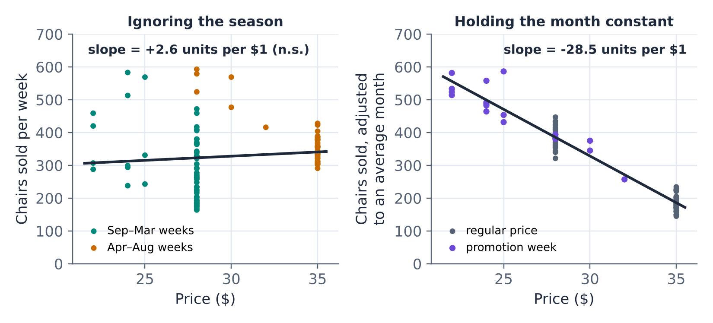
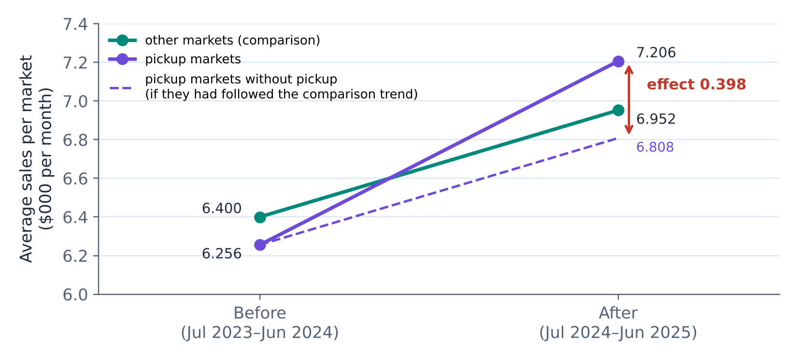
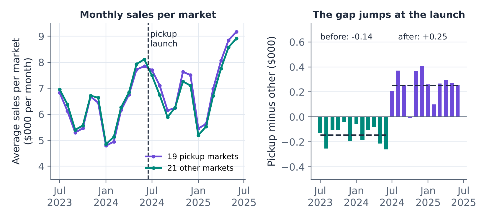
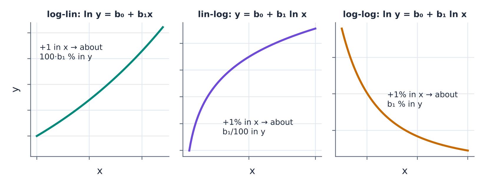
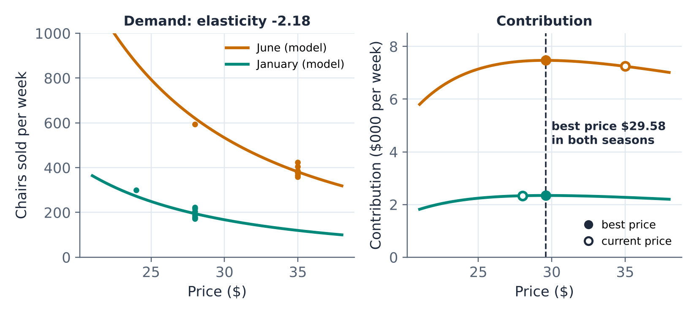
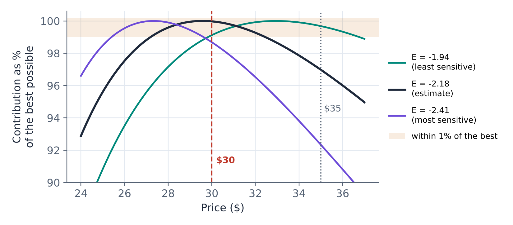

Unit 5 used regression to predict: what sales to expect in a market, what next month will bring. Prediction asks what is likely to happen if the world goes on as it has. Managers usually need something else: they want to know what will happen *if they act*. What happens to sales if Brazos raises the price of its camp chair? Is offering in-store pickup worth what a partner charges for it? Answering questions like these, and then choosing the best action, is **prescriptive analysis**.

A prescription needs two things, and this chapter takes them in turn. The first is an estimate of the **effect** of the decision: how much the outcome changes when the decision changes. A regression coefficient is not automatically such an effect, and the first half of the chapter is about when it is. It revisits control variables in multiple regression, introduces natural experiments, and develops the most widely used method for analyzing them, **difference-in-differences**, which turns out to be a regression with dummy variables and one new ingredient, an interaction term. The second thing a prescription needs is a way to turn the effect into the **best decision**. The second half of the chapter shows how logarithms let a regression describe percentage effects and price sensitivity, uses a log-log regression to estimate the price elasticity of Brazos's camp chair, finds the price that maximizes contribution, and tests how much that answer can be trusted with Excel's what-if tools.

Two decisions run through the chapter. The first is whether Brazos should pay a second retail partner to offer in-store pickup in the markets that do not have it yet. The second is what to charge for the Basecamp camp chair.

By the end of this chapter you should be able to:

- Explain what prescriptive analytics is and why a prescription requires an estimate of an effect, not just an association.
- Judge which variables belong in a regression as controls and which do not, and explain what controls can and cannot fix.
- Recognize natural experiments in business data and the conditions that make them credible.
- Estimate an effect with difference-in-differences, both from a 2 × 2 table of means and as a regression with an interaction term, and check its key assumption.
- Turn an estimated effect, with its confidence interval, into a recommendation.
- Interpret log-lin, lin-log, and log-log regressions, including percentage effects and elasticities.
- Find the contribution-maximizing price from an estimated elasticity, and explain the markup rule.
- Use Data Tables, Goal Seek, and Scenario Manager to test how robust a recommended decision is.

## 6.1 From Prediction to Prescription

Recall the four questions of analytics: *what happened* (descriptive), *why did it happen* (diagnostic), *what is likely to happen* (predictive), and *what should we do* (prescriptive). Units 3 to 5 answered the first three. This unit turns to the fourth.

::: {.callout-note title="Definition — Prescriptive analytics"}
**Prescriptive analytics** uses data and models to recommend actions. It estimates how an outcome responds to the choices a business can make, and uses that estimate to find the choice that best meets the business's goals. Its output is a recommended decision, together with its expected result and how sure we can be of it.
:::

Every prescriptive problem has the same parts. The **decision variable** is what the business controls: a price, whether to offer a service in a market, an advertising budget. The **objective** is the measure of success: usually contribution or profit, not revenue. **Constraints** are limits on acceptable decisions, such as a budget or the range of prices that has ever been tried. And the **response** links the decision to the outcome: how many more chairs sell at a lower price, how much more a market buys with pickup. The response is what regression estimates.

That last step is where prediction and prescription part ways. A predictive model can use any variable that reliably goes along with the outcome. The number of people searching for "tent" on Brazos's website predicts next week's tent sales well, but nobody would try to raise sales by searching for tents. A prescriptive model has to answer a different question: *if we change the decision ourselves, how much will the outcome change?* That is a question about an **effect**.

::: {.callout-note title="Definition — Effect of a decision"}
The **effect** of a decision on an outcome is the difference between the outcome with the decision and the outcome that would have occurred without it, everything else unchanged. The outcome that would have occurred otherwise is the **counterfactual**. Because the counterfactual is never observed, every estimate of an effect relies on a comparison that stands in for it: other weeks, other markets, other customers.
:::

The whole first half of this chapter is about choosing that comparison well.

## 6.2 When Is a Coefficient an Effect?

Brazos's best-selling private-label product is the Basecamp folding camp chair, which costs Brazos \$16.00 per chair sold (\$11.50 from the supplier and \$4.50 to pick, pack, and ship). In 2024 and 2025, Brazos priced it at \$28 from September to March and \$35 from April to August, the camping season, and ran occasional promotions at 10% to 20% off. The merchandising team wants to know whether these prices are right, and the first step is to find out how sales respond to price.

An analyst regresses weekly unit sales on price for the 104 weeks of 2024 and 2025:

$$
\widehat{\text{Units}} = 251.4 + 2.56 \times \text{Price}
$$

The slope is small, positive, and not significant ($t$ = 1.04, p-value = 0.30, $R^2$ = 0.011). Taken at face value, the regression says that price has no effect on chair sales: Brazos could raise the price and lose no customers. If anything, sales go *up* slightly with price.

Nobody who has sold anything believes that, and the left panel of @fig-controls shows what went wrong. Brazos charged its highest prices in exactly the months when demand was highest. The camping season raised sales and, through Brazos's pricing policy, raised the price at the same time. The season's effect on sales and the price's effect on sales are mixed together in the slope, and they almost cancel out.

{#fig-controls fig-alt="Two scatterplots of chairs sold per week against price, 104 weeks of 2024 and 2025. Left: September to March weeks cluster at 28 dollars, April to August weeks at 35 dollars, with promotion weeks at lower prices; the fitted line is nearly flat, slope plus 2.6 units per dollar, not significant. Right: sales adjusted to an average month against price; regular-price weeks at 28 and 35 dollars and promotion weeks at lower prices fall along a steep downward line with slope minus 28.5 units per dollar."}

This is the problem of confounding from Unit 4 and of omitted variable bias from Unit 5, seen from the point of view of a decision. Brazos sets the price, so it is tempting to think that the price coefficient must measure the effect of the price. But it measures the effect of price only if nothing else that affects sales moved together with price in the data. Here the season did.

::: {.callout-warning title="The prescription test"}
Before using a regression coefficient to choose an action, ask: *if we changed $x$ ourselves, would $y$ change by about $b$?* The answer is yes only if, after any control variables in the model, nothing else that affects $y$ moved together with $x$ in the data. Decisions are rarely made at random: prices follow demand, budgets follow sales, services go where they are expected to do well. So the coefficient on a business decision is especially likely to fail this test.
:::

There are three ways to get a coefficient that passes.

1. **Randomize the decision.** In a randomized experiment, chance decides which customers, weeks, or markets get which version of the decision, so nothing else can move with it. Online businesses routinely run such **A/B tests** on emails, web pages, and ads. For most other decisions, randomizing is slow, expensive, risky, or unpopular: few companies will charge random prices or open stores in randomly chosen cities to learn what happens.
2. **Hold the confounders constant** with multiple regression, so that the coefficient compares situations that differ in the decision but are alike in everything else that matters. Section 6.3 takes this route for the chair.
3. **Find a natural experiment**: an event outside the analyst's control that changed the decision for some units and not for others, for reasons unrelated to the outcome. Sections 6.4 to 6.6 take this route for in-store pickup.

## 6.3 Controls Revisited

Unit 5 introduced the idea of holding a variable constant. When Brazos's ad spend was regressed on sales across 40 markets, the slope was 9.48; adding the number of households in each market reduced it to 5.56, because larger markets received larger budgets *and* bought more. Market size was a **confounder**: a variable that affects the outcome and is related to the decision.

::: {.callout-note title="Definition — Confounder and control variable"}
A **confounder** is a variable that affects the outcome and is related to the decision variable, so that leaving it out of the regression mixes its effect into the coefficient of the decision. Including it as a **control variable** lets the regression compare observations that differ in the decision but are alike in the confounder.
:::

For the chair, the confounder is the season. Unit 5 showed how to represent the month of the year with 11 dummy variables, with January as the baseline. Adding them to the price regression gives:

| | Coefficients | Standard Error | t Stat | P-value | Lower 95% | Upper 95% |
|---|---|---|---|---|---|---|
| Intercept | 989.2184 | 44.2145 | 22.373 | 9.27E-39 | 901.3918 | 1077.0451 |
| Price | −28.4636 | 1.5631 | −18.209 | 4.26E-32 | −31.5685 | −25.3586 |
| *11 month dummies* | | | | | | |

$R^2$ = 0.920, $s_e$ = 30.0 chairs, $n$ = 104.

Holding the month constant, each \$1 increase in price is associated with about **28.5 fewer chairs** sold per week (95% CI: 25.4 to 31.6). The right panel of @fig-controls shows the comparison the regression now makes: chair sales adjusted to an average month, against price. Within a month, weeks with lower prices sold far more chairs.

### Where the estimate comes from

With the month dummies in the model, the regression can no longer use the difference between summer and winter to estimate the price effect, because that difference is now attributed to the months. What is left is the variation in price *within* a month, which comes from the 18 promotion weeks. Comparisons between promotion weeks and regular weeks of the same month are what the coefficient is built from.

This has two practical consequences.

- **Controls need leftover variation.** If Brazos had charged the same price every week of every month, price would be completely determined by the month dummies, and the regression could not estimate a price effect at all: Excel would report an error or meaningless coefficients. Controlling for a variable works only if the decision still varies after the control is held constant.
- **The estimate is only as good as that variation.** The coefficient is credible to the extent that the promotion weeks differed from other weeks of the same month only in price. Brazos schedules its promotions months in advance on a fixed marketing calendar and announces them only on the product page, which makes that plausible. If promotions had been launched whenever sales looked weak, or advertised heavily, the price coefficient would be biased again.

### What not to control for

Adding controls is not always an improvement. Brazos also records how many times the chair was added to a shopping cart each week. Add-to-carts are strongly related to sales, so an analyst might add them to the regression to "explain more of the variation". The result:

| Model | Price coefficient | Standard error | $R^2$ |
|---|---|---|---|
| Price + month dummies | −28.46 | 1.56 | 0.920 |
| Price + month dummies + add-to-carts | −3.39 | 1.17 | 0.990 |

The model fits better, and the price effect has almost disappeared. The problem is that add-to-carts are not a confounder but a **step on the path** from price to sales: a lower price persuades more customers to put the chair in their carts, and most of them then buy it. Holding add-to-carts constant asks how price affects sales *among weeks with the same number of add-to-carts*, which removes most of the effect we wanted to measure.

::: {.callout-warning title="Choosing control variables"}
**Do control for** variables that affect the outcome, are related to the decision, and are determined *before* the decision: the season, the size of a market, a customer's past purchases, a market's sales before a change.

**Do not control for** variables that are affected *by* the decision: add-to-carts or website visits after a price change, orders through a pickup partner after pickup is offered, whether a customer opened a promotional email. Controlling for them removes part of the effect being measured.

A better fit ($R^2$) is not a reason to include a variable. A model built for a decision is judged by whether its coefficient answers the decision's question.
:::

### The limits of controls

Multiple regression holds constant only the variables in the model. The season can be measured, so it can be controlled. Many confounders cannot: a competitor's promotions, a heat wave, a viral social media post, a local event. If any of them happened to coincide with Brazos's price changes, the coefficient is still biased, and the data cannot reveal it. This is why analysts look for situations in which the decision changed for reasons that have nothing to do with the outcome. The rest of the first half of this chapter is about them.

::: {.callout-note .excel icon=false title="In Excel — Month dummies as controls"}
With the month number (1–12) in column B, create 11 adjacent columns headed *Feb* to *Dec*: in the *Feb* column, `=IF($B2=2,1,0)`, and so on to `=IF($B2=12,1,0)`. Place the price column next to them, so that price and the 11 dummies form one block of 12 adjacent columns, and use that block as the **Input X Range** in the ToolPak regression. The Regression tool accepts up to 16 X columns. Never include a dummy for all 12 months together with the intercept: the dummy variable trap of Unit 5.
:::

## 6.4 Natural Experiments

In a randomized experiment, the analyst decides who gets the treatment. In a **natural experiment**, something else decides: a law, a supplier, a partner's schedule, the weather. If that something is unrelated to the outcome's other causes, the comparison between those who got the treatment and those who did not is almost as good as an experiment.

::: {.callout-note title="Definition — Natural experiment"}
A **natural experiment** is a situation in which an event or rule outside the analyst's control changes the decision variable (the **treatment**) for some units, the **treatment group**, and not for others, the **comparison group**, for reasons that are unrelated to the outcome's other causes. The units can be markets, stores, products, customers, or employees.
:::

Natural experiments are common in business, once you start looking for them.

| Kind of event | Business examples |
|---|---|
| Staggered rollouts | A new system, service, or store format launched in some locations months before others, on a schedule set by IT or construction |
| Cost shocks | A tariff or supplier price increase that forces price changes on some products but not on similar ones |
| Policy changes | A sales tax holiday or minimum-wage increase in one state but not its neighbors; a new regulation for one product category |
| Disruptions | A carrier strike, a platform outage, a storm that closes stores in one region |
| Rules and thresholds | Customers just above and just below a loyalty-tier cutoff; orders just above and below a free-shipping threshold |

Not every event is a good natural experiment. Four questions decide whether one can be trusted:

1. **Why did the treatment group get the treatment?** The best answer is a reason unrelated to the outcome, such as an IT schedule or a state border. If the treatment went where it was expected to work best, the comparison is biased.
2. **Is there a comparison group** that was not treated but is otherwise similar?
3. **Are there data from before and after** the change, for both groups?
4. **Did anything else change at the same time** for only one of the groups?

### Brazos's pickup launch

Unit 5 found that markets where customers can pick up their orders at a partner store have higher sales, holding ad spend and market size constant: about \$11,900 a year more, or \$8,300 after adding region. But it warned that this might not be an effect of pickup at all, because partners chose where to locate.

A natural experiment can answer the question. Trailhead General, a regional outdoor chain with stores in 19 of Brazos's 40 markets, began offering Brazos pickup on **July 1, 2024**, at all of its stores at once. The date was set by Trailhead's own point-of-sale upgrade, not by anything happening to Brazos's sales. The other 21 markets had no Trailhead store and never offered pickup. Brazos has monthly sales for every market from July 2023 to June 2025: twelve months before the launch and twelve after.

Check the four questions. The 19 markets were chosen long ago, by Trailhead's store locations; that is not random, and the pickup markets may differ from the others in ways that matter. The timing was set by an IT project. There is a comparison group of 21 markets, and data before and after for both. And Brazos changed nothing else in July 2024 that affected only one group. The one real concern, that pickup markets are different, is exactly the concern that the method of the next section handles.

The stakes are real. Summit Outfitters, another chain, has offered to provide pickup in Brazos's 21 remaining markets for a fee of **\$1,200 a year per market**. Whether that is worth it depends on the effect of pickup.

## 6.5 Difference-in-Differences

There are two obvious ways to estimate the effect of pickup, and both are flawed.

**Before and after.** Average monthly sales in the 19 pickup markets rose from \$6,256 per market in the year before the launch to \$7,206 in the year after, an increase of \$950. But sales grew everywhere: in the 21 markets without pickup they rose by \$552. Part of the \$950 would have happened anyway.

**Pickup markets against the others.** After the launch, pickup markets sold \$7,206 a month and the others \$6,952, a difference of \$254. But the two groups were not equal before the launch either: pickup markets sold \$144 a month *less* than the others in the year before. Part of the \$254 reflects how the markets differed all along.

**Difference-in-differences** combines the two comparisons so that each fixes the other's flaw:

| Average monthly sales per market (\$000) | Before (Jul 2023–Jun 2024) | After (Jul 2024–Jun 2025) | Change |
|---|---|---|---|
| Pickup markets (19) | 6.256 | 7.206 | **+0.950** |
| Other markets (21) | 6.400 | 6.952 | **+0.552** |
| Difference | −0.144 | +0.254 | **+0.398** |

The change in the pickup markets (+0.950) includes the effect of pickup and the growth that would have happened anyway. The change in the other markets (+0.552) estimates that growth. The difference between the two changes, **+0.398**, is the estimated effect of pickup: about **\$398 more sales per market per month**, or roughly \$4,800 a year. The same number appears in the bottom row: the gap between the groups widened from −0.144 to +0.254.

::: {.callout-note title="Definition — Difference-in-differences"}
**Difference-in-differences** (DiD) estimates the effect of a treatment as the change in the outcome in the treatment group minus the change in the comparison group:
$$
\text{DiD} = (\bar{y}_{T,\text{after}} - \bar{y}_{T,\text{before}}) - (\bar{y}_{C,\text{after}} - \bar{y}_{C,\text{before}})
$$
The change in the comparison group stands in for the change the treatment group would have experienced without the treatment. The key assumption is **parallel trends**: without the treatment, the two groups' outcomes would have changed by the same amount. DiD does *not* require the two groups to be alike in level; any fixed difference between them cancels out.
:::

@fig-did draws the logic. The dashed line shows the counterfactual: where the pickup markets would have ended up if they had grown like the other markets, \$6,808. The effect is the gap between where they actually ended up and that counterfactual.

{#fig-did fig-alt="Line chart with two time points, before (July 2023 to June 2024) and after (July 2024 to June 2025). Other markets rise from 6.400 to 6.952 thousand dollars per month. Pickup markets rise from 6.256 to 7.206. A dashed line from the pickup markets' starting point rises in parallel with the other markets to 6.808. A red arrow between 6.808 and 7.206 marks the effect, 0.398."}

Notice that this estimate is far smaller than Unit 5's cross-sectional estimate of \$8,300 to \$11,900 a year. The cross-sectional comparison mixed the effect of pickup with whatever made Trailhead's markets good markets for Brazos. DiD removes any difference between the groups that stays constant over time, and what is left is about \$4,800 a year.

### DiD as a regression

The 2 × 2 table can be reproduced with a regression, and the regression form has two advantages: it delivers standard errors, and it can be extended with control variables. Organize the data with one row per market and period (40 markets × 2 periods = 80 rows), with average monthly sales as $y$ and three predictors:

- *Pickup* = 1 for the 19 pickup markets, 0 for the others (a dummy for the group);
- *Post* = 1 for the period after the launch, 0 before (a dummy for the period);
- *Pickup × Post* = the product of the two, which equals 1 only for pickup markets after the launch.

$$
\widehat{\text{Sales}} = b_0 + b_1\,\text{Pickup} + b_2\,\text{Post} + b_3\,(\text{Pickup} \times \text{Post})
$$

| | Coefficients | Interpretation | Equals |
|---|---|---|---|
| Intercept $b_0$ | 6.3999 | Other markets, before | 6.400 |
| Pickup $b_1$ | −0.1442 | Pickup minus other markets, before | 6.256 − 6.400 |
| Post $b_2$ | 0.5523 | Change in the other markets | 6.952 − 6.400 |
| Pickup × Post $b_3$ | **0.3982** | **Extra change in the pickup markets: the DiD** | 0.950 − 0.552 |

Each coefficient is one cell or one difference of the table, and the coefficient on the product term is the difference-in-differences.

::: {.callout-note title="Definition — Interaction term"}
An **interaction term** is the product of two predictors, included in a regression alongside the two predictors themselves. Its coefficient measures how the effect of one predictor *changes* with the other. In a DiD regression, the coefficient on *Treated × Post* is how much more the outcome changed for the treated group than for the comparison group.
:::

### Getting the standard error right

The ToolPak output for this 80-row regression reports a standard error of 1.341 for $b_3$, which would make the effect look like noise ($t$ = 0.30). That standard error is wrong, and the reason is worth understanding. The regression treats the 80 rows as 80 independent observations, but each market appears twice, and a market that is large before the launch is large after it. The markets differ enormously in size, from about \$2,000 to \$16,000 a month, and the regression counts all that variation as noise.

The fix is to compare each market with itself. Compute each market's **change** in average monthly sales, after minus before, and regress the 40 changes on the *Pickup* dummy:

$$
\widehat{\Delta\text{Sales}} = 0.5523 + 0.3982 \times \text{Pickup}
$$

| | Coefficients | Standard Error | t Stat | P-value | Lower 95% | Upper 95% |
|---|---|---|---|---|---|---|
| Intercept | 0.5523 | 0.0718 | 7.689 | 2.94E-09 | 0.4069 | 0.6977 |
| Pickup | 0.3982 | 0.1042 | 3.820 | 0.0005 | 0.1872 | 0.6092 |

The intercept is the average change in the other markets, and the slope is the DiD, exactly as before. But now market size has been differenced away, and the standard error is 0.104 instead of 1.341. The effect of pickup is clearly positive: about **\$398 per market per month, with a 95% confidence interval from \$187 to \$609**. This regression is the same as a two-sample t test comparing the average change in the two groups (Unit 4), and it gives the same t statistic, 3.82.

::: {.callout-note .excel icon=false title="In Excel — Difference-in-differences"}
With one row per market and month (columns: *Market*, *Pickup*, *Post*, *Sales*):

- **The 2 × 2 table:** `=AVERAGEIFS(Sales, Pickup, 1, Post, 0)`, and similarly for the other three cells.
- **One row per market:** list the 40 markets, and compute each one's average before, `=AVERAGEIFS(Sales, Market, A2, Post, 0)`, its average after, and the change, after minus before.
- **The DiD regression:** ToolPak regression of the change on the *Pickup* dummy. The slope is the DiD, with a valid standard error and confidence interval.
- **The interaction form**, for interpretation: with one row per market and period, add a column `=B2*C2` (Pickup × Post) next to *Pickup* and *Post*, and regress sales on the three columns.
:::

## 6.6 Checking a Natural Experiment, and Making the Decision

Difference-in-differences rests on the parallel trends assumption: without pickup, the two groups would have grown alike. The assumption concerns a counterfactual, so it can never be proved. But it can be checked in several ways, and a careful analysis does all of them before anyone acts on the result.

### Look at the trends before the change

The left panel of @fig-trends plots average monthly sales in each group, month by month. Before July 2024 the two lines move together through the seasons. The right panel plots the gap between them: before the launch it hovers around −\$144 a month; after the launch it jumps to about +\$254 and stays there. If the two groups had been drifting apart before the launch, the parallel trends assumption would be in doubt, and the DiD would pick up the drift as if it were an effect.

{#fig-trends fig-alt="Left: average monthly sales per market for 19 pickup markets and 21 other markets from July 2023 to June 2025. Both lines follow the same seasonal pattern, from about 5 to 9 thousand dollars, and stay close together; a dashed vertical line marks the pickup launch in July 2024. Right: bars for each month showing pickup markets minus other markets. Before the launch the bars are all negative, averaging minus 0.14 thousand; after the launch they are all positive, averaging plus 0.25 thousand."}

### Run a placebo test

A **placebo test** applies the method to a date when nothing happened. If it finds an "effect", the method is picking up something other than the treatment. Using only the twelve months before the real launch, pretend that pickup started in January 2024 and compare the change from July–December 2023 to January–June 2024 in the two groups. The placebo DiD is **−0.015** (\$15 per month), with a p-value of 0.83: no effect where there should be none, as hoped.

### Add control variables

DiD can be combined with controls, as long as they are measured before the treatment (Section 6.3). One concern here is that larger markets tend to grow by more dollars than small ones. Adding each market's average monthly sales before the launch to the regression of changes gives a pickup effect of **0.413** (standard error 0.053), close to the 0.398 without it and estimated more precisely. When an estimate barely moves as reasonable controls are added, that is reassuring.

### Ask what else could explain it

Finally, think about anything else that happened in July 2024 to only one of the groups. Brazos did not change its ad budgets differently in the two groups, and Trailhead did not run special promotions. The effect could be overstated if pickup orders simply moved sales from neighboring markets into pickup markets, but customers rarely drive to another city to collect an order.

### The roll-out decision

Summit Outfitters would charge \$1,200 a year, or \$100 a month, for pickup in each of Brazos's 21 remaining markets. With Brazos's contribution margin of 31% (Unit 3's 43.0% gross margin less 11.8% of sales spent on shipping and fulfillment), the expected gain per market is:

| | Estimate | Low end of 95% CI | High end of 95% CI |
|---|---|---|---|
| Extra sales per market per month | \$398 | \$187 | \$609 |
| Extra contribution (× 0.31) | \$123 | \$58 | \$189 |
| Less Summit's fee | −\$100 | −\$100 | −\$100 |
| **Net gain per market per month** | **\$23** | **−\$42** | **\$89** |
| Net gain per year, 21 markets | \$5,900 | −\$10,600 | \$22,400 |

The best estimate says pickup pays, but only slightly, and the confidence interval includes a loss. Two further considerations matter.

- **External validity.** The effect was measured in Trailhead's markets with Trailhead's stores. Summit's markets and stores may be different, and the effect there could be larger or smaller. An effect estimated in one setting is evidence about another setting, not a guarantee.
- **The form of the effect.** The table assumes that pickup adds the same number of dollars to every market. If pickup instead raises sales by a similar *percentage* in every market, the gain depends on each market's size. Section 6.7 shows how logarithms estimate a percentage effect, and that it sharpens this decision considerably.

A sensible recommendation at this point is to proceed, but in stages: start pickup in some of Summit's markets first, chosen by Summit's own schedule, and compare their sales with the markets still waiting. The rollout itself then becomes the next natural experiment, and it measures the effect in exactly the markets where the decision will be made.

## 6.7 Logarithms in Regression

Unit 5 introduced logarithms briefly as one way to model a curve. They deserve a closer look, because many business effects are naturally expressed in percentages: a service that raises sales by 7%, a price increase of 10% that loses 20% of unit sales, an advertising budget that grows by half. A regression on logarithms measures exactly these percentage effects.

The key fact is that a small change in the natural logarithm of a variable is approximately its percentage change divided by 100:

$$
\ln(y_1) - \ln(y_0) \approx \frac{y_1 - y_0}{y_0}
$$

For example, ln(107) − ln(100) = 0.0677, close to 7%. The approximation is excellent for changes up to about 10% to 15%, and the exact percentage change is $100 \times (e^{\Delta \ln y} - 1)$.

Taking logs of $y$, of $x$, or of both gives three models, each with its own interpretation of the slope.

::: {.callout-note title="Definition — Three log models"}
| Model | Equation | Interpretation of $b_1$ | Typical use |
|---|---|---|---|
| **Log-lin** | $\ln \hat{y} = b_0 + b_1 x$ | +1 in $x$ → about $100 \times b_1$ % in $y$ (exactly $100(e^{b_1} - 1)$ %) | Growth rates; effects proportional to size; dummy variables with percentage effects |
| **Lin-log** | $\hat{y} = b_0 + b_1 \ln x$ | +1% in $x$ → about $b_1/100$ units of $y$ | Diminishing returns, such as advertising |
| **Log-log** | $\ln \hat{y} = b_0 + b_1 \ln x$ | +1% in $x$ → about $b_1$ % in $y$: $b_1$ is an **elasticity** | Price sensitivity; scale relationships |

In the familiar **lin-lin** model, $\hat{y} = b_0 + b_1 x$, +1 in $x$ → $b_1$ units of $y$.
:::

@fig-logs shows the shapes. A log-lin model curves upward, because a constant percentage increase adds more units at higher levels. A lin-log model rises steeply and then flattens: each additional percent of $x$ adds the same amount, so each additional *unit* of $x$ adds less. A log-log model with a negative slope falls steeply and then flattens, the typical shape of a demand curve.

{#fig-logs fig-alt="Three small panels. Log-lin: y against x curves upward at an increasing rate; plus 1 in x gives about 100 times b-one percent in y. Lin-log: y rises steeply at small x and flattens; plus 1 percent in x gives about b-one over 100 in y. Log-log with a negative slope: y falls steeply at small x and flattens; plus 1 percent in x gives about b-one percent in y."}

### Log-lin: the pickup effect as a percentage

Section 6.5 measured the effect of pickup in dollars: \$398 per market per month. But a market with \$16,000 of monthly sales probably gains more dollars from pickup than a market with \$2,000. If pickup instead raises sales by a similar *percentage* everywhere, the natural model is in logs. Repeat the DiD regression of Section 6.5 with each market's change in the log of its average monthly sales, ln(after) − ln(before), as the outcome:

$$
\widehat{\Delta \ln \text{Sales}} = 0.0815 + 0.0637 \times \text{Pickup}
$$

| | Coefficients | Standard Error | t Stat | P-value | Lower 95% | Upper 95% |
|---|---|---|---|---|---|---|
| Intercept | 0.0815 | 0.0053 | 15.436 | 5.89E-18 | 0.0708 | 0.0922 |
| Pickup | 0.0637 | 0.0077 | 8.323 | 4.32E-10 | 0.0482 | 0.0793 |

The intercept says that sales in the markets without pickup grew by about 8.5% from one year to the next ($e^{0.0815} - 1$). The slope says that pickup markets grew by an extra 0.0637 in logs: pickup raised sales by about $100(e^{0.0637} - 1)$ = **6.6%** (95% CI: 4.9% to 8.2%). The placebo test in logs again finds nothing (0.6%, p-value = 0.51).

The log version is also much more precise: its t statistic is 8.3, against 3.8 for the dollar version. The reason is the same as before. Markets of very different sizes grew by very different dollar amounts but by similar percentages, so in logs the noise from market size largely disappears. A model whose form matches how the effect actually works fits better and estimates more precisely.

### The roll-out decision, revisited

The percentage form also changes the decision of Section 6.6. Summit's 21 markets averaged \$6,952 of monthly sales after July 2024. A 6.6% effect there is \$458 a month per market:

| | Estimate | Low end of 95% CI | High end of 95% CI |
|---|---|---|---|
| Effect of pickup | 6.6% | 4.9% | 8.2% |
| Extra sales per market per month (on \$6,952) | \$458 | \$344 | \$573 |
| Extra contribution (× 0.31), less \$100 fee | **\$42** | **\$7** | **\$78** |
| Net gain per year, 21 markets | \$10,500 | \$1,600 | \$19,600 |

Now the whole confidence interval is above zero. The case for offering pickup through Summit is clearly stronger than the dollar model suggested, because the percentage model fits the data better and because it estimates the effect more precisely. The caution about external validity still applies, and so does the advice to roll out in stages.

### Lin-log: diminishing returns

In a lin-log model, $\hat{y} = b_0 + b_1 \ln x$, a 1% increase in $x$ adds about $b_1/100$ units of $y$, whatever the level of $x$. The effect of one more *unit* of $x$ is $b_1/x$: it shrinks as $x$ grows. That is the classic shape of diminishing returns. For example, if a regression of a market's annual sales (\$000) on ad spend (\$000) gave $\hat{y} = 30 + 60 \ln(\text{AdSpend})$, then each 1% increase in ad spend would add about \$600 of sales, and one more \$1 of ad spend would add about 60/5 = \$12 of sales at an ad budget of \$5,000 but only 60/15 = \$4 at \$15,000. A straight line, by contrast, would claim the same return on every dollar, however large the budget.

### Choosing a functional form

Three considerations guide the choice among these models:

- **How the effect should work.** If the effect of the decision should be proportional to the size of the unit (pickup and market size), or if percentage changes are what matter (prices and elasticities), use logs.
- **The residuals.** As in Unit 5, a curved or fan-shaped pattern in the residuals signals the wrong form.
- **Like with like.** $R^2$ measures the share of the variation in *the outcome as modeled*. An $R^2$ for $\ln y$ cannot be compared with an $R^2$ for $y$, because they explain different things. Compare forms by their residuals, by how they predict on held-out data, and by whether they make business sense.

A model with $\ln y$ predicts $\ln y$. To get back to $y$, take the exponential: $\hat{y} = e^{\widehat{\ln y}}$. This gives a typical (median) value, which is slightly below the average when the predictions are uncertain; for business decisions the difference is usually small.

::: {.callout-note .excel icon=false title="In Excel — Log models"}
- Create log columns next to the original data: `=LN(B2)`. Logs require positive values; sales, prices, and budgets qualify, but a variable that can be zero cannot be logged directly.
- Run the ToolPak regression with the log columns as $y$, as $x$, or both.
- Turn a log-lin coefficient into an exact percentage: `=EXP(b)-1`.
- Turn a predicted log back into units: `=EXP(prediction)`.
:::

## 6.8 Price Elasticity and the Best Price

Back to the camp chair. Section 6.3 found that, holding the month constant, each \$1 increase in price costs about 28.5 chairs a week. For pricing, the more useful number is the **elasticity**: the percentage change in sales associated with a 1% change in price. It is the slope of a log-log regression, here with the month dummies kept as controls:

| | Coefficients | Standard Error | t Stat | P-value | Lower 95% | Upper 95% |
|---|---|---|---|---|---|---|
| Intercept | 12.5292 | 0.3912 | 32.028 | 2.47E-51 | 11.7522 | 13.3063 |
| ln(Price) | −2.1783 | 0.1177 | −18.503 | 1.35E-32 | −2.4121 | −1.9444 |
| *11 month dummies* | | | | | | |

$R^2$ = 0.940, $s_e$ = 0.081, $n$ = 104.

Holding the month constant, a 1% increase in the chair's price reduces unit sales by about **2.18%** (95% CI: 1.94% to 2.41%). In this model the elasticity is the same at every price and in every month; what changes from month to month is the level of demand. The month coefficients are now percentage shifts: June's coefficient of 1.159, for example, means that at any given price June sells $e^{1.159}$ = 3.2 times as many chairs as January.

::: {.callout-note title="Definition — Price elasticity of demand"}
The **price elasticity of demand**, $E$, is the percentage change in the quantity sold associated with a 1% change in price, all else equal. Demand is **elastic** when $|E| > 1$: a price increase loses a larger percentage of units than it gains in price, so revenue falls. Demand is **inelastic** when $|E| < 1$: revenue rises with price. In a log-log regression of quantity on price, the slope is the elasticity.
:::

With $E$ = −2.18, chair demand is elastic: raising the price reduces revenue. That does not mean the price should be cut, because revenue is not the objective. Every chair costs \$16 to buy and ship, so what matters is contribution.

### Contribution as a function of price

Weekly contribution is the margin per chair times the number of chairs sold:

$$
\text{Contribution}(P) = (P - 16) \times \hat{Q}(P)
$$

where $\hat{Q}(P)$ comes from the log-log regression. For a June week, for example:

| Price | \$26 | \$28 | \$30 | \$32 | \$35 |
|---|---|---|---|---|---|
| Predicted chairs | 729 | 620 | 534 | 464 | 381 |
| Revenue | \$18,947 | \$17,363 | \$16,007 | \$14,835 | \$13,348 |
| Contribution | \$7,287 | \$7,441 | **\$7,470** | \$7,417 | \$7,246 |

Revenue rises steadily as the price falls, because demand is elastic. Contribution peaks near \$30. At the current summer price of \$35, Brazos earns about \$224 a week less contribution in June than it would at \$30.

### The markup rule

Marginal analysis finds the best price exactly. Raising the price by a small amount earns more on every chair still sold, but loses the margin on the chairs that are no longer sold. At low prices the first effect wins; at high prices the second does; the best price is where they balance. With constant elasticity, that balance gives a simple result.

::: {.callout-note title="Definition — The markup rule"}
At the contribution-maximizing price $P^*$, the markup as a share of price equals one over the absolute elasticity:
$$
\frac{P^* - c}{P^*} = \frac{1}{|E|} \qquad\Longleftrightarrow\qquad P^* = c \times \frac{|E|}{|E| - 1}
$$
where $c$ is the variable cost per unit. The rule requires $|E| > 1$: if demand is inelastic, raising the price always increases contribution, and the estimate cannot be correct far above the current prices.
:::

::: {.callout-tip title="Example — The best price for the camp chair"}
$$
P^* = 16 \times \frac{2.178}{2.178 - 1} = 16 \times 1.849 = \$29.58
$$
Check: the markup share is (29.58 − 16)/29.58 = 0.459, and 1/2.178 = 0.459.
:::

Two features of this answer are worth noticing.

**The best price is the same in every season.** Because the elasticity is the same in every month, the markup rule gives the same price in June as in January; a busy month sells more chairs at any price but does not change the trade-off between margin and volume. @fig-demand shows it: the June and January contribution curves are very different in height, but both peak at \$29.58. Brazos's practice of charging \$35 in the camping season and \$28 the rest of the year is not supported by its own data. The model says that a single price of about \$30 would earn more.

{#fig-demand fig-alt="Left: chairs sold per week against price from the log-log model for June, an upper curve falling from about 1,000 chairs at 21 dollars to about 320 at 38 dollars, and January, a lower curve falling from about 370 to 100, with the observed weeks of those months as points. Right: weekly contribution in thousands of dollars against price; the June curve peaks at about 7.5 thousand and the January curve at about 2.3 thousand, both at the dashed line marking 29.58 dollars. Open circles mark the current prices, 35 dollars in June and 28 dollars in January."}

**The best price is a multiple of cost.** $P^* = 1.849 \times c$: if a tariff raised the chair's cost by \$1, the best price would rise by about \$1.85, not \$1. With elastic demand of constant elasticity, cost increases are passed on to customers with a markup.

What is the change worth? Applying the model to a typical year of 52 weeks, moving from the current \$28/\$35 prices to \$30 all year raises annual contribution from about \$241,500 to \$246,200, an increase of about **\$4,700, or 2.0%**. Almost all of it comes from the camping season, where lowering the price from \$35 to \$30 sells about 40% more chairs a week; raising the off-season price from \$28 to \$30 adds only about \$400 a year. The gain is modest, because both of Brazos's current prices are on the flat top of the contribution curve, but it is a gain from simply changing a number.

::: {.callout-note .excel icon=false title="In Excel — The pricing model"}
Put the elasticity (−2.1783), the variable cost (16), and the month's constant in input cells: the intercept plus the month's dummy coefficient, for example 12.5292 + 1.1590 for June (January's constant is the intercept alone). Put the price in a decision cell, say B7.

- Predicted chairs: `=EXP(B3 + B4*LN(B7))`, where B3 holds the month's constant and B4 the elasticity
- Revenue: `=B7*B8`; contribution: `=(B7-B5)*B8`, where B5 holds the cost
- Best price by the markup rule: `=B5*ABS(B4)/(ABS(B4)-1)`
:::

## 6.9 What-If Analysis of the Pricing Decision

A recommended price rests on estimates and assumptions: an elasticity estimated with error, a cost that may change, a model that assumes the elasticity is constant. **What-if analysis** asks how the outputs, and the best decision, would change if those inputs were different. Excel provides three tools for it, all under **Data › What-If Analysis**.

::: {.callout-note title="Definition — What-if analysis and robust decisions"}
**What-if analysis** recalculates a model for alternative values of its inputs or decisions. **Sensitivity analysis** focuses on the uncertain inputs. A decision is **robust** if it performs well, close to the best possible, across the plausible range of the uncertain inputs.
:::

### Data Tables

A **one-variable Data Table** recalculates the model for a list of values of one input and collects the results. Listing prices from \$24 to \$36 with the June model as the formula produces the June table of Section 6.8 in one step.

A **two-variable Data Table** varies two inputs at once. The most important uncertainty in the pricing decision is the elasticity, whose 95% confidence interval runs from −1.94 to −2.41. The table below varies the price and the elasticity together and reports contribution as a percentage of the best contribution achievable *if that elasticity were true*:

| Price | Elasticity −1.94 | Elasticity −2.18 | Elasticity −2.41 | Worst case |
|---|---|---|---|---|
| \$26 | 93.4% | 97.6% | 99.5% | 93.4% |
| \$28 | 97.1% | 99.6% | 99.9% | 97.1% |
| **\$30** | **99.1%** | **100.0%** | **98.7%** | **98.7%** |
| \$32 | 99.9% | 99.3% | 96.6% | 96.6% |
| \$34 | 99.9% | 97.8% | 93.9% | 93.9% |
| \$35 | 99.7% | 97.0% | 92.4% | 92.4% |

*Contribution as a percentage of the best contribution possible under each elasticity.*

Whichever elasticity in the confidence interval is true, a price of \$30 earns at least 98.7% of the best possible contribution. The current summer price of \$35 could give up as much as 7.6%. Even without knowing the elasticity exactly, \$30 is a robust choice.

::: {.callout-note .excel icon=false title="In Excel — Data Tables"}
**One-variable:** list the prices in a column, say E4:E16. In the cell above and one column to the right of the first price (F3), enter a formula that refers to the output, such as `=B10` for contribution. Select E3:F16, choose **Data › What-If Analysis › Data Table**, and enter the price cell (B7) as the **Column input cell**.

**Two-variable:** put the prices down a column and the elasticities across a row, with the output formula in the corner cell where they meet. Select the whole block, open **Data Table**, and enter the elasticity cell as the **Row input cell** and the price cell as the **Column input cell**.

Data Tables recalculate whenever the model changes. They must be on the same sheet as their input cells.
:::

### Goal Seek

**Goal Seek** works backward: it finds the value of one input that makes a formula reach a target. A useful question for a skeptical manager is: *how price-sensitive would customers have to be for the current prices to be right?* Set the best-price cell (the markup-rule formula) to 35 by changing the elasticity cell, and Goal Seek returns an elasticity of **−1.84**. For the \$35 summer price to be optimal, a 1% price increase would have to cost only 1.84% of sales. The data say 2.18%, and the whole 95% confidence interval, 1.94% to 2.41%, lies beyond 1.84%. The \$35 price is not consistent with the evidence. Repeating the exercise for the \$28 winter price gives an elasticity of −2.33, which is inside the confidence interval: \$28 is a plausible price, just not the best estimate.

::: {.callout-note .excel icon=false title="In Excel — Goal Seek"}
**Data › What-If Analysis › Goal Seek.** **Set cell:** the cell with the markup-rule price. **To value:** 35. **By changing cell:** the elasticity cell. Goal Seek replaces the input cell's value with its answer; note the answer and undo (Ctrl+Z) to restore the original.
:::

### Scenarios

**Scenario Manager** stores named sets of input values and reports the outputs for each. Brazos's chair supplier is in a country facing possible new tariffs, so the merchandising team defines three cost scenarios:

| Scenario | Variable cost | Best price | Inside the prices Brazos has charged (\$22–\$35)? |
|---|---|---|---|
| Current | \$16 | \$29.58 | Yes |
| Moderate tariff | \$18 | \$33.28 | Yes |
| Severe tariff | \$20 | \$36.97 | No |

Each \$1 of cost raises the best price by \$1.85. The severe-tariff scenario recommends a price above anything Brazos has ever charged. The elasticity was estimated from prices between \$22 and \$35, and there is no evidence about how customers respond above that range, so that recommendation is an extrapolation, to be tested carefully rather than adopted.

::: {.callout-note .excel icon=false title="In Excel — Scenario Manager"}
**Data › What-If Analysis › Scenario Manager › Add.** Name the scenario, enter the **Changing cells** (the cost cell), and type the scenario's values. Repeat for each scenario. **Summary** creates a report of each scenario's inputs and the **Result cells** you choose (best price, contribution). **Show** loads a scenario into the model.
:::

## 6.10 How Sure Is the Best Price?

A prescription is only as good as the estimates behind it. Before recommending a price, Brazos's analysts check four things.

**How uncertain is the optimum?** Recomputing the best price at each end of the elasticity's confidence interval gives a range from **\$27.33** (elasticity −2.41) to **\$32.94** (−1.94). The best price is not known precisely. But the question that matters for the decision is not where exactly the optimum lies; it is how much a given price could cost if the estimate is off. @fig-robust plots contribution as a percentage of the best possible, for the estimated elasticity and for both ends of its confidence interval. All three curves have flat tops, and \$30 sits within about 1.3% of the best on all of them. At the estimated elasticity, any price from \$27.19 to \$32.46 earns within 1% of the maximum. Flat tops are typical of pricing problems, and they make a well-chosen price robust even when the elasticity is uncertain.

{#fig-robust fig-alt="Three arch-shaped curves of contribution as a percentage of the best possible against price from 24 to 37 dollars. The curve for elasticity minus 2.41 peaks near 27 dollars, the estimate minus 2.18 near 29.6 dollars, and minus 1.94 near 33 dollars. A shaded band marks 99 to 100 percent. A dashed line at 30 dollars crosses all three curves at about 98.7 percent or more; a dotted line at 35 dollars crosses the most sensitive curve at about 92 percent."}

**Are the model's assumptions reasonable?** The recommendation of one price all year rests on the assumption that the elasticity is the same in the camping season and the rest of the year. That can be tested with an interaction term, as in Section 6.5: add the product of ln(Price) and a dummy for the April-to-August season to the log-log regression. Its coefficient is 0.026 (standard error 0.246, p-value 0.92): there is no evidence that customers are less price-sensitive in summer. If there had been, the markup rule would recommend different prices in the two seasons.

**Is the recommendation inside the evidence?** Brazos has charged between \$22 and \$35 for the chair, and \$30 lies well inside that range. The model can be trusted here in a way it cannot be at \$37.

**What should operations expect?** A price change is also a forecast. For a June week at \$30, the log-log model predicts about **534 chairs**, with a 95% prediction interval from 449 to 634, against about 381 at the current \$35. Brazos will need about 40% more chairs in stock for the summer, and the prediction interval tells the buyers how much safety stock to consider.

### Implement, and check

Even a robust recommendation is a hypothesis about how customers will respond. The best way to check it is to make the change in a way that creates a natural experiment. If Brazos moves the chair to \$30 but leaves the prices of its other camp furniture unchanged, then a difference-in-differences comparison of the chair's sales with those products' sales, before and after the change, will measure the effect of the new price. If the effect matches the prediction, the change stays; if not, the model is updated with the new data. This loop, from estimating an effect to deciding, implementing, and measuring again, is how prescriptive analysis works in practice.

### Reporting the recommendation

A recommendation for a manager states the decision, its expected value with a range, the evidence, the main risk, and the plan for checking:

> *"We recommend a single regular price of \$30 for the Basecamp chair all year, replacing \$35 in the camping season and \$28 otherwise. Comparing promotion and regular weeks within the same month over 2024 and 2025, a 1% price increase cost about 2.2% of unit sales, in summer and winter alike. At that sensitivity, \$35 is too high: summer sales would rise by about 40% at \$30, and the model puts the annual gain at about \$4,700 of contribution. Because the estimate is uncertain, we chose a price that stays within 1.3% of the best result across the whole plausible range. The buyers should plan for about 40% more chairs in summer. We will compare the chair's sales with our other camp furniture for 12 weeks after the change to confirm the effect."*

The first half of this chapter showed how to estimate the effect of a decision when the data were not generated by an experiment: by controlling for confounders, and by finding natural experiments and analyzing them with difference-in-differences. The second half turned an effect into a decision, using logarithms to express effects as percentages and elasticities, marginal analysis to find the best price, and what-if analysis to test how robust it is. Together with the descriptive, diagnostic, and predictive tools of the earlier units, they complete the analyst's toolkit. Unit 7 turns to the generative and agentic AI tools that are changing how this work is done.

## Key Terms

- **A/B test:** A randomized experiment that compares two versions of something (an email, a web page, an offer), common in online businesses.
- **Comparison group:** In a natural experiment, the units that did not receive the treatment; their change stands in for what would have happened to the treatment group without it.
- **Confounder:** A variable that affects the outcome and is related to the decision variable, so that leaving it out of a regression biases the decision's coefficient.
- **Contribution margin:** Revenue minus all costs that vary with the activity, as a share of revenue; about 31% for Brazos.
- **Control variable:** A variable included in a regression so that the coefficient of interest compares observations that are alike in it.
- **Counterfactual:** The outcome that would have occurred without the decision; never observed directly.
- **Difference-in-differences (DiD):** The change in the outcome in the treatment group minus the change in the comparison group; in regression form, the coefficient on *Treated × Post*.
- **Effect:** The difference between the outcome with a decision and the counterfactual outcome without it.
- **Elastic / inelastic demand:** Demand with an absolute price elasticity greater / less than 1.
- **External validity:** Whether an effect estimated in one setting (markets, period, partner) applies in another.
- **Interaction term:** The product of two predictors in a regression; its coefficient measures how the effect of one predictor changes with the other.
- **Lin-log model:** $\hat{y} = b_0 + b_1 \ln x$; a 1% increase in $x$ changes $y$ by about $b_1/100$ units; models diminishing returns.
- **Log-lin model:** $\ln \hat{y} = b_0 + b_1 x$; a one-unit increase in $x$ changes $y$ by about $100 \times b_1$ percent (exactly $100(e^{b_1} - 1)$ percent).
- **Log-log model:** $\ln \hat{y} = b_0 + b_1 \ln x$; a 1% increase in $x$ changes $y$ by about $b_1$ percent; $b_1$ is an elasticity.
- **Markup rule:** At the contribution-maximizing price, $(P^* - c)/P^* = 1/|E|$, so $P^* = c|E|/(|E| - 1)$.
- **Natural experiment:** A situation in which an event or rule outside the analyst's control changes a decision for some units but not others, for reasons unrelated to the outcome.
- **Parallel trends:** The assumption of difference-in-differences that, without the treatment, the treatment and comparison groups would have changed by the same amount.
- **Placebo test:** Applying an analysis to a time, group, or outcome where no effect should exist, to check that the method does not find one.
- **Prescription test:** Before acting on a coefficient, ask whether changing $x$ ourselves would change $y$ by about $b$.
- **Prescriptive analytics:** The use of data and models to recommend actions.
- **Price elasticity of demand ($E$):** The percentage change in quantity sold associated with a 1% change in price.
- **Randomized experiment:** A study in which chance assigns the decision, so that nothing else can systematically move with it.
- **Robust decision:** A decision that performs close to the best possible across the plausible range of uncertain inputs.
- **Scenario Manager, Data Table, Goal Seek:** Excel's what-if tools for evaluating named sets of inputs, recalculating a model over a list or grid of input values, and finding the input value that produces a target output.
- **Treatment, treatment group:** The decision or event whose effect is being estimated, and the units that received it.
- **What-if analysis / sensitivity analysis:** Recalculating a model for alternative values of its inputs or decisions, to see how much the outputs and the best decision depend on them.

## Practice Problems

1. A restaurant chain finds that locations with more servers on duty have higher sales, and a regression of weekly sales on the number of servers has a large, significant positive slope. The operations director wants to use it to decide how many servers to add. Apply the prescription test. Name two likely confounders and say which way they bias the slope.
2. Brazos wants to estimate the effect of sending a 15%-off coupon by email on a customer's purchases over the next month, using historical data. For each candidate control variable, say whether it should be included: (a) the customer's purchases in the previous year; (b) whether the customer opened the coupon email; (c) the customer's region; (d) the number of coupons the customer redeemed that month; (e) how long the customer has been on the email list.
3. A regression of weekly sales of snow shovels on price, over three years, has a positive slope. After adding 11 month dummies, the slope is −12 shovels per \$1. Explain both results. Which number should a pricing decision use, and what assumption does it rely on?
4. Suppose Brazos had never run promotions on the camp chair and had always charged \$28 from September to March and \$35 from April to August. What would happen if an analyst regressed weekly sales on price and 11 month dummies? Explain.
5. A retailer opened a mobile app in its eastern stores in March; its western stores did not get the app. Average weekly sales per store were: eastern stores, \$120,000 before and \$150,000 after; western stores, \$100,000 before and \$115,000 after. (a) Compute the difference-in-differences. (b) What would the eastern stores' sales have been without the app, according to DiD? (c) State the assumption the estimate relies on.
6. A DiD regression of average sales on *Treated*, *Post*, and *Treated × Post* gives $b_0$ = 50, $b_1$ = 8, $b_2$ = 5, and $b_3$ = 3 (all in \$000). Reconstruct the four group averages of the 2 × 2 table, and state the estimated effect.
7. A state holds a sales tax holiday on outdoor gear for one weekend in August. Brazos wants to know how much its sales respond to a price reduction of that size. Describe the treatment group, a possible comparison group, and the data needed. Name one reason why the estimate might overstate the effect of a permanent price cut.
8. An analyst runs a placebo test for a DiD study, pretending that the treatment began six months before it actually did, and finds a large, significant "effect". What does this suggest about the study?
9. A DiD study estimates that a loyalty program raises monthly sales by \$500 per store (95% CI: \$200 to \$800). The contribution margin is 30%, and the program costs \$120 per store per month. Compute the expected net gain per store per month and its range. What would you recommend?
10. A regression of the log of annual salary on years of experience and an MBA dummy gives $\ln \widehat{\text{Salary}}$ = 10.5 + 0.06 × Years + 0.12 × MBA. Interpret both coefficients as exact percentages.
11. A DiD regression of each market's change in ln(sales) on a treatment dummy gives a slope of 0.05. What is the estimated percentage effect? Translate it into dollars for a market with sales of \$8,000 a month.
12. A regression of a region's annual sales (\$000) on its ad spend (\$000) gives $\hat{y}$ = 20 + 45 ln(AdSpend). (a) Interpret 45. (b) What is the extra sales from one more \$1 of ad spend at a budget of \$5,000 and at \$15,000? (c) With a contribution margin of 30%, at what budget does the last dollar of ad spend just pay for itself?
13. A log-log regression for a product gives $\ln \hat{Q}$ = 8.0 − 1.6 ln(P), and the variable cost is \$10. (a) Interpret −1.6. (b) Find the contribution-maximizing price. (c) By about how much would a 5% price cut change unit sales?
14. An analyst estimates an elasticity of −0.8 for a product and concludes that, by the markup rule, the price should be "infinite". What is wrong, and what should the analyst do?
15. A colleague reports that a log-lin model of sales has $R^2$ = 0.62 while a linear model has $R^2$ = 0.71, and concludes that the linear model is better. What is wrong with the comparison?
16. Using the two-variable Data Table in Section 6.9, find the worst-case percentage of the best contribution for prices of \$28, \$30, \$32, and \$35. Which price is the most robust? Why can it be a good choice even though the best estimate of the optimal price is \$29.58?
17. If tariffs raise the chair's variable cost from \$16 to \$18, what is the new best price according to the markup rule, and by how much does it rise? Is this recommendation inside the evidence?
18. A manager says: "Revenue is highest at the lowest price we have charged, \$22, so that is where we should price the chair." Respond.

### Answers

1. Ask whether adding a server would raise sales by the slope. Probably not by that much: busy locations and busy times get more servers *because* sales are high. Confounders include customer traffic (location, day, season) and restaurant size; both raise sales and the number of servers, so they bias the slope upward. Some of the relationship may also run from sales to staffing (reverse causality).
2. (a) Include: measured before the coupon, related to purchases and probably to who received coupons. (b) Do not include: opening the email happens *because* of the coupon; it is on the path from coupon to purchase. (c) Include: determined beforehand and possibly related to both. (d) Do not include: redemptions are a result of the coupon, nearly part of the outcome. (e) Include: determined beforehand.
3. Without month dummies, the slope mixes the effect of price with the effect of season: shovels are priced higher and sell more in snowy months, so the slope is positive. With month dummies, the slope compares weeks of the same month with different prices, and it is −12. The pricing decision should use −12. It relies on the assumption that price variation within a month (sales, promotions) was not timed to demand within the month, for example to snowstorms.
4. Price would be perfectly predictable from the month dummies (every January week at \$28, every June week at \$35), so the regression could not separate the effect of price from the effect of the month. Excel's ToolPak would report an error or meaningless coefficients and standard errors (perfect multicollinearity). Controls work only if the decision still varies after the controls are held constant.
5. (a) Eastern change: +\$30,000; western change: +\$15,000; DiD = **\$15,000 per store per week**. (b) Without the app, eastern stores would have grown like western stores: \$120,000 + \$15,000 = **\$135,000**. (c) Parallel trends: without the app, eastern and western stores' sales would have changed by the same amount. (The eastern stores' higher starting level does not matter.)
6. Comparison before: $b_0$ = **50**. Treated before: $b_0 + b_1$ = **58**. Comparison after: $b_0 + b_2$ = **55**. Treated after: $b_0 + b_1 + b_2 + b_3$ = **66**. Effect: $b_3$ = **3** (\$3,000): treated units changed by 8 and comparison units by 5.
7. Treatment group: Brazos's sales to customers in that state during the holiday weekend. Comparison group: customers in neighboring states without a tax holiday (or the same state's sales in the same weekend of other years). Data: sales by state for weekends before and including the holiday, ideally for several years. The estimate may overstate the effect of a permanent price cut because customers shift purchases into the holiday weekend from the weeks before and after (and holiday publicity draws extra attention); a permanent cut cannot create that rush.
8. The method finds an "effect" where none should exist, so the treatment and comparison groups were already diverging before the treatment. The parallel trends assumption is doubtful, and the real DiD estimate probably includes that pre-existing divergence. The study needs a better comparison group or controls for what drove the divergence.
9. Expected net gain = 0.30 × \$500 − \$120 = **\$30 per store per month**. Range: 0.30 × \$200 − \$120 = **−\$60** to 0.30 × \$800 − \$120 = **\$120**. The program probably pays, but a loss is possible. Recommend rolling it out in stages and measuring its effect in the first stores before committing everywhere (and checking whether the stores in the study resemble those that would get it next).
10. Years: each additional year of experience is associated with $100(e^{0.06} - 1)$ = **6.2%** higher salary, holding the MBA constant. MBA: holding experience constant, analysts with an MBA earn $100(e^{0.12} - 1)$ = **12.7%** more.
11. $100(e^{0.05} - 1)$ = **5.1%**. For a market with \$8,000 a month: about 0.0513 × \$8,000 = **\$410 a month**.
12. (a) A 1% increase in ad spend is associated with about 45/100 = 0.45 thousand, or **\$450**, more annual sales. (b) The extra sales from one more dollar is $b_1/x$: 45/5 = **\$9** at \$5,000 and 45/15 = **\$3** at \$15,000. (c) The last dollar pays for itself when 0.30 × 45/$x$ = 1, so $x$ = 0.30 × 45 = 13.5: a budget of about **\$13,500**.
13. (a) The price elasticity of demand: a 1% price increase reduces unit sales by about 1.6%. (b) $P^*$ = 10 × 1.6/0.6 = **\$26.67**. (c) About +8% (5 × 1.6); exactly, $0.95^{-1.6} - 1$ = +8.6%.
14. With $|E| < 1$, a price increase raises revenue and lowers costs, so contribution rises with every price increase, and the markup rule has no solution. But real demand cannot stay inelastic at every price: at some point customers switch to substitutes. The constant-elasticity model holds only within the range of prices observed. The analyst should raise the price cautiously within or slightly beyond that range, measure the response, and re-estimate.
15. The two $R^2$ values measure the share of variation in different outcomes (ln sales and sales), so they cannot be compared. Compare the models by their residual plots, by their accuracy in predicting sales on held-out data, and by whether the form makes business sense.
16. Worst cases: \$28: 97.1%; **\$30: 98.7%**; \$32: 96.6%; \$35: 92.4%. \$30 is the most robust. The best estimate of the optimum is \$29.58, but the optimum could lie anywhere from \$27.33 to \$32.94; \$30 is close to the best under every plausible elasticity, and the difference from \$29.58 is negligible because the contribution curve is flat near its peak.
17. $P^*$ = 18 × 2.178/1.178 = **\$33.28**, a rise of \$3.70 for a \$2 cost increase (\$1.85 per \$1). \$33.28 is within the \$22–\$35 range of prices Brazos has charged, so it is inside the evidence; a recommendation above \$35 would not be.
18. Revenue is highest at the lowest price because demand is elastic, but revenue is not profit. Each chair costs \$16, so at \$22 Brazos earns only \$6 per chair; the model shows contribution is far lower there than at \$30 (in a June week, about \$6,900 at \$24 and less still at \$22, against \$7,470 at \$30). The objective should be contribution, and the markup rule puts the best price near \$30.
